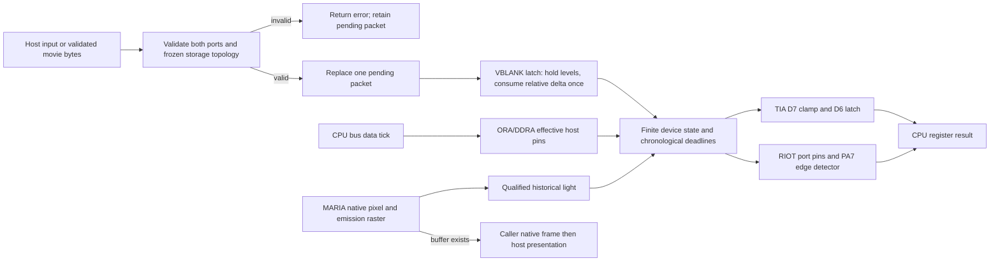

# Phase 08: Controllers at the pins - Research

**Researched:** 2026-10-24
**Domain:** Atari controller electronics, deterministic C17 input, runner replay and libretro
**Confidence:** MEDIUM overall; current-code contracts HIGH; hardware calibration remains unmeasured.

<user_constraints>
**Policy supersession, 2026-10-24:** DEC.61 and the revised CONTEXT D-20 retire
only the historical compressed archive cutoff after a separate owner-authorized
purpose review. All 399937 ceilings, fit/stop recommendations and historical policy
snapshots below describe the earlier rule; they do not govern current execution.
Required authenticated actual native current/base three-ZIP measurements, joined
JSON peaks, package integrity and every other existing contract remain. See
../../research/workflow-recovery/RECOMMENDATION.md. Hardware/API/model conclusions
are unchanged. This supersession does not claim the former cutoff passed.

## User Constraints (from CONTEXT.md)

The following blocks reproduce the locked decisions, discretion and deferred scope verbatim. Their authority is the phase discussion, not an assertion that future implementation or measurements have passed. [VERIFIED: .planning/phases/08-controllers-at-the-pins/08-CONTEXT.md:33-246,383-399]

<!-- DATA_K6p4vX2m_START -->
### Locked Decisions

### Input API, selection and lifecycle

- **D-01:** Add a separate size-tagged extended input structure and setter. Preserve
  the released 24-byte `muhtari_input`, old setter, constant values, field masks,
  unsupported-device refusals and legacy automatic ProLine fallback. Frozen
  `tests/api/v3.c` asserts both the size and explicit paddle refusal; do not rewrite
  those expectations to make a changed old API pass. New hosts opt into the extended
  setter, while new frozen/linked-client coverage proves the additive surface.
  Apply the existing API/ABI/behavior version policy. Preserving the old input API
  does not excuse missing TIA hardware: evidence-backed D6/D7 corrections follow
  D-17's narrow regression/version policy.
- **D-02:** In the extended path, resolve explicit per-frame device selection, then
  the successful load's explicit port override, then A78 header defaults. Distinguish
  Auto from explicit unplugged using existing constants; do not rewrite descriptive
  cartridge metadata to report a fallback. Newly supported explicit load overrides
  install the selected device with neutral controls immediately. Extended Auto must
  activate the actual resolved device before the first emulated frame; runner and
  libretro submit an initial extended packet, including when no controls are held.
  The legacy setter retains its released automatic semantics. Validate the entire
  request before replacing pending input, including both ports and resolved-device
  payloads; unknown masks/flags, invalid ranges and nonzero inapplicable fields fail
  transactionally. Missing supported tails have documented neutral defaults.
- **D-03:** Keep one VBLANK-applied packet: the latest accepted submission replaces
  earlier pending submissions. Hold buttons, console switches, keypad keys, paddle
  positions and gun aim until replaced; transfer relative motion exactly once at
  the latch and clear its pending contribution. A frame with no new submission must
  not replay its delta; already accepted finite device motion may finish. State
  units and signs explicitly: motion +X right/+Y down, absolute pot travel independent
  of a game's polling loop, native gun coordinates and a separate off-screen flag.
  Keep trigger separate from illumination and two paddle positions/buttons per port.
  Do not add subframe host events, timestamps, an input queue or recording machinery.
- **D-04:** Nonbattery device changes take effect at VBLANK and reset the replaced
  device's volatile protocol, motion, charge and pending-light state. Repeated packets
  for the same device preserve legitimate in-flight state. Define neutral startup,
  successful reload and power-cycle behavior; console Reset remains an input switch,
  distinct from power cycle. Phase 7's at-most-one EEPROM identity/port, battery
  pointer/length/layout and bytes remain frozen until reload. Reject attempts to
  add, remove, move or replace that attachment before changing either port's pending
  input. Test controller plus EEPROM in both legal placements; controller selection
  cannot reinterpret SAVE_RAM or suppress committed programming.

### Light gun and TIA input timing

- **D-05:** Sense the native MARIA signal at pixel emission, before host palettes,
  scaling, filters or output buffering. Qualify light by native luminosity and the
  aim window, then produce the delayed sensor response. Later palette writes or
  darkness cannot change historical illumination. Bright DMA-disabled BACKGRND is
  still visible and can trigger; actual blanking and off-screen aim cannot create
  illumination. A response already scheduled from a visible sample follows its
  defined pulse duration across later blanking. Preserve the emission raster when
  a delayed response crosses a line/frame boundary, including x=319 at the next line's
  tick zero. Null video buffers must give identical sensor behavior. Geometry-only
  detection and inspection of a completed framebuffer do not meet INPUT-02.
- **D-06:** Start research from the preparation's D=64 master ticks, W=30 ticks and
  L=9 lines as an explicitly unmeasured compatibility model, not a calibration.
  Research must define window anchoring, pulse composition and native-luma threshold
  T, document deterministic defaults and rounding, and derive independent vectors
  before pinning expected outputs. Named cited parameters belong to instance-owned
  emulation behavior; host display palettes cannot change them. No game-specific
  offsets, polling-loop heuristics or claimed zero-error retail calibration without
  measurements. Public owned diagnostics establish the chosen model; private retail
  ROMs and an owner-console run are not prerequisites.
- **D-07:** TIA owns VBLANK D6's INPT4/5 low latches and D7's INPT0–3 dump control;
  controller models supply pin levels. Research must settle the exact enable,
  repeated-write, clear and release truth tables from primary documentation and test
  their interaction with INPTCTRL and RIOT two-button control. Catch up relevant
  timed pin events through the access tick before reading or applying a write under
  the existing bus ordering. Low pulses must latch without CPU polling, including
  under HALT/JAM. Peeks remain observers and must not clock or commit device state.
  Preserve D7-only INPT driving/open-bus bits, existing decode and independent TIA
  audio; do not infer MARIA blanking from a TIA bit without evidence.
- **D-08:** Model paddles with a small integer elapsed-time charge/discharge state
  driven by D7 dump/release and the actual pot setting, not a register shortcut.
  Research must select and label physical or fitted charge endpoints/transfer,
  rounding, discharge and mid-charge setting-change behavior; elapsed charge cannot
  depend on how frequently software polls. Cover both pots/buttons, endpoints,
  repeated dump, one tick before/at/after charge deadlines, frame crossings, changed
  positions and reset. Never scale the physical pot range to a particular game's
  polling window. Host sensitivity is separate from core electrical behavior.
- **D-09:** Model keypad row selection from effective RIOT output/DDR pins and columns
  on INPT0/1/4 or INPT2/3/5. Use the preparation's immediate-low/timed-high pot-column
  model as a labelled derived starting point; digital trigger-column behavior stays
  distinct. The guide's 400 microseconds is elapsed time, approximately 2,864 NTSC
  master ticks rounded upward, not 716 executed CPU bus cycles. Slow cycles and HALT
  must not stretch that physical interval. Research must resolve row polarity, idle
  or multiple driven rows, D7 overlap, key ordering and electrical/retained-charge
  ghosting. Do not present the preparation's reported three-key limit as a universal
  hardware fact or invent diode isolation. Test early/late release and multi-key
  cases against independently documented expectations.

### Motion and adapter protocols

- **D-10:** Use compact fixed-size per-axis motion state and timed pin transitions.
  Driving and mice use device-specific quadrature tables; CX22 uses direction plus
  motion toggles. Define one motion unit, forward/reverse phase, both axes, initial
  phase, buttons and ST/Amiga wiring explicitly. ST documentation labels a positive
  waveform RIGHT/UP, so API +Y down needs a deliberate conversion. Do not reuse a
  single unqualified Gray table for every device or advance phase on reads.
- **D-11:** Bound accepted displacement, residual motion and event work; saturate
  excessive motion with documented discarded excess rather than accumulating an
  unbounded backlog. Latest pending packets replace each other; a latched delta is
  consumed once. Research must justify cadence, saturation and minimum edge spacing
  against emulated-time/operating-cost objectives and comparable measurements under
  ENGINEERING §11, with overflow-safe arithmetic for signed extremes. Preserve phase
  when idle. Device cadence is independent of polling and continues through CPU
  stalls. Chronological PA7 transitions must reach RIOT's edge detector even without
  SWCHA reads; projecting only the final phase can lose an even number of edges.
  Use existing deadline/catch-up mechanisms or prove an equivalent bounded summary;
  no general event framework or per-host-delta unbounded loop.
- **D-12:** Own finite SNES2Atari and Mega7800 state machines observing effective
  ORA/DDRA pin transitions at the bus data tick. Reads/peeks only observe response
  pins; identical writes cannot synthesize edges. Preserve the other port's nibble,
  normal device behavior outside extended scans, and two-button electrical context.
  SNES2Atari wires CLOCK/LATCH/DATA to pins 1/2/6; research must reconcile exact
  latch/shift edges and the documented detection tail, including the seventeenth
  bit. Mega7800 enters scanning through pins 1/2, returns six two-bit observations
  on pins 3/4 and advances through its documented strobe; research must establish
  identification/class/button, completion and restart tables. Do not assume every
  low/low write restarts the scan. Both pinned CC0 drivers explicitly support both
  ports: a port-2 sample is not a hardware restriction. Cover partial/extra clocks,
  DDR-only edges, every returned bit, reset and EEPROM coexistence. Reuse driver
  facts; a code seed requires the existing provenance/notice process.

### Runner and libretro

- **D-13:** Extend existing `--port1`/`--port2` device names and add movie format 2 for
  new typed payloads. Preserve movie 1 grammar, meanings, failures and legacy replay
  behavior. Movie 2 records explicit per-port devices and complete deterministic
  per-frame control state, with relative fields interpreted once; no hotplug record,
  recorder or subframe stream. Preserve whole-file validation and media/behavior
  identity checks before the first frame, strict integer/range/mask validation,
  deterministic line/column faults and CLI/header conflict handling. Reject invalid
  late lines before any emulation or save-side effect.
- **D-14:** Reuse the immutable validated movie bytes and sequentially decode into one
  extended packet, or prove an equally compact bounded representation. Do not
  multiply the million-frame limit by a newly enlarged public structure. Retain
  existing total-file, frame-count and header bounds; derive the version-2 line bound
  from its largest accepted canonical record and measure parser/allocation work.
  No streaming external input, generic parser package or new core allocation path.
- **D-15:** Advertise libretro device subclasses with appropriate base abstractions;
  poll using base IDs. Use absolute LIGHTGUN SCREEN_X/Y and explicit off-screen/reload
  information, never deprecated relative gun coordinates. Convert coordinates using
  bounded integer arithmetic over reported native geometry, including -32768; do
  not hard-code host window dimensions or complete PAL here. Use analog axes for
  absolute pots, relative MOUSE input for mice/CX22 and applicable driving controls,
  RetroPad buttons for adapters, and a documented keypad mapping. Poll motion once
  per frame. Publish complete device-specific mappings/descriptors and refresh them
  on selection; unsupported physical abstractions are documented limitations rather
  than invented device I/O.
- **D-16:** Preserve ProSystem-compatible ProLine/joystick layouts and legacy console
  shortcuts. Extended device buttons must not simultaneously trigger console actions:
  adapter Start/Select/X/shoulders cannot also Pause/Select/Reset/change difficulty.
  Map SNES buttons conventionally and use a documented conventional six-button
  layout for Mega7800. Keep existing difficulty options. For console momentary
  switches unavailable from another selected ordinary port, use narrowly scoped
  documented nonconflicting host controls, preferring unused RetroPad controls or
  a chord whose constituents are withheld from controller input. Research must
  publish a complete reachable mapping before implementation, without a new menu
  system. Unknown frontend IDs fail visibly or follow a documented safe fallback;
  late storage-changing callbacks still require reload and cannot mutate SAVE_RAM.

### Evidence, resource limits and architecture

- **D-17:** Add independent pin/timing vectors and owned executable numeric diagnostics
  for every newly claimed device family. Derive expected records from the documented
  model before hashing output; a successful exit or two equally wrong hosts is not
  a verdict. Exercise library, actual runner replay and in-process libretro mappings,
  including both ports, meaningful control changes and native frame/audio equality.
  Test threshold/deadline boundaries, absent video buffers, unpolled D6/PA7 events,
  palette changes during gun latency, rightmost/last-visible pixels, matrix history,
  opposite/zero/extreme motion, malformed replay, rejected-packet pending-state
  retention, device changes, reload/reset, instance isolation and no allocation after
  load. Extend existing deterministic property/fuzz harnesses with actual new devices
  and bounded cases. Every behavior test belongs to `cmake --workflow --preset ci`
  with exact inventories and current lane authority. Keep old predicates/pins; any
  intentional D6/D7 hardware correction requires specific evidence, a narrow
  behavior-version transition and explicit affected expectations, not blanket repins.
- **D-18:** Keep the existing two hosted RetroArch cases and 300-test-line bound;
  detailed controller semantics belong in in-process/runner tests. Public CI needs
  no private games, firmware or owner hardware. Diagnostic evidence proves the
  selected device model, not universal title playability or measured XG-1 accuracy.
  Preserve lag semantics: only CPU reads of the existing input-register set count,
  not automatic device events, peeks or DMA. Publish truthful capabilities only
  after their executed evidence. Graduate behavior into hardware, embedding, runner,
  libretro and testing docs together; keep README and public header within budgets.
- **D-19:** Reuse the existing ports owner, RIOT/TIA/MARIA seams, plain C tests,
  diagnostics and vendored libretro header. No dependency or generic controller/bus
  abstraction is selected. Apply ENGINEERING §11's ownership, coupling, control-flow
  and test-independence review; retired maintenance-line quotas do not return.
  Extend trusted fixture comparability only for named owned controller diagnostics,
  preserving every trusted old row, uniqueness, raw identity, actual producer/join
  controls and normal provenance admission. Existing admission covers board/save
  fixtures, not arbitrary controller additions. Before relying on fixture-dependent
  acceptance, prove this narrow prerequisite through the real consumer.
- **D-20:** The independent archive ceiling remains 399,937 bytes for the sum of the
  three component ZIPs in each of six native lanes. Phase 7's historical worst
  393,952 leaves only 5,985 bytes; that is a risk indicator, not demonstrated Phase 8
  fit. Research/planning must put attributable comparable package measurements early
  and final six-native acceptance last. No ceiling increase, automatic rebaseline,
  policy self-authorization, weakened semantic guard or advisory-lane promotion is
  granted. Optimize/reuse under the current contracts; a reproduced ceiling failure
  stops affected expansion for a specific evidence-backed resolution. Preserve the
  armed test-card performance gate and avoid inferring whole-controller performance
  from that workload alone.

### Agent's Discretion

Exact additive names, struct layout, internal source splits, keypad/adapter host
button tables, diagnostic count/names and plan ordering are delegated within these
contracts. Research resolves factual ambiguities and chooses justified numeric model
parameters before implementation expectations are frozen. It must distinguish
primary hardware facts, permissive-driver behavior and fitted compatibility policy.
No further owner interview is needed for routine engineering choices. This context
does not claim the future measurements, diagnostics or package acceptance passed.

### Deferred Ideas (OUT OF SCOPE)

Hardware-calibrated thresholds/cadence and broader accuracy oracles remain later
work; unmeasured model parameters are documented here. PAL execution, expansion
boards, AtariVox speech, recording, save states and general input tooling retain
their existing roadmap placement. No additional hosted RetroArch case is selected.

### Reviewed Todos (not folded)

- `.planning/todos/pending/2026-10-19-close-the-phase-2-review-seeds-on-the-nightly-filter-and-the-rom-tables.md`
  — broad keyword match; residual generator/firmware-scan seeds add no controller
  requirement. Preserve already completed nightly/header corrections.
- `.planning/todos/pending/2026-10-16-close-the-re-review-findings-on-the-dependabot-gate-and-the-publish-checks.md`
  — unrelated CI/release follow-up; accepted Phase 5 work remains authoritative.
- `.planning/todos/pending/2026-10-16-promote-the-wasm32-lane-into-ci-required.md`
  — separate lane-promotion history, not earned by controller implementation.
- `.planning/todos/pending/2026-10-19-close-the-phase-2-re-review-findings-when-maria-and-the-run-loop-land.md`
  — substantive run-loop items are already closed; remaining optional test seeds
  do not become INPUT requirements. Existing required contract violations still block.
<!-- DATA_K6p4vX2m_END -->
</user_constraints>

## Summary

Use the existing ports owner for per-device state, TIA for input dump/latches, RIOT for electrical readback and PA7 detection, and MARIA for historical native-light samples. The current port owner already separates submission from VBLANK application and has a real-tick EEPROM notification seam. Its legacy automatic fallback and refusal path must remain a separate compatibility entry point. Relevant existing definitions are quoted below. [VERIFIED: src/ports.c:206-297; src/riot.c:138-159]

Three primary-source corrections matter when planning: D6 is a level-enabled low latch cleared by disabling it, so a repeated enable does not clear a captured pulse; keypad recovery is elapsed time rather than executed CPU cycles; and the CX22 is direction plus toggles, not quadrature. The original CX22 PDF was successfully fetched with curl and its scanned output table and schematic were visually inspected; the browser fetch timed out. [CITED: https://www.blarworld.net/stella/8.%20Input%20ports.html] [CITED: https://www.blarworld.net/stella/VBLANK.html] [CITED: https://7800.8bitdev.org/index.php/7800_Software_Guide] [CITED: https://www.atarimania.com/documents/Atari-CX22-Trakball-Field-Service-Manual.pdf]

**Primary recommendation:** stage implementation around the numeric policies and independent vectors in this document, establish narrow fixture comparability first, measure packages after the first working extended vertical slice, and stop affected expansion if an attributable measurement reproduces the unchanged archive ceiling failure. Hardware capture is later work, not an owner verification prerequisite. [VERIFIED: .planning/phases/08-controllers-at-the-pins/08-CONTEXT.md:196-246]

<phase_requirements>
## Phase Requirements

Descriptions below are verbatim requirement text. [VERIFIED: .planning/REQUIREMENTS.md:37-41]

| ID | Description | Research Support |
|---|---|---|
| INPUT-01 | Hosts can select header defaults or explicit device overrides and supply the new device inputs through append-only API, runner replay and applicable libretro abstractions without changing old caller behavior. | Additive packet, legacy separation, selection lifecycle, typed movie 2 and complete host tables below. |
| INPUT-02 | XG-1 software sees trigger and brightness-sensitive beam-timed sensor pins, with dark/off-screen/blanking controls and fitted latency parameters identified. | Emission sampling, named delay/pulse/aperture/luma policy, historical raster and independent light vectors. |
| INPUT-03 | Paddle and keypad software sees documented buttons, pot dump/charge and matrix behavior at access time, with fitted analog timing identified. | Primary wiring, D6/D7 truth tables, integer RC progress, fixed settle time and connected-switch matrix policy. |
| INPUT-04 | Driving, CX22 trak-ball, ST mouse and Amiga mouse software sees their documented quadrature sequences and buttons, with bounded delta handling. | Explicit per-device forward tables, CX22 polarity, line-spaced motion and unpolled PA7 scheduling. |
| INPUT-05 | SNES2Atari and Mega7800 software sees documented serial/select handshakes and button states through RIOT output/DDR pin transitions. | Both-port CC0 driver evidence, full SNES tail and Mega pair/class/restart tables. |
</phase_requirements>

## Project Constraints (from AGENTS.md)

These directives apply to planning and execution. The quoted source includes all project rules and style directives. [VERIFIED: AGENTS.md:1-87]

- Reuse only permitted permissive code; check repository and file licensing at the exact pin; preserve notices through the existing provenance process. Never open GPL, LGPL or unlicensed emulator source. Reference emulators run as released binaries.
- Deliver library, headless runner and libretro; add no window, sound-device or physical input-device code.
- Keep ROM/BIOS/save bytes outside the tracked tree except manifest-admitted fixtures. No personal identity or paths; commits use GitHub noreply. Enable existing hygiene hooks.
- Integer-only, deterministic, bounded, instance-owned state; preserve no allocation after load.
- Every behavior change has a CI-run test and corresponding docs. Keep README user-facing and short, header terse and behavior prose in docs.
- Verification is automation-first. The agent runs checks and makes routine judgments; only identity consent or owner hardware requires owner action. Record command, exit status and run URL, never commit logs.
- Extend existing CMake/POSIX sh checks. New checks name the concrete fault and exercise representative pass/fault behavior through their consumer. Apply ENGINEERING §11 review and measured resource-bound rationale; retain finite review/gap limits, seed optional improvements.
- One GSD step per session, then stop. No auto/chain/next orchestration or hygiene bypasses.
- Branch off the trusted base before committing; never commit main once remote exists. Orchestrator owns this research commit. Shipping follows the existing PR, auto-squash, head-CI and release-PR checks.
- Lessons remain hypotheses until reproduced; export only on request using their template.
- Every plan SUMMARY includes requirements-completed and block-style coverage with id, description, requirement, verification kind/ref/status and human_judgment; no flow mappings or inline comments.
- Small modules, plain control flow, fixed-width integers, public muhtari_ names and internal module prefixes. Hardware comments cite behavior sources. No planning IDs in code, tests or user docs. Follow the dependency ladder and prefer local reuse/minimum code.
- Local Claude instructions point to AGENTS and prohibit profile-user. No project skills or configured researcher skills were returned during discovery. Graphify is disabled; no graph relationships were inferred. [VERIFIED: .claude/CLAUDE.md:1-4; .planning/config.json:73-89]

## Architectural Responsibility Map

Recommended ownership follows the existing component contracts, with the specific new responsibilities assigned here under the delegated engineering discretion. [VERIFIED: .planning/phases/08-controllers-at-the-pins/08-CONTEXT.md:218-246]

| Capability | Primary Tier | Secondary Tier | Rationale |
|---|---|---|---|
| Physical input, frontend device choice, presentation | Host runner/libretro | Public C boundary | Hosts translate documented abstractions into one packet. |
| Validation, resolution, pending/applied controls, device protocol/motion/charge | Core ports | Load lifecycle | One instance owner; successful selection and storage invariants remain transactional. |
| Clock advancement, chronological events | Core bus | Ports/MARIA | Extend the existing deadline dispatcher; preserve fast no-device path. |
| Native illumination | Core MARIA | Ports light sensor | Pixel value and emission raster are known before host conversion. |
| D6 low memory, D7 clamp | Core TIA | Ports pin sources | Latches are chip behavior, shared across every controller including legacy callers. |
| PA output/DDR and PA7 flags | Core RIOT | Ports | Output transitions clock adapters and every timed input transition reaches the detector. |
| Replay validation/bytes/cursor | Runner | Extended public API | Whole-file purity and bounded memory remain host responsibilities. |
| Persistent EEPROM data | Existing battery owner | Existing timed EEPROM state | Controller choice cannot change battery identity or layout. |
| Numeric judgments and cross-host evidence | Tests/CI | Owned executable diagnostics | Model-derived records precede hashes; no new hosted RetroArch case. |

## Standard Stack

Use the existing stack; install no package and update no vendored dependency for this phase. Package legitimacy installation audit is therefore not applicable. [VERIFIED: .planning/phases/08-controllers-at-the-pins/08-CONTEXT.md:218-221]

| Component | Version/source observed | Purpose |
|---|---|---|
| ISO C | Source declaration `set(CMAKE_C_STANDARD 17)` | Core and host implementations. [VERIFIED: CMakeLists.txt:16-17] |
| CMake / Ninja | Local executable probes: 4.4.3 / 1.13.2 | Existing configure/build/test/package recipes. [VERIFIED: environment probes 2026-10-24, exit 0] |
| libretro header | Existing vendored API; adapter identifies RetroArch v1.22.2 | Device subclasses, mouse, analog, gun and RetroPad input. [VERIFIED: libretro/libretro.c:1-5] |
| wasmtime / dasm | Existing pinned runtime probe: 48.0.6; existing dasm.wasm in fetched package | Rebuild owned numeric diagnostics, not a new assembler dependency. [VERIFIED: pins.txt:10-23; tests/diag/assemble.cmake:58-83] |
| Plain C/CMake tests | Existing input, host mocks, diagnostic driver, seeded property/fuzz | Portable behavior and integration evidence. [VERIFIED: tests/input/tests.cmake:1-47; tests/diag/driver.c:1-21] |

**Installation:** none. Reuse fetched pins; if missing, use the repository's existing fetch-pin commands documented in testing docs. Do not install a parser, controller package, generic event framework or replacement emulator. [VERIFIED: .planning/phases/08-controllers-at-the-pins/08-CONTEXT.md:166-171,218-221]

## Architecture Patterns

### System Architecture Diagram

Recommended flow, preserving the existing ownership boundaries:



### Current definitions that must stay frozen

<!-- DATA_u7J3fQ9s_START -->
```c
/* Exact released definitions, include/muhtari.h:110-126,225-246. */
MUHTARI_PORT_NONE = 0,
MUHTARI_PORT_PROLINE = 1,
MUHTARI_PORT_LIGHTGUN = 2,
MUHTARI_PORT_PADDLE = 3,
MUHTARI_PORT_TRAKBALL = 4,
MUHTARI_PORT_JOYSTICK = 5,
MUHTARI_PORT_DRIVING = 6,
MUHTARI_PORT_KEYPAD = 7,
MUHTARI_PORT_ST_MOUSE = 8,
MUHTARI_PORT_AMIGA_MOUSE = 9,
MUHTARI_PORT_ATARIVOX = 10,
MUHTARI_PORT_SNES2ATARI = 11,
MUHTARI_PORT_MEGA7800 = 12,
MUHTARI_PORT_UNPLUGGED = 256, /* outside the A78 byte range */
MUHTARI_PORT_SAVEKEY = 257

MUHTARI_BUTTON_UP = 1u,
MUHTARI_BUTTON_DOWN = 2u,
MUHTARI_BUTTON_LEFT = 4u,
MUHTARI_BUTTON_RIGHT = 8u,
MUHTARI_BUTTON_1 = 16u,
MUHTARI_BUTTON_2 = 32u

MUHTARI_SWITCH_RESET = 1u,
MUHTARI_SWITCH_SELECT = 2u,
MUHTARI_SWITCH_PAUSE = 4u,
MUHTARI_SWITCH_LEFT_DIFFICULTY_A = 8u,
MUHTARI_SWITCH_RIGHT_DIFFICULTY_A = 16u

typedef struct muhtari_input {
    uint32_t size;
    uint32_t device[2];  /* 0: the cartridge's; MUHTARI_PORT_PROLINE, _JOYSTICK, _UNPLUGGED */
    uint32_t buttons[2]; /* MUHTARI_BUTTON_*, pressed = 1 */
    uint32_t switches;   /* MUHTARI_SWITCH_*: held = 1; a difficulty bit set = A */
} muhtari_input;
```
<!-- DATA_u7J3fQ9s_END -->

Those values are released definitions, not suggested additions. The frozen client explicitly asserts `sizeof(muhtari_input), 24` and tests `in.device[1] = MUHTARI_PORT_PADDLE;` followed by `MUHTARI_STATUS_ERR_UNSUPPORTED_DEVICE`. Keep both. [VERIFIED: include/muhtari.h:110-126,225-246; tests/api/v3.c:51-52,86-96]

The present version declarations are `#define MUHTARI_API_VERSION 5` and `#define MUHTARI__BEHAVIOUR_REVISION 4u`. Recommend API +1 for the additive surface; retain ABI and battery layout; use the next behavior revision for evidence-backed D6/D7 corrections and corresponding movie identity. Do not authorize arbitrary hash changes. [VERIFIED: include/muhtari.h:12; src/instance.c:13; .planning/preparation/ARCHITECTURE.md:118-128]

### Additive packet and lifecycle

**Recommended new surface:** a separate size-tagged packet/setter, with a fixed per-port block of device, buttons, two absolute pot positions, keypad mask, signed relative dx/dy, native gun x/y and flags; outer console switches. A straightforward all-32-bit representation is 88 bytes (two 40-byte port blocks plus size/switches). This is a design recommendation, not a claim that these declarations already exist. Use semantic scalar fields rather than a public C union so zero/inapplicable-field validation is straightforward. Publish exact size offsets and linked-client assertions with the new header. [VERIFIED: .planning/phases/08-controllers-at-the-pins/08-CONTEXT.md:35-72,240-246]

**Recommended domains:** pots 0..65535, increasing resistance; keys low 12 bits in row-major order; relative fields signed int32 with core saturation below; gun x/y within reported native image and an explicit off-screen flag. Existing direction/primary-button bits retain their meaning; for SNES, additional bits 6..11 mean Y,X,L,R,Select,Start with primary bits B,A. For Mega they mean C,X,Y,Z,Mode,Start with primary bits B,A. Document these as per-device extended masks, never broaden the old setter's mask. Keypad, gun and paddle payloads use no unrelated fields. Suggested gun trigger uses primary button 1 and flags only for off-screen; second paddle button uses primary button 2. [VERIFIED: .planning/phases/08-controllers-at-the-pins/08-CONTEXT.md:35-63,240-246]

Validation must normalize supported missing tails into device-neutral state before checking resolved payloads. Gun with no supplied aim tail defaults off-screen; pot travel zero is minimum resistance; other omitted fields are zero. Validate size, unknown tail bytes, flags/masks, both resolved devices, every range and all inapplicable fields before touching pending state. A failure on port 2 preserves a previously accepted port-1 packet and its one-shot motion. Distinguish a legal all-zero Auto submission from no submission. [VERIFIED: .planning/phases/08-controllers-at-the-pins/08-CONTEXT.md:44-63]

Resolve extended per-frame explicit choice > successful load explicit override > descriptive header. Save the load choice separately; otherwise extended Auto after a temporary controller change cannot restore it. Header zero resolves unplugged with content; retain the ROM-free test-card convention explicitly. Install explicit supported load devices immediately with neutral controls, and activate resolved extended Auto on first accepted packet before frame execution. Runner/libretro must submit that packet even without a held button; fast-boot's short first frame otherwise bypasses the usual latch. Existing code currently guards the latch with `elapsed == MUHTARI__TICKS_PER_FRAME_NTSC` / `elapsed == MUHTARI__VBLANK_START`. [VERIFIED: src/frame.c:60-68; src/instance.c:238-259,355-364; src/ports.c:283-297]

The old setter must keep its own supported-device validation and automatic ProLine fallback. It may translate accepted digital controls into common internal pending state, with an explicit legacy-versus-extended resolution mode. Do not route old validation through the newly broadened validator. A successful power cycle clears volatile protocol, charge, motion, light and pending input, retains the load selection and battery contract, and starts device-neutral controls; a console Reset submission is only a held switch. Repeated same-device submissions preserve protocol and accepted motion; a changed nonbattery device clears only that replaced device's volatile state at VBLANK. [VERIFIED: src/ports.c:206-297; .planning/phases/08-controllers-at-the-pins/08-CONTEXT.md:35-72]

Keep EEPROM identity/placement frozen before either port changes. The existing attachment calculation is `(b->hsc_attached != 0u ? 2048u : 0u) + (b->eeprom_port != 0u ? 32768u : 0u)`; new ordinary-device support extends load validation without changing this calculation or SAVE_RAM publication. Catch up committed programming under the existing power-cycle semantics before clearing epochs. [VERIFIED: src/instance.c:238-261; src/ports.c:28-55]

### Component responsibilities and project structure

Use existing source owners. A narrow private controller helper/source split is justified only if it reduces a present responsibility's control-flow burden; do not add a generic vtable, bus framework or second scheduler. The following are implementation touchpoints, not a request to create every listed file. [VERIFIED: .planning/phases/08-controllers-at-the-pins/08-CONTEXT.md:218-246]

| Owner | Change |
|---|---|
| Public header / instance | Add packet/setter contract, frozen-client tests and remembered load override; extend supported ordinary load choices. |
| Ports | Resolve/validate/latch, finite per-port state, native light qualification, matrix connections, analog progress, timed motion and adapter responses. Keep EEPROM state separate. |
| TIA | Store D6/D7, apply clamp and low capture to every input source; expose observer reads. |
| RIOT | Notify the port owner after ORA or DDRA mutation at data tick; also recompute affected pins when PB/INPTCTRL changes alter electrical mode. Preserve other nibble. |
| MARIA | Compute needed native pixels independently of caller buffer, pass original line/x/tick/value to sensor, flush before writes and line-RAM swap. |
| Bus/frame | Merge earliest controller deadlines and native sample ticks with existing events; catch through actual execution/overshoot and held cycles. |
| Runner | Keep version-1 legacy entry point; add pure version-2 parse/cursor and extended submission path. |
| Libretro | Device-aware base polling and descriptors, normalized geometry, conflict-free console provider. |
| Tests/docs | Independent numeric device diagnostics, actual runner and module-host consumers, narrow quality admission, inventory/hash schema extension, public hardware and host docs. |

### Timed causality and bounded execution

The existing slow bus constants are `BUS_SLOW_TICKS 6u` and `BUS_SLOW_DATA 5u`; ORA/DDRA notification already receives the access data tick. Catch relevant device transitions through that tick before the CPU observes a read or applies a write, then process the changed effective host levels. Identical writes produce no electrical edge; a DDR-only change can. [VERIFIED: src/bus.c:16-21,278-293; src/riot.c:138-159; src/ports.c:175-203]

Extend the cached earliest deadline and held-cycle stepping with a controller deadline. Emit chronological PA7 changes one by one within the finite bound, or prove a summary that preserves selected edges and flag clearing order; a final-state projection loses even numbers of transitions. Light qualification must be scheduled before its response becomes due even under JAM/HALT. For a gun, schedule only its one relevant native sample tick per eligible raster; that tick flushes MARIA to the historical sample. Do not force per-tick rendering of the full picture or all-device polling per CPU cycle. Observer peeks do no catch-up, shifting, clearing, lag marking or clock advancement. [VERIFIED: src/bus.c:97-110,181-269; src/riot.c:96-120,175-188; .planning/phases/08-controllers-at-the-pins/08-CONTEXT.md:95-103,131-141]

## Hardware Facts and Chosen Compatibility Models

Every **Policy** below is a deliberate deterministic implementation recommendation under the locked discretion, not a measured hardware fact. Sources justify wiring/shape; the stated numeric fits define this phase's oracle. Unmeasured real-world parameters are not silently promoted to hardware calibration.

### TIA D6/D7: complete truth tables

Primary Atari TIA sections 8B/8C and the VBLANK register page distinguish four grounded pot inputs from two low-memory trigger inputs. Disabling resets the trigger latches high and removes them from the input path. [CITED: https://www.blarworld.net/stella/8.%20Input%20ports.html] [CITED: https://www.blarworld.net/stella/VBLANK.html]

| Previous D6 | New D6 | Action before/after write | Read |
|---|---|---|---|
| 0 | 0 | Catch old pin history; keep stored latch high | Live trigger pin |
| 0 | 1 | Start with stored high, immediately capture a currently low pin | Stored low if current pin low, otherwise high |
| 1 | 1 | Keep stored latch; capture any due low; repeated enable never rearms | Stored latch |
| 1 | 0 | Catch old due low, then clear stored latch high and bypass it | Current live pin |

While enabled, any low interval clears the stored high even if there is no CPU INPT read; subsequent pin-high does not release it. Reads never clear it. Reset disables and clears it. D7 does not affect these two inputs. These are the consequences of the primary source's level-enabled latch description; test simultaneous low/enable and low/disable access ticks explicitly. [CITED: https://www.blarworld.net/stella/8.%20Input%20ports.html]

| Previous D7 | New D7 | Pot inputs / charge action |
|---|---|---|
| 0 | 0 | Continue existing charge, no new epoch |
| 0 | 1 | Ground all four pot inputs; discard charge immediately under the ideal-clamp policy |
| 1 | 1 | Keep them grounded and charge zero; no repeated-release side effect |
| 1 | 0 | Remove ground; begin charging from zero using current electrical source |

D7 dominates even a ProLine button's high source; this is a shared TIA correction, not an extended-only trick. It leaves INPT4/5 unaffected. D6 operates on whichever physical pin level two-button wiring supplies. Retain the present two-button condition `(m->riot.ddrb & bit) != 0u && (m->riot.orb & bit) == 0u && (m->bus.inptctrl & MUHTARI__INPTCTRL_TIA_EN) == 0u`. Mode changes must feed a newly low pin to D6 immediately. TIA video blanking is not evidence that MARIA output disappeared; use MARIA's emission visibility. [CITED: https://www.blarworld.net/stella/8.%20Input%20ports.html] [VERIFIED: src/ports.c:322-329]

INPT reads retain D7-only driving and other open-bus bits: `return (uint8_t)((level & driven) | (m->bus.open_bus & (uint8_t)~driven));`. Do not touch the independent audio lattice, WSYNC or decode. [VERIFIED: src/tia.c:13-46,130-160]

### XG-1 emitted light

The trigger is pin 1, low at rest and high when pulled; the sensor pulls pin 6 low. ANTIC's original hardware article provides the unusual trigger polarity. Software should select one-button mode. Trigger and light must remain independent. [CITED: https://www.atarimagazines.com/v7n8/xg1light.php]

**Policy default:** delay D=64 master ticks, sensor low pulse W=30 ticks, vertical aperture L=9 native rows centered on aim y (y-4..y+4 clipped, never wrapped), sample exactly native x=aim_x once on each eligible row. Native luminosity threshold T=8 of 0..15, inclusive. A qualifying visible sample schedules [sample_tick+64, sample_tick+94); no light schedules nothing. This retains the preparation's D/W/L model shape while giving brightness a causal meaning. T, optical horizontal sampling and the parameters are unmeasured compatibility choices. The original preparation's zero-error retail calibration suggestion is superseded by locked D-06. [VERIFIED: .planning/preparation/A7800-CARTRIDGES-AND-PERIPHERALS.md:162-167; .planning/phases/08-controllers-at-the-pins/08-CONTEXT.md:76-94]

Qualification uses the already selected native color's low nibble, independent of host palette/filter/scaling. A bright BACKGRND with DMA disabled is visible; actual nonvisible rasters, horizontal blanking, off-screen aim and native luma below T do not qualify. Snapshot qualification at emission; neither a palette rewrite nor subsequent darkness cancels scheduled light. Once scheduled, a pulse completes across blanking/frame boundaries. Device replacement/power cycle clears it; an ordinary same-device aim packet does not erase historical light. [CITED: https://7800.8bitdev.org/index.php/7800_Software_Guide] [VERIFIED: .planning/phases/08-controllers-at-the-pins/08-CONTEXT.md:76-94]

The actual rendering definitions say `MARIA_FIRST_PIXEL_T 135u`, `MARIA_PIXELS 320u`, `MARIA_FIRST_RASTER 16u`, and the renderer flushes `render(m, line - 1u, MARIA_PIXELS);` at line-origin before swapping buffers. The rightmost pixel therefore belongs to the previous raster even though it emits at the next origin. Pass the explicit emission raster and absolute sample tick into the sensor; do not reconstruct it from current event_line or tick modulo a line. Compute pixels for sensor use when rows are NULL; restrict buffer writes to non-NULL rows. [VERIFIED: src/maria.c:398-419,443-475,574-592]

**Independent numeric vectors (policy oracle):**

| Input sample / operation | Expected |
|---|---|
| Aim (100,20), visible native byte 0xA7 at that coordinate | No pulse |
| Same sample with 0xA8 or 0x08 | Low at sample+64 through sample+93; high at sample+63 and sample+94 |
| Native bright sample, host presentation changed, or palette rewritten at sample+1 | Same scheduled result |
| Aim y=20 | Eligible native rows 16..24 inclusive; rows 15/25 do not qualify |
| Aim y=0 | Eligible rows 0..4 only; no bottom wrapping |
| Native x=319, raster 100 | Sample tick relative to its raster origin 454; response at 518..547, belonging to the raster-100 sample |
| Last native row 241, raster 257, x=319 | Sample at raster-258 tick 0; response at tick 64..93, after VBLANK starts at tick 42; preserve it across the host frame return |
| Trigger held on a dark/off-screen frame | Pin 1 high, sensor high |
| Same native emissions with video NULL | Identical sensor/latch records |

These vectors follow the policy and existing emission constants, not output hashes. [VERIFIED: src/maria.c:398-419,388-396; .planning/phases/08-controllers-at-the-pins/08-CONTEXT.md:76-94]

One candidate sample per raster and a delay shorter than the line span permit a fixed pending response plus active-until state per port; no pixel-event queue is needed. Merge touching/overlapping intervals if future samples require it, but never truncate an existing low. The chosen model can qualify light without a trigger pull. [VERIFIED: .planning/phases/08-controllers-at-the-pins/08-CONTEXT.md:55-63,76-94]

### Paddles: full physical travel and integer charge

Primary evidence: Atari's field manual describes a 1 MΩ pot; its figure 7-4 pairs pin 5 with the pin-4 button and pin 9 with the pin-3 button. The original 7800 schematic C025231-001, visible in the training-manual PDF p69, shows input resistors R38–R41 at 10 kΩ and capacitors C43–C46 at .068 µF (the sheet's notes specify µF). Do not import a different console's 1.8 kΩ resistor into this 7800 model. [CITED: https://device.report/m/8306a6faedfdf47374a64953243943fa25947d4082f57d325a39ed1976bc2c78] [CITED: https://www.atarimania.com/documents/stella_system_training_manual.pdf]

**Policy:** packet pot[0] controls pin 5/INPT0 or 2 and primary button 1 controls pin 4; pot[1] controls pin 9/INPT1 or 3 and primary button 2 controls pin 3. Position p=0..65535 denotes increasing resistance, with R(p)=floor(p*1,000,000/65535) Ω. Use the schematic's C=68 nF and series 10 kΩ. Choose unmeasured comparator ratio Vthreshold/Vsupply=0.32, equivalent to 1.6 V at 5 V. Fit the exponential charge law with integer coefficient 187747/1,000,000 master ticks per Ω, rounded from f*C*(-ln(1-0.32)). Full dump-to-high duration is ceil((10,000+R)*187747/1,000,000) ticks. This is full physical pot travel; it can exceed a frame. The comparator fit and ideal instantaneous dump remain model policy, not hardware calibration. [CITED: https://www.atarimania.com/documents/stella_system_training_manual.pdf] [CITED: https://www.blarworld.net/stella/8.%20Input%20ports.html]

Keep a normalized charge-action accumulator in [0,2^32] and a last-change tick. It represents accumulated exponential charging action, not a host knob position. With constant pot setting, add elapsed_ticks*2^32/charge_duration, saturating high. Compute reads and crossing deadlines without mutating the accumulator. Only materialize progress on a setting/dump/topology change, so polling cannot change rounding. On a setting change, first materialize old-rate progress at that tick, floor once to Q32, then continue at the new rate; do not restart from zero. Remaining delay is ceil((2^32-progress)*new_duration/2^32). A high capacitor stays high until D7 grounds it. Bound elapsed before multiplication by the crossing duration; all products then fit uint64. An equivalent exact rational state is acceptable if equally compact and independently vector-tested. [CITED: https://www.blarworld.net/stella/8.%20Input%20ports.html] [VERIFIED: .planning/phases/08-controllers-at-the-pins/08-CONTEXT.md:104-111,240-246]

**Independent fitted vectors:** p=0 → R=0, duration=1878; p=32767 → R=499992, duration=95750; p=32768 → R=500007, duration=95753; p=65535 → R=1,000,000, duration=189625 ticks. A release at tick 100 gives low at 1977, high at 1978 and 1979 for p=0. A change after 1000 ticks at p=0 materializes Q32 progress 2286990040; changing to p=65535 then crosses after another 88654 ticks. Repeat reads add no progress/rounding; repeated D7-high stays zero; repeated D7-low retains the epoch. Derivation was executed with independent Python Fraction arithmetic, exit 0; production remains integer C. [CITED: https://www.atarimania.com/documents/stella_system_training_manual.pdf] [VERIFIED: .planning/phases/08-controllers-at-the-pins/08-CONTEXT.md:104-111]

### Keypad: matrix, connectivity and retained charge

Original field-manual figure 7-9, visually inspected at PDF p141, shows the twelve switches, row pins 1..4, column pins 5/9/6, and 4.7 kΩ pullups on the two pot columns; it does not show isolating diodes. Row-major key order is 1,2,3 / 4,5,6 / 7,8,9 / *,0,#. Ground on selected rows makes closed-key columns low. The 7800 guide specifies a 400 µs wait after row output changes. [CITED: https://www.atarimania.com/documents/Atari_2600_2600_A_VCS_Domestic_Field_Service_Manual.pdf] [CITED: https://7800.8bitdev.org/index.php/7800_Software_Guide]

**Policy:** build connectivity of four row and three column nodes through held switches with a fixed seven-node bitmask closure (at most seven relaxation passes, not a general circuit package). Output-low rows are strong low sources, output-high rows are high sources, input rows are released. The two pot pullups and console trigger pullup provide idle high. A connected low source dominates; multiple low rows union their selected keys. Mixed driven-high/low contention uses a documented low-dominant compatibility policy, not a claim about analog short-circuit current or diode isolation. Input rows may be pulled through keys; preserve normal RIOT output readback for output rows. D7 grounds pot columns and therefore can propagate low through a connected key component to the other column/trigger; the digital trigger path is still not given an RC timer. [CITED: https://www.atarimania.com/documents/Atari_2600_2600_A_VCS_Domestic_Field_Service_Manual.pdf]

Use the locked derived immediate-low/timed-high model on each pot column: a low path or dump sets charge low immediately; after its last low path disappears, begin a 2864-master-tick recovery, high exactly at the deadline. This is ceil(400*315/44) NTSC ticks, independently calculated; not 716 executed bus cycles. Repeated writes or reads that do not change the low/high source do not restart recovery. D7 held high prevents charge; releasing it starts recovery only where the switch network no longer grounds the component. Start keypad pots discharged at attachment/power-on; trigger starts live-high unless connected low. This deliberately does not claim analog charge-sharing calibration. [CITED: https://7800.8bitdev.org/index.php/7800_Software_Guide] [VERIFIED: .planning/phases/08-controllers-at-the-pins/08-CONTEXT.md:112-121]

**Independent vectors:** with key 1 held and row 1 low, INPT0 is low; after row 1 releases at t=100, it stays low through t=2963 and rises at t=2964. Moving to a different row in the same column before then still reads the retained low; waiting through recovery removes it. Key 3 uses the trigger column and releases immediately, unless D6 retained a low. With keys 1,2,4 held, row 1 low and row 2 released, the connected network pulls both first and second columns low when row 2 is examined: the fourth corner is a real matrix ghost in this policy. Four simultaneous keys are accepted; there is no software three-key cap. With no keys and D7 high, pot columns low but trigger high. Test all columns, both ports, all-input/all-high/all-low rows, dump overlap, retained-charge history, and contended rows under the stated policy. [CITED: https://www.atarimania.com/documents/Atari_2600_2600_A_VCS_Domestic_Field_Service_Manual.pdf] [VERIFIED: .planning/phases/08-controllers-at-the-pins/08-CONTEXT.md:112-121]

### Motion wiring and independent forward tables

Every tuple below is in the explicitly named connector-pin order, so bit significance is unambiguous. Reset phase is the all-high tuple; reverse walks each cycle backward. One relative unit means one table transition, not one revolution, host pixel or full quadrature cycle. Buttons on mice/driving/CX22 pull pin 6 low; mouse right button pulls pin 9 low and respects TIA dump. [CITED: https://www.temlib.org/AtariForumWiki/index.php/Engineering_Hardware_Specification] [CITED: https://www.theflatnet.de/pub/cbm/amiga/AmigaDevDocs/hard_e.html] [CITED: https://www.atarimania.com/documents/Atari-CX22-Trakball-Field-Service-Manual.pdf]

| Device / API positive axis | Tuple pin order | Positive cycle starting at idle |
|---|---|---|
| Driving +X = clockwise | (1,2) | (1,1) → (1,0) → (0,0) → (0,1) → (1,1) |
| ST +X = right | (1=XB,2=XA) | (1,1) → (1,0) → (0,0) → (0,1) → (1,1) |
| ST +Y = down | (3=YA,4=YB) | (1,1) → (1,0) → (0,0) → (0,1) → (1,1) |
| Amiga +X = right | (2=H,4=HQ) | (1,1) → (0,1) → (0,0) → (1,0) → (1,1) |
| Amiga +Y = down | (1=V,3=VQ) | (1,1) → (0,1) → (0,0) → (1,0) → (1,1) |

Driving's original table lists internal switch pins 2/4; the schematic maps those to connector pins 1/2. Starting from both closed, clockwise yields (0,0)→(0,1)→(1,1)→(1,0), equivalent to the rotation above. ST's primary waveform is positive RIGHT/UP for (XA,YA) leading (XB,YB); API +Y down deliberately reverses the vertical waveform. Amiga's original Figure 8-2 count-up waveform has V preceding VQ; its counters increment for right/down. These give distinct electrical cycles even where some numeric tuple sequences happen to match. [CITED: https://www.atarimania.com/documents/Atari_2600_2600_A_VCS_Domestic_Field_Service_Manual.pdf] [CITED: https://www.temlib.org/AtariForumWiki/index.php/Engineering_Hardware_Specification] [CITED: https://www.theflatnet.de/pub/cbm/amiga/AmigaDevDocs/hard_8.html]

CX22 in trackball mode: pin 1 is X direction (1 right / 0 left), pin 2 X toggle; pin 3 Y direction (1 down / 0 up), pin 4 Y toggle. Primary manual p14 Table 2-1 identifies internal A5 outputs: pin 10 Y toggle, pin 11 high down/low up, pin 12 X toggle, pin 13 high right/low left; p27 figure 5-3 gives connector routing. **Policy idle:** direction and toggle lines high. A positive X unit keeps direction high and flips pin 2; negative X sets direction low and flips pin 2; Y analogously. Do not reset toggles while idle or change direction merely because a zero delta arrived. Both fire switches are one shared trigger. [CITED: https://www.atarimania.com/documents/Atari-CX22-Trakball-Field-Service-Manual.pdf]

### Bounded motion policy and resource rationale

**Policy default:** cadence/minimum per-axis edge spacing = 454 master ticks (one native line); accepted signed int32 delta is saturated to [-255,+255] per axis, and signed residual after adding it is independently saturated to the same interval. Discard excess immediately, with documented saturation; do not hide an ever-growing queue. A new idle axis schedules its first edge one cadence later. An in-flight axis retains its next deadline when a packet adds/cancels/reverses residual. At each due edge advance according to residual sign, move residual one toward zero, and preserve phase when zero. Submissions before VBLANK replace rather than add; accepted motion is transferred once. [VERIFIED: .planning/phases/08-controllers-at-the-pins/08-CONTEXT.md:125-141,240-246]

Rationale: a fresh maximum displacement drains in 115770 ticks, within a full NTSC frame. The cadence allows about 15769 pin transitions/s per axis and a CPU polling loop substantially shorter than a line can observe every edge. It limits autonomous work to at most 263 transitions per axis per full frame, or 1052 across four mouse axes; same-tick updates can share one deadline dispatch but must deliver the resulting PA7 level. This bounds cost and carry state on small/slow hosts without a per-delta loop. These are derived engineering bounds, not measured wheel or mouse calibration, and not new global performance thresholds. Require comparable no-input / ordinary / maximum-motion measurements before accepting the chosen implementation's operating cost under ENGINEERING §11. [VERIFIED: .planning/phases/08-controllers-at-the-pins/08-CONTEXT.md:125-141,227-246]

Saturate before addition/absolute value; never negate INT32_MIN. Example: clamp each input first, then add two values whose magnitudes are at most 255 in int32, clamp the sum, and decrement one at each due event. The scalar arithmetic cannot overflow. Input -2147483648 becomes -255; +2147483647 becomes +255. Example at t=100: dx=2 schedules edges at 554 and 1008, then idle; no further submission cannot repeat them. Replacing a pending +2 by -1 before latch yields one negative edge. Applied +255 plus a new +255 retains at most 255 residual; +255 followed by -255 cancels unspent residual. Test no-read four-edge cycles on a port-1 pin-4 motion device: final phase may equal initial while PA7's flag must still set. [VERIFIED: .planning/phases/08-controllers-at-the-pins/08-CONTEXT.md:131-141]

### SNES2Atari: complete finite scan

License was fetched before code: pinned 7800basic LICENSE assigns included assembly CC0; the two exact include files also begin with the CC0 notice. Both drivers explicitly index left/right ports. Read these as permissive-driver evidence; copying expression into diagnostics or production still needs the existing seed/notice/parity process. [CITED: https://github.com/7800-devtools/7800basic/blob/e7c18d2ecdc6/LICENSE.txt] [CITED: https://github.com/7800-devtools/7800basic/blob/e7c18d2ecdc6/includes/snes2atari.asm]

Wiring: connector pin 1 CLOCK, pin 2 LATCH, pin 6 DATA through 1 kΩ. The Atari sample's port-2 choice is an example; the pinned driver's clock masks cover both nibbles. Primary implementation documentation from the HMC physical SNES project says latch rising presents the first bit and clock rising advances subsequent output; falling clocks are the observation side. This also matches both pinned driver's before-rise samples and the original driver's extra terminal clock. [CITED: https://7800.8bitdev.org/index.php/SNES2Atari] [CITED: https://pages.hmc.edu/harris/class/e155/projects02/snes.pdf]

**Policy state machine:** effective LATCH rising snapshots held controls and exposes bit 1; while LATCH high keep bit 1; LATCH falling holds bit 1. With LATCH low, each effective CLOCK rising advances one position; CLOCK falling does not. If both rise together, latch has priority. No event on unchanged levels; DDR release/drive changes count when effective levels change. Read/peek observes only; extra clocks saturate at low tail until a new latch. Reset/selection begins released-high and ready for latch. No added minimum-pulse-duration filter is justified by the source. [CITED: https://github.com/7800-devtools/7800basic/blob/e7c18d2ecdc6/includes/snes2atari.asm] [CITED: https://pages.hmc.edu/harris/class/e155/projects02/snes.pdf]

| Bit position | 1 | 2 | 3 | 4 | 5 | 6 | 7 | 8 | 9 | 10 | 11 | 12 | 13..16 | 17 and later |
|---|---|---|---|---|---|---|---|---|---|---|---|---|---|---|
| DATA | B | Y | Select | Start | Up | Down | Left | Right | A | X | L | R | High | Low |

Buttons are active-low. All released gives sixteen high observations then low; only B held gives low then fifteen high then low; only R held gives bit 12 low and the same detection tail. The pinned driver's detection explicitly compares the high sixteenth and low seventeenth observations. The original driver samples after another clock, which still sees the saturated low tail; do not substitute an indefinitely high generic SNES/NES tail. Snapshot buttons for the scan, not on every read. [CITED: https://github.com/7800-devtools/7800basic/blob/e7c18d2ecdc6/includes/snes2atari.asm] [CITED: https://7800.8bitdev.org/index.php/SNES2Atari]

The resistor protects DATA when the console drives pin 6 in two-button mode; the original driver explicitly selects one-button mode. **Policy:** two-button +5 V drive masks this resistor-isolated serial DATA high; normal one-button mode exposes the data. Label this contention behavior as electrical compatibility policy, not a measured resistor/threshold result. Test PB/INPTCTRL interactions and D6 disabled during a full scan. Do not fabricate ordinary direction behavior for the passive original SNES wiring or silently add SNES2Atari++ protocol support. [CITED: https://7800.8bitdev.org/index.php/SNES2Atari]

### Mega7800: class, every pair, normal mode and restart

The original manufacturer's product page confirms normal two-button operation and an extended scan; it does not publish detailed electrical timing. The exact pair order is derived from the pinned CC0 driver's shifts and masks, not from the ambiguous summary comment. Driver observations on pin 4 precede pin 3. [CITED: https://www.retrohq.co.uk/products/mega-7800-atari-joypad-adapter] [CITED: https://github.com/7800-devtools/7800basic/blob/e7c18d2ecdc6/includes/mega7800.asm]

| Observation index | Pin 4 | Pin 3 | Meaning |
|---|---|---|---|
| 0 | Class high bit | Class low bit | Class 00 = six-button, 10 = three-button; 01/11 = two-button according to driver count table |
| 1 | 0 | 0 | Adapter identification; driver requires this pair low |
| 2 | C | B | Active-low |
| 3 | Start | A | Active-low |
| 4 | Y | Z | Active-low |
| 5 | Mode | X | Active-low |

The default emulated adapter is the six-button class, not all possible downstream hardware. No extra selector is needed for two/three-button subclasses in this phase. All released default pairs are 00,00,11,11,11,11. Derived assembled bytes are state nibble 0 and data FF. C held clears data bit 7; B bit 6; Start bit 5; A bit 4; Y bit 3; Z bit 2; Mode bit 1; X bit 0. The driver's nondefault class values are evidence for the table, not a commitment to physical downstream-device detection. [CITED: https://github.com/7800-devtools/7800basic/blob/e7c18d2ecdc6/includes/mega7800.asm]

**Policy state machine:** pin 1 high = normal/rearmed; transition into pin1=0,pin2=0 starts observation 0. While pin 1 stays low, pin-2 rising advances one observation; its falling edge exposes the current observation without restarting; duplicate low/low writes do nothing. Reaching the sixth advance completes the scan; further toggles remain complete until pin 1 releases high, then a new entry can start. Raising pin 1 during a partial scan aborts and rearms normal mode; a later low/low entry restarts. Releasing DDRA returns both select lines high and therefore rearms. If pin 1 falls while pin 2 is high, wait until pin 2 falls to enter observation 0. These rules reproduce the pinned driver, including its duplicated initial low writes and end-of-scan DDR release. Undocumented rapid/malformed restart behavior is explicitly this compatibility policy, not verified hardware. [CITED: https://github.com/7800-devtools/7800basic/blob/e7c18d2ecdc6/includes/mega7800.asm]

Outside scans, D-pad directions remain ordinary active-low pins, Mega B/C serve normal ProLine primary buttons with current one/two-button behavior; A is extended-only. During a scan only the selected nibble's response pins change. The six-button mapping is an emulated chosen adapter model; verify B/C normal-mode compatibility and state-table extraction with an owned diagnostic before capability claims. Keep EEPROM on the other port functional, including pending programming through scan completion. [CITED: https://www.retrohq.co.uk/products/mega-7800-atari-joypad-adapter] [CITED: https://github.com/7800-devtools/7800basic/blob/e7c18d2ecdc6/includes/mega7800.asm] [VERIFIED: .planning/phases/08-controllers-at-the-pins/08-CONTEXT.md:142-154]

## Runner and libretro Implementation Contract

### Compact movie 2

Current limits are quoted verbatim: `MUHTARI__MOVIE_BYTES_MAX (32u * 1024u * 1024u)`, `MUHTARI__MOVIE_FRAMES_MAX 1000000u`, `MUHTARI__MOVIE_LINE_MAX 64u`, `MUHTARI__MOVIE_HEADER_LINES_MAX 32u`. Existing runner materializes `((size_t)mv->count + 1u) * sizeof *mv->frames` where the old frame is 24 bytes. Keep movie 1 parsing, diagnostics, allocation behavior and old setter routing intact; movie 2 must not allocate a million new packets. [VERIFIED: runner/movie.h:12-15; runner/main.c:743-765]

**Recommended grammar:** retain movie-1 header keys and whole-file ASCII/line-ending rules; first line is `muhtari-movie 2`. Require explicit header devices on both ports; Auto remains CLI-only. Every frame is `|device:payload|device:payload|RSPAA|`, with the console field retaining the existing letter/dot and A/B meaning. Repeat each fixed header device name in its frame tag and require equality; this gives explicit typed records without hotplug. New CLI/header device names: lightgun, paddle, trakball, driving, keypad, st-mouse, amiga-mouse, snes2atari, mega7800, alongside existing names. These names and grammar are proposed protocol declarations. [VERIFIED: .planning/phases/08-controllers-at-the-pins/08-CONTEXT.md:158-171,240-246]

| Device payload | Canonical syntax / domain |
|---|---|
| proline / joystick | Existing UDLR12 / UDLR1 letter/dot fields, after the tag |
| none / savekey / atarivox | Empty payload, but retain device: |
| lightgun | x,y,flags ; x/y native geometry; flags 0..3: bit 0 trigger, bit 1 off-screen |
| paddle | pot0,pot1,buttons ; positions 0..65535, low two button bits |
| driving | dx,0,button ; signed int32 dx, literal zero Y, button 0..1 |
| trakball | dx,dy,button ; signed int32 motion, button 0..1 |
| st-mouse / amiga-mouse | dx,dy,buttons ; signed int32 motion, low two button bits |
| keypad | decimal held-key mask 0..4095 |
| snes2atari / mega7800 | decimal extended per-device button mask 0..4095 as defined above |

Reject whitespace padding, plus signs, leading zeros other than the single zero, negative zero, empty/extra fields, invalid characters, integer overflow, invalid masks, unknown tags and mismatched tags. Signed extrema are legal and pass to the core's documented saturation. Off-screen still has bounded x/y coordinates (use 0,0 when no meaningful aim). Encode complete absolute state each frame; relative fields contribute once. The longest proposed port field is `amiga-mouse:-2147483648,-2147483648,3` (37 bytes). Two such fields plus four delimiters and five console characters give an exact version-2 maximum frame line of 83 bytes, excluding LF/CRLF. Keep old 64-byte errors on version 1; hash header lines retain their existing exact special limits. Independent length calculation executed, exit 0. [VERIFIED: runner/movie.c:63-120,277-367; .planning/phases/08-controllers-at-the-pins/08-CONTEXT.md:158-171]

Read one bounded immutable byte buffer; perform a complete pure validation/count pass before loading media/importing saves/creating output. Then decode sequentially with one cursor and one extended packet; never reopen or reread mutable external bytes after validation. No per-frame index/allocation is necessary. Keep total-file and frame limits independent: not every million-frame file fits the byte ceiling, which is already true. Measure maximum accepted parse time/peak allocation and one-over faults. At movie-2 EOF, release buttons/keys and momentary console switches, zero relative fields, retain final pot positions/aim and difficulty bits. Movie-1 EOF behavior remains unchanged. [VERIFIED: runner/main.c:743-771,1143-1168; .planning/phases/08-controllers-at-the-pins/08-CONTEXT.md:158-171]

### Complete libretro device and controller mappings

Advertise subclasses but poll base device IDs; the original API explicitly separates abstract types from frontend hardware. Existing subclasses must keep their numeric identities. Unknown callback IDs should log a visible warning and select safe unplugged for ordinary input; on a battery-bearing port, retain the installed attachment and report reload. Initial load and every controller selection refresh descriptors; storage options still provision before SAVE_RAM publication. [CITED: https://docs.libretro.com/development/input-api/] [VERIFIED: libretro/libretro.c:74-77,129-165,430-530]

Recommended new subclasses: LIGHTGUN for XG-1, ANALOG for paddles, MOUSE for driving/CX22/ST/Amiga (distinct subclass IDs), JOYPAD for keypad/SNES/Mega. They are labels on existing abstractions, not new physical interfaces. All listed controls are queried once per frame after one input_poll. [CITED: https://docs.libretro.com/development/input-api/]

| Emulated device | Base abstraction / complete emulated controls |
|---|---|
| ProLine | JOYPAD D-pad; B → primary 1, A → primary 2. Preserve ProSystem layout. |
| 2600 joystick | JOYPAD D-pad; B or A → fire, preserving legacy behavior. |
| XG-1 | LIGHTGUN SCREEN_X/Y → aim; TRIGGER → trigger; RELOAD → forced off-screen trigger; IS_OFFSCREEN or either coordinate -32768 → off-screen. No other gun button reaches emulated controller pins. |
| Paddle pair | ANALOG left-stick X → pot0, right-stick X → pot1; JOYPAD B/A → respective paddle buttons. All Y axes ignored, documented. |
| Driving | MOUSE X → one-unit relative motion; MOUSE LEFT → fire. MOUSE Y ignored. No pretend support for an absolute physical steering wheel. |
| CX22 | MOUSE X/Y → motion; LEFT or RIGHT → shared fire. Wheels/middle are not extra emulated buttons. |
| ST/Amiga mouse | MOUSE X/Y → motion; LEFT/RIGHT → pin-6/pin-9 buttons. Ignore wheels and extra buttons for emulated pins. |
| Keypad | 1=Y, 2=Up, 3=X; 4=Left, 5=B, 6=Right; 7=L, 8=Down, 9=R; *=Select, 0=A, #=Start. Multiple held keys set all corresponding mask bits. |
| SNES2Atari | D-pad identity; B,Y,Select,Start,A,X,L,R → same native SNES names. |
| Mega7800 | D-pad; RetroPad Y→A, B→B, A→C, L→X, X→Y, R→Z, Select→Mode, Start→Start. This is the conventional Genesis-style two-row layout. |
| Unplugged / save devices | No emulated controller buttons or motion; EEPROM is driven only by emulated software. |

These complete mappings are recommendations under delegated D-15/D-16; preserve all old ordinary-pad meanings. Expose descriptors with the base device/index/ID actually polled and device-specific labels. Do not advertise a raw keyboard, HID, spinner or proprietary adapter interface that libretro does not supply. Document that a frontend must bind the relevant base abstraction and any supplemental RetroPad controls. [VERIFIED: .planning/phases/08-controllers-at-the-pins/08-CONTEXT.md:172-192,240-246] [CITED: https://docs.libretro.com/development/input-api/]

**Coordinate conversion:** for valid screen coordinate v in [-32767,32767], use floor((int32(v)+32767)*(dimension-1)/65534), with uint64 intermediate, from the current native geometry. -32768 is handled as off-screen before conversion. For width 320: -32767→0, 0→159, 32767→319; for height 242: 0→120. Analog pots use int32(v)+32768, yielding exact 0..65535 including -32768; center 0→32768. RELOAD sets both trigger and off-screen for that frame. Avoid floating point and a hard-coded host window. [CITED: https://docs.libretro.com/development/input-api/] [VERIFIED: libretro/libretro.h:222-260,410-425]

### Complete console mapping without collisions

Choose exactly one console provider per frame: lowest numbered selected ProLine/joystick port first (port 0 retains its legacy preference); otherwise the lowest numbered active controller with its device-specific console controls below. If both ports are empty/storage, use supplemental RetroPad controls on port 0. Never OR legacy console shortcuts from an adapter/keypad port into switches. Difficulty options continue to work on all device combinations. [VERIFIED: .planning/phases/08-controllers-at-the-pins/08-CONTEXT.md:182-192,240-246]

| Console provider | Pause | Select | Reset | Difficulty quick toggles |
|---|---|---|---|---|
| Ordinary ProLine/joystick | RetroPad Start | RetroPad Select | RetroPad X | L/R rising edges toggle left/right, preserving existing ordinary-pad behavior |
| Paddle | RetroPad Start | RetroPad Select | RetroPad X | Options only; L/R may remain unused |
| Gun | LIGHTGUN START | LIGHTGUN SELECT | LIGHTGUN AUX_A | Options only |
| Driving | MOUSE MIDDLE | MOUSE BUTTON_4 | MOUSE RIGHT | Options only |
| CX22 or ST/Amiga mouse | MOUSE MIDDLE | MOUSE BUTTON_4 | MOUSE BUTTON_5 | Options only; CX22 RIGHT remains fire |
| Keypad, SNES or Mega | Supplemental RetroPad L2 | Supplemental RetroPad R2 | Supplemental RetroPad L3 | Options only |
| Neither active ordinary controller | Supplemental RetroPad L2 | Supplemental RetroPad R2 | Supplemental RetroPad L3 | Options only |

Each fallback consumes controls unused by that emulated controller; no adapter Start/Select/face/shoulder action doubles as console input. When the second port is ordinary, it can supply console actions while the first uses an adapter. Selecting a provider resets the difficulty-edge history to its current held levels, avoiding synthetic toggles. All actions are reachable through documented existing libretro abstractions, but physical frontend bindings remain a host capability/limitation. Polling a supplemental JOYPAD does not mean opening a physical device. [VERIFIED: .planning/phases/08-controllers-at-the-pins/08-CONTEXT.md:172-192,240-246]

The relevant vendored constants are `RETRO_DEVICE_ID_JOYPAD_L2 12`, `RETRO_DEVICE_ID_JOYPAD_R2 13`, `RETRO_DEVICE_ID_JOYPAD_L3 14`, `RETRO_DEVICE_ID_MOUSE_MIDDLE 6`, `RETRO_DEVICE_ID_MOUSE_BUTTON_4 9`, `RETRO_DEVICE_ID_MOUSE_BUTTON_5 10`, `RETRO_DEVICE_ID_LIGHTGUN_START 6`, `RETRO_DEVICE_ID_LIGHTGUN_SELECT 7`, and `RETRO_DEVICE_ID_LIGHTGUN_AUX_A 3`. Use named constants, not these literals. [VERIFIED: libretro/libretro.h:355-365,400-421]

## Don't Hand-Roll

| Problem | Don't build | Reuse |
|---|---|---|
| Controller scheduling | General event queue, timestamps or host event stream | Existing cached deadline plus finite per-port next events |
| Keypad network | General circuit simulator | Seven-node fixed mask closure plus two recovery timers |
| Replay | Generic parser package or a million enlarged structs | Existing strict ASCII reader, immutable bytes and cursor |
| Device evidence | Private game dependence or hash-only agreement | Existing numeric mailbox, owned assembly, runner reports and module host |
| Package/provenance gates | New policy registry, blanket fixture permission or self-rebaseline | Existing producer/join and manifest with named-controller admission |
| Libretro physical devices | Window/HID/raw keyboard implementation | Existing callbacks with documented base abstractions |

These are prescriptive architectural choices under the locked reuse/dependency contract. [VERIFIED: .planning/phases/08-controllers-at-the-pins/08-CONTEXT.md:158-221]

## Common Pitfalls

- **Wrong initial Auto:** broadening the enum switch without activating resolved header devices before the first short fast-boot frame leaves ProLine or unplugged behavior in place. Cover immediate load override, first modern Auto, and old Auto separately. [VERIFIED: src/frame.c:60-68; src/ports.c:283-297]
- **Historical light lost:** sampling the completed framebuffer, checking rows != NULL, using the current palette after D, or treating next-line tick zero as the new raster violates emission causality. Numeric rightmost/last-row tests are mandatory. [VERIFIED: src/maria.c:443-475,574-592]
- **Read-driven peripherals:** shifting on SWCHA/INPT reads, resetting on every low/low write, or computing only the final motion phase misses required edges. Test peeks, duplicated writes, DDR-only transitions and no-poll flags. [CITED: https://github.com/7800-devtools/7800basic/blob/e7c18d2ecdc6/includes/mega7800.asm] [VERIFIED: .planning/phases/08-controllers-at-the-pins/08-CONTEXT.md:95-103,131-154]
- **Wrong analog clock:** decrementing timers per executed CPU cycle makes 400 µs longer under slow cycles/HALT. Use master ticks, explicit deadlines and register-access boundaries. [CITED: https://7800.8bitdev.org/index.php/7800_Software_Guide]
- **Poll-dependent rounding:** materializing paddle progress on every read makes frequent polling change the charge crossing. Read a projected value; materialize only electrical/position changes. [VERIFIED: .planning/phases/08-controllers-at-the-pins/08-CONTEXT.md:104-121]
- **False universal matrix rules:** a three-key cap, invented diodes or immediate pot-column recovery misrepresent documented wiring or the chosen model. Label contention/charge approximation and test held-key connectivity/history. [CITED: https://www.atarimania.com/documents/Atari_2600_2600_A_VCS_Domestic_Field_Service_Manual.pdf]
- **Storage mutation through selection:** replacing either port before validating the other can move/remove EEPROM or destroy accepted pending controls on failure. Check both first; controller protocols never own SAVE_RAM. [VERIFIED: src/ports.c:235-258; src/instance.c:238-261]
- **Host agreement mistaken for correctness:** three identical hashes can all encode the same wrong table. Numeric external expectations and mutant/fault controls precede hashes. [VERIFIED: .planning/phases/08-controllers-at-the-pins/08-CONTEXT.md:196-226]
- **Archive feasibility assumed:** historical margin or a successful Mac package is not six-native acceptance. Attribute actual ZIP sizes to exact source/toolchain/fixture identities; never alter the ceiling as implementation convenience. [VERIFIED: .planning/phases/08-controllers-at-the-pins/08-CONTEXT.md:227-236]

## Code Examples

These are new pseudocode recommendations, not existing function names or declarations. Wiring and model constants are defined above; no unexplained repository enum values are introduced.

### Overflow-safe one-shot motion

```c
/* Policy: at most 255 unspent pin transitions per axis. */
int32_t delta = host_delta;
if (delta > 255) delta = 255;
if (delta < -255) delta = -255;
int32_t next = residual + delta; /* both operands bounded before addition */
if (next > 255) next = 255;
if (next < -255) next = -255;
residual = next;
/* Clear only the submitted delta at latch; retain held absolute fields.
   At a due tick, advance one phase using sign(residual), then move toward 0. */
```

This realizes D-03/D-11's bounded-state contract, not a physical cadence measurement. [VERIFIED: .planning/phases/08-controllers-at-the-pins/08-CONTEXT.md:55-63,131-141]

### Effective adapter host lines

```c
/* After catch-up through the actual access tick, and after ORA/DDRA write:
   inputs release high. Compare with saved host levels; never infer an edge
   from the byte written or from a response pin read. */
uint8_t host_drive = (uint8_t)(ora | (uint8_t)~ddra);
/* Apply the selected port nibble's select/clock state machine once.
   Recompute resolved pins, then notify TIA low capture and RIOT PA7.
   The other nibble and pending EEPROM programming retain their owners. */
```

The exact current EEPROM expression is `uint8_t drive = (uint8_t)(m->riot.ora | (uint8_t)~m->riot.ddra);`; reuse that host-versus-device distinction rather than feeding ACK/response pins back as host clocks. [VERIFIED: src/ports.c:175-203]

## Evidence, Plan Ordering and Resource Gates

### Narrow trusted-fixture prerequisite first

The actual allow-list currently contains the verbatim regex `^tests/diag/(activision|absolute|fractalus|battery)[.]a78$`. It rejects unrelated new fixtures, preserves every trusted old row, checks uniqueness and resolves identity from the raw base manifest. The real producer calls `quality_fixture_identity(fixture ...)` before composing comparable environments. These facts make fixture admission an implementation prerequisite rather than optional cleanup. [VERIFIED: tests/cmake/quality.cmake:115-157; tests/cmake/quality_evidence.cmake:43-56]

Recommend exactly three owned diagnostic fixtures: controller-light, controller-analog, controller-motion (the last includes both adapter protocols). These are proposed names, not existing paths. Add their names narrowly to the established admission surface; preserve old admitted names and all existing predicates. Rebuild/admit with normal source/license/hash manifest rows. Extend the existing policy control through the real recursive producer and join using actual newly admitted rows, authentic base Git objects, same environment and genuine record schema. Cover added valid rows plus changed/deleted old row, duplicates old/new, unrelated addition, malformed pin/license/hash, forged base/source/run and mutated new row. Do not merely unit-test a regex or mark the manifest incomparable and skip acceptance. [VERIFIED: tests/policy/quality.cmake:233-309; tests/cmake/quality_join.cmake:26-80; .planning/phases/08-controllers-at-the-pins/08-CONTEXT.md:218-226]

### Package and operating-cost sequence

The authoritative policy contains `"archive_bytes"`, `"ceiling": 399937`, `"units": "bytes"`, `"configuration": "native"`, `"availability": "required"`. The producer requires exactly three archives and sums their actual file sizes. The join retains the worst native observation and checks comparable environments. [VERIFIED: quality.json:51-58; tests/cmake/quality_evidence.cmake:128-142; tests/cmake/quality_join.cmake:38-71]

1. Establish the controller fixture admission prerequisite and preserve old evidence controls.
2. Build an additive API/selection/replay/host tracer slice with one real numeric controller diagnostic; run an attributable comparable package observation on the likely limiting native lane immediately, plus local size attribution where useful.
3. Expand TIA/light/analog/motion/adapter behavior in finite vertical slices, measuring package deltas when meaningful product bytes grow. Docs and public header are included in the ZIP sum, so keep them terse without deleting required behavior documentation.
4. After a reproduced ceiling failure, stop affected expansion and identify the specific attributable bytes and permissible optimization; do not silently continue with a larger policy, blanket pin changes, advisory promotion or invented rebaseline authority.
5. Finish with actual candidate/base packages and required acceptance on all six native lanes, full numeric and native/BE hash evidence at retained lane authority, nofp/sanitizer/property/fuzz checks, and the existing armed test-card performance gate. Extra worst-motion/parser measurements supplement that gate rather than claiming the test card covers controller work.

This ordering is prescriptive within D-19/D-20. The historical worst quoted in context is 393952 and the remaining arithmetic margin 5985; neither is a new Phase-08 observation. Confirm fresh candidate SHA, parent SHA, image/compiler/config, raw trusted fixture/sample identities, exactly three ZIPs/lane and actual sizes matching producer JSON. Keep the run URL with command and exit status in SUMMARY/VERIFICATION, never committed measurement logs. [VERIFIED: .planning/phases/08-controllers-at-the-pins/08-CONTEXT.md:227-246; .planning/phases/07-battery-saves/07-VERIFICATION.md:328-360]

Resource-bound rationale belongs in normal change review: ownership, change locality, coupling, state/control flow, test independence, understandable dependencies and measured operating cost. There is no replacement maintenance LOC quota. Measure neutral/ordinary versus maximum motion, gun with/without rows, repeated matrix changes, and maximum valid/late-invalid movie parsing on comparable builds. The model's finite event count and byte cap justify boundedness; measured time/Ir/RSS assess cost. Avoid inventing an unrequested pass threshold. [VERIFIED: .planning/preparation/ENGINEERING.md:250-283]

## Test Seams and Required Verification

Nyquist is explicitly `"nyquist_validation": false`; do not create VALIDATION.md or a Nyquist section. Security enforcement is explicitly `"security_enforcement": false`; no ASVS section is required for this local emulator phase. Existing hostile-input and memory contracts still apply. [VERIFIED: .planning/config.json:24-28,52-54]

| Requirement | Behavior tests before hash pinning | Existing consumer to extend |
|---|---|---|
| INPUT-01 | Frozen old size/refusal/linked client; size/tail/mask faults; both-port transactional pending retention; initial Auto/load override; one-shot relative input; same/replaced device/reset/reload; immutable EEPROM in either placement | Plain API/input tests, allocator seam, actual runner CLI and in-process libretro host |
| INPUT-02 | Luma 7/8, exact D/W endpoints, row aperture, off-screen/trigger split, DMA-off bright background, null video, mid-latency palette change, last/rightmost emission, unpolled D6 under JAM/HALT | Input/TIA/MARIA unit seams and controller-light executable numeric mailbox |
| INPUT-03 | Both pot/button pairs; full-range deadlines before/at/after; mid-charge setting change independent of reads; all D6/D7 transitions; 2864-tick matrix recovery; key graph/ghost/history and D7 overlap | Input/TIA/RIOT seams and controller-analog numeric mailbox |
| INPUT-04 | Every device forward/reverse tuple and axis, initial/idle phase, signed extremes, canceled/opposed/replaced deltas, per-axis saturation, continuing motion across no submission/stalls, unpolled PA7 cycle | Input/bus/RIOT tests and controller-motion numeric mailbox |
| INPUT-05 | Every SNES bit including 13..17, latch/rise/fall/DDR/duplicates/peeks/partial/extra clocks; every Mega pair/class/completion/rearm; normal mode and port isolation; EEPROM coexistence | Owned scan loops/numeric mailbox, actual replay and libretro host controls |

The diagnostic driver already defines mailbox judgments independently of hashes, including record count, version and CRC; its literal addresses are `MB 0x2200u`, `MB_VERSION 0x2204u`, `MB_STATUS 0x2205u`, `MB_COUNT 0x2206u`, `MB_ROMID 0x2207u`, `MB_CRC 0x2208u`, `MB_REC 0x2210u`, `MB_END 0x2300u`. Retain this mailbox. Add explicit host stimulus schedules for the new families in the existing driver rather than a new test framework; expected records are computed from tables above and labelled guide/fit accordingly. Include meaningful changes on both ports, native frame/raw-audio/PCM equality across all three deliverables, and rejection of missing/duplicated/incorrect records through actual report consumers. [VERIFIED: tests/diag/driver.c:1-21,39-49; .planning/phases/08-controllers-at-the-pins/08-CONTEXT.md:196-217]

Extend seeded property/fuzz inputs with actual new device selections, nonzero typed payloads, rejected transactional requests, motion extrema and bounded output/line events. Merely varying old digital buttons is inadequate. Preserve no-allocation-after-load assertions and instance isolation. Keep all prior exact observation rows and predicates; append device observations with matching equality-schema controls. If D6/D7 affects an old expectation, identify the exact register sequence, cite the primary correction, narrow the behavior transition and admit only the necessary sample annotation transition through existing controls. Do not delete old rows or blanket repin. [VERIFIED: tests/fuzz/run.c:1-25,75-93; .planning/phases/08-controllers-at-the-pins/08-CONTEXT.md:196-217]

**Executable command conventions** (implementation commands, not claims they ran during this research):

```sh
cmake --workflow --preset ci
ctest --preset ci -R '^(input|tia|riot|maria|api|abi|runner|libretro|diag|policy[.]quality)[.]' --output-on-failure
git diff --check
```

Use existing names/inventory updates and targeted subsets during development; the full workflow, release packaging and exact inventories remain the acceptance mechanism. A targeted regex is not evidence every required case ran. Existing control registration is `NAME policy.quality.controls`; its command already invokes the real control script and producer seams. [VERIFIED: tests/policy/tests.cmake:117-122; docs/testing.md:1-110]

The existing assembler script accepts WASMTIME, PKG, SRC, optional CFG, OUT, MANIFEST, PATH and KEEP. Use its documented invocation with the installed runtime/package to build the new owned fixtures and compare/admit their digests; no alternate assembler install or committed build log is needed. Generated files under the build tree come from `set(dir "${OUT}/${name}")` and `file(MAKE_DIRECTORY "${dir}")`. [VERIFIED: tests/diag/assemble.cmake:1-17,45-49,79-83]

## Environment Availability

These are research-session read-only probes, exit 0 unless noted; they do not establish future source acceptance.

| Dependency | Observed | Version / availability | Execution use / fallback |
|---|---|---|---|
| CMake | Available | 4.4.3 | Existing workflows |
| Ninja | Available | 1.13.2 | Existing generator |
| Apple clang | Available | 21.0.0 | Local native build; use normal CI compiler matrix for authority |
| wasmtime | Not on PATH; fetched project runtime available | 48.0.6 from project pin directory | Use existing fetched runtime, not a new install |
| Diagnostic assembler module | Existing fetched package file | dasm.wasm present | Existing assemble.cmake recipe |
| Python | Available for research arithmetic | Python 3 interpreter executed Fraction calculations | Offline research only; no production dependency |
| curl, pdftotext, pdftoppm | Available | Hardware PDFs downloaded/rendered | Research tooling only; not added to repository gates |
| GitHub CLI | Available | 2.101.0 | Orchestrator's existing CI artifact/run inspection |
| Context7 MCP / ctx7 | No callable tool found; ctx7 not on PATH | Unavailable | Official docs/header fetched directly; no auto-install |

No external dependency blocks implementation. Hosted six-native/package evidence and Linux-only cost/fuzz tooling remain the existing CI responsibilities. The research plan seam selected websearch for hardware/driver questions and Context7 for libretro; unavailable Context7 fell back to official docs and the vendored header. `query classify-confidence --provider websearch --verified` returned MEDIUM, used for fetched sources/cache digests; direct source-read code contracts are tagged VERIFIED with exact definitions. No package audit was fabricated to elevate provider confidence. [VERIFIED: environment probes 2026-10-24; .planning/config.json:7-16]

## State of the Art

| Existing limitation | Planned current behavior | Basis |
|---|---|---|
| Legacy digital packet and unsupported explicit controllers | Separate extended packet while legacy remains frozen | Locked additive contract |
| Geometry-only unmeasured gun precedent | Historical native-luma qualification plus documented D/W/L/T policy | Locked causal sensor contract |
| Cycle-count keypad simplification | Actual 2864-master-tick recovery and explicit matrix history | Primary 400 µs requirement |
| Read-driven shortcuts | Effective output edges and timed autonomous input transitions | Pin-level device ownership |
| Enlarged replay frame array | Immutable validated bytes and one decode cursor | Locked memory bound |

This table describes the proposed phase transition rather than claiming a broader emulator industry's consensus or hardware-calibrated state of the art. [VERIFIED: .planning/phases/08-controllers-at-the-pins/08-CONTEXT.md:35-221]

## Assumptions Log

| ID | Unmeasured matter | Disposition / risk |
|---|---|---|
| M1 | XG-1 actual optical aperture, threshold, latency and pulse calibration | Chosen D/W/L/T and aperture are explicit compatibility policy; a later hardware capture may refit behavior. |
| M2 | Real TIA comparator threshold/tolerance, analog discharge and setting-change detail | Use cited RC network plus chosen threshold/ideal clamp/Q32 action policy; diagnostics prove the fit, not component calibration. |
| M3 | Keypad analog contention and capacitor charge sharing under arbitrary simultaneous keys | Seven-node low-dominant connection and per-column recovery are explicit derived policy; do not claim exact analog voltages or a three-key cap. |
| M4 | Device-specific physical wheel/mouse cadence and real host counts-per-distance | One unit/edge, 454-tick cadence and saturation are explicit operating-cost policy; hardware-calibrated motion remains deferred. |
| M5 | Mega undocumented malformed/rapid restart and detailed normal B/C electrical behavior; SNES resistor contention level | Driver-compatible finite/default policy selected above; public owned diagnostics establish implementation compatibility, not hardware measurements. |

No training-only factual claim is being promoted to a locked hardware fact. These policies are adopted under the owner's explicit routine engineering delegation; they do not require another interview. If actual hardware evidence later contradicts one, record the new evidence and revise the appropriate behavior/model contract. [VERIFIED: .planning/phases/08-controllers-at-the-pins/08-CONTEXT.md:240-246,383-386]

## Open Questions

1. **RESOLVED for planning: archive fit is a blocking execution gate; measurement pending.** Will the full phase fit the unchanged archive limit? Unknown until exact candidate packages exist. Early attributable limiting-lane measurement is mandatory; final six-native acceptance remains last. Reproduced failure stops affected expansion for a specific evidence-backed resolution. [VERIFIED: .planning/phases/08-controllers-at-the-pins/08-CONTEXT.md:227-236]
2. **RESOLVED for planning: use the stated compatibility models; hardware calibration remains deferred and unmeasured.** What are real calibrated sensor/analog/motion parameters and undocumented adapter electrical corners? Not measured this session. Explicit policies above permit implementation and numeric testing now; broader accuracy/hardware captures retain deferred scope. [VERIFIED: .planning/phases/08-controllers-at-the-pins/08-CONTEXT.md:86-94,240-246,383-386]
3. **RESOLVED for planning: operating cost is an execution measurement gate; measurement pending.** What is the measured cost of maximum autonomous controller work and maximum accepted movie parsing? Finite bounds are derived, but comparable measurements must be produced during implementation. Existing test-card Ir remains independently armed; do not infer controller cost from it alone. [VERIFIED: .planning/preparation/ENGINEERING.md:268-283; .planning/phases/08-controllers-at-the-pins/08-CONTEXT.md:131-141,227-236]

## Sources

### Primary hardware documentation, fetched and inspected

- [Atari TIA input-port specification §8](https://www.blarworld.net/stella/8.%20Input%20ports.html), [programmer input guide §12](https://www.blarworld.net/stella/12.0%20Input%20Ports.html), [VBLANK register](https://www.blarworld.net/stella/VBLANK.html): original documentation transcriptions; dump, low latch and disable-reset semantics. Fetched directly after browser cache miss.
- [7800 Software Guide](https://7800.8bitdev.org/index.php/7800_Software_Guide): original guide mirrored at 8BitDev; controller pin/register tables, 400 µs keypad wait, two-button mode and MARIA background/display role.
- [Atari Stella system training manual](https://www.atarimania.com/documents/stella_system_training_manual.pdf), original 7800 schematic C025231-001 in PDF pp69–72: visually inspected pot-network component values and controller wiring; no firmware/code read.
- [Atari VCS domestic field service manual](https://www.atarimania.com/documents/Atari_2600_2600_A_VCS_Domestic_Field_Service_Manual.pdf), PDF pp136–141 / printed §§7-4..7-9: paddle, driving and keypad schematic images inspected; [searchable original-manual mirror](https://device.report/m/8306a6faedfdf47374a64953243943fa25947d4082f57d325a39ed1976bc2c78) cross-checks 1 MΩ description.
- [CX22 field service manual](https://www.atarimania.com/documents/Atari-CX22-Trakball-Field-Service-Manual.pdf), 36-page scan; PDF p14 Table 2-1 and p27 figure 5-3 inspected. curl download succeeded, pdftotext had no usable text, rendered pages supplied the evidence. Browser retrieval timed out.
- [Atari ST engineering hardware specification §5.1](https://www.temlib.org/AtariForumWiki/index.php/Engineering_Hardware_Specification), original 1986-01-07 document transcription: explicit mouse pins and RIGHT/UP waveform.
- [Amiga hardware reference §8](https://www.theflatnet.de/pub/cbm/amiga/AmigaDevDocs/hard_8.html) Figure 8-2 and [Appendix E mouse/trackball](https://www.theflatnet.de/pub/cbm/amiga/AmigaDevDocs/hard_e.html): primary manual mirrors, phase/count convention and connector pinout. Alternate elowar curl failed certificate verification; no unsupported observation inferred from that failure.
- [ANTIC XG-1 article](https://www.atarimagazines.com/v7n8/xg1light.php): original periodical hardware description/polarity, not timing calibration.

### Primary project / permissive-driver evidence

- [Original SNES2Atari design/driver](https://7800.8bitdev.org/index.php/SNES2Atari), revision 1002: wiring, detection tail and CC0 statement.
- [Pinned CC0 SNES driver](https://github.com/7800-devtools/7800basic/blob/e7c18d2ecdc6/includes/snes2atari.asm), [Mega driver](https://github.com/7800-devtools/7800basic/blob/e7c18d2ecdc6/includes/mega7800.asm), [licensing overview](https://github.com/7800-devtools/7800basic/blob/e7c18d2ecdc6/LICENSE.txt): both-port facts and full scan extraction. No compiler or excluded include source opened.
- [SNES physical controller project report](https://pages.hmc.edu/harris/class/e155/projects02/snes.pdf), 2002-12-12, p5: original hardware implementation report, positive output edges cross-check.
- [Mega7800 manufacturer](https://www.retrohq.co.uk/products/mega-7800-atari-joypad-adapter): normal/extended product behavior. Detailed scan/restart policy comes from the pinned driver, not this marketing page.
- [Official libretro input API](https://docs.libretro.com/development/input-api/), existing vendored MIT header: base abstractions, signed coordinates and polling contracts.
- Source-of-truth repository files opened in this session: context, requirements/state, AGENTS/local Claude pointer, preparation index and canonical hardware/architecture/host/engineering/conformance/provenance/asset references, current public docs, relevant C/header/parser/host/test/quality/diagnostic sources cited inline.

### Excluded and lower-confidence material

No GPL/LGPL/unlicensed emulator source was opened. Unknown-license lightgun.sv remains excluded. Forum/search snippets informed source discovery only; neither a retail game claim, unavailable PDF, generic SNES tail nor source absence was promoted into a hardware fact. Numerical fits and undocumented corner behavior are expressly policies, not measurement evidence. [VERIFIED: PROVENANCE.md:13-22; .planning/phases/08-controllers-at-the-pins/08-CONTEXT.md:302-326]

## Metadata

- **Standard stack confidence:** HIGH for existing repository contracts; no new package.
- **Architecture confidence:** HIGH for ownership and reusable seams, MEDIUM for new cost feasibility before measurements.
- **Pin/protocol facts:** MEDIUM per source-provider confidence result; original scanned wiring inspected and driver extraction cross-checked.
- **Fitted accuracy:** explicitly unmeasured; diagnostics can establish conformance only to the stated model.
- **Research date:** 2026-10-24; recheck mutable host docs and implementation source before execution. Stable primary hardware documents have no expected short-term expiry.
- **Writing/commit:** canonical research file written by researcher; orchestrator performs verified documentation commit. No production changes or commits made by researcher.

