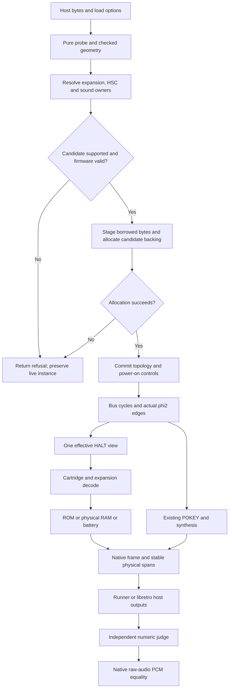

# Phase 10: Homebrew and expansion memory - Research

**Researched:** 2026-10-25 (project-local date)
**Domain:** C17 cartridge mapping, stretched-clock DMA ownership, expansion topology and host integration
**Confidence:** MEDIUM overall; directly inspected code and executed baseline evidence are distinguished below from implementation-backed hardware claims.

<user_constraints>
## User Constraints (from CONTEXT.md)

The following decisions and scope are copied verbatim from the phase context; they are binding choices, not claims of completed runtime acceptance. [VERIFIED: .planning/phases/10-homebrew-expansion-memory/10-CONTEXT.md:34-255,382-411]

### Locked Decisions

### Selection, capability reporting and lifecycle

- **D-01:** Append one load-time expansion selector with Auto, Off, XBoard and XM.
  Zero and an omitted/incomplete optional field mean Auto. Explicit selection
  wins; otherwise use the probe's existing resolved `MUHTARI_DEVICE_XM`, then Off.
  Preserve the current interpretation of any nonzero A78 byte 63 as an XM request,
  including its warning for values other than 1. XBoard needs explicit selection;
  no distinct header encoding was established. Never infer an expansion from a
  filename, firmware size or trial execution, or accept a database-marked module/
  firmware image as a game cartridge. Capture the effective selection only on
  successful load; power cycle retains it and resets volatile hardware controls.
- **D-02:** Keep raw probe identity and resolved cartridge requests distinct from
  effective attachment. Expose the latter through additive size-tagged information,
  runner information and libretro logging. Use matching `--expansion
  auto|off|xboard|xm` and a reload-only libretro option. Say "XM RAM/POKEY/HSC
  subset" and name unavailable features. Off may intentionally suppress the XM
  request, but must not erase independently declared unsupported audio or imply
  the game is verified playable. Probe remains descriptive; executable load refuses
  declared YM2151, Covox/ADPCM and other unimplemented devices with the existing
  appropriate unsupported status, runner exit 77 and a named frontend failure.
  Retain Souper's board refusal. No silent soundless-success compatibility path.
- **D-03:** Preserve old layouts, size minima, numeric constants/statuses and ABI 1.
  Apply the established API/behavior revision policy to the actual additive
  declarations and changed execution semantics. Newly supported hardware must
  work for old zero-tail callers; explicitly changing the old silent acceptance
  of unsupported sound is a documented behavior correction. Judge optional-field
  presence from the complete field end and test sizes before, inside and at that
  end against explicit defaults. Validate geometry, effective attachment, sound
  ownership and conflicts before live-state replacement or allocation for a
  refused configuration. Allocation failure and invalid candidates preserve
  content, execution, firmware, public spans, battery bytes/topology and generation.
  Retain safe staging of borrowed firmware before its backing memory can be freed
  or cleared. Expansion RAM is instance-owned volatile memory, allocated at load
  through the existing allocator; checked size arithmetic and the physical 128 KiB
  capacity establish its bounds, not a new proxy quota.

### BankSet geometry and memory ownership

- **D-04:** Accept equal CPU-then-MARIA ROM halves of 32, 48, 52, 128, 256 or
  512 KiB; the total remains at most the existing 1 MiB ROM limit. Linear halves
  end at $FFFF; switched halves derive bank counts and fixed windows from one
  half, never the combined body. Keep one shared bank register, initially zero.
  The wiki documents through 128 KiB per set; 256/512 are supported producer/
  emulator extensions with explicit confidence limits, not measured cartridge
  capacities. Reject odd, truncated, unsupported or inconsistent geometries
  without fallback that silently discards a valid unsupported v4 declaration.
- **D-05:** Preserve declarations rather than inventing RAM from the BankSet bit.
  Omitted RAM means none; normal 16 KiB means shared CPU/MARIA RAM; HALT RAM
  means two physical 16 KiB halves. The supported matrix is:

  | ROM KiB per set | No RAM | Shared 16 KiB | HALT-selected 32 KiB |
  |---|---|---|---|
  | 32 | Yes | Emulator extension | Yes |
  | 48 or 52 | Yes | Refuse | Refuse |
  | 128 | Yes | Emulator extension | Yes |
  | 256 or 512 | Size extension | Size/shared-RAM extension | Size extension |

  Shared RAM is a deliberate emulator extension supported by distinct metadata
  and emulator documentation; the BankSet hardware wiki describes HALT RAM.
  Do not claim these are identical physical boards. Retain refusal of unsupported
  A8/X2/EXROM/EXFIX combinations rather than inferring them from this matrix.
  In HALT RAM, CPU writes $4000–$7FFF update the CPU half and writes
  $C000–$FFFF update the MARIA half; CPU ROM reads at the latter addresses remain
  ROM. MARIA reads its half at $4000–$7FFF during the effective HALT view.
- **D-06:** Model the electrically selected view: SALLY until the second falling
  phi2 edge after HALT assertion, then MARIA until HALT rises. Derive these edges
  from the actual stretched phase sequence. A `by_maria` flag alone is insufficient:
  MARIA has VBE/display-list helper reads while HALT is high. Existing `halt_stage`
  alone is also insufficient because it is cleared before the batched burst runs.
  Preserve caller identity and access time where needed, with one instance-owned
  authority for the effective view. No mutable global DMA flag. Debug observation
  has a documented logical CPU view and no clocking, bank changes or register side
  effects; actual CPU/DMA transfers obey their electrical timing.
- **D-07:** Preserve causal memory ordering in the current batched MARIA design.
  A bus-level counterexample is slow c0 RIOT access followed by fast c1 cartridge
  write: the latter commits at HALT-fall+10, while the current retroactive first
  DMA read is timestamped fall+8. A timestamp argument cannot undo an applied
  write. This is a code-derived bus-level counterexample, not an executed ROM or
  hardware measurement. Prefer a narrowly justified burst handoff that starts
  memory reads only after the CPU relinquishes the bus and preceding effects
  commit; preserve the all-fast fit, line deadline, DMA abort and existing edge
  owners. Document any changed slow-edge timing as a derived compatibility fit.
  Research must verify the minimum coherent correction before planning it.
  Move to chronological individual fetch scheduling only if a supported path
  requires real interleaving that batching cannot represent. Do not introduce
  write history/rollback, or broadly refit unrelated SALLY/MARIA timings.
- **D-08:** Resolve overlaps explicitly. BankSet $4000 ROM or RAM remains readable
  beside a write-only POKEY there; redirects and mapper writes must not be silently
  swallowed by an unrelated decoder. A 52 KiB half occupies $3000–$FFFF and cannot
  coexist with effectively provisioned HSC in this supported profile. Refuse that
  combination before allocation, including XM Auto-HSC; explicit HSC Off can
  remove the conflict. Expansion overlays otherwise have their documented priority
  over underlying cartridge windows; disabling an overlay reveals the cartridge.
  Preserve MEN/BIOS priority and test boundaries rather than inventing aliases.

### Distinct XBoard and XM profiles

- **D-09:** Implement XBoard separately: 128 KiB RAM in eight 16 KiB banks;
  $0470–$047F are control aliases, bits 0–2 choose the bank, bit 3 enables RAM
  at $4000–$7FFF, bit 4 gates POKEY CPU register decode at $0450–$045F. Controls
  reset to zero. Disabling or changing a bank retains stored RAM. Retain existing
  deterministic power-on RAM fill and distinguish power cycle from the console
  Reset switch. The optional second XBoard POKEY at $0460 is unverified and is
  not part of the supported profile.
- **D-10:** Implement the XM game-facing subset from the audited XM implementation,
  not the older XBoard-style XM paragraph in preparation audio §6. XM uses exact
  $0470, $0478 and $047C writes: $0470 bits 5/6 enable $4000–$5FFF and
  $6000–$7FFF; low/high nibbles of $0478 select their CPU pages, and $047C supplies
  the corresponding MARIA pages. There are sixteen physical 8 KiB pages, with
  bounded offsets through $1FFFF. Bit 3 gates HSC, bit 4 gates $0450 POKEY decode.
  Controls reset to zero. Use the same effective HALT view as BankSet, including
  non-HALT MARIA reads; no independent, inconsistent DMA flag. Disabled windows
  pass through to the cartridge and ordinary cartridge bank writes still work
  outside an enabled overlay.
- **D-11:** State the limits precisely: this is an implementation-backed compatibility
  profile, with medium confidence for physical XM semantics. The primary XM
  developer specification remains inaccessible. Do not synthesize firmware, sticky
  locks or detection success from emulator comments. XM $0470 bits 0–2/7 and
  unsupported $0471/$0472 controls have no implemented effect in this profile;
  unsupported reads retain the established open-bus behavior. ROF aliases, internal
  XM BIOS/top-slot switching, flash, PIA, flat-48-KiB mode, write protection, sticky
  locks and PAL-specific firmware selection are unavailable. Cartridge pass-through
  remains active; no full-XM service or game claim follows from accepting the subset.
  Do not add a new runtime fault protocol merely because a ROM probes absent hardware.

### HSC, POKEY and host memory

- **D-12:** XM Auto provisions the existing HSC storage at successful load; the
  explicit HSC override wins, including Off. Separate physical provisioning from
  $0470 bit 3, which gates both SRAM and ROM decode. The existing raw battery
  layout 1, pointer, length and attachment stay fixed until reload/destroy.
  Gate writes alone change no bytes/generation; hidden HSC writes are ignored;
  re-enabling reveals retained bytes. Power cycle clears expansion controls but
  retains committed HSC/EEPROM data and generation. Standalone HSC keeps its existing
  behavior. Gating both windows is a source-qualified physical inference; the
  reference's always-on SRAM is explicitly a persistence workaround to avoid.
  Preserve signature-only stub limits and user-supplied firmware validation.
- **D-13:** Resolve effective expansion and HSC consistently in core battery preparation,
  runner setup, libretro optional `highscre.bin` discovery and late-option/storage
  checks. Attaching HSC only inside the core would miss firmware discovery and
  create incorrect reload warnings in existing adapter consumers. Discover/read
  optional firmware only for an effectively attached device; invalid requested
  firmware fails before replacing a live machine. Late hardware option changes
  require reload and never reinterpret SAVE_RAM. Avoid a general configuration
  framework; share or duplicate the small stable resolution rule as appropriate.
- **D-14:** An installed expansion POKEY continues clocking and sounding while its
  register window is disabled. Bit 4 gates CPU decode, not chip existence, reset,
  DAC history, timers, mixer normalization or declared IRQ wiring. This is the
  source-backed chip-select model, not a measured audio-mute circuit. Re-enabling
  exposes continued state. Gate writes must not reset POKEY or synthesis. Retain
  stretched phi2 clocks through HALT and both regional profiles.
- **D-15:** Keep the current two-chip identity/source/IRQ bounds. With expansion
  selected, a declared $0450 means that single gated expansion POKEY; it does not
  instantiate a duplicate. A declared $0440 secondary can coexist. Refuse expansion
  plus separate $4000/$0800 primary sound, requests for independent same-address
  owners, and the unverified $0460 expansion chip in this profile. These are explicit
  support limits, not claims that physical hardware cannot combine them. Do not
  silently drop, rename or merge independent chips, or introduce a third chip.
  A concrete required configuration and evidence-backed owner/IRQ model may reopen
  this boundary with corresponding proofs; hypothetical topology flexibility does not.
- **D-16:** Keep physical storage separate from active CPU windows. Existing
  `MEMORY_CART_RAM` covers physical cartridge RAM, including both BankSet halves;
  expansion RAM has a distinct additive physical memory kind if exposed. It is
  neither cartridge metadata RAM nor battery SAVE_RAM. Do not publish banked or
  conditionally gated windows as permanently mapped pointers. In particular, revise
  the current static-map condition that treats non-`BANKED_RAM` cart RAM as fixed:
  it must also exclude HALT RAM. XM-gated HSC descriptors must remain honest as its
  control changes. Retain stable physical spans and validate CPU-map holes through
  the existing rcheevos resolver. Failed load and unload/reload cannot leave stale
  frontend pointers or effective selections.

### Independent evidence, resources and stopping rules

- **D-17:** Use owned numeric diagnostics with independent expected records and CRC,
  then compare native frames, canonical raw audio and PCM through the real library,
  runner and loaded libretro module. Equal hashes alone do not prove ownership.
  Exercise every supported geometry, shared versus HALT RAM, both HALT edges,
  no-HALT VBE reads, all bank/page values and endpoints, and slow-edge ordering.
  Include actual CPU/MARIA accesses, distinct sentinels, redirected stores, hidden
  writes, disabled overlays and integrated RAM+HSC+POKEY. Separate valid metadata
  admission, executable behavior and result comparison; forged/missing/extra or
  wrong expected observations must fail at the relevant existing consumer.
- **D-18:** Test invalid/partial structs, malformed headers, conflicting geometry/
  devices, failed allocation and borrowed media transactionality; neutral startup,
  power cycle, same-value stores, gate toggles, failed reload and cross-instance
  isolation. Prove HSC restore before execution while initially gated off, later
  visibility and unchanged save identity. Prove POKEY gate-off tone/phase continuity
  against a control and ignored disabled-window writes. Exercise unsupported-register
  and hostile bank/control traffic under finite NTSC/PAL calls, with no allocation
  after load and bounded array/index arithmetic. The slow-c0/fast-c1 synthetic
  sequence is bus-level evidence; do not label it a demonstrated instruction stream.
- **D-19:** Extend existing CTest/CMake registrations, owned fixture admission,
  fuzz/property coverage and native/PowerPC equality. Preserve prior passing
  observations unless specific new evidence justifies a narrowly recorded revision.
  Keep the two existing real-RetroArch cases, not a third hosted harness; semantics
  belong in process/module diagnostics. Preserve the armed test-card performance
  guard, authenticated current/base three-component package observations and all
  existing correctness/provenance/ABI contracts. Measure complete changed workloads
  before setting deadlines through DEC.47; add no replacement archive/LOC quota,
  new registry or advisory-lane promotion. Record commands, exits and actual run URLs,
  without committed execution logs. Discussion evidence is not runtime acceptance.
- **D-20:** Apply ENGINEERING §11's bounded architecture review to the changed ownership,
  encapsulation, locality, state/control flow, independent tests and recurring cost.
  Prefer the existing cartridge switch, bus timing owner, chip models and host
  boundaries. Another small understood permissive copy can be cheaper than a
  dependency, but any reused expression still needs its notice and maintenance
  rationale. No package is needed here. Stop specialist expansion after this
  synthesis. Reopen a choice only for an accessible primary specification,
  contradictory hardware observation, or concrete required fixture/consumer that
  falsifies the profile. Optional tooling remains seeds; existing required contract
  violations remain blocking. Preserve the two-review-fix/one-gap limits.


### Agent's Discretion

Choose private field/helper names, checked allocation layout, small module seams,
fixture organization and precise automated assertions within these decisions.
Research must verify source assumptions and the narrow causal DMA correction before
planning implementation. No routine owner judgment, hardware run or new framework
is required. The owner has delegated adoption of the coherent recommendations.

### Deferred Ideas (OUT OF SCOPE)

- Full XM boot/service/flash/PIA/locks, YM2151, Souper/BupChip, Covox/ADPCM,
  additional independently owned sound chips, full OpenHSC and measured hardware
  calibration retain later scope. Required counterexamples may reopen a specific
  decision; broad hypothetical extensibility does not.
- Phase 11 owns whole-library accounting and gameplay claims. Synthetic board
  diagnostics establish only their asserted capabilities, not every title's playability.
- Independent release follow-up: PR 35 merged with green required CI 40246033915,
  but v0.8.0 is still a draft. Publication run 40249027723 attempt 1 failed in
  Windows x64 and macOS x64 quality-observation steps, then quality and the required
  aggregate; publication was skipped. Read-only `gh pr view`, `gh release view`,
  `gh run list` and complete-job `gh run view` queries exited 0. This records the
  failed outcome, not release acceptance or a diagnosed cause:
  https://github.com/szTheory/muhtari/actions/runs/40249027723.
  No release repair or retry is performed in this discussion step.

### Reviewed Todos (not folded)

- Phase 2 nightly/ROM-table seeds: historical trigger coverage and API comment
  fixes already landed; remaining optional parser/scan improvements stay seeds
  unless new work demonstrates a current required-contract defect.
- Phase 2 CPU/HALT re-review seeds: frame termination and queue wording already
  landed; optional old test strengthening remains separate. New HALT-edge evidence
  is required by BOARD-04 and does not blanket-close the historical todo.
- Dependabot/publication review group: retain historical disposition; this phase
  does not add a release/CI cleanup workstream. Existing contract violations still
  block their affected work if reproduced.
- WASM promotion: needs its own qualifying evidence and authority; filename overlap
  and Phase 10 expansion coverage do not authorize advisory-lane promotion.
</user_constraints>

## Summary

Implement this phase within the existing cartridge switch, bus timing authority, staged loader, two POKEYs and host adapters. The necessary owners already exist: cartridge installation allocates before freeing live content; the bus invokes MARIA only when c2 is reached; MARIA reads board memory without CPU audio-register effects; chip clocking already follows actual half edges. Extend these boundaries, rather than introducing a bus/plugin framework. [VERIFIED: src/cart.c:782-818,896-1059; src/bus.c:162-193,299-336; src/maria.c:68-111,646-660; src/pokey.c:172-211]

D-07 has a concrete minimal causal correction. Current c0/c1 effects commit before the batched burst executes, but the burst schedules its first fetch at fall+8 regardless of stretched c0/c1. A disposable bus-level probe against the current archive reproduced a slow c0 followed by a cartridge write at fall+10; the subsequent burst consumed that new byte while its first-read schedule still says fall+8. Set the first fetch to the later of the existing fit and c2, equivalently move only the burst's PLA origin to max(fall+6,c2−2). Preserve the absolute LRC, ordinary/last-line tails, release convention and c2 DLI grid. This is a derived compatibility fit, not a measured physical handshake or a demonstrated instruction stream. [VERIFIED: src/bus.c:16-21,162-182,463-482; src/maria.c:5-23,330-373,646-660; research probe commands in Evidence below]

The XM implementation and the older MAME XBoard-style XM implementation disagree. The locked profile correctly uses the separately audited XM source for its two independently enabled 8 KiB windows and CPU/MARIA page selectors, and the XBoard source only for XBoard. Both are implementation evidence; the inaccessible original developer specification cannot establish full physical XM semantics. HSC gating and decode-only POKEY gating remain explicitly qualified profile choices. [CITED: https://raw.githubusercontent.com/7800-devtools/a7800/7a2afdc1ea08/src/devices/bus/a7800/xm.cpp] [CITED: https://raw.githubusercontent.com/mamedev/mame/dddf4cd1faee/src/devices/bus/a7800/xboard.cpp]

**Primary recommendation:** Plan a causal bus/BankSet slice first, a transactional selection/XBoard slice next, an XM/HSC/POKEY slice next, host consumers after their core contract is concrete, then independent admission/equality and final acceptance. Do not leave the slow-edge correction or evidence consumers as unspecified follow-up work. [VERIFIED: .planning/phases/10-homebrew-expansion-memory/10-CONTEXT.md:98-119,159-245]

## Architectural Responsibility Map

These assignments implement the locked ownership choices. [VERIFIED: .planning/phases/10-homebrew-expansion-memory/10-CONTEXT.md:22-27,98-119,159-245]

| Capability | Primary Tier | Secondary Tier | Rationale |
|---|---|---|---|
| A78 geometry and descriptive requests | Core cartridge parser | Loader | Parse declarations independently of effective host override. |
| Effective expansion/HSC/topology | Core load transaction | Runner/libretro request preparation | Validate once per candidate; publish only on successful load. |
| HALT selection and stretched timing | Core bus | MARIA fetch engine | Bus owns elapsed time and electrical edges; MARIA supplies fetch times. |
| BankSet/expansion address mapping | Core cartridge owner | Bus | Mapping consumes access identity/time, never advances time. |
| POKEY timers/audio/IRQ | Existing chip/synthesis owners | Bus edge delivery | Decode gates do not alter installed chip identity or clocks. |
| HSC persistent bytes | Existing battery storage | Cartridge decode | Physical provisioning is load-stable; gate is volatile. |
| Files, options, firmware discovery | Runner/libretro | Core validation | Hosts own I/O; core owns only bytes and selection. |
| Physical spans and static CPU descriptors | Core spans / libretro map | rcheevos resolver | Distinguish backing memory from windows that may change. |
| Numeric truth and equality | Existing C diagnostics / CMake consumers | Native and PowerPC CI | Judge behavior first; equality then protects determinism. |

<phase_requirements>
## Phase Requirements

Descriptions are reproduced from the requirement definitions. [VERIFIED: .planning/REQUIREMENTS.md:21-24]

| ID | Description | Research Support |
|---|---|---|
| BOARD-04 | BankSet cartridges select the documented CPU/MARIA ROM and RAM views at both HALT transitions, with supported image geometries validated before load changes state. | Checked per-half geometry; causal c2 handoff; one effective HALT view; redirected stores; edge/VBE and independent sentinel tests. |
| BOARD-05 | XBoard and the XM RAM/POKEY/HSC subset run with documented control registers and CPU/MARIA banking; unsupported sound expansions remain explicit. | Distinct maps; load-stable attachment; continuous POKEY; gated HSC; host request/refusal/map changes; independent integrated diagnostics. |
</phase_requirements>

## Project Constraints (from AGENTS.md)

Actionable directives for plans and execution: [VERIFIED: AGENTS.md:1-70]

- Reuse only permitted permissive expression under the provenance policy. Never open GPL/LGPL/unlicensed emulator source; released binary oracles only.
- Deliver library, headless runner and libretro core. No window/audio-device/input-device layer.
- Commit only admitted fixture bytes; no personal data/paths. Use noreply commits and existing hygiene hooks. No hygiene bypass.
- Use integer-only, deterministic, instance-owned bounded state and bounded calls, including hostile/JAM traffic; no allocations after load.
- Every behavior change needs an automated test in the existing CI workflow and corresponding documentation. Keep README user-facing, public header terse and hardware prose in docs.
- Agent performs routine verification, source/doc/image judgments and RetroArch work. Owner involvement is restricted to identity-bound consent or their own hardware.
- Extend existing CMake/POSIX sh checks. Name each concrete fault and meaningful pass/fault controls. Apply ENGINEERING §11 to changed boundaries and new bounds; no new quota/framework.
- Keep two review-fix rounds and one gap round. Optional tooling becomes seeds; existing required-contract defects remain blocking. Replan only with new evidence.
- Honor bounded recovery, one GSD step per session, forbidden chained/automatic commands and single ownership of shared planning state.
- Branch from the remote main before committing; phase branch and Conventional Commit PR policy apply. This research agent is explicitly instructed not to commit.
- Evidence is command, exit and actual run URL; no committed logs. Shipping owns merge/release confirmation.
- Small modules, plain flow, fixed-width arithmetic, public namespace, module-private prefixes and source-cited hardware comments. No planning IDs in code/test names/user docs.
- SUMMARY metadata includes the required completed requirements and block-style coverage records, with genuine owner-only judgment flags.
- Lessons remain hypotheses until reproduced; export only on request using the existing template.

The existing configuration explicitly says `"nyquist_validation": false` and `"security_enforcement": false`; omit the optional Validation Architecture and Security Domain templates. Memory/input safety remains a required product contract. [VERIFIED: .planning/config.json:24-58]

## Standard Stack

No package installation is needed or recommended. Reuse the project toolchain and test mechanisms; this is the locked dependency decision. [VERIFIED: .planning/phases/10-homebrew-expansion-memory/10-CONTEXT.md:235-245]

| Component | Version / status | Purpose and recommendation | Evidence |
|---|---|---|---|
| Core language | C17, extensions disabled | Keep current compiler flags and fixed-width state. | `set(CMAKE_C_STANDARD 17)`, `set(CMAKE_C_STANDARD_REQUIRED ON)`; [VERIFIED: CMakeLists.txt:16-18] |
| CMake / CTest | Local 4.4.3 | Existing presets, CMake scripts, exact inventories, package checks. | [VERIFIED: research tool probes, 2026-10-25] |
| Ninja / compiler | Local 1.13.2 / Apple clang 21.0.0 | Existing native build. | [VERIFIED: research tool probes, 2026-10-25] |
| Owned C checks / fixtures | Existing | Independent numeric assertions, counting allocators, old caller packets and synthetic cartridges. | [VERIFIED: tests/cart/images.c:6-59; tests/bus/test_bus.c:32-48; tests/api/v6-layout.c:1-35,49-95] |
| Fixture toolchain | Pinned wasmtime package; local wasmtime 48.0.6 | Existing DASM/sign/header WASM tools; do not install another assembler. | [VERIFIED: tests/diag/assemble.cmake:58-84; tests/built/tests.cmake:8-17; research tool probes] |
| rcheevos / libretro | Existing pinned resolver and vendored header | Exercise actual consumer, without a second map model. | [VERIFIED: tests/libretro/rcheevos.c:1-12,64-85] |

**Installation:** none. Package Legitimacy Audit is inapplicable because this phase installs no package. An external seed is not authorized by merely reading a permissive file; notices and the existing provenance process still apply to copied expression. [VERIFIED: PROVENANCE.md:13-20,46-58]

## Architecture Patterns

### System architecture and data flow

This proposed flow follows the existing load transaction and locked decode priorities. [VERIFIED: src/instance.c:305-380; src/bus.c:35-65; .planning/phases/10-homebrew-expansion-memory/10-CONTEXT.md:36-68,120-157]



### Component responsibilities and concrete seams

| Owner | Existing seam to extend | Required effect | Source |
|---|---|---|---|
| Cartridge parser | Geometry, v3/v4 resolution, hash overrides | Admit only the selected matrix; preserve unsupported declarations and descriptive sound. | [VERIFIED: src/cart.c:88-115,119-207,211-289,534-605] |
| Bus | HALT cycle, actual cycle lengths, data-edge order | One electrical-view authority independent of transient halt-stage bookkeeping. | [VERIFIED: src/bus.c:16-21,162-193,299-336,463-482] |
| MARIA | Fetch, DLL helper, line burst | Supply meaningful access time to mapper reads; no caller-only MARIA selection. | [VERIFIED: src/maria.c:76-111,139-148,194-203,330-373,646-660] |
| Instance / cartridge install | Candidate preparation and commit | Validate all conflicts first; keep old allocation live through every fallible step. | [VERIFIED: src/instance.c:239-380; src/cart.c:782-818] |
| Existing POKEYs | Installed addresses, fixed source identities | Gate access only; do not reset chip/synth on control stores. | [VERIFIED: src/cart.c:823-842,964-1011; src/pokey.c:7-20,172-211] |
| Battery | Load-time attachment and byte-change generation | Hidden HSC stores do nothing; gate transitions preserve raw storage. | [VERIFIED: src/instance.c:249-301,359-380,393-438; src/cart.c:1013-1019] |
| Host adapters | Requests, discovery, reporting, descriptors | Consistent effective configuration before firmware I/O and publication. | [VERIFIED: runner/main.c:1148-1218; libretro/libretro.c:569-587,754-785,1124-1135,1201-1246,1335-1410] |
| Evidence consumers | Existing diagnostic driver, manifest admission, hash writer/validator, quality producer/join | Numeric semantics, legal admission and equality each fail independently. | [VERIFIED: tests/diag/driver.c:1-21,528-599; tests/cmake/hashes.cmake:6-74,173-240; tests/cmake/quality.cmake:116-156] |

Keep changes in those owners. A small expansion structure inside the instance and small cartridge-local helpers suffice; a separate private implementation file is discretionary only if it makes current responsibilities clearer. Do not split stable trivial selection rules into a generic configuration layer. [VERIFIED: .planning/preparation/ENGINEERING.md:257-291; .planning/phases/10-homebrew-expansion-memory/10-CONTEXT.md:171-178,235-245]

### Pattern 1: checked geometry before allocation

Use one validated per-set ROM size and bank count. CPU set starts at zero, MARIA set starts at the half size. Linear half sizes map to the top of the address space; switched offsets are bounded within one half before adding its set base. Do not reuse the existing SuperGame helper's combined-image bank count unchanged. [VERIFIED: src/cart.c:871-887,946-955] [CITED: https://7800.8bitdev.org/index.php/Bankset_Bankswitching]

The accepted matrix is already fixed in D-04/D-05 above. Distinguish three cases: no RAM, one shared 16 KiB span, and two HALT-selected physical 16 KiB spans. ROM size alone never creates RAM. Validate forbidden combinations even when the v4 syntax is valid, and preserve authoritative valid-but-unsupported v4 semantics instead of accidentally falling back to stale v3 bits. The existing v4 choice expression couples `cart_refused(&v4)` with `cart_fits(&v4, mapped)`; changing BankSet from refused to accepted changes that expression's behavior. [VERIFIED: src/cart.c:174-189,256-287,534-548,598-604; .planning/phases/10-homebrew-expansion-memory/10-CONTEXT.md:72-97]

Checked allocation recommendation: keep one candidate allocation containing ROM, cartridge RAM and optional expansion RAM, with separately recorded physical lengths and total allocation length. Check each addition against the size type before allocation, populate before freeing the old block, and use the recorded exact allocation length in replacement/destruction. This preserves the existing one-allocation transaction while keeping expansion bytes out of cartridge metadata. The current free calculations sum only ROM and cartridge RAM and therefore must change if this layout is adopted. [VERIFIED: src/cart.c:782-809; src/instance.c:120-130; .planning/phases/10-homebrew-expansion-memory/10-CONTEXT.md:55-68,194-203]

Bounds to prove from the selected profile: maximum per-set ROM is 512 KiB, complete ROM is 1 MiB, cartridge HALT RAM is 32 KiB, expansion RAM is 128 KiB. The resulting maximum candidate backing is 1,212,416 bytes; this is the sum of actual capacities, not an additional acceptance quota. Maximum XM page offset is 15×8192+8191=131071, maximum XBoard bank offset is 7×16384+16383=131071. Cast before shift/multiply and keep ROM half/base arithmetic wide enough on 32-bit hosts. [VERIFIED: .planning/phases/10-homebrew-expansion-memory/10-CONTEXT.md:66-89,131-146; .planning/preparation/ENGINEERING.md:73-81] (Derived arithmetic.)

### Pattern 2: electrical view and causal DMA handoff

**Observed implementation:** `BUS_FAST_TICKS 4u`, `BUS_FAST_DATA 4u`, `BUS_SLOW_TICKS 6u`, `BUS_SLOW_DATA 5u`; `HALT_RUN_CYCLES 2u`; current `MARIA_HALT_T0 6u` and `MARIA_PLA_START 2u`. The bus increments c0/c1 at their starts, clears halt_stage before the burst, and then holds c2 according to the existing fitted release rule. [VERIFIED: src/bus.c:16-21,83-95,162-193; src/maria.c:5-23,384-386]

**Causal derivation:** use the following table relative to the recorded HALT fall. The second falling edge is the c1 data tick; CPU c1 data sampling/commit precedes the selector transition at a coincident edge. The delayed batched reads run only after those effects have committed. [VERIFIED: src/bus.c:299-318,367-396,463-482; src/maria.c:646-660] (Derived sequencing recommendation.)

| c0 / c1 | Second fall | c2 start | Current first fetch | Recommended PLA origin | Recommended first fetch |
|---|---:|---:|---:|---:|---:|
| fast / fast | 8 | 8 | 8 | 6 | 8 |
| fast / slow | 9 | 10 | 8 | 8 | 10 |
| slow / fast | 10 | 10 | 8 | 8 | 10 |
| slow / slow | 11 | 12 | 8 | 10 | 12 |

All-fast keeps the exact old schedule. A stretched sequence moves the effective PLA origin only far enough that its first fetch is at c2. For a slow c1 this is one tick after the second fall; do not describe that extra tick as a hardware measurement. Keep absolute LRC unchanged so delayed starts may complete fewer bytes rather than gain a larger line budget. Cost remains HALTRST minus the effective PLA origin, while CPU hold uses its existing convention. Recheck last-line DLL reads, abort tails, DLI, held RDY and subsequent DMA requests; do not rewrite unrelated timing constants. [VERIFIED: src/maria.c:330-373,558-568,638-660; src/bus.c:178-182,245-288; .planning/phases/10-homebrew-expansion-memory/10-CONTEXT.md:107-119] (Derived correction.)

Maintain one instance-owned electrical selection interval/state in the bus. Its start is the actual second falling edge; its end is HALTRST. Keep it distinct from halt_stage, which is scheduling bookkeeping and is cleared early. Cartridge reads need both caller identity and relevant access time: CPU accesses and debug logical peeks do not become MARIA simply because a batched burst is active; VBE/DLL helpers with HALT high must see the CPU-selected set. Batch fetches, including last-line helper reads, must remain inside the intended selected interval with explicit ordering at release. Thread timing through the current private fetch path where needed; do not introduce global state. [VERIFIED: src/bus.c:162-182; src/maria.c:76-111,139-148,194-203,359-365,582-635; .planning/phases/10-homebrew-expansion-memory/10-CONTEXT.md:98-106,138-146]

This establishes a coherent minimum for the supported paths because no CPU memory transfer occurs within the held burst. A future supported consumer requiring memory-changing events interleaved with DMA would falsify that premise and justify chronological fetch scheduling; no such path is required by the selected RAM/POKEY/HSC subset. Preserve observer non-mutation: the debug view is logical CPU memory, with no clocks, banks or chip-register effects. [VERIFIED: src/bus.c:399-435; src/cart.c:964-989; .planning/phases/10-homebrew-expansion-memory/10-CONTEXT.md:98-119,138-157] (Scope-qualified architectural reasoning.)

### Pattern 3: separate attachment from volatile decode

Resolve Auto/Off/XBoard/XM before battery preparation. Effective XM plus automatic HSC provisions physical HSC even though its power-on decode is disabled. An explicit HSC Off suppresses provisioning and may eliminate the 52 KiB conflict; supplying firmware together with Off remains an invalid request under the existing contract. Power cycle resets expansion controls/RAM and chip state, retaining selected hardware and committed battery bytes/generation. The console Reset input is a different operation. [VERIFIED: src/instance.c:181-201,239-301,359-380; src/cart.c:823-842; .planning/phases/10-homebrew-expansion-memory/10-CONTEXT.md:36-68,120-178]

Keep XBoard and XM decoders distinct:
- XBoard uses eight 16 KiB banks and control aliases throughout its specified control range. Disabled RAM reveals the cartridge.
- XM uses two 8 KiB windows, independent CPU/MARIA page nibbles and exact control addresses. Unsupported controls do not create firmware/detection/locking behavior.
- Both use bounded physical RAM; the POKEY register gate changes CPU chip select only.
These are the locked compatibility profiles. [CITED: https://raw.githubusercontent.com/mamedev/mame/dddf4cd1faee/src/devices/bus/a7800/xboard.cpp] [CITED: https://raw.githubusercontent.com/7800-devtools/a7800/7a2afdc1ea08/src/devices/bus/a7800/xm.cpp] [VERIFIED: .planning/phases/10-homebrew-expansion-memory/10-CONTEXT.md:129-184]

HSC gate both SRAM and firmware through one visibility predicate shared by side-effect-free memory access and actual reads/writes. Do not change attachment, pointers or generation on a gate store; compare actual SRAM bytes before incrementing generation on visible stores. The reference XM source explicitly labels always-on SRAM as a persistence workaround, so reproducing it would violate the selected model. Gating both windows is a source-qualified inference chosen in D-12, not independently measured circuitry. [VERIFIED: src/cart.c:902-911,1013-1019; src/instance.c:393-438; .planning/phases/10-homebrew-expansion-memory/10-CONTEXT.md:161-170] [CITED: https://raw.githubusercontent.com/7800-devtools/a7800/7a2afdc1ea08/src/devices/bus/a7800/xm.cpp]

Keep installed POKEY addresses/count/source IDs unchanged while the gate toggles. The bus already clocks half edges through holds, and chip output/mixer normalization depends on installed topology. Preserve those paths; never clear an address, decrement installed chip count, reset synth, or suppress DAC events to implement chip select. With expansion present the existing primary slot is the single gated expansion POKEY, while a separately declared secondary may coexist within the locked two-chip boundary. [VERIFIED: src/bus.c:199-208,305-330; src/cart.c:823-837; src/pokey.c:7-20,172-211; src/synth.c:238-247,368-379; .planning/phases/10-homebrew-expansion-memory/10-CONTEXT.md:179-193]

### Pattern 4: append-only transaction and honest hosts

Existing source-of-truth values (preserve these verbatim):
```c
#define MUHTARI_API_VERSION 6
#define MUHTARI_IMAGE_SIZE_MAX 1048704u
MUHTARI_BOARD_BANKSET = 6,
MUHTARI_BOARD_SOUPER = 7
MUHTARI_BOARD_ROM_AT_4000 = 1u,
MUHTARI_BOARD_BANK6_AT_4000 = 2u,
MUHTARI_BOARD_BANKED_RAM = 4u,
MUHTARI_BOARD_HALT_BANKED_RAM = 8u
MUHTARI_SOUND_POKEY_4000 = 1u,
MUHTARI_SOUND_POKEY_450 = 2u,
MUHTARI_SOUND_POKEY_440 = 4u,
MUHTARI_SOUND_POKEY_800 = 8u,
MUHTARI_SOUND_YM2151 = 16u,
MUHTARI_SOUND_COVOX = 32u
enum { MUHTARI_DEVICE_HSC = 1u, MUHTARI_DEVICE_SAVEKEY = 2u, MUHTARI_DEVICE_XM = 4u };
enum { MUHTARI_HSC_AUTO = 0, MUHTARI_HSC_ON = 1, MUHTARI_HSC_OFF = 2 };
enum { MUHTARI_MEMORY_SYSTEM_RAM = 1, MUHTARI_MEMORY_RIOT_RAM = 2, MUHTARI_MEMORY_CART_RAM = 3 };
```
[VERIFIED: include/muhtari.h:12-13,92-109,192,282] The image maximum's trailing explanatory comment was omitted above; declarations and values are quoted verbatim.

Internal version declarations are `#define MUHTARI__ABI 1u` and `#define MUHTARI__BEHAVIOUR_REVISION 5u`. Apply the next API revision for actual added declarations and a behavior revision for the changed execution model; keep ABI and old prefixes/minima. Do not blindly copy the stale version paragraph in the embedding guide, which still says API 5/behavior 4 elsewhere in that same document. [VERIFIED: src/instance.c:9-13; docs/embedding.md:578-589; include/muhtari.h:12]

Append a single selector field to the media tail and effective selection to the info tail; new memory-kind exposure is additive. Private field/helper spelling and new enum spelling are delegated implementation choices, not already-existing declarations. For input optional presence, reuse complete-field-end copying; for output use the existing bounded writer and test canaries/partial tails. Preserve old frozen callers rather than editing their historical expectations to fit the new header. [VERIFIED: include/muhtari.h:179-190; src/instance.c:20-42,203-222; tests/api/v6-layout.c:1-35,49-95; .planning/phases/10-homebrew-expansion-memory/10-CONTEXT.md:36-68]

A required correction: the v4 audio validator permits six audio bits, but decode only assigns POKEY, YM2151 and Covox. The accepted ADPCM bit is lost from resolved sound. Preserve it explicitly (an additive sound flag is the clearest existing representation), then reject unsupported effective requests at executable public load. Do not reject mere probe identity or let expansion Off erase an independently requested unsupported device. Hash overrides retain their established precedence; ignored invalid v4 fields must not create extra requests. [VERIFIED: src/cart.c:211-255,534-548,571-605] [CITED: https://7800.8bitdev.org/index.php/A78_Header_Specification]

Existing refusal values are `MUHTARI_STATUS_ERR_UNSUPPORTED_BOARD = 9`, `MUHTARI_STATUS_ERR_UNSUPPORTED_DEVICE = 13`, and `MUHTARI_STATUS_ERR_INVALID_HSC = 14`. Use existing appropriate statuses; no new runtime fault protocol. Runner currently translates board/region/2600 refusal to capability exit but omits unsupported device; add that case and name unsupported hardware in frontend logging. The runner value is `MUHTARI__EXIT_REFUSED = 77`. [VERIFIED: include/muhtari.h:25-31; runner/exit_status.h:7-13; runner/main.c:1212-1218; libretro/libretro.c:1242-1246]

Resolve attachment consistently in core battery preparation, runner request/I/O and libretro firmware discovery plus late-request warnings. Current libretro duplicates the same HSC-only decision in discovery and late checks, so changing only the core produces missing firmware discovery and false reload warnings. Retain small stable duplication or a tiny present-purpose helper; no configuration framework. Expose effective selection only after success and clear host cached state on release/unload. Existing libretro load begins by releasing its session; do not accidentally promise a new transactional replacement contract for retro_load_game itself. Core rejected-load preservation remains mandatory and is the relevant live-machine contract. [VERIFIED: src/instance.c:239-380; libretro/libretro.c:754-785,1124-1135,1212-1246,1419-1456,1495-1499; .planning/phases/10-homebrew-expansion-memory/10-CONTEXT.md:55-68,171-178]

**Static map recommendation:** omit conditionally mapped HSC windows for the entire XM session and omit all expansion-overlappable cartridge windows while expansion is installed, even while initially disabled. This is the cheapest honest static representation; keep pointer-less holes so the resolver reaches later stable ranges. Exclude HALT RAM from the present non-banked cart-RAM branch. Physical expansion and cartridge RAM spans stay separately available through the core API, and physical HSC remains SAVE_RAM. Document that a physical span is not a permanently decoded CPU window. For BankSet fixed CPU ROM descriptors use per-half CPU offsets only where the logical CPU mapping is stable; switched/gated ranges stay holes. [VERIFIED: libretro/libretro.c:1280-1410; src/ports.c:1030-1058; .planning/phases/10-homebrew-expansion-memory/10-CONTEXT.md:194-203] [CITED: https://raw.githubusercontent.com/libretro/RetroArch/v1.22.2/libretro-common/include/libretro.h] [CITED: https://raw.githubusercontent.com/RetroAchievements/rcheevos/6755915f2bdf6c11c83b3e0e68c4623a39c0dabe/src/rc_libretro.c]

## Don't Hand-Roll

| Problem | Do not build | Use instead | Grounding |
|---|---|---|---|
| DMA causality | Write history/rollback or a generic event scheduler | Narrow c2 handoff plus one bus selection authority | [VERIFIED: phase context D-06/D-07; src/bus.c:162-193] |
| Expansion sound | Another POKEY engine or third-chip mixer | Existing two chip slots and continuous edges | [VERIFIED: src/pokey.c:172-211; src/synth.c:368-379; phase context D-14/D-15] |
| HSC persistence | Gated allocation, new save layout or full firmware emulation | Existing raw battery storage and decode predicate | [VERIFIED: src/instance.c:239-301,393-438; phase context D-12] |
| Configuration | New registry or mode framework | Existing size-tagged tails, small resolution rules and switches | [VERIFIED: src/instance.c:203-222; phase context D-03/D-13/D-20] |
| Host test orchestration | Third RetroArch harness | Existing process/module diagnostics and two hosted cases | [VERIFIED: phase context D-17/D-19] |
| Fixture trust/equality | New evidence registry or metadata-only pass | Existing manifest admission, producer/join and strict hash consumers | [VERIFIED: tests/cmake/quality.cmake:116-156; tests/cmake/hashes.cmake:6-74,173-240] |

## Runtime State Inventory

This is an additive hardware phase with a narrow timing refactor, not a rename or data-format migration. The following inventory prevents confusing volatile decode changes with external migration work. [VERIFIED: .planning/phases/10-homebrew-expansion-memory/10-CONTEXT.md:22-27,161-178,194-203]

| Category | Items and action |
|---|---|
| Stored data | Existing raw HSC/EEPROM span remains layout 1. No data migration; keep bytes/length/order, restore before execution even while hidden, retain generation through power cycle. [VERIFIED: src/instance.c:393-417; docs/embedding.md:304-326] |
| Live service config | No external service configuration is targeted. Runtime frontend options are reload-only; implement and test effective selection/discovery/late warnings through the existing adapter. [VERIFIED: phase context D-01/D-13; libretro/libretro.c:754-785,1124-1135] |
| OS-registered state | No OS registration changes are required by this phase; all capabilities are instance hardware plus existing hosts. No task/system service rename is proposed or audited as part of research. [VERIFIED: phase context D-20; AGENTS.md:3-6] |
| Secrets/env vars | No secret/env rename is requested. User firmware remains optional host-provided bytes; no credential/provisioning step. [VERIFIED: phase context D-13/D-20; src/instance.c:239-301] |
| Build artifacts | Rebuild library, runner, module and owned fixtures with existing machinery. Old loaded pointers become invalid at their documented successful reload/destroy boundary; no installed-package migration. [VERIFIED: src/cart.c:782-818; src/instance.c:120-130; tests/diag/assemble.cmake:79-105] |

## Common Pitfalls

1. **Using caller identity as electrical ownership.** VBE and DLL helpers call the MARIA fetch path without HALT, while halt_stage is cleared before a normal burst. Test these independently using unequal CPU/MARIA sentinels; neither flag alone is authoritative. [VERIFIED: src/maria.c:94-111,582-635; src/bus.c:174-180]
2. **Retiming reads without retiming causal execution.** A timestamp cannot undo c1 memory already committed. Retard the first burst fetch to c2 and keep CPU c1 effects before coincident selector changes; do not backdate it. [VERIFIED: src/bus.c:463-482; src/maria.c:646-660; probe evidence below]
3. **Reusing full-ROM bank counts or creating RAM implicitly.** Split geometry first; banks and fixed windows belong to one half. Normal RAM and HALT RAM are different declarations and capacities. [VERIFIED: src/cart.c:174-189,256-287,871-887; phase context D-04/D-05]
4. **Stealing overlapping writes.** Current POKEY write decode returns before RAM/mapper work. Explicitly judge intended simultaneous write-only audio plus mapper/redirect effects; do not silently suppress the latter. Overlay-enabled RAM legitimately consumes only its specified windows, leaving ordinary bank writes outside them. [VERIFIED: src/cart.c:1004-1055; phase context D-08/D-10]
5. **Resetting POKEY when disabling registers.** This loses timer phase, IRQ/history, DAC events and mixer continuity. Compare gate-off with an otherwise equivalent control session, including ignored writes and both regions. [VERIFIED: src/pokey.c:7-20,172-211; phase context D-14/D-18]
6. **Treating attachment as visibility.** HSC is physically present while initially hidden; save import must still happen before the first frame. Test enable→disable→enable, hidden stores, same-value stores, power cycle and generation invariants. [VERIFIED: src/instance.c:249-301,393-438; phase context D-12/D-18]
7. **Static descriptors revealing a conditional window.** Even a correct initial map can become false after a control store. Leave such ranges unmapped throughout the session, preserve explicit holes and prove resolver behavior for every exposed byte through bank/gate changes. [VERIFIED: libretro/libretro.c:1280-1410; tests/libretro/rcheevos.c:1-12; phase context D-16]
8. **Updating only a hash list.** A valid owned manifest row must pass trust admission; a real report must pass numeric judgment; complete observations must then pass strict equality schema and native/PPC join. Updating one layer does not authorize the others. [VERIFIED: tests/cmake/quality.cmake:116-156; tests/cmake/quality_evidence.cmake:25-56; tests/cmake/hashes.cmake:6-74,173-240; tests/cmake/lane_equality.cmake:12-36]
9. **Behavior-version churn hiding regression.** The sample-identity guard currently permits only its explicit historical transitions, while audio/report validators name the current revision. Extend the narrowly authorized next transition with pass/fault controls and preserve all old numeric/hash expectations unless the causal correction demonstrably changes a specific output. Do not broadly regenerate expected values. [VERIFIED: tests/cmake/quality.cmake:159-187; tests/cmake/hashes.cmake:15-19,234-236; phase context D-19]

## Code Examples

The following are recommendations grounded in opened source, not a patch or claims of implemented new behavior.

### Existing complete-field-end input pattern

```c
#define MEDIA_FIELD(field)                                                                         \
    do {                                                                                           \
        if (src->size >= offsetof(muhtari_media, field) + sizeof dst->field) {                     \
            memcpy(&dst->field, &src->field, sizeof dst->field);                                   \
        }                                                                                          \
    } while (0)
```
[VERIFIED: src/instance.c:209-214] Reuse this pattern for the appended selector after zeroing the candidate, and test every size inside the new field against explicit Auto. The input packet prefix must remain unchanged. [VERIFIED: src/instance.c:203-222; phase context D-03]

### Minimal burst-origin correction (derived sketch)

```text
first fetch = max(existing fall + 8, actual c2 start)
effective PLA origin = first fetch - 2
absolute abort deadline = existing dma_lrc
```

The numeric inputs are quoted from the current definitions: `#define MARIA_HALT_T0 6u`, `#define MARIA_PLA_START 2u`, and `#define BUS_FAST_TICKS 4u`. The 8 is derived as 6+2; c2 is the already-read current bus tick at burst handoff. Keep the calculation local to the burst handoff and prove the four-row table above. [VERIFIED: src/maria.c:12,386,646-652; src/bus.c:18] This sketch deliberately supplies no speculative new enum/helper identifiers.

### Existing battery byte-change predicate

```c
if (*cell != v) {
    *cell = v;
    m->battery.generation++;
}
```
[VERIFIED: src/cart.c:1015-1018] Place the expansion HSC visibility gate before reaching this existing predicate; a gate transition itself never touches it. [VERIFIED: phase context D-12]

## Independent Evidence and Test Seams

The diagnostic protocol already reports numbers with external verdicts and CRC; missing/extra records fail. Existing host drivers compare actual module callbacks/native buffers and raw/PCM evidence. Extend these mechanisms; do not derive expected records from production mapping getters or freeze equality hashes before semantic assertions pass. [VERIFIED: tests/diag/driver.c:1-21,528-599,759-892,1482-1506,1973-2212]

| Requirement / risk | Independent observation to implement | Existing seam |
|---|---|---|
| Geometry admission | Every supported half size × selected RAM mode; odd/truncated/over-capacity/inconsistent header variants; unsupported A8/X2/EXROM/EXFIX never v3-fallback. Assert no allocation/state change on refused candidates. | Synthetic cart tests and image builders; loader replay. [VERIFIED: tests/cart/tests.cmake:13-32; tests/cart/images.c:26-59; tests/fuzz/loader.c:1-14] |
| Both HALT edges | Distinct ROM and RAM sentinels; actual bus CPU read/write; actual MARIA graphics and helper reads; second-fall−1/at/after sequencing and HALT rise; resumed CPU sees CPU set. | Bus tests plus MARIA DMA/line-RAM tests. [VERIFIED: tests/bus/test_bus.c:362-411; tests/maria/test_maria.c:138-143; phase context D-17] |
| Slow causality | Four phase-pair table; slow-c0/fast-c1 store is visible at the delayed first fetch, never claimed at an earlier tick. All-fast cost unchanged; abort still drops at absolute LRC. | Disposable probe established the existing issue; add recurring bus test beside current HALT cases. [VERIFIED: src/bus.c:162-182; src/maria.c:330-373,646-660; Evidence below] |
| BankSet RAM and sound overlap | Shared versus separate halves, endpoints, redirected CPU stores with ROM reads retained, write-only POKEY overlap and no stolen redirect/bank stores. | Cartridge tests and owned executable diagnostic. [VERIFIED: src/cart.c:964-1059; phase context D-05/D-08/D-17] |
| XBoard | All eight banks, both endpoints, all control aliases, disabled overlay fall-through, storage retained over gate/bank changes, neutral startup and power cycle. | Existing cartridge switch/test builders; owned numeric records. [VERIFIED: phase context D-09/D-17/D-18] |
| XM | All sixteen pages in each window for CPU and MARIA; unequal page sentinels; no-HALT VBE uses CPU pages; exact control addresses; disable/reveal and integrated RAM+HSC+POKEY. | Same cartridge/bus/MARIA seams, independent page numbers in expected CSV. [VERIFIED: phase context D-10/D-17] |
| HSC lifecycle | Restore raw bytes while gated off, then enable and observe retained bytes; hidden writes ignored; gate-only and same-value writes retain generation; power cycle and failed load retain identity. | Battery API tests, real runner save import and loaded module SAVE_RAM. [VERIFIED: src/instance.c:393-438; runner/main.c:1002-1007; phase context D-12/D-18] |
| POKEY topology/gating | Tone/timer/RANDOM phase continuity against control while decode is off; ignored off-window stores; exact source identity/IRQ, no duplicate expansion primary, allowed secondary, unsupported primary collisions. Both regions and stretched/HALT clocks. | POKEY/bus/raw observer tests and loaded module callback comparison. [VERIFIED: src/pokey.c:7-20,172-211; tests/diag/driver.c:739-750,1555-1601; phase context D-14/D-15/D-18] |
| API/lifetime | Omitted/partial selector equals explicit Auto; invalid selector, sound conflicts, allocator failure at candidate install; borrowed ROM/RAM/battery/firmware; stable pointers and subsequent execution; instance isolation. | Old linked clients, canaries and existing counting allocator/control instances. [VERIFIED: src/instance.c:203-222,305-380; tests/api/v6-layout.c:49-95; tests/fuzz/loader.c:59-135] |
| Descriptor honesty | Use actual pinned resolver on every exposed byte and intended hole before/after controls; direct stable backing spans remain distinct; unload/reload clears stale maps/selection. | Existing rcheevos consumer, no shadow map implementation. [VERIFIED: tests/libretro/rcheevos.c:1-12,64-85; libretro/libretro.c:1280-1410; phase context D-16] |
| Bounded hostile execution | Finite NTSC/PAL calls under arbitrary bank/page/control stores, unsupported controls, no allocation after load, bounded offset/index arithmetic. | Existing run/loader fuzz replay, property/counting-allocator machinery. [VERIFIED: tests/fuzz/tests.cmake:19-42; phase context D-18/D-19] |
| All-host truth | Independently judged mailbox/CRC from actual library, process runner and loaded module; native video, canonical raw audio, PCM and sample counts compared only after judgment. Gate errors must fail in each consumer, including CRC-valid wrong values. | Diagnostic driver and tests.cmake, then hashes writer/validator. [VERIFIED: tests/diag/driver.c:528-599,759-892,1482-1506; tests/diag/tests.cmake:360-427; tests/cmake/hashes.cmake:6-74,173-240] |

Keep broad geometry/page enumeration cheap in C units; executable diagnostics must meaningfully exercise each newly advertised family and geometry with actual CPU/MARIA activity, rather than store expected numbers in advance. Do not multiply every geometry by a long sustained PAL workload: the existing sustained PAL contract remains, and new bounded matrix cases should have a concrete independent assertion and measured recurring cost. [VERIFIED: phase context D-17/D-19/D-20; .planning/preparation/ENGINEERING.md:257-275]

### Three evidence consumers that planning must name

1. **Admission:** extend only the explicit owned-fixture names in the existing trusted-manifest comparison, preserve prior rows byte-for-byte and test malformed/forged/duplicate/unrelated additions through the real quality producer and join. Current admission explicitly lists prior diagnostic names; adding a manifest row alone will fail. [VERIFIED: tests/cmake/quality.cmake:116-156; tests/cmake/quality_evidence.cmake:25-56; tests/policy/quality.cmake:751-795]
2. **Execution/judgment:** run the actual public library API, runner process and loaded module with the same owned diagnostic; independently validate record count/order/identity/CRC and numerical observations. Use sentinel/gate-fault controls and unsupported-request failures. Host success or matching screenshots alone is insufficient. [VERIFIED: tests/diag/driver.c:528-599,759-892,1482-1506; tests/diag/tests.cmake:360-427; phase context D-17]
3. **Equality:** extend production write/validate logic and its existing negative controls for new observations, including missing/extra/duplicate/forged fields. Retain immutable commit/configuration/fixture identity and exact artifact membership in native/PowerPC consumers. New semantic observations must reach both the six native artifacts and PowerPC comparison. [VERIFIED: tests/cmake/hashes.cmake:173-240,302-335; tests/cmake/lane_equality.cmake:12-36; tests/policy/tests.cmake:162-220]

### Suggested planning split

These are implementation slices, not new locked decisions or acceptance claims; each behavior-changing slice carries its own tests/docs and relevant CTest registration/inventory work. [VERIFIED: AGENTS.md:28-54; phase context D-17–D-20]

| Slice | Concrete output and stop condition | Dependencies |
|---|---|---|
| 1. Causal handoff and effective ownership | Reproduce bus counterexample, implement minimal retiming, one electrical-view authority, edge/VBE/abort/DLI tests; preserve all-fast existing predicates or document narrowly evidenced changes. | None |
| 2. BankSet | Checked matrix, per-set ROM maps, shared/HALT RAM and redirects, sound overlaps, transactional refusal; independent synthetic and executable evidence. | 1 |
| 3. Load contract and XBoard | Add selector/effective info/physical expansion span; checked backing transaction/destruction; resolve HSC/sound conflicts; preserve unsupported declarations; implement/test distinct XBoard. | Checked BankSet conflicts; 1 for shared owner |
| 4. XM lifecycle | Exact window/page controls, shared ownership authority, gated HSC with stable raw storage, continuous installed POKEY and topology limits. | 1, 3 |
| 5. Hosts and descriptors | Runner flag/info/exit77; libretro reload-only option/discovery/logging; conservative static holes, physical span retention and resolver proof; old ABI clients. | Core contract concrete; 2–4 |
| 6. Diagnostic admission and all-host equality | Owned fixture build/admission; independent records/CRC; actual process/module semantics/native/raw/PCM; strict production consumers and pass/fault cases, native/PPC integration. | 2–5; fixture work can accompany each earlier slice |
| 7. Full preserved acceptance | Native/PowerPC equality, full existing CI/package/release tests, nofp/ASan, armed performance, authenticated current/base package observations; bounded review and final evidence. | 1–6 |

Do not defer all testing until slice 6. It integrates already independently asserted behavior into trusted release/equality consumers. Do not introduce a third hosted RetroArch case or promote advisory lanes. Final phase evidence preserves existing correctness, provenance, ABI, package and performance contracts. [VERIFIED: .planning/phases/10-homebrew-expansion-memory/10-CONTEXT.md:207-245]

## State of the Art / Source Corrections

| Historical statement | Current plan treatment | Why |
|---|---|---|
| BankSet only through 128 KiB per set | Hardware-described sizes remain distinct from producer/emulator size extensions | Larger sizes and shared RAM are documented compatibility extensions, not physical measurements. [CITED: https://www.randomterrain.com/7800basic.html] [CITED: https://github.com/wavemotion-dave/A7800DS/blob/6c108cd9767a/README.md] |
| XM behaves like XBoard | Implement XM's separate two-window CPU/MARIA page profile | The separately pinned XM implementation differs from the older shared XBoard/XM file. [CITED: https://raw.githubusercontent.com/7800-devtools/a7800/7a2afdc1ea08/src/devices/bus/a7800/xm.cpp] |
| Unsupported sound is never refused | Probe describes requests; executable load explicitly refuses unavailable sound | Existing documentation literally says “never refused”; D-02 supersedes it. [VERIFIED: docs/hardware/cartridge.md:231-232; phase context D-02] |
| A timestamp makes a burst chronological | Causal handoff must precede memory reads | Current probe demonstrates the retroactive-read problem; narrow fit above fixes its ordering premise. [VERIFIED: src/bus.c:162-182; src/maria.c:646-660; Evidence below] |
| Non-banked physical RAM is always a static CPU map | Exclude HALT RAM and expansion-overlapped windows; omit XM HSC windows | Current map only excludes the old banked-RAM option. [VERIFIED: libretro/libretro.c:1353-1369; phase context D-16] |

## Environment Availability

| Dependency | Available here | Version / observation | Execution fallback |
|---|---|---|---|
| CMake / CTest, Ninja, C compiler | Yes | 4.4.3 / 1.13.2 / Apple clang 21.0.0 | Existing native presets. |
| Pinned fixture WASM tools | Yes | Existing DASM/sign/header modules; wasmtime 48.0.6 | Existing fetch-pin recipes on clean hosts. |
| Native tests, linked module, resolver | Yes | Focused baseline completed below | Existing build targets. |
| PowerPC compiler / qemu-ppc | Not found on PATH in this probe | No local target run claimed | Existing Linux PowerPC CI lane, not an omitted requirement. |
| RetroArch CLI | Not found on PATH in this probe | No new local frontend run claimed | Existing two hosted cases; no new hosted harness. |

[VERIFIED: research availability commands, 2026-10-25; tests/built/tests.cmake:8-17; tests/libretro/rcheevos.c:1-12; .planning/preparation/ENGINEERING.md:86-94]

**Missing dependencies with no fallback:** none identified for planning. Final cross-platform acceptance remains execution work. **Missing with fallback:** local PowerPC and RetroArch execution use the existing hosted environments. PATH probes establish only PATH availability, not absence from the entire computer. [VERIFIED: research availability commands; phase context D-19]

## Evidence Produced During Research

This is baseline and problem-reproduction evidence only. No product change, phase acceptance, full CI run or hosted result is claimed. Local run URL for these commands: N/A-local. No execution log is committed.

| Command | Exit | Observation |
|---|---:|---|
| `cmake --preset ci && cmake --build --preset ci && ctest --preset ci -R '^(bus[.]\|maria[.]\|cart[.]\|api[.]\|libretro[.]rcheevos)' --no-tests=error --output-on-failure` | 0 | 52 selected/dependency tests passed; current bus/MARIA/cart/resolver baseline. The API prefix here matches no old ABI test names; those are covered by the separate command below. |
| `ctest --preset ci -R '^(abi[.]api_\|diag[.](retail\|battery\|pal)\|fuzz[.]regress[.](loader\|run)\|policy[.]quality)' --no-tests=error --output-on-failure` | 0 | 18 tests passed: old API clients/layouts, real retail/battery/PAL diagnostic consumers, loader/run replay and controls, and current quality controls. This establishes existing baseline behavior, not new expansion support. |
| `cc -std=c17 -Iinclude -Isrc /tmp/muhtari-phase10-order-probe.c build/ci/libmuhtari.a -o /tmp/muhtari-phase10-order-probe && /tmp/muhtari-phase10-order-probe` | 0 | Bus-only slow RIOT c0 / fast cart-RAM c1: write tick10, c2 tick10, current fitted first fetch tick8, first graphic cell3 from updated byte rather than cell1 from old byte. First-fetch timestamp is derived from opened code; the graphic selection is actually observed. |
| Four-row arithmetic probe using cycle lengths/data falls from opened bus source | 0 | FF/FS/SF/SS first-fetch clamp gives8/10/10/12, never before c2 or second falling edge. This is arithmetic validation, not runtime acceptance of the proposed correction. |

The disposable probe is outside the repository and is not a recurring test or delivered artifact. Initial probe construction used incorrect graphics addresses for OFFSET=1 and produced cell0 (exit1); correcting only that test fixture to the matching offset produced the reproduced cell3 above. No product code changed, and no failed product assertion was hidden. [VERIFIED: research probe tool outputs, 2026-10-25]

Execution command guidance (prospective, not research results):
```sh
cmake --preset ci
cmake --build --preset ci
ctest --preset ci -R '^(bus[.]|maria[.]|cart[.]|abi[.]api_|diag[.]|libretro[.]|fuzz[.]regress[.]|policy[.]quality)' --no-tests=error --output-on-failure
cmake --workflow --preset ci
cmake --build --preset ci --target package
ctest --preset ci-release --output-on-failure
```
Use focused JUnit output separately from full-inventory workflow artifacts. Full inventory and release checks remain authoritative; regex execution alone does not certify every required test. Measure complete changed workloads before adjusting deadlines through DEC.47. [VERIFIED: .planning/preparation/ENGINEERING.md:109-113,142-143; .planning/preparation/GSD-HANDOFF.md:116-135; phase context D-19]

## Assumptions Log

No new unresolved design assumption is proposed for locking. The qualified physical XM/HSC/POKEY semantics, larger BankSet sizes and slow-edge timing fit are already delegated compatibility choices, explicitly distinguished from hardware proof in D-04/D-11/D-12/D-14. Do not convert inaccessible specifications into “unsupported by hardware” conclusions. [VERIFIED: .planning/phases/10-homebrew-expansion-memory/10-CONTEXT.md:72-79,148-170,179-193]

| Item | Confidence limit | Planner treatment |
|---|---|---|
| XM subset | MEDIUM implementation-backed semantics; full original developer specification inaccessible in this session | Implement selected subset and limitations, no owner confirmation needed; reopen only with concrete contradictory evidence. |
| HSC both-window gate and POKEY decode-only gate | Selected source-qualified physical inferences; no measurement here | Label as profile behavior and test it independently; do not claim a mute circuit or full service model. |
| Larger/shared BankSet variants | Producer/emulator extensions, not measured board capacities | Distinguish capabilities in docs and tests. |
| Slow c0/c1 handoff fit | Code-derived causal correction, not hardware measurement | Preserve fit boundaries and independent old tests; hardware calibration remains later scope. |

[VERIFIED: phase context D-04/D-05/D-07/D-11/D-12/D-14/D-20] No claim in this document relies on unmarked training-memory facts.

## Open Questions

These dispositions establish planning readiness only. They do not obtain inaccessible evidence, settle unknown physical facts, claim execution success or resolve the separate release failure. Retain the recorded confidence limits and failed-fetch/run history.

1. **Physical XM behaviors beyond this subset — RESOLVED FOR PLANNING (accepted evidence limitation):** the original developer page could not be accessed, so no observation of its contents was obtained. The two accessible permissive implementations are not proof of service/flash/lock/firmware circuitry. This does not block the locked subset; keep the explicit limitations. Plans10-04/10-12 implement and document D-11's medium-confidence profile; broader physical facts remain unknown and reopen only on the locked evidence conditions. [CITED: http://www.7800xm.com/XMdevelopers.htm] [VERIFIED: phase context D-11]
2. **Exact oldid fetches — RESOLVED FOR PLANNING (accepted evidence limitation):** the pinned wiki URLs returned fetch/cache failures here. Accessible live BankSet/A78 pages corroborated the relevant declarations and ownership description; do not claim that this session independently retrieved those exact historical revisions. The pinned preparation/context evidence remains separately identified. Plans10-02/10-12 retain the distinction between accessible corroboration, historical pins and producer/emulator extensions; no successful exact-oldid retrieval is asserted. [CITED: https://7800.8bitdev.org/index.php/Bankset_Bankswitching] [CITED: https://7800.8bitdev.org/index.php/A78_Header_Specification]
3. **Changes to existing slow-edge outputs — RESOLVED FOR PLANNING (execution-time verification required):** only implementation and independent regression runs can determine exactly which existing numeric/frame/audio expectations move under the causal correction. The research baseline passes; broad expected-value regeneration is not authorized. Plans10-01/10-03 require independent exact causal reproduction before changing any affected predicate, and10-09/10-13 retain full equality and final exact-source acceptance. The particular changed outputs remain unverified until execution; a required-contract failure blocks its affected work. [VERIFIED: phase context D-07/D-19; Evidence above]
4. **Publication follow-up — RESOLVED FOR PLANNING (separately deferred):** the existing context records the separate failed v0.8.0 publication run. Research does not diagnose, retry or resolve it, and it is not an expansion-memory acceptance result. Plans10-12/10-13 explicitly exclude release repair/retry and preserve that failed/draft outcome. The release remains unresolved; this disposition assigns it outside Phase10 under the existing deferred scope rather than declaring publication success. [VERIFIED: .planning/STATE.md:69-78]

## Sources and Confidence

Every in-repository discrete value used above is quoted beside its opened defining source; proposed new identifiers are deliberately left to implementation. Recommendations marked derived use source arithmetic or locked decisions, not unverified memory.

### Opened source-of-truth repository material

- AGENTS, project/requirement/roadmap/state/context files; preparation index then relevant cartridge/audio/system/MARIA/architecture/hosts/conformance/engineering/process/provenance/asset sections; inherited battery/input/PAL decisions. [VERIFIED: citations throughout]
- Actual cartridge parser/install/decode, bus/phase/holds, MARIA helper/burst, chip/synthesis, instance/battery/span and runner/libretro consumers. [VERIFIED: citations throughout]
- Existing C units, fixture builders, old packet tests, diagnostic/CRC/module drivers, assembler recipe, trusted-manifest/quality/hash/equality consumers. [VERIFIED: citations throughout]

### Accessible external sources

- [BankSet creator-linked specification, live page](https://7800.8bitdev.org/index.php/Bankset_Bankswitching): HALT rule, ROM order, RAM redirect, hardware-described sizes. Intended historical pin1016; exact pin fetch failed. [CITED: https://7800.8bitdev.org/index.php/Bankset_Bankswitching]
- [A78 format reference, live page](https://7800.8bitdev.org/index.php/A78_Header_Specification): distinct declarations and audio requests. Intended historical pin1120; exact pin fetch failed. [CITED: https://7800.8bitdev.org/index.php/A78_Header_Specification]
- [7800basic producer guide](https://www.randomterrain.com/7800basic.html): doubled BankSet output and producer sizes; author documentation, not a claim that every combination is physical hardware. [CITED: https://www.randomterrain.com/7800basic.html]
- [A7800DS README at6c108cd9767a](https://github.com/wavemotion-dave/A7800DS/blob/6c108cd9767a/README.md): six per-set sizes and separate shared/HALT RAM documentation only. No GPL emulator source opened. [CITED: https://github.com/wavemotion-dave/A7800DS/blob/6c108cd9767a/README.md]
- [BSD-3 BankSet implementation at7a2afdc1ea08](https://raw.githubusercontent.com/7800-devtools/a7800/7a2afdc1ea08/src/devices/bus/a7800/bankset.cpp): implementation cross-check; its global DMA flag is explicitly not the recommended architecture. [CITED: https://raw.githubusercontent.com/7800-devtools/a7800/7a2afdc1ea08/src/devices/bus/a7800/bankset.cpp]
- [BSD-3 XM implementation at7a2afdc1ea08](https://raw.githubusercontent.com/7800-devtools/a7800/7a2afdc1ea08/src/devices/bus/a7800/xm.cpp): separately controlled windows/pages and explicit persistence workaround. [CITED: https://raw.githubusercontent.com/7800-devtools/a7800/7a2afdc1ea08/src/devices/bus/a7800/xm.cpp]
- [BSD-3 XBoard implementation atdddf4cd1faee](https://raw.githubusercontent.com/mamedev/mame/dddf4cd1faee/src/devices/bus/a7800/xboard.cpp): XBoard control aliases, banking, chip-select model. File headers confirmed; preparation provenance records exact per-file licensing. [CITED: https://raw.githubusercontent.com/mamedev/mame/dddf4cd1faee/src/devices/bus/a7800/xboard.cpp] [VERIFIED: PROVENANCE.md:22-27]
- [Official libretro header atv1.22.2](https://raw.githubusercontent.com/libretro/RetroArch/v1.22.2/libretro-common/include/libretro.h) and [MIT rcheevos resolver at6755915f2bdf6c11c83b3e0e68c4623a39c0dabe](https://raw.githubusercontent.com/RetroAchievements/rcheevos/6755915f2bdf6c11c83b3e0e68c4623a39c0dabe/src/rc_libretro.c): descriptor session lifetime and null filler behavior. [CITED: URLs in this entry]

### Lookup seam and provenance limits

The research-plan seam selected jina for four targeted source questions; no jina MCP tool was available. Built-in web fetch failed for the pinned wiki/raw source URLs, so accessible live primary pages plus direct HTTPS fetches of the exact permissive implementation pins were used. No package was downloaded or installed. Source digests were cached with provider websearch and MEDIUM confidence. The classify-confidence seam returned MEDIUM for websearch with official verification, and MEDIUM for jina; it does not elevate these hardware implementation profiles to physical ground truth. [VERIFIED: research-plan, tool-discovery, classify-confidence and research-store tool results, 2026-10-25]

## Metadata

| Area | Confidence | Reason |
|---|---|---|
| Standard stack | MEDIUM | Existing project stack; actual local tool versions probed; no new package choice. |
| Current code/consumer behavior | MEDIUM; directly verified locally | Opened definitions and baseline commands; source-backed counterexample reproduced with a disposable bus probe. |
| Architecture | MEDIUM | Coherent minimal correction and explicit locked ownership, still requiring implementation proofs. |
| Physical XM/HSC/POKEY details | MEDIUM, limited | Audited implementation evidence and explicit profile inference; original specification unavailable. |
| Pitfalls/evidence seams | MEDIUM; directly verified locally | Concrete decoders, early returns, static descriptors and strict consumers inspected. |

**Research date:** 2026-10-25.
**Validity:** recheck if hardware evidence, accepted profile, public API or the relevant source paths change; no publication or phase acceptance is inferred.

