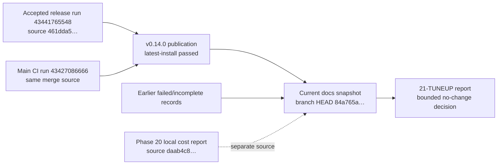

# Phase 21: Measured milestone tune-up — Research

**Researched:** 2026-11-13

**Domain:** Source-qualified release records and proportional CI/quality review

**Confidence:** HIGH

<phase_requirements>
## Phase Requirements

| ID | Description | Research Support |
|----|-------------|------------------|
| TUNE-11 | Maintainers begin the milestone from current release and documentation evidence plus a source-specific quality/efficiency review, and record either one evidence-backed low-risk correction or a bounded no-change disposition without weakening required checks or obscuring prior failures. | Trace the accepted v0.14.0 release and its merge CI to their exact source; inspect the later docs snapshot separately; label Phase 20 local performance/cost and all failed evidence by source; review only the available run and existing quality controls; document why no safe change is warranted. |

DATA_Q7N4P2LX_START
> “- [ ] **TUNE-11**: Maintainers begin the milestone from current release and documentation evidence plus a source-specific quality/efficiency review, and record either one evidence-backed low-risk correction or a bounded no-change disposition without weakening required checks or obscuring prior failures.”
DATA_Q7N4P2LX_END
[VERIFIED: `.planning/REQUIREMENTS.md:14`]
</phase_requirements>

## Summary

Phase 21 is a maintainer evidence and reporting phase. The roadmap goal is to identify the current shipped baseline, then record one small correction or a bounded no-change disposition while preserving the existing checks and previous failures. [VERIFIED: `.planning/ROADMAP.md:43-50`]

**Primary recommendation:** plan one report-only outcome, `21-TUNEUP.md`, that links current release and project records, contains a source ledger and six evidence-linked quality judgments, and records a bounded no-change disposition. Do not change code, workflow topology, timeouts, caches, quality floors, test membership, or remote state. Existing reports already support this decision; a new metrics system or another publication attempt would add work without answering an unresolved acceptance question. [VERIFIED: `.planning/seeds/SEED-007-milestone-tune-up.md:18-39`; `.planning/seeds/SEED-009-proportional-maintenance-review.md:23-50`; `.planning/milestones/v6.0-SHIP.md:13-19`]

The accepted publication and CI baseline is the v0.14.0 release source `461dda5545bcc202fb4b90c1232fb2e9a00b6c28`, with release run `43441765548` and main CI run `43427086666`. The current planning branch is later, but the local Git comparison shows only planning/documentation changes after that source; it does not establish a fresh CI pass on the current branch. [VERIFIED: `.planning/milestones/v6.0-SHIP.md:3,8-11`; local `git log` and `git diff --name-only 461dda5..HEAD`, 2026-11-13]

The detailed Phase 20 local cost report is a separate source. Its final local gates are recorded at `daab4c82c0bb3393b3e93ee2b23ead09236f16ec`; comparison with the accepted release source shows changes across implementation, tests, workflow, and publisher code. Keep those local measurements as qualified historical evidence rather than presenting them as performance measurements of the published source. The later release receipt is the source for accepted publication and current-main CI. [VERIFIED: `.planning/milestones/v6.0-phases/20-complete-ym2151-homebrew-sound/20-COST-EVIDENCE.md:3`; local `git diff --name-status daab4c8..461dda5`, 2026-11-13]

DATA_9V2C8R5M_START
> “Outcome: v6.0 YM2151 homebrew sound shipped as package v0.14.0 on 2026-11-13.”
DATA_9V2C8R5M_END
[VERIFIED: `.planning/milestones/v6.0-SHIP.md:3`]

## Architectural Responsibility Map

| Capability | Primary Tier | Secondary Tier | Rationale |
|------------|-------------|----------------|-----------|
| Release/publication record | Repository documentation | Release workflow receipt | The phase must identify the accepted artifact and the exact source/run that produced it. This is a records task; do not repeat publication. [VERIFIED: `.planning/ROADMAP.md:43-50`; `.planning/milestones/v6.0-SHIP.md:5-11`] |
| CI efficiency review | CI/release workflow | Maintainer evidence report | The run owns queue, critical path, job duration, cancellation, and fault-control evidence; the report records the bounded review. [VERIFIED: `.planning/preparation/ENGINEERING.md:303-319`; `.planning/milestones/v6.0-SHIP.md:13-15`] |
| Current documentation baseline | Repository documentation | Git source comparison | Read current docs at the current checkout, while identifying which CI evidence was actually run on which commit. [VERIFIED: `.planning/ROADMAP.md:11-12,43-50`; `.planning/PRODUCT-ROADMAP.md:18-36`; local Git comparison, 2026-11-13] |

This phase changes no emulator runtime tier: no browser/client, frontend server, API, database, or host feature is in scope. The roadmap keeps all three existing deliverables and forbids new host, UI, and dependency scope. [VERIFIED: `AGENTS.md:44-50,57-66`; `.planning/ROADMAP.md:28-34`]

## Standard Stack

| Existing mechanism | Version / source | Use | Recommendation |
|---|---|---|---|
| Git history and local source comparison | Current checkout; commands recorded below | Distinguish published source, current docs snapshot, and the Phase 20 local report | Use for source identity only; never treat a later docs-only ref as CI acceptance. [VERIFIED: local `git log`, `git status`, and `git diff`, 2026-11-13] |
| Existing ship receipt and phase reports | v6.0 archive | Publication, current-main CI, local feature-cost evidence, prior failures | Cite the owning artifact for every result. Do not normalize different sources into one baseline. [VERIFIED: `.planning/milestones/v6.0-SHIP.md:1-19`; `.planning/milestones/v6.0-phases/20-complete-ym2151-homebrew-sound/20-COST-EVIDENCE.md:1-75`] |
| Existing CI/quality contracts | `quality.json`, CMake/CTest, workflow inventory, `ENGINEERING.md` §§4, 8, 12 | Preserve floors, fault detection, workload limits, and per-run efficiency review | Reuse; do not add metrics, packages, wrappers, or another gate. [VERIFIED: `quality.json:1-83`; `.planning/preparation/ENGINEERING.md:124-145,192-215,303-319`] |

No external package is needed or recommended for a records-only tune-up. The current project documents already direct maintainer and CI policy into existing `docs/` and `.planning/` artifacts. [VERIFIED: `AGENTS.md:64-66`; `.planning/ROADMAP.md:43-50`]

**Environment observed:** CMake 4.4.3 and Python 3.14.4 are installed locally. The phase can use existing local document checks if needed; no `gh` or other hosted query is needed for this task. This probe is not a CI run. [VERIFIED: local `cmake --version` and `python3 --version`, 2026-11-13]

## Package Legitimacy Audit

Not applicable: the phase recommends no external package or install. [VERIFIED: `.planning/ROADMAP.md:43-50`; `.planning/REQUIREMENTS.md:14`]

## Architecture Patterns

### Evidence flow



The diagram separates the accepted release, the later current documentation view, historical failures, and the Phase 20 local measurement source. The current docs view does not supply another CI receipt, and the local cost report is not the release-source measurement. [VERIFIED: `.planning/milestones/v6.0-SHIP.md:3-19`; `.planning/milestones/v6.0-phases/20-complete-ym2151-homebrew-sound/20-COST-EVIDENCE.md:3`; local Git comparisons, 2026-11-13]

### Source-specific evidence ledger

| Evidence role | Source and result | How Phase 21 should use it |
|---|---|---|
| Accepted publication | v0.14.0, published from source `461dda5545bcc202fb4b90c1232fb2e9a00b6c28`; release run `43441765548` passed, including publish verification and `install-line-latest`. [VERIFIED: `.planning/milestones/v6.0-SHIP.md:3,8`] | Treat as the accepted release. Do not reopen publication recovery or repeat receipt checks. |
| Same-source main CI | PR #61 merged at the release source; main CI run `43427086666` passed on that merge commit. [VERIFIED: `.planning/milestones/v6.0-SHIP.md:9-10`] | Treat as the accepted main-CI receipt on the merge source, not a new run on the later planning branch. |
| Current documentation snapshot | Local Git state at research time: branch `milestone/v7.0-souper-mapper`, HEAD `84a765a4477a2590a118431c5e3480d4cb0faea6`; `origin/main` points to `40de59e965864d4327ae77a8ab8b542845db015c`. The comparison from release source to current HEAD lists planning/docs and `AGENTS.md`, with no product, test, workflow, or script paths. [VERIFIED: local `git status`, `git log`, and `git diff --name-only 461dda5..HEAD`, 2026-11-13] | Inspect current docs at HEAD. State explicitly that no CI pass on HEAD or `origin/main` was established by this comparison. |
| Phase 20 local cost and feature gates | Local gates passed on `daab4c82c0bb3393b3e93ee2b23ead09236f16ec`; independent review names product head `5158bb649160f081f6f1253da3be3099b93c8a03`. Direct Git comparison to release source `461dda5` shows differences in implementation, tests, and CI/release files. [VERIFIED: `.planning/milestones/v6.0-phases/20-complete-ym2151-homebrew-sound/20-COST-EVIDENCE.md:3`; local `git diff --name-status daab4c8..461dda5`, 2026-11-13] | Retain the measurements and gate results with their named local source. Do not report them as measurements or checks of the published release source. |
| Earlier failed publication evidence | Release equality was cancelled on source `8d73321953f417dc973a4cb93cfb4b8521772150`, run `43318681115`; the retained lesson says it is not a timing sample or acceptance. A later source-baseline mismatch in run `43367755963` failed quality and kept publication skipped; the lesson says the hosted failure is historical and not retried. [VERIFIED: `.planning/LESSONS.md:812-826,889-903`] | Preserve both as historical failures. Do not retry, recalculate, or substitute either for the accepted v0.14.0 receipt. |

DATA_H6R1W8DM_START
> “Status: required final local gates passed at `daab4c82c0bb3393b3e93ee2b23ead09236f16ec`; independent review is clean at product head `5158bb649160f081f6f1253da3be3099b93c8a03`.”
DATA_H6R1W8DM_END
[VERIFIED: `.planning/milestones/v6.0-phases/20-complete-ym2151-homebrew-sound/20-COST-EVIDENCE.md:3`]

DATA_K3W7H1ZD_START
> “`gh run view 43441765548 --json databaseId,status,conclusion,headSha,url,jobs` — exit 0. The release workflow passed on `461dda5545bcc202fb4b90c1232fb2e9a00b6c28`; publish verification and `install-line-latest` passed. The run had no failed or cancelled jobs.”
DATA_K3W7H1ZD_END
[VERIFIED: `.planning/milestones/v6.0-SHIP.md:8`]

DATA_T8F4J6PA_START
> “`gh run view 43427086666 --json workflowName,conclusion,headSha,url` — exit 0. Main CI passed on that merge commit: [CI run](https://github.com/szTheory/muhtari/actions/runs/43427086666).”
DATA_T8F4J6PA_END
[VERIFIED: `.planning/milestones/v6.0-SHIP.md:10`]

DATA_N5C2Y9FA_START
> “Release equality was cancelled at its 30-minute deadline on exact release SHA `8d73321953f417dc973a4cb93cfb4b8521772150` in [Release run 43318681115, job 131533478415](https://github.com/szTheory/muhtari/actions/runs/43318681115/job/131533478415).”
DATA_N5C2Y9FA_END
[VERIFIED: `.planning/LESSONS.md:814-816`]

DATA_P8D4K1QM_START
> “Evidence: [Release run 43367755963](https://github.com/szTheory/muhtari/actions/runs/43367755963) checked out target `8d73321` but its producers recorded caller parent `6abadfd`, while the quality join expected the target's parent `77d9bec`; the quality gate failed and publication stayed skipped. [...] The hosted failure remains historical evidence; it is not retried.”
DATA_P8D4K1QM_END
[VERIFIED: `.planning/LESSONS.md:897-903`]

DATA_B2N9V5CR_START
> “The first job started four seconds after dispatch. No jobs were cancelled. The longest checks were Windows ARM64 at 39m49s and equality at 30m42s. Merged PR [#59](https://github.com/szTheory/muhtari/pull/59) already removes up to nine minutes of non-gating property tests from PR runs while retaining required coverage. This release provides no safe additional cut to the required release checks.”
DATA_B2N9V5CR_END
[VERIFIED: `.planning/milestones/v6.0-SHIP.md:15`]

### Pattern 1: Keep evidence source-qualified

**What:** Every report row identifies its commit, run or local command and its result. Keep published release, same-source main CI, current planning docs, local product-cost measurements, and historical failures in separate rows.

**When to use:** Always for this phase; Phase 20 local test data and Phase 21 current docs refer to distinct Git sources.

**Example:** Use the release receipt for publication and hosted CI; use `20-COST-EVIDENCE.md` only for the local source it names. Do not infer a pass on the current branch from either record. [VERIFIED: `.planning/milestones/v6.0-SHIP.md:7-10`; `.planning/milestones/v6.0-phases/20-complete-ym2151-homebrew-sound/20-COST-EVIDENCE.md:3`; local Git comparisons, 2026-11-13]

### Pattern 2: Bound the efficiency review to evidence at hand

**What:** Inspect the saved release receipt’s queue/start delay, longest jobs, cancellations, and already-made coverage-preserving efficiency change; compare that evidence with the repository policy.

**When to use:** For the recurring tune-up when a hosted CI/release run is already under review.

**Example:** Record the two long jobs and no cancellations as observations; do not lower their timeouts or change the matrix/cache policy from a single release run. The engineering policy requires 40 successful samples for timeout calculation and comparable runs for workflow changes. [VERIFIED: `.planning/milestones/v6.0-SHIP.md:13-15`; `.planning/preparation/ENGINEERING.md:142,303-309`]

### Recommended deliverable

Produce one `21-TUNEUP.md` report alongside the phase plan. It should contain: publication/current-doc links; the source ledger above; six qualitative, evidence-linked SEED-007 ratings; queue/critical-path/job/cancellation review from the accepted run; a narrow note on unchanged quality controls; a bounded no-change decision; and pointers to preserved historical failures. This mirrors the prior tune-up’s one-report pattern without adding a recurring gate. [VERIFIED: `.planning/milestones/v6.0-phases/19-measured-milestone-tune-up/19-TUNEUP.md:1-3,35-53,105-122`; `.planning/seeds/SEED-007-milestone-tune-up.md:28-39`]

### Anti-patterns to avoid

- **Conflating commits:** Phase 20’s local cost source `daab4c8` is not the accepted release source `461dda5`; source comparison shows intervening source, test, and workflow changes. Keep those results separate. [VERIFIED: `.planning/milestones/v6.0-phases/20-complete-ym2151-homebrew-sound/20-COST-EVIDENCE.md:3`; local `git diff --name-status daab4c8..461dda5`, 2026-11-13]
- **Treating later docs as CI acceptance:** the current docs-only branch has no new hosted CI receipt. Do not describe its local Git ancestry as a pass on that source. [VERIFIED: local `git diff --name-only 461dda5..HEAD`, 2026-11-13]
- **Using a censored failure as a timing sample:** the earlier cancelled equality run is failure history, not successful timing data. [VERIFIED: `.planning/LESSONS.md:812-826`]
- **Cutting long tests or gates from one sample:** the accepted release receipt already says no safe required-check cut; keep test/fault coverage and workload bounds. [VERIFIED: `.planning/milestones/v6.0-SHIP.md:15`; `AGENTS.md:79-84,135-142`]
- **Building a new score or metrics system:** the seed asks for a compact review and disposition; SEED-009 explicitly rejects a new audit program, quota, or dashboard for this need. [VERIFIED: `.planning/seeds/SEED-009-proportional-maintenance-review.md:23-50`]
- **Refreshing live settings or dependency versions:** this research is local-only; a fresh hosted/repository-settings check would cross the task’s explicit scope. Do not imply that local files prove live settings or external version freshness. [VERIFIED: task scope; `AGENTS.md:21,31,67-78`]

## Don't Hand-Roll

| Problem | Don't Build | Use Instead | Why |
|---------|-------------|-------------|-----|
| CI performance history | A new dashboard, collector, or audit program | Saved source-specific ship receipt and the repository’s existing CI policy | A single accepted run supports a per-run observation, not a trend or workflow redesign. [VERIFIED: `.planning/milestones/v6.0-SHIP.md:13-15`; `.planning/preparation/ENGINEERING.md:303-319`] |
| Quality floors and fault controls | Replacement counters or a second quality registry | `quality.json`, existing CMake evidence producer, and named policy controls | Current required floor/ceiling contract and producer are already explicit. [VERIFIED: `quality.json:1-83`; `tests/cmake/quality_evidence.cmake:65-79,118-141`] |
| Source identification | Synthetic merged evidence | Exact source/run/local command references in existing receipts | Different accepted outcomes and failures must remain attributable to their source. [VERIFIED: `.planning/milestones/v6.0-SHIP.md:7-10`; `.planning/LESSONS.md:812-826,889-903`] |

**Key insight:** the improvement this phase needs is a compact, source-correct account of existing evidence. The release receipt already concludes that the observed release run supports no safe additional cut to required release checks; no additional mechanism is needed to reach that disposition. [VERIFIED: `.planning/milestones/v6.0-SHIP.md:13-19`; `.planning/seeds/SEED-009-proportional-maintenance-review.md:47-52`]

## Common Pitfalls

### Pitfall 1: Treating the Phase 20 report as the published-source baseline

**What goes wrong:** Release-source acceptance and earlier local performance values are combined as if they came from one source.

**Why it happens:** Both records close v6.0 but identify different commit snapshots.

**How to avoid:** Cite `461dda…` / run `43441765548` for publication, `461dda…` / run `43427086666` for same-source main CI, and `daab4…` only for Phase 20 local gates/cost. Git comparison confirms the local cost and release commits are not interchangeable. [VERIFIED: `.planning/milestones/v6.0-SHIP.md:8-10`; `.planning/milestones/v6.0-phases/20-complete-ym2151-homebrew-sound/20-COST-EVIDENCE.md:3`; local Git compare, 2026-11-13]
**Warning signs:** A table row names a release, current-main, or performance result but lacks the source identity it came from.

### Pitfall 2: Recalibrating from long jobs or failed runs

**What goes wrong:** A single long duration triggers a timeout, caching, matrix, or cancellation change, or a timed-out run gets treated as a completed sample.

**Why it happens:** Run wall time, job duration, queue delay, and runner-minute totals answer different questions; a cancellation is not a timing sample.

**How to avoid:** Preserve the existing 40-success timeout method, record only the receipt’s observations, and make a no-change disposition unless comparable evidence supports a specific correction. [VERIFIED: `.planning/preparation/ENGINEERING.md:142,303-309`; `.planning/LESSONS.md:814-826`]

### Pitfall 3: Weakening the quality gate to improve a number

**What goes wrong:** Required cases, test floors, or fault detectors are cut to make CI shorter.

**Why it happens:** Test counts can be mistaken for redundant coverage without checking named fault controls.

**How to avoid:** Keep existing `quality.json` floors and zero-finding ceilings and retain their producers and representative failure controls unless a measured correction proves equal or stronger coverage. [VERIFIED: `quality.json:3-49,51-81`; `AGENTS.md:79-84`]

DATA_C7M3Q8YK_START
> ```json
> "tests.native": {
>       "floor": 605,
>       "units": "count",
>       "direction": "floor",
>       "producer": "tests/cmake/quality_evidence.cmake",
>       "configuration": "native",
>       "availability": "required"
> },
> "abi_tests": {
>       "floor": 12,
>       "units": "count",
>       "direction": "floor",
>       "producer": "tests/cmake/quality_evidence.cmake",
>       "configuration": "native",
>       "availability": "required"
> },
> ```
DATA_C7M3Q8YK_END
[VERIFIED: `quality.json:3-17`]

DATA_G4P9T2LX_START
> ```json
> "abi_findings": {
>   "ceiling": 0,
>   "units": "findings",
>   "direction": "ceiling",
>   "producer": "tests/cmake/quality_evidence.cmake",
>   "configuration": "native",
>   "availability": "required"
> },
> "warnings": {
>   "ceiling": 0,
> ```
DATA_G4P9T2LX_END
[VERIFIED: `quality.json:35-49`]

## Code Examples

No product code or new check is recommended. If plan execution finds a concrete changed behavior or required-check defect, use the existing CMake/CTest mechanisms and the project’s full workflow command; a newly changed check must exercise both representative pass and fault behavior. [VERIFIED: `AGENTS.md:64-84`; `.planning/config.json:69`]

For this report-only path, record a command, exit status, and run URL only when a check is actually run; do not add raw logs to the repository. No project build or test suite was run during this research pass. [VERIFIED: `AGENTS.md:67-78,143`]

## State of the Art

No external technology, package, CI service, or runtime pattern is being adopted. Reuse the existing repository receipts, quality producer, workflow policy, and concise tune-up report. [VERIFIED: `.planning/ROADMAP.md:43-50`; `AGENTS.md:79-84`]

## Project Constraints (from AGENTS.md)

- Keep Muhtari Atari 7800-only and maintain its three deliverables; this reporting phase adds no UI, device code, or 2600 emulation. [VERIFIED: `AGENTS.md:44-57`]
- Do not open or copy GPL, LGPL, or unlicensed emulator source. Any code reuse must be permissively licensed with its notice; this phase needs no outside code or package. [VERIFIED: `AGENTS.md:54-56,161-167`]
- Keep the tree free of ROM, BIOS, and save bytes except manifest fixtures, and omit personal paths/names. Commits must use the GitHub noreply identity and the hygiene hooks. [VERIFIED: `AGENTS.md:58-60`]
- Preserve deterministic, bounded, integer-only, instance-owned core behavior. Any behavior change requires a test run by `cmake --workflow --preset ci`; keep the README short and put maintainer/testing details in `docs/`. [VERIFIED: `AGENTS.md:61-66`]
- Use automation-first, local/offline checks; do not ask for blanket owner UAT. Host, remote, identity-bound, publication, and merge actions stay separate and are outside this phase. [VERIFIED: `AGENTS.md:67-78`; `.planning/STATE.md:52-56`]
- Reuse CMake `-P` or POSIX shell checks. A new or materially changed check must identify a concrete fault and exercise pass/fault behavior; preserve existing contracts and fault coverage. Keep within two code-review fix rounds and one gap round. Optional improvements become seeds. [VERIFIED: `AGENTS.md:79-86`]
- Respect GSD step and authority boundaries: do not run the prohibited progress/manager/profile commands or any GSD command containing `--auto`/`--chain`; do not set hygiene bypasses. Resolve GSD tooling through the repository resolver and preserve source-specific stops. [VERIFIED: `AGENTS.md:87-124`]
- Stay off `main` for commits; this checkout is already on the v7 milestone branch. A later ship boundary owns PR/merge and post-merge confirmation. Any CI/release run under review gets a queue, critical-path, duration, runner-use, and cancellation review that preserves test/fault coverage. [VERIFIED: `AGENTS.md:135-142`; local `git status`, 2026-11-13]
- Record evidence as a command, exit status, and URL, never a committed log. Read relevant lessons before phase planning and only promote a reproduced lesson. [VERIFIED: `AGENTS.md:143-146`]
- Keep plan summaries’ requirement completion and coverage in the required block structure; code uses small modules, fixed-width types, module-prefixed public names, cited hardware comments, and no planning IDs in code/tests/user docs. This phase creates no code. [VERIFIED: `AGENTS.md:152-167`]

## Assumptions Log

| # | Claim | Section | Risk if Wrong |
|---|-------|---------|---------------|
| A1 | Performance/efficiency is the likely weakest quality-dimension confidence for the tune-up because the local product-cost report is not the accepted release source and the hosted receipt is a single run. This is a review hypothesis, not a measured product regression. | Architecture Patterns | The phase could mis-rank the six qualitative dimensions; have the report score all six against the exact sources without converting the scores into gates. |

## Open Questions

No owner decision is needed to plan the local report-only path. The one unresolved analytical limit is that the accepted release receipt supplies a single source-specific hosted sample; it cannot justify a structural timeout/cache/matrix change under the existing policy. Record that limit and select no change. [VERIFIED: `.planning/milestones/v6.0-SHIP.md:13-15`; `.planning/preparation/ENGINEERING.md:142,303-309`]

## Environment Availability

| Dependency | Required By | Available | Version | Fallback |
|------------|------------|-----------|---------|----------|
| CMake | Optional local verification if the report exposes a concrete project check | ✓ | 4.4.3 | Do not run a product workflow for a documentation-only report. |
| Python 3 | Existing local helper, only if selected by the plan | ✓ | 3.14.4 | Use existing shell/CMake checks where they already apply. |

No remote service or host is required by the recommended plan. [VERIFIED: local version probes, 2026-11-13; task scope]

## Sources

### Primary — project records and policy

- `.planning/ROADMAP.md:43-50` — Phase 21 goal, dependency, requirement, and acceptance criteria.
- `.planning/REQUIREMENTS.md:14` — TUNE-11 wording.
- `.planning/STATE.md:20-56` — current milestone, v6.0 close, preserved boundaries.
- `.planning/PRODUCT-ROADMAP.md:18-36` — current release summary and limits.
- `.planning/milestones/v6.0-SHIP.md:1-19` — accepted v0.14.0 publication, exact source, release/main CI, efficiency review, closed scopes.
- `.planning/milestones/v6.0-MILESTONE-AUDIT.md:52-64` — local verification source, retained failures, qualified limits.
- `.planning/milestones/v6.0-phases/20-complete-ym2151-homebrew-sound/20-COST-EVIDENCE.md:1-75` — local source-bound performance, cost, gates, and incomplete/unavailable evidence.
- `.planning/milestones/v6.0-phases/19-measured-milestone-tune-up/19-TUNEUP.md:1-130` — prior report shape, source-specific receipt pattern, no-change precedent.
- `.planning/LESSONS.md:812-926` — cancelled release attempt and historical recovery failures; do not retry.
- `.planning/seeds/SEED-007-milestone-tune-up.md:14-45` and `.planning/seeds/SEED-009-proportional-maintenance-review.md:14-52` — recurring tune-up and proportional-review rules.
- `.planning/preparation/README.md:18-39,69-84` — preparation index and research/source conventions.
- `.planning/preparation/ENGINEERING.md:124-145,192-215,303-319` — CI, performance ratchet, and recurring efficiency review.
- `quality.json:1-83` and `tests/cmake/quality_evidence.cmake:65-79,118-141` — existing quality contract and producer.
- `AGENTS.md:44-167` — project scope, constraints, verification, evidence, GSD, branch, summary, and style rules.
- `.planning/config.json:11,36,60,69` — documentation commit setting; Nyquist and security workflow flags; configured local test command.

### Local Git verification

- `git status --short --branch` — clean branch `milestone/v7.0-souper-mapper` at research time.
- `git log --oneline --decorate --graph -12` — current `HEAD` and local `origin/main` identities.
- `git diff --name-only 461dda5..HEAD` — current documentation/planning changes after the release source; no product/test/workflow/script path changed.
- `git diff --name-status daab4c8..461dda5` — source differences that prevent treating the Phase 20 local cost report as release-source measurements.
- No web search, remote GitHub query, host action, CI dispatch, publication, or implementation command was used.

## Metadata

**Confidence breakdown:**
- Standard stack: HIGH — existing local sources and tools were directly inspected; no package is proposed.
- Source lineage: HIGH — ship and local reports were read and compared with local Git objects.
- Efficiency recommendation: HIGH — the accepted run receipt and current project rule explicitly support a bounded no-change decision for this one-run evidence.
- Six-dimension ratings: MEDIUM — these are qualitative judgments, not policy metrics. Phase 21 should score all six dimensions required by SEED-007, link each score to the evidence it actually has, and state where current-source or external freshness evidence is unavailable.

**Research date:** 2026-11-13
**Valid until:** 2026-12-13, or until a new release/CI source changes the baseline.
