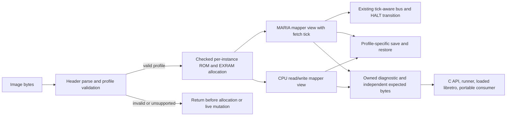

# Phase 22: Complete Souper homebrew mapper - Research

**Researched:** 2026-11-13  
**Domain:** C cartridge mapping, Atari 7800 CPU/MARIA bus integration, state compatibility, portable diagnostics  
**Confidence:** MEDIUM

<user_constraints>
## User Constraints (from CONTEXT.md)

### Locked Decisions

#### Supported profile and refusals
- **D-01:** Accept the existing public Souper identity through A78 v3 cart-type bit 12 or a valid A78 v4 mapper value 4, preserving DEC.38's v4 precedence. The mapped ROM body is exactly 512 KiB; the mapper owns a separate 32 KiB volatile EXRAM span. Refuse wrong geometry, malformed declarations, unsupported options, and payloads whose layout is not covered by the selected profile before allocation or mutation.
- **D-02:** Keep Souper mapper-only. `$8007` writes do not synthesize, queue, or expose BupChip audio. This phase adds no Souper-specific YM2151, Covox, ADPCM, BupChip/BupBoop, Rikki & Vikki, or extra music-payload support, and makes no unqualified audio claims. Preserve existing POKEY declaration handling without adding new Souper-specific POKEY wiring or quality claims.
- **D-03:** Implement the public mapping description in Muhtari's own C code. Keep the low-three-bit register aliases and the independent EXRAM-segmentation, character-remap, and MARIA-fetch-trap controls. Keep CPU and MARIA views separate and route MARIA reads through the existing tick-aware HALT path. Treat undefined register `$8006` as unsupported/no effect; do not infer BupChip behavior from `$8007`.

#### Reset and resource policy
- **D-04:** Reset mapper latches to zero. The resulting initial map is flat EXRAM at `$4000–$7FFF`, ROM bank 0 at `$8000–$BFFF`, and the last ROM bank at `$C000–$FFFF`. Zero-fill all 32 KiB of EXRAM at load and power cycle. This is a deterministic emulator policy because physical EXRAM power-on contents are not established. A console Reset input remains distinct from power cycling the cartridge.
- **D-05:** Keep ROM and EXRAM instance-owned in the existing checked cartridge allocation path. Include all mapper latches and every EXRAM byte in snapshot size, validation, and application. Keep all invalid snapshot checks before mutation and do not allocate after load.

#### Compatibility and consumers
- **D-06:** Apply the established additive state policy. Souper snapshots use state format 3 / behavior revision 8; `muhtari_get_versions` reports latest supported format 3 / behavior 8. Preserve existing non-YM snapshots at format 1 / behavior 6 and YM snapshots at format 2 / behavior 7, including their existing bytes and identities. Do not add general cross-build migration. Keep API 8 and ABI 1; the Souper public board value and load/probe APIs already exist.
- **D-07:** Exercise the owned diagnostic through the public C API, runner, loaded libretro module, and existing portable test consumer. Keep the existing libretro memory-map contract: publish stable CPU windows and leave dynamic/banked windows without a descriptor. This phase makes no new RetroAchievements memory-map claim for segmented Souper pages and does not require an actual RetroArch session.
- **D-08:** Author literal expected mapping bytes independently from production mapping code. Check malformed/unsupported controls and retain existing non-Souper observations. Cross-route hash agreement is integration evidence, not the independent mapper oracle.
- **D-09:** Keep all three deliverables and document the exact profile, reset/EXRAM policy, unsupported audio/payload forms, and confidence limits. Use existing code and checks; no new dependency is justified.

### the agent's Discretion
- Choose the smallest integration that follows the decisions above and current module patterns.
- Select generated diagnostic patterns and boundary cases that distinguish every supported mapping state with independent expected values.
- Use the existing source references as a software-model contract; do not present them as physical validation.

### Deferred Ideas (OUT OF SCOPE)

#### Reviewed Todos (not folded)
- `Close the re-review's findings on the Dependabot gate and the publish checks` — historical CI/publishing work; outside this mapper phase.
- `Promote the wasm32 lane into CI required` — historical CI policy work; portable mapper acceptance uses the existing consumer path.
- `Close the phase 2 re-review findings when MARIA and the run-loop land` — its remaining items are old test/documentation seeds; Phase 22's MARIA checks are defined by its own requirements.
- `Close the phase 2 review seeds on the nightly filter and the ROM tables` — historical nightly/cart database maintenance; outside this mapper phase.
- `Keep the phase 11 first review's info findings whose ids the gap-round review reused` — compatibility-documentation review findings; outside this mapper phase.

No additional deferred ideas were raised.
</user_constraints>

<phase_requirements>
## Phase Requirements

| ID | Description | Research Support |
|----|-------------|------------------|
| SOUPER-01 | A host can load a Souper-declared image only when its header, mapper declaration, and ROM/EXRAM geometry match the explicitly documented supported profile; malformed, oversized, and unsupported Souper variants are refused before allocation or live-machine mutation. | Extend the existing A78 resolve/refuse/fit path and preserve probe-before-install ordering; existing source establishes the transactional seam [VERIFIED: `src/cart.c:480-492`, `src/cart.c:557-633`, `src/cart.c:818-829`]. |
| SOUPER-02 | CPU reads and writes observe the documented banked ROM and EXRAM windows, register decode, aliases, and independent mapping controls, including flat and segmented EXRAM behavior, with boundary and transition cases covered by independent expected bytes. | Add the board behavior to the existing cartridge read/write dispatch and make EXRAM segment selection explicit; use literal expected values authored separately from that implementation [VERIFIED: `src/cart.c:1048-1125`, `src/cart.c:1180-1305`; `tests/diag/tests.cmake:198-267`]. |
| SOUPER-03 | MARIA fetches observe the documented mapper-specific ROM/EXRAM and character-remap views independently from CPU reads, including the fetch-trap transition through the existing tick-aware bus/HALT path. | Preserve caller identity in cartridge read views and the actual fetch tick in the MARIA-selected path [VERIFIED: `src/cart.c:1048-1055`, `src/cart.c:1133-1177`]. |
| SOUPER-04 | Reset, unload/reload, and separate instances deterministically initialize and own all Souper registers and EXRAM; save/restore preserves mapper state and subsequent CPU/MARIA observations, while invalid snapshots are rejected transactionally under a state-format/version policy decided before implementation. | Reuse the instance-owned cartridge allocation and reset lifecycle, then extend the ordered state visitor and validate before apply; preserve existing identity/version branches for other profiles [VERIFIED: `src/internal.h:288-309`, `src/cart.c:832-890`, `src/state.c:1488-1509`, `src/state.c:1512-1546`]. |
| SOUPER-05 | A generated patterned diagnostic checks CPU and MARIA mapping against literal expected values authored separately from production mapping logic, and includes malformed-profile and non-Souper regression controls without relying on copyrighted game images. | The owned diagnostic system already combines generated images, numeric expected values, fault controls and independent host observations [VERIFIED: `tests/diag/tests.cmake:198-337`, `tests/diag/tests.cmake:855-894`]. |
| SOUPER-06 | The same supported mapper diagnostic runs through the existing public C library, headless runner, loaded libretro core, and applicable portable consumer; existing non-Souper observations remain unchanged, and no BupChip audio is claimed or emitted. | Follow the existing diagnostic route through the driver, runner and loaded module and preserve the stable-only libretro memory descriptor policy [VERIFIED: `tests/diag/tests.cmake:198-267`, `docs/libretro.md`; locked decision D-07]. |
| SOUPER-07 | Integrators can identify the exact supported Souper software profile, reset/EXRAM model policy, unsupported image and audio forms, and evidence limits in existing documentation. | Update the cartridge-support section that currently lists Souper as unsupported; document the selected software model and explicit accuracy/audio limits [VERIFIED: `docs/hardware/cartridge.md:229-235`] [CITED: `22-CONTEXT.md`, D-09]. |
</phase_requirements>

## Summary

The phase is a focused extension of the existing C cartridge subsystem. It should add Souper declaration acceptance and strict geometry/option refusal in `src/cart.c`, implement the CPU and MARIA views using the existing board switch and tick-aware cartridge paths, store mapper state and EXRAM in the cartridge instance allocation, and add a Souper-specific state envelope without changing the bytes and identities used by current non-Souper or YM profiles [VERIFIED: `src/cart.c:480-492`, `src/cart.c:557-633`, `src/cart.c:832-890`, `src/cart.c:1048-1177`, `src/state.c:1488-1546`] [CITED: `22-CONTEXT.md`, D-03–D-07].

The public references support a software model for one mapper-only homebrew profile. The community code example describes the register-driven ROM/EXRAM mapping and MARIA modes; its author's separate HALT discussion explicitly limits certainty about the physical bus behavior. Plan implementation and tests against that scoped software model, and describe the result as model conformance rather than hardware or retail-game accuracy [CITED: https://forums.atariage.com/topic/353011-homebrew-code-examples/#findComment-5292592; https://forums.atariage.com/topic/331505-sally-and-marias-memory-dance/] [VERIFIED: `.planning/research/next-milestone/v7-SOUPER.md:94-123`].

**Primary recommendation:** Integrate in the existing cartridge probe/install, read/write, lifecycle, state visitor, diagnostic and documentation paths. Use a generated patterned diagnostic with independent literal expected bytes as the mapping oracle; use C API, runner, loaded libretro and portable-consumer agreement as route integration evidence only [VERIFIED: `src/cart.c:818-890`, `src/cart.c:1048-1177`, `src/state.c:1488-1546`, `tests/diag/tests.cmake:198-267`] [CITED: `22-CONTEXT.md`, D-08–D-09].

## Architectural Responsibility Map

| Capability | Primary Tier | Secondary Tier | Rationale |
|------------|-------------|----------------|-----------|
| Header declaration, geometry acceptance and refusal | API / Backend | — | The C library owns probe decisions, refuses unsupported boards, and validates before install [VERIFIED: `src/cart.c:480-492`, `src/cart.c:623-633`, `src/cart.c:818-829`]. |
| CPU and MARIA mapper reads/writes | API / Backend | — | Cartridge dispatch receives CPU/MARIA identity, while DMA carries the fetch tick into the bus-selected view [VERIFIED: `src/cart.c:1048-1177`, `src/internal.h:720-732`]. |
| Mapper latch and EXRAM lifecycle | API / Backend | — | The per-instance cartridge owns its allocation, mutable latches, and RAM; reset/load/power-cycle transitions are core responsibilities [VERIFIED: `src/internal.h:288-309`, `src/cart.c:832-925`]. |
| Snapshot compatibility | API / Backend | — | `src/state.c` defines deterministic serialization, identity, validation and apply order [VERIFIED: `src/state.c:11-19`, `src/state.c:1488-1546`]. |
| Diagnostic execution across library, runner, module and portable consumer | API / Backend | Browser / Client — | Existing test consumers invoke the built core and loaded module through repository diagnostics; no interactive host UI is in scope [VERIFIED: `tests/diag/tests.cmake:198-267`, `tests/diag/tests.cmake:855-894`] [CITED: `22-CONTEXT.md`, D-07]. |
| Support and evidence documentation | API / Backend | — | The cartridge guide owns board support and refusal statements; the libretro guide owns memory-map behavior [VERIFIED: `docs/hardware/cartridge.md:229-235`, `docs/libretro.md`]. |

## Standard Stack

### Core

| Library / tool | Version | Purpose | Why Standard |
|----------------|---------|---------|--------------|
| Muhtari C core | Existing project code; C17 | Cartridge mapping, instance lifecycle, state serialization and all three deliverables | The project sets its C standard with the exact line `set(CMAKE_C_STANDARD 17)`; module behavior is already implemented in `src/cart.c`, `src/instance.c` and `src/state.c` [VERIFIED: `CMakeLists.txt:16-17`, `src/cart.c`, `src/instance.c`, `src/state.c`]. |
| CMake / CTest | Existing project build | Build and run repository checks and generated diagnostics | Existing diagnostic registrations use project CMake test helpers and labels, including the mapper-family tracing pattern [VERIFIED: `tests/diag/tests.cmake:855-894`]. |
| Owned patterned assembly diagnostic | Existing repository mechanism | Stimulate mapper state changes and expose CPU/MARIA reads to the independent checker | The repo builds diagnostics from owned source and compares generated output with its manifest; the test path has literal expected-value and real-host comparisons [VERIFIED: `tests/diag/assemble.cmake:1-17`, `tests/diag/assemble.cmake:79-90`, `tests/diag/tests.cmake:198-267`]. |

### Supporting

| Tool | Version | Purpose | When to Use |
|------|---------|---------|-------------|
| Pinned Wasmtime and 7800basic WASM tools | Existing repo pins | Rebuild committed diagnostic fixtures from source | Use the existing generated-fixture flow; do not add a new package or install an alternative toolchain [VERIFIED: `tests/built/tests.cmake:7-15`, `tests/diag/assemble.cmake:58-84`] [CITED: `22-CONTEXT.md`, D-09]. |
| `muhtari-run` and loaded libretro test module | Current build outputs | Exercise the same diagnostic through existing consumers | The existing diagnostic runner invokes the built runner and module through generated CMake scripts [VERIFIED: `tests/diag/tests.cmake:238-267`, `tests/diag/tests.cmake:855-894`]. |

### Alternatives Considered

| Instead of | Could Use | Tradeoff |
|------------|-----------|----------|
| Existing in-repo cartridge switch and test harness | New mapper framework or dependency | The project already uses switch dispatch, one instance-owned cartridge allocation, and generated diagnostics; a framework would add surface without solving a missing capability [VERIFIED: `src/cart.c:1042-1048`, `src/internal.h:288-309`, `tests/diag/tests.cmake:198-267`] [CITED: `22-CONTEXT.md`, D-09]. |
| Independently authored expected mapping bytes | Hash equality alone or another emulator's output | Cross-route equality detects integration differences but does not independently judge whether the selected mapping is correct [CITED: `22-CONTEXT.md`, D-08] [VERIFIED: `tests/diag/tests.cmake:258-269`]. |

**Installation:** None. This phase selects no external packages or new dependencies [CITED: `22-CONTEXT.md`, D-09].

## Architecture Patterns

### System Architecture Diagram



The probe-before-install split, per-instance allocation, independent CPU/MARIA read views, tick-aware DMA route, and validate-before-apply state flow already exist as reusable seams [VERIFIED: `src/cart.c:818-890`, `src/cart.c:1048-1177`, `src/state.c:1512-1546`]. The diagram adds only the locked Souper behavior to those seams [CITED: `22-CONTEXT.md`, D-03–D-08].

### Recommended Project Structure

No new subsystem directory is indicated. Keep implementation in the current module ownership: `src/cart.c` for identification, mapping and reset; `src/internal.h` and `src/instance.c` for instance data, lifecycle and reported versions; `src/state.c` for profile state; existing `tests/cart`, `tests/bus`, `tests/core`, `tests/state`, `tests/diag`, `tests/runner` and `tests/libretro` for focused checks; and `docs/hardware/cartridge.md` plus `docs/libretro.md` for support contracts [VERIFIED: `22-CONTEXT.md`, Code Context; `src/cart.c`; `src/internal.h`; `src/instance.c`; `src/state.c`; `tests/diag/tests.cmake`; `docs/hardware/cartridge.md`; `docs/libretro.md`].

### Pattern 1: Validate, then install transactionally

**What:** Keep classification and geometry checks in cartridge identification. The loader calls identify first and calls install only after a successful result; install allocates and copies the new cartridge before replacing the old allocation [VERIFIED: `src/cart.c:818-890`].

**When to use:** Apply to supported-profile admission and malformed/unsupported profile refusal. Header selection must retain the repository's valid-v4-over-v3 rule [VERIFIED: `src/cart.c:557-573`].

**Example:** The current source defines Souper's v3 bit as `#define CT_SOUPER 0x1000u`; the public enum includes the exact value `MUHTARI_BOARD_SOUPER = 7`; and the v4 board table includes that public board [VERIFIED: `src/cart.c:53`, `src/cart.c:223-229`, `src/cart.c:557-573`, `include/muhtari.h:95-103`]. The v4 block replaces the v3 result only when the block decodes and is accepted by the existing fit/refusal gate [VERIFIED: `src/cart.c:557-573`]. Preserve these exact existing definitions when extending the fit and refusal checks.

### Pattern 2: Preserve reader identity and actual DMA tick

**What:** The existing shared peek accepts a MARIA selector; DMA passes a tick through the bus-selected path, while `muhtari__cart_read_at` keeps observation reads free of register-write side effects [VERIFIED: `src/cart.c:1048-1055`, `src/cart.c:1133-1177`].

**When to use:** Use the separate CPU/MARIA mapper view for all independent page/remap/trap controls; keep MARIA trap effects on the current tick-aware bus/HALT route, not a global DMA flag [VERIFIED: `src/cart.c:1133-1177`] [CITED: `.planning/preparation/A7800-CARTRIDGES-AND-PERIPHERALS.md:123`, `22-CONTEXT.md`, D-03].

### Pattern 3: Profile-specific state extension

**What:** Extend the ordered state visitor with topology checks, all latches and the complete EXRAM span. Determine the state profile by loaded cartridge topology, preserve the prior serializer branches byte-for-byte, validate the entire candidate before applying it, and avoid allocation during restore [VERIFIED: `src/state.c:11-19`, `src/state.c:900-920`, `src/state.c:1300-1345`, `src/state.c:1488-1546`] [CITED: `22-CONTEXT.md`, D-05–D-06].

**When to use:** Only for the new Souper profile. Existing source defines the currently shipped state constants exactly as follows:

> `#define STATE_LEGACY_FORMAT 1u`  
> `#define STATE_LEGACY_BEHAVIOUR_REVISION 6u`  
> `#define STATE_YM_FORMAT 2u`  
> `#define STATE_YM_BEHAVIOUR_REVISION 7u`

[VERIFIED: `src/state.c:15-18`]. The new profile values are locked by D-06 and should not replace these existing constants or identities [CITED: `22-CONTEXT.md`, D-06].

### Pattern 4: Independent diagnostic oracle plus route checks

**What:** Generate patterned images, compare CPU/MARIA observations with literal expected bytes maintained apart from production mapping code, and then compare public C, runner, loaded module and portable-consumer observations as integration checks [CITED: `22-CONTEXT.md`, D-07–D-08]. Existing diagnostics generate fixture images and check independent numeric judgments before comparing actual host outputs [VERIFIED: `tests/diag/tests.cmake:198-267`].

**When to use:** Use a smallest traceable test first, then add diagnostic cases that distinguish each supported mapping state and boundary. Keep malformed geometry and a current non-Souper control so profile changes cannot silently alter unrelated cart behavior [VERIFIED: `tests/diag/tests.cmake:271-337`] [CITED: `22-CONTEXT.md`, D-08].

### Anti-Patterns to Avoid

- **Don't implement audio from mapper command writes:** the `$8007` command is outside this mapper-only acceptance scope; do not synthesize or expose BupChip behavior [CITED: `22-CONTEXT.md`, D-02–D-03].
- **Don't merge CPU and MARIA into one address calculation:** the caller identity and selected tick are part of the existing seam [VERIFIED: `src/cart.c:1048-1055`, `src/cart.c:1133-1177`].
- **Don't use cross-route hash agreement as the mapper oracle:** it can establish route agreement only; independent literal values decide mapping correctness [CITED: `22-CONTEXT.md`, D-08].
- **Don't perform state mutation during validation or add a restore allocation:** current load validates the state visitor before application [VERIFIED: `src/state.c:1542-1546`].
- **Don't infer silicon accuracy from agreement with a public software model:** the author's uncertainty and the phase boundary expressly limit the claim [CITED: https://forums.atariage.com/topic/331505-sally-and-marias-memory-dance/; `22-CONTEXT.md`, Phase Boundary].

## Don't Hand-Roll

| Problem | Don't Build | Use Instead | Why |
|---------|-------------|-------------|-----|
| Mapper dispatch and instance state | New operations table, global mapper state or generic cartridge framework | Existing board `switch` and instance-owned `muhtari__cart` allocation [VERIFIED: `src/cart.c:1042-1048`, `src/internal.h:288-309`] | This follows the project's established module model and keeps mutable state per instance. |
| Host integration | New host, UI, API or descriptor scheme | Existing C API, runner, loaded libretro module and portable consumer [CITED: `22-CONTEXT.md`, D-07] | These routes are the acceptance surface already selected for the phase. |
| Diagnostic expected values | Mapper-derived expected bytes or game ROM fixtures | Owned patterned diagnostic source plus separately authored literal expected bytes [CITED: `22-CONTEXT.md`, D-08] [VERIFIED: `tests/diag/tests.cmake:198-267`]. | This preserves an independent mapper judgment without copyrighted game material. |
| State migration | General cross-build converter | Additive profile-specific envelope and existing validation/apply visitor [CITED: `22-CONTEXT.md`, D-06] [VERIFIED: `src/state.c:1512-1546`]. | Broader migration is out of scope and adds compatibility behavior not needed by this profile. |
| Emulator reference implementation | Copy code from another emulator | Muhtari-owned C implementation using cited software-model facts only [CITED: `AGENTS.md`, Rule 1; `.planning/preparation/A7800-CARTRIDGES-AND-PERIPHERALS.md:300,316`]. | The project's source policy forbids GPL/LGPL/unlicensed source, and the public code example is evidence for behavior, not a code seed. |

**Key insight:** The difficult integration is coordinating two address readers, the MARIA tick/HALT transition, and state compatibility. The repository already has seams for each; extra dependencies or a separate framework do not reduce those risks [VERIFIED: `src/cart.c:1048-1177`, `src/state.c:1488-1546`] [CITED: `22-CONTEXT.md`, D-09].

## Common Pitfalls

### Pitfall 1: Refusing too late

**What goes wrong:** A malformed declaration or unsupported profile may allocate memory or replace the running cartridge before refusal [ASSUMED: failure mode based on the required transactional contract].

**Why it happens:** New board checks may be added only to runtime dispatch instead of the identify/fit/refusal path [ASSUMED].

**How to avoid:** Keep all profile/declaration/geometry checks in probe and ensure `cart_load` continues to identify before install; preserve the outer `muhtari_load` validation-before-apply sequence [VERIFIED: `src/cart.c:623-633`, `src/cart.c:818-829`, `src/instance.c:336-365`]. Add allocation-count and old-instance-preservation fault controls to the existing lifecycle checks [CITED: `22-CONTEXT.md`, SOUPER-01].

**Warning signs:** A negative case reaches the allocator or changes existing cartridge observations [ASSUMED: acceptance diagnostic derived from SOUPER-01].

### Pitfall 2: CPU/MARIA view drift or lost HALT timing

**What goes wrong:** CPU reads look correct while MARIA fetches use the CPU page, character mapping is not applied, or trap changes happen outside the correct bus tick [ASSUMED: failure modes implied by the separate mapping requirement].

**Why it happens:** The mapper can be added to one peek path without preserving the MARIA selector or actual fetch tick [VERIFIED: `src/cart.c:1048-1055`, `src/cart.c:1133-1177`].

**How to avoid:** Give CPU and MARIA independent expected observations and force a fetch-trap transition that exercises the existing tick-aware HALT path [CITED: `22-CONTEXT.md`, D-03] [VERIFIED: `src/cart.c:1133-1177`].

**Warning signs:** Test output agrees for CPU and MARIA in every state even where the selected map says they differ, or trap tests inspect only a final frame/hash [ASSUMED: diagnostic design implication].

### Pitfall 3: Breaking current state bytes

**What goes wrong:** Existing non-YM or YM snapshots change size, bytes, identity, or restore acceptance while adding the Souper profile [CITED: `22-CONTEXT.md`, D-06].

**Why it happens:** State version selection is generalized globally instead of profile-specific [ASSUMED].

**How to avoid:** Add a distinct Souper profile branch, quote/golden existing state bytes before edits, and keep the current validation-before-apply visitor [VERIFIED: `src/state.c:1488-1546`] [CITED: `22-CONTEXT.md`, D-05–D-06].

**Warning signs:** Any current non-Souper state fixture changes without a separately authorized compatibility decision [CITED: `22-CONTEXT.md`, D-06].

### Pitfall 4: Confusing console Reset with power cycle

**What goes wrong:** EXRAM is cleared on a console Reset even though the chosen model only mandates zero-fill at load and power cycle [CITED: `22-CONTEXT.md`, D-04].

**Why it happens:** New latch reset code is inserted into a lifecycle function used by both events without separating the policies [ASSUMED].

**How to avoid:** Trace reset, unload/reload and power-cycle calls separately before implementation; test that latch and EXRAM behavior matches the locked lifecycle policy [CITED: `22-CONTEXT.md`, D-04–D-05].

**Warning signs:** One lifecycle test covers only initial load, or the console Reset path's RAM effect is undocumented [ASSUMED].

### Pitfall 5: Portable generated tests omit their emulator

**What goes wrong:** A generated CMake test script tries to execute a cross-compiled binary directly and fails with an exec-format error [CITED: `.planning/LESSONS.md`, MU-TEST-013].

**Why it happens:** The test script does not carry `CMAKE_CROSSCOMPILING_EMULATOR` into its generated child invocation [CITED: `.planning/LESSONS.md`, MU-TEST-013].

**How to avoid:** Follow the existing generated diagnostic pattern that passes the configured emulator through the CMake script [VERIFIED: `tests/diag/tests.cmake:855-894`].

**Warning signs:** Native tests pass but the portable consumer fails before diagnostic code runs [CITED: `.planning/LESSONS.md`, MU-TEST-013].

### Pitfall 6: Treating public software-model agreement as physical proof

**What goes wrong:** Documentation or tests overclaim physical Souper behavior or retail compatibility [CITED: `22-CONTEXT.md`, Phase Boundary].

**Why it happens:** The public sources describe a useful software model but do not provide calibrated device measurements; the mapper author's HALT account explicitly describes uncertainty [CITED: https://forums.atariage.com/topic/331505-sally-and-marias-memory-dance/] [VERIFIED: `.planning/research/next-milestone/v7-SOUPER.md:94-123`].

**How to avoid:** State the exact software profile and confidence limits in existing documentation; keep retail images and physical hardware claims out of acceptance [CITED: `22-CONTEXT.md`, D-09; `.planning/REQUIREMENTS.md:37-42`].

**Warning signs:** A claim uses “hardware accurate”, names a retail game, or treats emulator agreement as independent validation [CITED: `.planning/REQUIREMENTS.md:37-42`, `22-CONTEXT.md`, Phase Boundary].

## Code Examples

### Existing integration flow

The current loader's essential sequencing is:

```text
probe and validate image
if rejected: return without allocation
allocate and copy accepted ROM/RAM
install cartridge and initialize latches
```

This is a prose rendering of the existing ordering, not an implementation proposal for new APIs [VERIFIED: `src/cart.c:818-890`]. Keep Souper checks in this flow and use the already-owned board dispatch and reader-specific path [VERIFIED: `src/cart.c:1048-1177`].

### Current serializer profile constants

```c
#define STATE_LEGACY_FORMAT 1u
#define STATE_LEGACY_BEHAVIOUR_REVISION 6u
#define STATE_YM_FORMAT 2u
#define STATE_YM_BEHAVIOUR_REVISION 7u
```

These are verbatim existing definitions; Souper's additive values are a locked user decision and must preserve the old profile bytes and identities [VERIFIED: `src/state.c:15-18`] [CITED: `22-CONTEXT.md`, D-06].

## State of the Art

| Existing approach | Phase 22 approach | When changed | Impact |
|-------------------|------------------|--------------|--------|
| Souper is recognized by header parsing but refused at load time [VERIFIED: `src/cart.c:218-229`, `src/cart.c:480-492`, `docs/hardware/cartridge.md:231-235`] | Accept only the selected mapper-only profile, then implement its mapping/lifecycle/state [CITED: `22-CONTEXT.md`, D-01–D-06] | This phase | Enables the chosen homebrew software profile while preserving strict refusal outside it [CITED: `.planning/REQUIREMENTS.md:18-24`]. |
| State format selection distinguishes current legacy and YM topologies [VERIFIED: `src/state.c:15-18`, `src/state.c:1494-1509`] | Add a separate Souper format and behavior identity while keeping existing serialized profiles intact [CITED: `22-CONTEXT.md`, D-06] | This phase | State compatibility remains topology-specific rather than a general migration promise [CITED: `22-CONTEXT.md`, D-06]. |

**Deprecated/outdated:** No deprecation is required. Do not describe the previously unsupported board status in current cartridge support docs after implementation [VERIFIED: `docs/hardware/cartridge.md:229-235`] [CITED: `22-CONTEXT.md`, D-09].

## Assumptions Log

| # | Claim | Section | Risk if Wrong |
|---|-------|---------|---------------|
| A1 | The phase should implement the selected public software model without treating it as a complete physical mapper specification. | Summary, Pitfall 6 | Expanding beyond the evidence would create unsupported hardware claims; narrowing below it would miss the locked acceptance target [CITED: `22-CONTEXT.md`, Phase Boundary; `.planning/research/next-milestone/v7-SOUPER.md:94-123`]. |
| A2 | The existing portable consumer is the appropriate portability acceptance route for this phase. | Phase Requirements, Architecture | Replacing it with a new hosted/required CI lane would expand into the explicitly deferred historical TODO [CITED: `22-CONTEXT.md`, D-07; Deferred Ideas]. |

## Open Questions (RESOLVED)

1. **RESOLVED: No owner decision or planning question remains open in the selected scope.** The locked context and cited public software model define the diagnostic acceptance contract, including the profile, reset/state policy, consumers and confidence boundary [CITED: `22-CONTEXT.md`, D-01–D-09; https://forums.atariage.com/topic/353011-homebrew-code-examples/#findComment-5292592; https://forums.atariage.com/topic/331505-sally-and-marias-memory-dance/]. Plan 22-01 Tasks 1–2 specify the initial-map tracer, profile refusals and lifecycle cases; Plan 22-02 Tasks 1–2 specify the CPU/MARIA boundary, alias, segmentation, character-remap and HALT-transition cases with independent literal expectations and fault controls [CITED: `22-01-PLAN.md`, Tasks 1–2; `22-02-PLAN.md`, Tasks 1–2]. Creating those specified cases is implementation work under the existing software-model limits; it does not require a new decision or a physical-accuracy claim.

## Environment Availability

| Dependency | Required By | Available | Version | Fallback |
|------------|-------------|-----------|---------|----------|
| CMake | Configure and run local project checks | ✓ | 4.4.3 [VERIFIED: local `cmake --version`] | — |
| Clang | Native C build | ✓ | Apple Clang 21.0.0 [VERIFIED: local `clang --version`] | Existing configured compiler |
| Wasmtime | Rebuild owned generated diagnostic from pinned WASM tools | ✓ | 48.0.6 [VERIFIED: pinned `wasmtime --version`] | Use the repo's pinned path; no new tool install |
| 7800basic | Existing diagnostic build support | ✓ | Pinned WASM package exists locally [VERIFIED: local file probe] | Existing CMake/Wasmtime route |
| Standalone `dasm` / `7800basic` commands | None; tests use the pinned WASM package | ✗ | — | Existing pinned WASM tools under Wasmtime [VERIFIED: `tests/diag/assemble.cmake:58-84`] |

Availability was checked by local executable/version probes and the existing build pin files; this phase does not add external package dependencies [CITED: `22-CONTEXT.md`, D-09].

## Security Domain

The project config contains the exact setting `"security_enforcement": false,`, so the ASVS category matrix is not applicable to this phase [VERIFIED: `.planning/config.json:60-61`]. Input handling still needs to preserve the project's existing trust boundary: header/geometry checks precede allocation, malformed state is fully validated before apply, and no untrusted payload size should bypass checked arithmetic [VERIFIED: `src/cart.c:818-829`, `src/cart.c:832-848`, `src/state.c:1520-1546`].

## Sources

### Primary (HIGH confidence for repository behavior)
- `.planning/phases/22-complete-souper-homebrew-mapper/22-CONTEXT.md` — locked profile, exclusions, state policy and consumers.
- `.planning/REQUIREMENTS.md` — SOUPER-01–07 acceptance descriptions and explicit out-of-scope areas.
- `src/cart.c`, `src/internal.h`, `src/instance.c`, `src/state.c` — current probe, lifecycle, mapping, timing and state seams.
- `tests/diag/tests.cmake`, `tests/diag/assemble.cmake`, `tests/diag/expected.csv` — owned diagnostic build, oracle and consumer patterns.
- `.planning/preparation/A7800-CARTRIDGES-AND-PERIPHERALS.md` — CART.01, CART.25 and CART.42 source confidence and scope notes.
- `.planning/LESSONS.md` — MU-TEST-013 portable generated-test emulator propagation lesson.

### Secondary (MEDIUM confidence; public software-model descriptions)
- [A78 Header Specification, revision 1120](https://7800.8bitdev.org/index.php/A78_Header_Specification?oldid=1120) — public header identity and precedence facts. The pinned URL could not be loaded directly during this session; local preparation records it as the curated revision [CITED: `.planning/preparation/A7800-CARTRIDGES-AND-PERIPHERALS.md:277`].
- [AtariAge Homebrew Code Examples, comment #5292592](https://forums.atariage.com/topic/353011-homebrew-code-examples/#findComment-5292592) — public developer code/comments used as the mapper software-model contract; not code reuse [CITED: `.planning/preparation/A7800-CARTRIDGES-AND-PERIPHERALS.md:316`].
- [TailChao, Sally and Maria's Memory Dance](https://forums.atariage.com/topic/331505-sally-and-marias-memory-dance/) — mapper-author explanation of bus/HALT behavior and its stated uncertainty [CITED: `.planning/preparation/A7800-CARTRIDGES-AND-PERIPHERALS.md:316`].
- `.planning/research/next-milestone/v7-SOUPER.md` — recent evidence register and confidence boundaries [VERIFIED: `.planning/research/next-milestone/v7-SOUPER.md:94-123`].

### Tertiary (LOW confidence)
- None used as an authoritative implementation claim. The available web-search provider's confidence tier is LOW; direct public pages were inspected and are kept as cited software-model references, not physical proof [ASSUMED: provider confidence classification and source limits are not a calibrated hardware measurement].

## Metadata

**Confidence breakdown:**
- Standard stack: HIGH — current C/CMake and diagnostic patterns were read from source files [VERIFIED: `CMakeLists.txt:16-17`, `tests/diag/tests.cmake:855-894`].
- Architecture: HIGH for repository integration seams; MEDIUM for selected external mapper model [VERIFIED: `src/cart.c:818-890`, `src/cart.c:1048-1177`, `src/state.c:1512-1546`] [CITED: public model sources above].
- Pitfalls: HIGH for existing transactional/state/portable test contracts; MEDIUM for unmeasured software-model edges [VERIFIED: `src/cart.c:818-829`, `src/state.c:1542-1546`, `tests/diag/tests.cmake:855-894`] [CITED: `22-CONTEXT.md`, D-03–D-08].

**Research date:** 2026-11-13  
**Valid until:** 2026-12-13 for repository patterns; revisit external model claims only if new primary evidence changes the locked profile.
