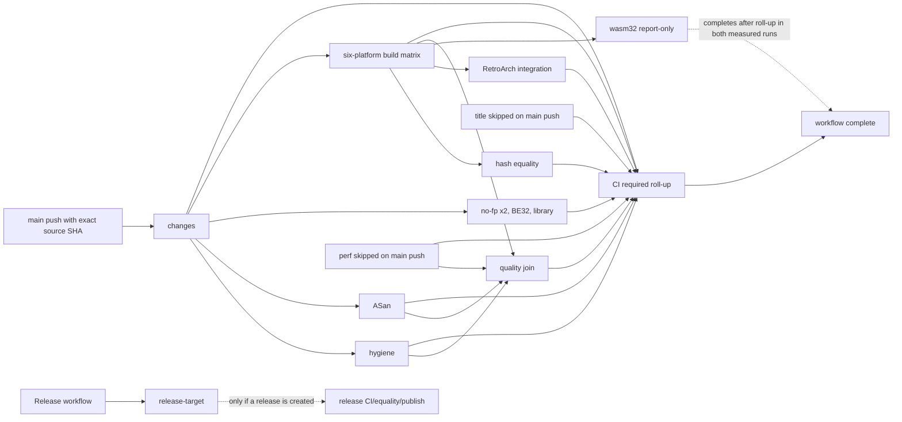

# Phase 23: Measured milestone tune-up — Research

**Researched:** 2026-11-15<br>
**Domain:** Source-qualified CI operations and evidence review<br>
**Confidence:** MEDIUM

<user_constraints>
## User Constraints (from 23-CONTEXT.md)

### Locked Decisions

<!-- DATA_R4V8Q1XM_START -->
### Source and CI evidence
- Anchor the report to merged `main` commit `5a1336f91bf401bab96a8e868e99c661cdca8dae` and retain the immediately preceding `bb70dcf86a3872d3981304bd8c6f664dc58dc401` main run as a separate comparison.
- Use the two complete same-topology main CI receipts, runs 43720418561 and 43725190953, for queue, job-duration, critical-path and cancellation observations; keep each run's source and exact outcome attached to its measurements.
- Keep the Release workflow result distinct from CI. The current release run passed its target check and skipped publication; the v0.15.0 draft remains on its earlier failed exact source.
<!-- DATA_R4V8Q1XM_END -->

<!-- DATA_C7M2P9LA_START -->
### Tune-up disposition
- Inspect the current quality floors, required/report-only job membership, and recent lessons before proposing any check or workflow change.
- Treat Windows ARM64's repeated long baseline comparison as the current CI performance bottleneck, but do not change the serial baseline, job deadline, matrix, topology, caching, or required/advisory membership from two observations.
- Make a low-risk correction only if a fault reproduces and the existing fault-detection contract remains intact; otherwise record the bounded no-change result and specific revisit trigger.
<!-- DATA_C7M2P9LA_END -->

<!-- DATA_Y8D3N5KF_START -->
### Local verification order
- Run cheap checks first: `git diff --check`, the GSD roadmap analyzer, the existing tree hygiene check, and the CMake hygiene workflow.
- Do not repeat the full product CI workflow if these checks pass and the current merged source already has green required CI with unchanged product/test/workflow bytes. Record that limitation explicitly; this report is not a new product acceptance claim.
- Keep the evidence in the phase report as commands and exits plus hosted run URLs; do not commit logs or generated ROM, firmware, save, or screenshot bytes.
<!-- DATA_Y8D3N5KF_END -->

### the agent's Discretion

<!-- DATA_H5W1Z9QB_START -->
- Choose the report structure and exact score labels from the evidence, preserve uncertainty and source attribution, and use existing checks and documents without adding dependencies or a new recurring metric system.
<!-- DATA_H5W1Z9QB_END -->

### Deferred Ideas (OUT OF SCOPE)

<!-- DATA_J3P6A8VT_START -->
GameDrive contract research, fixture/oracle decisions, product/API/state implementation, publishing v0.15.0, and all host or hardware checks remain outside Phase 23.
<!-- DATA_J3P6A8VT_END -->
</user_constraints>

<phase_requirements>
## Phase Requirements

| ID | Description | Research Support |
|----|-------------|------------------|
| <!-- DATA_M9F2T6RC_START -->TUNE-12<!-- DATA_M9F2T6RC_END --> | <!-- DATA_B4K7V1NP_START -->Maintainers begin the milestone from current release, CI, hygiene and quality evidence; inspect queue time, critical path, cancellations and reproduced lessons; run cheap applicable consistency checks before longer suites; and record one evidence-backed low-risk correction or a bounded no-change result without weakening required checks or obscuring failures.<!-- DATA_B4K7V1NP_END --> | Record the two main CI receipts per source, distinguish the required roll-up from the report-only tail, inspect policy floors and prior lessons, then use the authorized cheap local checks to decide between a reproduced narrow fix and a bounded no-change report. |
</phase_requirements>

## Summary

Use the current merged `main` source `5a1336f91bf401bab96a8e868e99c661cdca8dae` and its main CI run 43725190953 as the v8.0 baseline; keep run 43720418561 on `bb70dcf86a3872d3981304bd8c6f664dc58dc401` as a separate comparison. Direct `gh run view` queries returned both complete job lists successfully. Both runs had 20 jobs, 18 successful jobs, the two expected push-event skips (`title` and `perf`), no failed or cancelled jobs, and a two-second delay from workflow creation to the first active job. [CITED: [run 43725190953](https://github.com/szTheory/muhtari/actions/runs/43725190953), [run 43720418561](https://github.com/szTheory/muhtari/actions/runs/43720418561); `gh run view … --json …`, exit 0]

Windows ARM64 is the longest lane in each receipt. Its combined “Quality observations and independent base” step took 26m27s and 25m09s; the preceding “Build, test, package” step took 15m55s and 14m59s. The CI workflow files at the two source commits are identical, and the run job-name sets match. These are two source-specific observations, not a trend or enough evidence to change the serial baseline, deadline, matrix, topology, caching, or gate membership. [CITED: both run URLs above; `git diff --exit-code bb70dcf86a3872d3981304bd8c6f664dc58dc401 5a1336f91bf401bab96a8e868e99c661cdca8dae -- .github/workflows/ci.yml .github/workflows/release.yml`, exit 0; sorted run job-name comparison below, exit 0] [VERIFIED: `.planning/phases/23-measured-milestone-tune-up/23-CONTEXT.md:17-24`]

**Primary recommendation:** Run the four cheap local checks in the locked order, then record a bounded no-change result unless a concrete fault reproduces and can be fixed without weakening named fault detection. After the report tasks, run the one required GSD post-plan local CI gate and record it separately; do not dispatch or rerun hosted CI or add another product suite. Treat that local workflow gate as execution evidence, not a new product-source acceptance claim. Keep the latest Release workflow and the earlier unpublished v0.15.0 source as separate evidence. [VERIFIED: `.planning/phases/23-measured-milestone-tune-up/23-CONTEXT.md:17-29`; `.planning/milestones/v7.0-SHIP.md:5-21`]

## Architectural Responsibility Map

| Capability | Primary Tier | Secondary Tier | Rationale |
|------------|-------------|----------------|-----------|
| Build/test orchestration and required-gate decision | CI workflow | GitHub-hosted runners | The workflow owns the `needs` graph and `CI required` roll-up; platform runners execute independent matrix work. [VERIFIED: `.github/workflows/ci.yml:145-180,375-405,724-785`] |
| Optional portability evidence | CI workflow | GitHub-hosted runners | `wasm32` runs after the native build matrix but is outside the `CI required` dependency list; it can extend run completion without changing the required result. [VERIFIED: `.github/workflows/ci.yml:396-405,767-785`; `.planning/preparation/ENGINEERING.md:134`] |
| Source and outcome record | Phase report | GitHub Actions run records and existing ship receipt | The report keeps current main, previous main, current Release, and historical exact-source failure evidence attached to their respective source identities. [VERIFIED: `.planning/phases/23-measured-milestone-tune-up/23-CONTEXT.md:17-24`; `.planning/milestones/v7.0-SHIP.md:5-21`] |

## Standard Stack

No library or package is needed for this documentation and CI-evidence phase. Reuse GitHub Actions, the installed GitHub CLI, the project GSD runtime, Git, and CMake. Local probes on 2026-11-15 returned `gh 2.101.0`, GSD runtime `@opengsd/gsd-core 1.20.0`, Git `2.50.1`, and CMake `4.4.3`; the three requested run queries completed successfully. [CITED: local `gh --version`, `git --version`, `cmake --version`, and GSD `runtime-identity` probes, exit 0]

**Installation:** None. Do not add dependencies or a recurring metrics service for this phase. [VERIFIED: `.planning/phases/23-measured-milestone-tune-up/23-CONTEXT.md:31-32`; `.planning/seeds/SEED-009-proportional-maintenance-review.md:23-27,47-52`]

## Package Legitimacy Audit

Not applicable: no external package is installed or recommended. [VERIFIED: `.planning/phases/23-measured-milestone-tune-up/23-CONTEXT.md:31-32`]

## Architecture Patterns

### Evidence flow and job dependency graph



The dependency lines come from `ci.yml`; the measured completion order shows why the required check and the whole workflow have different end points. In both runs `CI required` passed before `wasm32` completed. GitHub Actions `needs` dependencies and conditional jobs determine which descendants run; its official workflow syntax documents that skipped or failed dependencies skip descendants unless a condition overrides the default. [VERIFIED: `.github/workflows/ci.yml:375-405,724-785`; run URLs in Summary] [CITED: [GitHub Actions workflow syntax](https://docs.github.com/en/actions/reference/workflows-and-actions/workflow-syntax)]

### Source-qualified CI receipt ledger

| Evidence role | Exact source | Result and measurements | Evidence limit |
|---|---|---|---|
| Current v8.0 main CI | `5a1336f91bf401bab96a8e868e99c661cdca8dae`; run 43725190953 | Created 14:35:28 UTC, first active job 14:35:30, full workflow 44m58s. Windows ARM64 40m47s; its quality/base step 25m09s and build/test/package step 14m59s. Required `CI required` completed 15:17:17; advisory `wasm32` completed 15:20:25. 20 jobs: 18 success, 2 skipped, 0 failed, 0 cancelled. [CITED: [run 43725190953](https://github.com/szTheory/muhtari/actions/runs/43725190953); `gh run view`, exit 0] | Receipt is for this SHA only. `wasm32` completion is not part of required-gate acceptance. |
| Immediately preceding main CI | `bb70dcf86a3872d3981304bd8c6f664dc58dc401`; run 43720418561 | Created 13:42:45 UTC, first active job 13:42:47, full workflow 45m25s. Windows ARM64 43m07s; its quality/base step 26m27s and build/test/package step 15m55s. Required `CI required` completed 14:26:56; advisory `wasm32` completed 14:28:09. 20 jobs: 18 success, 2 skipped, 0 failed, 0 cancelled. [CITED: [run 43720418561](https://github.com/szTheory/muhtari/actions/runs/43720418561); `gh run view`, exit 0] | A distinct older source; retain as a per-run comparison rather than a current-source result. |
| Current Release workflow | `5a1336f91bf401bab96a8e868e99c661cdca8dae`; run 43725190733 | `release-target` passed; `release-ci`, `release-equality`, `publish`, and `install-line-latest` were skipped. This is not a CI receipt and does not establish publication. [CITED: [Release run 43725190733](https://github.com/szTheory/muhtari/actions/runs/43725190733); `gh run view`, exit 0] | A passed target check with publication skipped is not a published release. |
| Prior exact-source release boundary | `v0.15.0` draft target `2b47656cb0307fb5fc10d9ea3fbfd2236830c355` | The v7.0 ship receipt says this exact source failed its Wasm32 stack test; a later test-only correction did not retarget the tag or publish a package. [VERIFIED: `.planning/milestones/v7.0-SHIP.md:5-9,16-21`] | Later green main CI or a Release target check does not repair that exact-source release gate. Do not reopen it in Phase 23. |
| Research checkout snapshot | `145525a708477f709605380bd8db614b6e9ac17d` | `git diff --name-status 5a1336f91bf401bab96a8e868e99c661cdca8dae..HEAD` showed only the added Phase 23 context file; this later planning snapshot has no separate product/test/workflow CI receipt. [CITED: local Git comparison, exit 0] | Keep the merged main receipt as the product baseline; do not call the planning tip accepted product source. |

**Run comparison:** Both runs began active work two seconds after creation. Windows ARM64 remained longest; its combined quality/base step exceeded its own build/test/package step in both receipts. The Windows x64 lane was 24m37s and 25m28s, respectively. The observed ARM64 duration delta is a difference between two observations only; it is not evidence of a performance trend. [CITED: both GitHub Actions run URLs above; exact job and step timestamps returned by `gh run view`, exit 0]

### Required versus report-only membership

The repository's current CI contract states:

<!-- DATA_L8N4W2QZ_START -->
> “`wasm32` stays advisory” and “`library` is required”
<!-- DATA_L8N4W2QZ_END -->

[VERIFIED: `docs/testing.md:238-242`]

The workflow’s `CI required` dependency list includes `hash-equality`, `retroarch`, and `quality`, but not `wasm32`; `wasm32` itself waits for the six-platform build matrix. [VERIFIED: `.github/workflows/ci.yml:396-405,767-785`]

### Reconstructing the critical path

Do not label the Windows ARM64 duration alone as the full critical path. In run 43720418561 the lane ended at 14:26:02 UTC, the post-matrix `retroarch` job ended at 14:26:50, and `CI required` ended at 14:26:56; `wasm32` ended at 14:28:09. In run 43725190953 the corresponding ends were 15:16:28, 15:17:11, 15:17:17, and 15:20:25. [CITED: both run URLs; `gh run view` jobs timestamps, exit 0]

**Inference:** The gating chain in these two runs is the Windows ARM64 member of the build matrix, followed by the post-matrix required jobs (with `retroarch` the last to finish), followed by `CI required`. The end-to-end workflow then waits for the report-only `wasm32` result. Report required-gate elapsed time and workflow completion separately; the latter must not be used as a required-gate duration. [VERIFIED: `.github/workflows/ci.yml:375-405,724-785`; [run 43720418561](https://github.com/szTheory/muhtari/actions/runs/43720418561), [run 43725190953](https://github.com/szTheory/muhtari/actions/runs/43725190953)]

### Current quality policy baseline

These are policy thresholds, not measured values from the two run artifacts. Both runs' `quality` jobs passed, but this research did not download or report the per-metric quality artifacts. The values below are selected direct excerpts from `quality.json`; the execution report can link the full source file. [CITED: both run URLs; `.planning/config.json` and `quality.json` were read locally]

<!-- DATA_Z6C1R8PM_START -->
| Metric | Exact policy values |
|---|---|
| `tests.native` | `"floor": 605`; `"availability": "required"` |
| `abi_tests` | `"floor": 12`; `"availability": "required"` |
| `fuzz_tests` | `"floor": 4`; `"availability": "required"` |
| `title_tests` | `"floor": 3`; `"availability": "required"` |
| `abi_findings` | `"ceiling": 0`; `"availability": "required"` |
| `warnings` | `"ceiling": 0`; `"availability": "required"` |
| `tests.hygiene` | `"floor": 24`; `"availability": "required"` |
| `analyzer_findings` | `"ceiling": 0`; `"availability": "required"` |
| `tests.asan` | `"floor": 593`; `"availability": "required"` |
| `sanitizer_findings` | `"ceiling": 0`; `"availability": "required"` |
<!-- DATA_Z6C1R8PM_END -->

[VERIFIED: `quality.json:3-82`]

The profile is consistent with the project lesson to preserve required work and its rejection controls until a specific redundant cost is measured. The prior Phase 21 report notes that Windows baseline inventory runs serially because the runner lacks CTest jobserver integration; the current data reproduces a long combined quality/base step but does not isolate a safe part to parallelize, cache, or remove. [VERIFIED: `.planning/milestones/v7.0-SHIP.md:35-40`; `.planning/LESSONS.md:976-982`; `.planning/preparation/ENGINEERING.md:305-309`]

### Pattern 1: Keep every result attached to its source

**What:** Use separate rows for the current main CI run, the previous main CI run, the current Release run, the old unpublished exact release source, and the local planning checkout. [VERIFIED: `.planning/phases/23-measured-milestone-tune-up/23-CONTEXT.md:17-19`; `.planning/milestones/v7.0-SHIP.md:5-21`]

**When to use:** For every CI timing, release, quality, or publication statement in Phase 23. [VERIFIED: `.planning/phases/23-measured-milestone-tune-up/23-CONTEXT.md:17-19,28-29`]

**Example:** `gh run view 43725190953 --json databaseId,workflowName,event,status,conclusion,headSha,url,createdAt,startedAt,updatedAt,jobs` — exit 0; record the linked run SHA and exact result beside every measurement. [CITED: [run 43725190953](https://github.com/szTheory/muhtari/actions/runs/43725190953); local CLI query, exit 0]

### Anti-patterns to Avoid

- **Conflating the workflow tail with required-gate time:** `wasm32` extends both complete run durations but is advisory and absent from `CI required`'s `needs`. [VERIFIED: `.github/workflows/ci.yml:396-405,767-785`; both run URLs]
- **Calling two observations a trend:** keep each source/run's measurements separate; two runs show recurrence of a long lane, not its distribution or direction. [VERIFIED: `.planning/phases/23-measured-milestone-tune-up/23-CONTEXT.md:17-24`; `.planning/preparation/ENGINEERING.md:305-309`]
- **Changing the Windows baseline or deleting costly tests from wall time alone:** the combined workflow step does not show which individual cases can be removed or safely parallelized; preserve current floors and fault controls absent case-level evidence. [VERIFIED: `.planning/milestones/v7.0-SHIP.md:35-40`; `.planning/LESSONS.md:976-982`; `quality.json:3-82`]
- **Treating a Release target pass as publication:** current Release run 43725190733 skipped the publish and install descendants; the v0.15.0 tag remains tied to its earlier failed source. [CITED: [Release run 43725190733](https://github.com/szTheory/muhtari/actions/runs/43725190733)] [VERIFIED: `.planning/milestones/v7.0-SHIP.md:5-9,16-21`]
- **Adding a new metrics collector or audit framework:** the seed asks for an ordinary evidence-based disposition and explicitly rejects a new audit program, dashboard, policy registry, or quota for this need. [VERIFIED: `.planning/seeds/SEED-009-proportional-maintenance-review.md:23-27,47-52`]

## Don't Hand-Roll

| Problem | Don't Build | Use Instead | Why |
|---------|-------------|-------------|-----|
| CI timing history | New dashboard, collector, or metrics subsystem | Existing Actions run records plus the project's recurring CI review policy | The current phase has two comparable receipts; the policy calls for a longer comparable sample for structural, timeout, cache, or parallelism changes. [VERIFIED: `.planning/preparation/ENGINEERING.md:305-319`] |
| Required/report-only classification | A second gate registry | `docs/testing.md` and `.github/workflows/ci.yml` as the single sources of gate membership | The workflow contract and its test inventory already exercise the aggregate. [VERIFIED: `docs/testing.md:218-249`; `.github/workflows/ci.yml:767-785`] |
| Job critical-path reconstruction | Guess from the single longest lane or total run wall time | Combine `needs` edges in `ci.yml` with each run's job start/completion timestamps | The required roll-up completes before report-only wasm32 in both observations. [CITED: run 43720418561 and 43725190953; workflow lines above] |

**Key insight:** The practical improvement for this phase is accurate evidence and correctly bounded conclusions. Existing job graphs, quality policy, run records, and the source-specific ship receipt provide what is needed; no new recurring mechanism is justified. [VERIFIED: `.planning/phases/23-measured-milestone-tune-up/23-CONTEXT.md:17-29`; `.planning/seeds/SEED-009-proportional-maintenance-review.md:23-52`]

## Common Pitfalls

### Pitfall 1: Treating main CI as release acceptance

**What goes wrong:** A green current main run is mistaken for publication or for acceptance of the old v0.15.0 tag. [VERIFIED: `.planning/milestones/v7.0-SHIP.md:5-9,16-21`]

**How to avoid:** Record `CI`, `Release target`, and `publish` as separate results and identify their exact source. [VERIFIED: `.planning/phases/23-measured-milestone-tune-up/23-CONTEXT.md:17-19`]

### Pitfall 2: Confusing end-to-end completion with the required critical path

**What goes wrong:** Advisory `wasm32` time is attributed to the `CI required` gate. [CITED: both run URLs; VERIFIED: `.github/workflows/ci.yml:396-405,767-785`]

**How to avoid:** List Windows ARM64 → post-matrix required work → `CI required` separately from the report-only tail. The actual downstream ordering is visible in each run's timestamps. [CITED: run 43720418561 and 43725190953; VERIFIED: `.github/workflows/ci.yml:375-405,724-785`]

### Pitfall 3: Changing a bound based on incomplete or censored work

**What goes wrong:** A timeout or an incomplete job is treated as a successful timing sample, or one long step triggers a deadline/cache/matrix change. [VERIFIED: `.planning/phases/23-measured-milestone-tune-up/23-CONTEXT.md:21-24`; `.planning/preparation/ENGINEERING.md:305-309`]

**How to avoid:** Use completed successful observations only; use the existing comparable-run policy and inspect per-case work before proposing a correction. The prior recent lesson specifically says the Windows ARM64 publish-control work retains its real preparation/rejection cases and should keep its limits until narrower profiling identifies a remedy. [VERIFIED: `.planning/LESSONS.md:976-982`; `.planning/preparation/ENGINEERING.md:305-309`]

## Project Constraints (from AGENTS.md)

- Keep this phase in documentation/CI operations; do not change the emulator's three deliverables, add UI/device code, or broaden Muhtari beyond Atari 7800. [VERIFIED: `AGENTS.md:44-60`]
- Do not add dependencies or a new recurring metric system for a report-only tune-up. [VERIFIED: `.planning/phases/23-measured-milestone-tune-up/23-CONTEXT.md:31-32`; `.planning/seeds/SEED-009-proportional-maintenance-review.md:47-52`]
- For any actual check/workflow correction, name its concrete fault, exercise representative pass and fault behavior, and preserve required behavior and fault detection. [VERIFIED: `AGENTS.md:81-86`]
- Prefer automation-first, local/offline checks; avoid owner-device checks and keep live/remote/release boundaries separate. Evidence is a command, exit status, and run URL, not a committed log. [VERIFIED: `AGENTS.md:69-80,137-150`; `.planning/phases/23-measured-milestone-tune-up/23-CONTEXT.md:26-29`]
- Read relevant project lessons before planning or changing a subsystem; newly reproduced lessons need evidence. [VERIFIED: `AGENTS.md:147-150`]
- Preserve clean-tree rules: no ROM, BIOS, or save bytes except manifest fixtures; avoid personal paths and names in the artifact. [VERIFIED: `AGENTS.md:60-62`]

## Code Examples

The report needs the exact run record rather than a new script. These read-only queries returned exit 0 during research. [CITED: [run 43720418561](https://github.com/szTheory/muhtari/actions/runs/43720418561), [run 43725190953](https://github.com/szTheory/muhtari/actions/runs/43725190953), [Release run 43725190733](https://github.com/szTheory/muhtari/actions/runs/43725190733)]

```sh
gh run view 43720418561 --json databaseId,workflowName,event,status,conclusion,headSha,url,createdAt,startedAt,updatedAt,jobs
gh run view 43725190953 --json databaseId,workflowName,event,status,conclusion,headSha,url,createdAt,startedAt,updatedAt,jobs
gh run view 43725190733 --json databaseId,workflowName,event,status,conclusion,headSha,url,createdAt,startedAt,updatedAt,jobs
diff -u <(gh run view 43720418561 --json jobs | jq -r '[.jobs[].name]|sort|join("\n")') <(gh run view 43725190953 --json jobs | jq -r '[.jobs[].name]|sort|join("\n")')
```

The execution phase's cheap preflight is fixed by context. Use the identity-checked GSD runtime resolved by the project resolver for its roadmap query; run the tree hygiene check and CMake hygiene workflow afterward. This research did not run these checks or any tests, per task scope. [VERIFIED: `.planning/phases/23-measured-milestone-tune-up/23-CONTEXT.md:26-29`; `AGENTS.md:124-126`]

## State of the Art

There is no technology or dependency adoption in this phase. The project policy uses 30-day CI efficiency summaries and completed comparable observations; it requires multi-run evidence before a structural, timeout, cache, or parallelism change. The measured two-run comparison supplies an updated source-specific observation only. [VERIFIED: `.planning/preparation/ENGINEERING.md:305-319`; `.planning/phases/23-measured-milestone-tune-up/23-CONTEXT.md:17-24`]

**Disposition supported by current measurements:** no low-risk CI reduction is justified by these two receipts. Revisit if the phase's cheap checks reproduce a concrete fault, or a later comparable sample plus per-case profiling identifies one narrow change that keeps the same tests and fault controls. [Inference from both run URLs and locked phase criteria: `.planning/phases/23-measured-milestone-tune-up/23-CONTEXT.md:21-29`; `.planning/preparation/ENGINEERING.md:305-309`; `.planning/LESSONS.md:976-982`]

## Assumptions Log

| # | Claim | Section | Risk if Wrong |
|---|-------|---------|---------------|
| — | No unverified technology, package, or platform assumption is needed. Execution must record the local preflight outcomes and follow the already specified result branch; no planning choice remains. | Summary / Open Questions | A reproduced fault may require the plan's bounded investigation and correction branch. |

## Open Questions

None block planning. The four preflight outcomes are intentionally unknown until execution; they are execution-time acceptance inputs, not an unresolved research or planning decision. The approved plan specifies the exact check order and both branches: if checks pass and product/test/workflow bytes are unchanged, record bounded no-change; if a check fails, investigate the fault and use the bounded correction path while preserving existing fault detection. After both report tasks, the GSD orchestrator still runs its single configured local post-plan CI gate and records that result separately. No result is asserted here, and this gate does not create a new product-source acceptance claim. [VERIFIED: `.planning/phases/23-measured-milestone-tune-up/23-CONTEXT.md:21-29`]

## Environment Availability

| Dependency | Required By | Available | Version | Fallback |
|------------|------------|-----------|---------|----------|
| GitHub Actions records / `gh` | Source-specific run and job evidence | Yes; all three run queries succeeded | `gh 2.101.0` | None needed for already fetched receipts |
| Git | Source comparison and local checks | Yes | `2.50.1` | None |
| CMake | Existing hygiene workflow | Yes | `4.4.3` | None |
| OpenGSD tools | Roadmap analysis and GSD state | Yes; runtime identity is `@opengsd/gsd-core` version `1.20.0` | `1.20.0` | Use the same identity-checked runtime resolved from the project resolver |

**Missing dependencies:** None found for the scoped work. [CITED: local version probes, exit 0; GitHub CLI run queries, exit 0]

Validation and security configuration were checked. The project explicitly disables Nyquist validation and security enforcement, so omit the Validation Architecture and Security Domain sections for this phase:

<!-- DATA_N3X6B8KC_START -->
`"nyquist_validation": false`
<!-- DATA_N3X6B8KC_END -->

[VERIFIED: `.planning/config.json:32-38`]

<!-- DATA_V1Q7M4TZ_START -->
`"security_enforcement": false`
<!-- DATA_V1Q7M4TZ_END -->

[VERIFIED: `.planning/config.json:59-62`]

## Sources

### Primary

- [Phase 23 context](23-CONTEXT.md) — locked source boundaries, no-change criteria, local check order, and evidence format.
- [v8.0 requirements](../../REQUIREMENTS.md) and [v8.0 roadmap](../../ROADMAP.md) — TUNE-12 and phase success criteria.
- [Phase 21 tune-up report](../../milestones/v7.0-phases/21-measured-milestone-tune-up/21-TUNEUP.md) and [v7.0 ship receipt](../../milestones/v7.0-SHIP.md) — prior reporting pattern, current release state, first comparable main run, and the previous bounded baseline conclusion.
- [SEED-007](../../seeds/SEED-007-milestone-tune-up.md), [SEED-009](../../seeds/SEED-009-proportional-maintenance-review.md), and [LESSONS](../../LESSONS.md) — recurring review intent and reproduced CI maintenance lessons.
- [CI workflow](../../../.github/workflows/ci.yml), [Release workflow](../../../.github/workflows/release.yml), [testing guide](../../../docs/testing.md), and [quality policy](../../../quality.json) — dependency graph, required/advisory membership, and exact threshold configuration.
- GitHub Actions receipts: [43720418561](https://github.com/szTheory/muhtari/actions/runs/43720418561), [43725190953](https://github.com/szTheory/muhtari/actions/runs/43725190953), and [Release 43725190733](https://github.com/szTheory/muhtari/actions/runs/43725190733). Read-only `gh run view` queries returned exit 0.

### Secondary

- [GitHub Actions workflow syntax](https://docs.github.com/en/actions/reference/workflows-and-actions/workflow-syntax) — official `needs`, skipped-dependency, and job-condition semantics. Confidence MEDIUM per `query classify-confidence --provider websearch --verified`.

## Metadata

**Confidence breakdown:**
- Standard stack: HIGH — existing tools only; version probes and exact run retrieval succeeded. [CITED: local CLI/GSD version probes and three run URLs]
- Architecture: HIGH — current workflow and two complete run job graphs agree; the workflow files at the two compared source commits are identical. [VERIFIED: `.github/workflows/ci.yml:375-405,724-785`; `git diff --exit-code` comparison, exit 0]
- Pitfalls and recommendation: MEDIUM — the no-change recommendation is bounded to two successful observations and the local checks still belong to execution. Exact run data remain linked as citations because the confidence seam does not classify the `gh` provider above LOW. [VERIFIED: `.planning/phases/23-measured-milestone-tune-up/23-CONTEXT.md:17-29`; `.planning/preparation/ENGINEERING.md:305-309`]

**Research date:** 2026-11-15<br>
**Valid until:** 2026-12-15 for the stable project pattern; rerun receipt queries before relying on current GitHub status.
