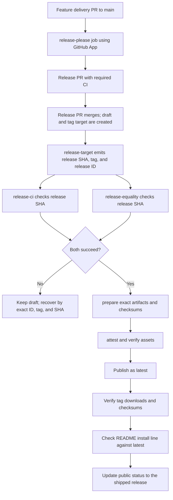

# Phase 25: Publish the corrected Souper mapper - Research

**Researched:** 2026-11-15  
**Domain:** GitHub Actions release automation, release-please version selection, exact-source package publication  
**Confidence:** MEDIUM

## User Constraints

No Phase 25 `CONTEXT.md` exists. The locked scope comes from the active roadmap and requirements:

- “Publish the already-merged Souper feature as v0.16.0 under the settled pre-1.0 minor-bump policy.” Preserve the old v0.15.0 tag and draft, and use the established source-bound release workflow. [VERIFIED: `.planning/ROADMAP.md:40-42`]
- “without changing emulator behavior or moving the failed v0.15.0 tag.” [VERIFIED: `.planning/REQUIREMENTS.md:5`]
- “Retargeting or deleting the v0.15.0 tag or draft” is out of scope; new dependencies, workflow structure, caches, or timeout changes need repeated evidence. [VERIFIED: `.planning/REQUIREMENTS.md:22-28`]
- The release must pass the exact-source CI, fixture, artifact, provenance, publication, and latest-install gates; the README and status page must stay accurate. [VERIFIED: `.planning/REQUIREMENTS.md:15-20`]

<phase_requirements>
## Phase Requirements

| ID | Description | Research Support |
|----|-------------|------------------|
| TUNE-13 | “Review the current release and CI evidence, queue time, critical path, job durations, cancellations and reproduced lessons; run applicable cheap consistency checks before longer release work; record one evidence-backed low-risk correction or a bounded no-change result without weakening coverage.” [VERIFIED: `.planning/REQUIREMENTS.md:11`] | Compare current main CI runs `43770820444` and `43765372722`, current Release runs, their queues/jobs/cancellations, and the release lessons before recommending any pipeline change. |
| REL-01 | “Publish a fresh v0.16.0 feature release from corrected mainline source under the settled pre-1.0 minor-bump rule. Preserve the existing unpublished v0.15.0 tag and draft exactly as they are; do not repeat the one-time CI-only v0.13.1 patch exception.” [VERIFIED: `.planning/REQUIREMENTS.md:15`] | Use a fresh release-please identity and record the v0.15.0 API/tag baseline before and after publication. |
| REL-02 | “Existing source-bound release gates pass for the exact release commit, including required CI, Souper fixture coverage, artifact integrity and provenance, publication, and latest-install verification; record command, exit status and run URL.” [VERIFIED: `.planning/REQUIREMENTS.md:16`] | The release workflow passes the release-please SHA through CI, equality, publisher, attestation, download verification, and latest-install jobs. |
| DOC-01 | “README and status documentation explain the three deliverables, current published-versus-merged support, known compatibility limits and a concrete completion standard in clear, concise language.” [VERIFIED: `.planning/REQUIREMENTS.md:20`] | README and `docs/status.md` already state that v0.14.0 is published and Souper is merged but unpublished; update only after the v0.16.0 publication is proven. |
</phase_requirements>

## Summary

Keep the release path entirely on the existing `release.yml` and `scripts/publish.sh` path. The public v0.15.0 tag and draft remain at the failing source; the test-only correction is already on corrected mainline. The current release automation takes the release-please-reported commit SHA and uses that same SHA for the release CI, equality, artifact-source checks, attestations, and downloaded-release verification. [VERIFIED: `.planning/milestones/v7.0-SHIP.md:15-21`; `.github/workflows/release.yml:180-211, 215-228, 273-370`; `scripts/publish.sh:50-79, 106-160`]

One release-trigger step needs explicit treatment in the plan. The release-please manifest and `version.txt` currently contain `0.15.0`; commits after the v0.15.0 tag through public main are `test:` and `docs:` changes, which the project's settled policy says do not cut a release. A new truthful feature-release commit is therefore needed for ordinary release-please to generate v0.16.0. The recommended interpretation is that making already-merged Souper support newly downloadable is the feature being delivered; use a Conventional Commit `feat:` delivery PR and let release-please create its normal release PR. Do not create or retarget a tag by hand. [VERIFIED: `version.txt:1` quote: `0.15.0`; `.release-please-manifest.json:1-3` quote: `".": "0.15.0"`; `.planning/preparation/ENGINEERING.md:158`; `docs/maintaining.md:8-26`; `git log --oneline --first-parent v0.15.0..origin/main`]

**Primary recommendation:** Treat public availability of the already-merged Souper support as the feature release, then use the normal release-please PR and source-bound Release workflow. Snapshot v0.15.0 state before starting and compare its release record, tag ref, and asset list after v0.16.0 ships. [ASSUMED: this is a truthful `feat:` use because the delivery adds a new downloadable capability, although it adds no emulator behavior; confirm the title matches the actual PR diff.]

## Reproduced Facts

- Read-only GitHub API requests on 2026-11-15 show public `main` at `a252aeb7dfc6a54a884ffc66995d445d75d531fc`. The local release worktree is one commit ahead on the milestone branch; do not mistake that planning commit for public main. [CITED: `https://api.github.com/repos/szTheory/muhtari/commits/main`; local `git status --short --branch`, `git rev-parse HEAD origin/main`]
- v0.15.0 is draft release ID `445523668`, tag ref `refs/tags/v0.15.0` points to `2b47656cb0307fb5fc10d9ea3fbfd2236830c355`, `target_commitish` is the same SHA, `published_at` is null, and it currently has no assets. [CITED: `https://api.github.com/repos/szTheory/muhtari/releases/445523668`; `https://api.github.com/repos/szTheory/muhtari/git/ref/tags/v0.15.0`]
- v0.14.0 is the latest published release; its release object points to `8d73321953f417dc973a4cb93cfb4b8521772150`. No v0.16.0 release or tag was found, and the open pull-request list was empty at query time. [CITED: `https://api.github.com/repos/szTheory/muhtari/releases/latest`; `https://api.github.com/repos/szTheory/muhtari/releases?per_page=100`; `https://api.github.com/repos/szTheory/muhtari/git/ref/tags/v0.16.0`; `https://github.com/szTheory/muhtari/pulls`]
- The Souper WASI stack fix is merged in PR #65 as `bb70dcf86a3872d3981304bd8c6f664dc58dc401`; that commit is an ancestor of current main. Its post-merge main CI passed, but its Release run skipped release CI, equality, publication, and latest-install because the `test:` correction created no release. [VERIFIED: `.planning/milestones/v7.0-SHIP.md:18-21`; `git merge-base --is-ancestor bb70dcf86a3872d3981304bd8c6f664dc58dc401 origin/main`]
- The latest main CI run, `43770820444`, passed on `a252aeb`; it completed in 44m09s, started its first jobs about two seconds after workflow creation, had Windows ARM64 as its longest job at 41m06s, and cancelled no jobs. The preceding main CI run `43765372722` also passed with no cancellations and a similar Windows ARM64 duration (41m56s). [CITED: `https://github.com/szTheory/muhtari/actions/runs/43770820444`; `https://github.com/szTheory/muhtari/actions/runs/43765372722`; `gh api .../actions/runs/{id}/jobs`]
- The current-main Release run `43770820538` is green only as a workflow aggregate: `release-please` and `release-target` ran, while release CI, equality, publish, and latest-install were skipped. The prior Release run `43765372812` had the same skipped publication path. These runs are not v0.16.0 acceptance. [CITED: `https://github.com/szTheory/muhtari/actions/runs/43770820538`; `https://github.com/szTheory/muhtari/actions/runs/43765372812`; read-only Actions jobs API]

## Source-Backed Facts

- The release action is `googleapis/release-please-action` v5.0.0, SHA-pinned, with simple release type, draft releases, and forced tag creation. The exact action line is `uses: googleapis/release-please-action@45996ed1f6d02564a971a2fa1b5860e934307cf7 # v5.0.0`. The checked-in config quotes: `"release-type": "simple"`, `"initial-version": "0.1.0"`, `"bump-minor-pre-major": true`, `"bump-patch-for-minor-pre-major": false`, `"draft": true`, `"force-tag-creation": true`, and `"include-v-in-tag": true`. Project policy is `feat` → minor before 1.0.0; `docs`, `chore`, `ci`, `test`, `build`, `refactor`, and `style` do not cut a release. [VERIFIED: `.github/workflows/release.yml:200-203`; `release-please-config.json:4-10`; `.planning/preparation/ENGINEERING.md:158`; official release-please docs: [manifest releaser](https://github.com/googleapis/release-please/blob/main/docs/manifest-releaser.md), [versioning strategy](https://github.com/googleapis/release-please/blob/main/src/versioning-strategies/default.ts)]
- On a main push, release-please creates or updates its release PR with an App token and enables auto-merge. Its merge creates a draft release; release CI and binary equality then use the SHA from release-please, not the workflow-triggering commit. [VERIFIED: `.github/workflows/release.yml:1-8, 180-211, 215-228, 273-299`]
- Publication requires successful exact-SHA CI and equality. `prepare` checks six native commit receipts and the portable Emscripten source/bundle, scans the 19 archives for prohibited firmware/known ROM bytes, and writes checksums. The publish job verifies main-ref attestations, rejects a tampered copy, publishes the draft as latest, verifies all downloads against `SHA256SUMS`, and runs the latest-install check. [VERIFIED: `.github/workflows/release.yml:297-370, 372-386`; `scripts/publish.sh:23-79, 106-160`]
- The release set is “exactly 19 ZIPs—18 native `muhtari-{library,runner,libretro}-{linux,macos,windows}-{x64,arm64}.zip` plus `muhtari-libretro-emscripten.zip`—and `SHA256SUMS`, for 20 release assets.” The workflow uses a SHA-verified pinned GitHub CLI; the repository pin is `gh-linux-x86_64 2.102.0`, while the local read-only query CLI reported 2.101.0. The workflow fetches its pin before publisher use, so the local CLI version does not block hosted publication. [VERIFIED: `.planning/preparation/ENGINEERING.md:156`; `pins.txt:58` quote: `gh-linux-x86_64 2.102.0`; `.github/workflows/release.yml:330-335`; local `gh version`]
- `scripts/publish.sh resolve-target` is the recovery path for an existing stable draft: it checks that release ID, tag, target SHA, draft state, and stable-release status all match before emitting workflow outputs. Dispatch must run from main and repeats CI, equality, publication, and latest-install against that named SHA. [VERIFIED: `.github/workflows/release.yml:213-268`; `scripts/publish.sh:256-275`; `docs/maintaining.md:72-75,83-105`]
- GitHub REST documents that `target_commitish` is ignored when the requested tag already exists. A fresh v0.16.0 tag is required to establish its target from the selected release commit. Once a release is published under immutable releases, its tag and assets cannot be changed; GitHub recommends staging the assets on a draft before publishing. [CITED: [GitHub release API](https://docs.github.com/en/rest/releases/releases); [GitHub immutable releases](https://docs.github.com/en/code-security/concepts/supply-chain-security/immutable-releases)]
- README currently states: “The latest published release is v0.14.0. Souper mapper support is in the source on main, but has not shipped in a downloadable release yet.” The status page likewise distinguishes merged-but-unpublished Souper support and says v0.15.0 remains on the original source. Keep these statements until publication succeeds, then update both pages to report the verified release. [VERIFIED: `README.md:8-10`; `docs/status.md:8-13`; `.planning/ROADMAP.md:46-53`]

## Inference and Recommendation

- The existing v0.15.0 release PR already consumed the original Souper `feat:` change and produced the draft at the failed source. The post-tag history now has only `test:` and `docs:` commits. Therefore, a fresh release-please trigger is needed to get v0.16.0 without modifying v0.15.0. [VERIFIED: `.planning/milestones/v7.0-SHIP.md:15-21`; `git log --oneline --first-parent v0.15.0..origin/main`; `docs/maintaining.md:10-17`]
- Recommended trigger: title the actual package-delivery PR as a truthful `feat:` describing that users can now download the merged Souper support. This follows the project's existing pre-1.0 feature policy and avoids a manual tag or release-version override. The title must describe the actual PR; do not label unrelated planning-only changes as a feature. [ASSUMED: the package becoming downloadable is a feature even though emulator code is unchanged; if project title policy rejects that interpretation, the plan must surface the explicit version-trigger choice rather than silently force a release.]
- Adversarial check: a green Release aggregate can be misleading when all release-specific jobs are skipped. Accept v0.16.0 only when `release-ci`, `release-equality`, `publish`, `install-line-latest`, and the published release/tag all identify the same new release SHA. [VERIFIED: `.github/workflows/release.yml:273-386`; current Release run `43770820538` job results]
- For tune-up, record the successful current and previous main CI sources, queue delay, critical jobs, total duration, skipped/cancelled work, and the current Release skip status. The latest two CI runs have similar Windows ARM64 critical paths and low queue delay; existing lessons require repeated evidence before changing timeouts, concurrency, caching, or workflow structure. The bounded no-change result is currently the safer recommendation. [VERIFIED: current Actions runs above; `.planning/LESSONS.md:1005-1019`; `.planning/INTENT.md:191-197`]

## Safest Exact-Source Sequence

1. Before release work, read the live release/tag state and save a non-committed comparison snapshot of v0.15.0: release ID, tag, target SHA, draft/prerelease/publication fields, body/name, assets and tag-ref SHA. Confirm there is no open `autorelease: pending` PR, no v0.16.0 tag/release, and that corrected Souper source is an ancestor of current main. [VERIFIED: `docs/maintaining.md:83-100`; `.planning/milestones/v7.0-SHIP.md:15-21`; current API snapshot above]
2. Run cheap title/version/repository consistency checks before full CI. Make only the scoped README/status edits needed to keep current published-vs-merged status accurate; do not claim v0.16.0 is published yet. Do not edit `version.txt` by hand. [VERIFIED: `.planning/preparation/ENGINEERING.md:153-159`; `README.md:8-10`; `docs/status.md:8-13`]
3. Merge a truthful feature-release delivery PR to main. Let the resulting main push create the release-please PR; require its `CI required` check, then let the App auto-merge that release PR. Do not create a tag/release manually or reuse the v0.15.0 release object. [VERIFIED: `.github/workflows/release.yml:180-211`; `docs/maintaining.md:8-26`]
4. On the release-please PR merge, take the `release_created`, tag, release ID, and SHA outputs as authoritative. Require `release-ci` and `release-equality` to pass on that same SHA before publish can run. `publish.sh prepare` must admit exact artifacts; attestation must verify from `refs/heads/main`; publish must create the new stable release; `publish.sh verify` must validate every downloaded asset and `gh release verify`; then `install-line-latest` must pass. [VERIFIED: `.github/workflows/release.yml:215-386`; `scripts/publish.sh:50-160`]
5. After publication, query the new v0.16.0 release and tag ref: verify published/latest status, tag target equals the release-please SHA, and all 20 assets are present and non-empty. Re-query v0.15.0 and compare the saved fields and tag-ref SHA exactly; require its release ID and `2b47656cb0307fb5fc10d9ea3fbfd2236830c355` target to remain unchanged. Only after that should README/status say v0.16.0 is available. [CITED: GitHub API endpoints above; `.planning/ROADMAP.md:50-53`; official [immutable release guidance](https://docs.github.com/en/code-security/concepts/supply-chain-security/immutable-releases)]
6. If CI or equality fails before publish, use the guarded `workflow_dispatch` recovery from main with the exact draft ID, tag, and SHA; do not rely on a new push or full rerun to recreate `release_created`. If only publication fails, follow the workflow's safe draft rerun behavior. Do not alter the immutable published release if a post-publication check fails; investigate and use the documented fix-forward/withdrawal policy. [VERIFIED: `.planning/LESSONS.md:889-903,918-935`; `.github/workflows/release.yml:213-268,293-370`; `docs/maintaining.md:83-110`]

**Acceptance evidence:** release PR and merge commit; source SHA from release-please; exact-SHA CI and equality run URLs; Release job results proving publish and latest-install ran (not skipped); GitHub release/tag API snapshot; 20 asset names/sizes and checksums; attestation verification; latest install result; before/after v0.15.0 release/tag comparison; concise public docs diff. Record commands, exit codes, and run URLs; do not commit raw logs. [VERIFIED: `.planning/REQUIREMENTS.md:16`; `.planning/preparation/ENGINEERING.md:156`; project rule 10 in `AGENTS.md`]

## Architectural Responsibility Map

| Capability | Primary Tier | Secondary Tier | Rationale |
|------------|-------------|----------------|-----------|
| Version decision and release PR | GitHub Actions / release-please | GitHub App | The main-push workflow creates and auto-merges the release PR; release-please owns version metadata. [VERIFIED: `.github/workflows/release.yml:180-211`] |
| Exact-source CI and equality | GitHub Actions | CMake CI / equality workflows | Both reusable workflows receive the release commit SHA explicitly before publish. [VERIFIED: `.github/workflows/release.yml:273-299`] |
| Artifact validation, attestations and publication | GitHub Actions publisher | GitHub Releases | The publisher validates source/contents, verifies attestations, publishes, then verifies downloads by tag URL. [VERIFIED: `.github/workflows/release.yml:297-370`; `scripts/publish.sh:50-160`] |
| Latest download and user status | GitHub Releases / static assets | README and status page | The latest-install job tests the user-facing alias; docs describe current package availability. [VERIFIED: `.github/workflows/release.yml:372-386`; `README.md:8-27`; `docs/status.md:8-13`] |

## Standard Stack

### Core

| Tool | Version | Purpose | Why Standard |
|------|---------|---------|--------------|
| GitHub Actions Release workflow | repository workflow | Source-bound release orchestration | Existing supported path; owns PR merge, target SHA, CI/equality, publication, and install gate. [VERIFIED: `.github/workflows/release.yml:1-8,180-386`] |
| release-please-action | v5.0.0, pinned SHA `45996ed1f6d02564a971a2fa1b5860e934307cf7` | Version/changelog PR and draft identity | Existing repo policy and config. [VERIFIED: `.github/workflows/release.yml:200-203`; `.planning/preparation/ENGINEERING.md:149-159`] |
| `scripts/publish.sh` | in-repo POSIX shell | Artifact/source checks, upload, attestation and download verification | Reuses established checks; no custom replacement is needed. [VERIFIED: `scripts/publish.sh:1-15,50-160`] |
| GitHub CLI | pinned stable 2.102.0 | Release API, attestation, verification | CI fetches the hash-pinned CLI; publisher checks the minimum version. [VERIFIED: `pins.txt:58`; `scripts/publish.sh:98-104`; `.github/workflows/release.yml:330-335`] |

### Supporting

| Tool | Purpose | When to Use |
|------|---------|-------------|
| `ci.yml` reusable workflow | Full exact-source test/package CI | Always for the release SHA. [VERIFIED: `.github/workflows/release.yml:273-282`] |
| `be-equality.yml` reusable workflow | Native/PowerPC equality on the exact release SHA | Always before publication. [VERIFIED: `.github/workflows/release.yml:284-291`] |
| GitHub artifact attestations | Verify asset provenance and tamper rejection | Before and after publication. [VERIFIED: `.github/workflows/release.yml:358-370`; `scripts/publish.sh:106-124,155-158`] |

**Installation:** No new package installation. Reuse the checked-in workflow, scripts, and pinned Actions/CLI. [VERIFIED: `.planning/REQUIREMENTS.md:28`; `.github/workflows/release.yml:313-335`]

## Architecture Patterns

### System Architecture Diagram

The diagram is the current workflow, with the last documentation step taken from the Phase 25 success criteria. [VERIFIED: `.github/workflows/release.yml:180-386`; `.planning/ROADMAP.md:50-54`]

### Recommended Project Structure

No new product module or package is needed. Keep user-facing availability in `README.md` and `docs/status.md`; release mechanics stay in `.github/workflows/release.yml` and `scripts/publish.sh`. [VERIFIED: `.planning/REQUIREMENTS.md:20,28`; `README.md:8-10`; `.github/workflows/release.yml:1-8`]

### Pattern 1: Release from the release-please SHA

**What:** The push that triggers Release may be newer than the release source; always use release-please's release SHA for the called CI/equality workflows and artifact checks. [VERIFIED: `.github/workflows/release.yml:215-228,273-299`; `.planning/preparation/ENGINEERING.md:155`]

**When to use:** Every normal release and every guarded recovery. [VERIFIED: `docs/maintaining.md:72-75,83-105`]

### Pattern 2: Resume only a fully identified draft

**What:** Recovery validates release ID, stable tag, exact commit SHA, and draft state, then repeats gates on that identity. The existing operator command is quoted from maintainer docs:

> `gh workflow run Release --ref main \
>   --field release_id=<release-id> \
>   --field tag_name=vX.Y.Z \
>   --field sha=<release-commit-sha>` [VERIFIED: `docs/maintaining.md:95-100`]

Use this only when an existing v0.16.0 draft needs recovery; it is not the normal release trigger. [VERIFIED: `.github/workflows/release.yml:213-268`; `docs/maintaining.md:83-105`]

### Anti-Patterns to Avoid

- **Moving or deleting v0.15.0:** directly violates the locked scope and loses the source-specific failure record. [VERIFIED: `.planning/REQUIREMENTS.md:5,25`; `.planning/milestones/v7.0-SHIP.md:42-44`]
- **Treating a green Release aggregate as package acceptance:** current successful runs skipped the source CI, equality, publish, and install jobs. [CITED: current Release run `43770820538`]
- **Manual tag/upload or a build from the triggering SHA:** these bypass the established release identity and exact-source guards. [VERIFIED: `docs/maintaining.md:8-37`; `.github/workflows/release.yml:215-228,297-370`]
- **Unmeasured CI changes:** one observed run or a faster retry is not enough to change timeouts, caches, concurrency, or required coverage. [VERIFIED: `.planning/LESSONS.md:1005-1019`; `.planning/REQUIREMENTS.md:28`]

## Don't Hand-Roll

| Problem | Don't Build | Use Instead | Why |
|---------|-------------|-------------|-----|
| Release version and tag | Manual version edits or direct tag creation | release-please PR and `release.yml` | Keeps the version, release notes, tag, draft, and source SHA on the established path. [VERIFIED: `.planning/preparation/ENGINEERING.md:153-159`; `docs/maintaining.md:8-26`] |
| Archive integrity/provenance | One-off ZIP scripts or manual upload | `scripts/publish.sh` and attestation jobs | Existing checks bind assets to source SHA, expected inventory, checksums, signer workflow, and main ref. [VERIFIED: `scripts/publish.sh:50-160`] |
| v0.15.0 preservation | Retarget/delete/repurpose old release | New v0.16.0 draft/tag plus pre/post API comparison | The selected requirement preserves v0.15.0 exactly and GitHub locks published immutable releases. [VERIFIED: `.planning/REQUIREMENTS.md:15,25`; [GitHub immutable releases](https://docs.github.com/en/code-security/concepts/supply-chain-security/immutable-releases)] |

**Key insight:** Source identity is the core acceptance boundary: CI success on corrected main does not prove a release built from the new release tag, and the old v0.15.0 source cannot be silently repaired. [VERIFIED: `.planning/milestones/v7.0-SHIP.md:16-21,42-44`; `.github/workflows/release.yml:273-386`]

## Common Pitfalls

### Pitfall 1: No release-triggering change after v0.15.0

**What goes wrong:** Release-please has no new release to create, so the Release workflow can be green while every publication gate is skipped. [VERIFIED: `.planning/preparation/ENGINEERING.md:158`; current Release run `43770820538`]

**How to avoid:** Plan a truthful feature-delivery commit that represents the newly downloadable support; verify the release PR actually targets v0.16.0 before it merges. [ASSUMED: this is a truthful feature classification; see Assumptions Log.]

### Pitfall 2: Publishing artifacts from the wrong source

**What goes wrong:** A successful current-main or PR test does not prove the release tag's source passed its own full gates. [VERIFIED: `.planning/milestones/v7.0-SHIP.md:16-21,42-44`]

**How to avoid:** Match the release tag target, release-please SHA, six native commit receipts, portable bundle embedded commit, CI, equality, and attestation source ref. [VERIFIED: `.github/workflows/release.yml:273-370`; `scripts/publish.sh:50-79,106-160`]

### Pitfall 3: Reusing an existing tag name

**What goes wrong:** GitHub ignores `target_commitish` when a tag already exists, so a release request cannot make an existing tag point to the corrected source. [CITED: [GitHub release API](https://docs.github.com/en/rest/releases/releases)]

**How to avoid:** Let release-please create the fresh v0.16.0 tag from its release commit; never repoint v0.15.0. [VERIFIED: `.planning/ROADMAP.md:40-53`; `release-please-config.json:8-10`]

### Pitfall 4: Rerunning the wrong workflow after a failed gate

**What goes wrong:** A follow-up push or full rerun may not recreate `release_created` for an existing draft, leaving CI/equality/publication skipped. [VERIFIED: `.planning/LESSONS.md:889-903,953-964`]

**How to avoid:** Use the exact draft ID/tag/SHA continuation from main; if only publish failed, follow the documented safe publish rerun. [VERIFIED: `.planning/LESSONS.md:889-903`; `docs/maintaining.md:83-105`]

## State of the Art

| Old Approach | Current Approach | Impact |
|--------------|------------------|--------|
| Treating a release as a tag plus uploaded files | Draft first; validate source/artifacts; verify attestations; publish immutable release; re-download and check | Prevents publishing assets that don't match the release SHA or expected bytes. [CITED: [GitHub immutable releases](https://docs.github.com/en/code-security/concepts/supply-chain-security/immutable-releases); `scripts/publish.sh:50-160`] |
| Rerun a green current-main Release as proof of shipment | Require publish and latest-install jobs to actually run successfully on the release SHA | Workflow aggregate success alone does not prove package publication. [VERIFIED: `.github/workflows/release.yml:297-386`; current Release run `43770820538`] |

**Deprecated/outdated:** Manually creating/repointing release tags or treating the one-time v0.13.1 CI-only exception as normal policy. [VERIFIED: `docs/maintaining.md:8-17`; `.planning/PRODUCT-ROADMAP.md:28-33`]

## Assumptions Log

| # | Claim | Section | Risk if Wrong |
|---|-------|---------|---------------|
| A1 | The v0.16.0 delivery PR may use `feat:` because it makes the already-merged Souper capability newly downloadable; the phase label itself does not determine the package version. | Resolved by Phase 25 CONTEXT D-02 and the explicit REL-01 feature-release requirement; `.planning/preparation/ENGINEERING.md` §5; `docs/maintaining.md` §How a release happens | If the PR does not make this package availability concrete, its title would be misleading and release-please would not produce the required minor version. The phase plan requires the actual delivery diff and a title matching that outcome; no `Release-As` override or manual tag substitutes for it. |

## Planning Decision Closure and Execution-Time Unknowns

- **Release trigger resolved:** Phase 25's deliverable is the first downloadable package containing the already-merged Souper capability. Use the unscoped Conventional Commit title `feat: make corrected Souper mapper support downloadable` only for the shipping PR whose actual diff triggers this exact release. This is a feature delivery based on what package users gain, not a version bump based on the `v9.0` planning label. The phase's D-02 records this autonomous recommendation and the ordinary pre-1.0 minor-bump behavior; retain the maintainer rule against milestone-derived release names, sticky `release-as` configuration, and routine `Release-As` overrides.

**Execution-time unknown — publisher credentials:** The current-main Release run passed `release-please` and `release-target`, but skipped release CI, equality, publication, and latest-install, so it did not prove upload or attestation permission. [CITED: `https://github.com/szTheory/muhtari/actions/runs/43770820538`]

This is an execution acceptance gate, not an unresolved planning decision. Let the existing source-bound release jobs test the configured App token. If a required publisher job fails on permission, preserve the exact run and draft state, do not publish manually or add a token/permission workaround, and stop for the owner-controlled credential action documented in `.planning/preparation/GSD-HANDOFF.md` §7. No publication is accepted until all existing gates pass. [VERIFIED: `.github/workflows/release.yml:192-211,297-370`; `.planning/LESSONS.md:918-935`]

## Environment Availability

| Dependency | Required By | Available | Version / Evidence | Fallback |
|------------|------------|-----------|--------------------|----------|
| GitHub repository/API access | Read current release/tag/PR state | Yes, read-only queries succeeded | Current public main/release/ref endpoints; snapshot date 2026-11-15 | None needed for planning |
| GitHub Actions | Release PR, exact-source CI/equality, publication and install line | Yes; current main CI and Release workflows completed | CI `43770820444` passed; Release `43770820538` passed with publication skipped | No local substitute for hosted attestation/publication |
| GitHub App / Actions publisher token | Release-please auto-merge and publication | Partially observed | Current `release-please` job succeeded; publication scopes were not exercised by that run | Normal workflow reports missing scope; use existing guarded main dispatch only for a specific failed draft |
| GitHub CLI in hosted publisher | Release API and attestation verification | Available through checked-in pinned download | `pins.txt:58` quote: `gh-linux-x86_64 2.102.0`; publisher requires `>=2.102.0` | None for hosted path; do not use local 2.101.0 to run publisher gates |

**Missing dependencies with no fallback:** None observed for planning. Publication remains unproven until the v0.16.0 Release jobs actually run and pass. [CITED: current Release run `43770820538`]

## Configuration Notes

- The workflow has explicit, limited GitHub permissions for build, attestation, and publication jobs; keep the release App token scoped to the existing main-bound release process. [VERIFIED: `.github/workflows/release.yml:24-26,192-199,297-311`]
- `.planning/config.json` explicitly sets `workflow.nyquist_validation` to `false` and `workflow.security_enforcement` to `false`, so this research omits the optional Validation Architecture and ASVS sections. [VERIFIED: `.planning/config.json:32-36,60` quote: `"nyquist_validation": false`, `"security_enforcement": false`]
- No packages are installed by this phase; package legitimacy audit is not applicable. [VERIFIED: `.planning/REQUIREMENTS.md:28`]

## Project Constraints (from AGENTS.md)

- “The README stays user-facing and short; testing, CI and maintainer docs live in `docs/`.” [VERIFIED: `AGENTS.md:66-68`]
- “Prefer simulated, offline and CLI checks; do not take over the owner's Mac by default.” [VERIFIED: `AGENTS.md:73-76`]
- “Never commit on `main` once a remote exists.” [VERIFIED: `AGENTS.md:137-142`]
- “Evidence is a command, an exit status and a run URL, never a committed log.” [VERIFIED: `AGENTS.md:147`]
- The v0.15.0 no-retarget boundary and source-specific evidence requirement come from phase requirements, not AGENTS.md. [VERIFIED: `.planning/REQUIREMENTS.md:22-28`; `AGENTS.md:117-123`]
- No new dependencies, emulator changes, host/device tests, GameDrive support, or new compatibility claims belong in this phase. [VERIFIED: `.planning/ROADMAP.md:42`; `.planning/REQUIREMENTS.md:22-28`]

## Sources

### Primary (HIGH confidence)

- `.github/workflows/release.yml` and `scripts/publish.sh` — exact release trigger, source identity, gates, artifacts, attestations, publication, verification, and recovery.
- `.planning/milestones/v7.0-SHIP.md`, `.planning/REQUIREMENTS.md`, `.planning/ROADMAP.md`, `.planning/preparation/ENGINEERING.md`, `.planning/preparation/DECISIONS.md`, `.planning/LESSONS.md`, `.planning/INTENT.md`, `.planning/research/fan-out/prompt.txt` — locked version/scope, prior source failure and successful correction, project policy, and phase evidence expectations.
- Read-only GitHub API and Actions job queries on 2026-11-15 — current main SHA, release/tag/PR state, CI duration/critical path, and skipped Release jobs.

### Secondary (MEDIUM confidence)

- [GitHub REST API: Releases](https://docs.github.com/en/rest/releases/releases) — draft/tag creation behavior and `target_commitish` semantics.
- [GitHub immutable releases](https://docs.github.com/en/code-security/concepts/supply-chain-security/immutable-releases) — tag/asset immutability after publish and draft-first staging recommendation.
- [googleapis/release-please manifest docs](https://github.com/googleapis/release-please/blob/main/docs/manifest-releaser.md) and [default versioning strategy](https://github.com/googleapis/release-please/blob/main/src/versioning-strategies/default.ts) — Conventional Commit and pre-1.0 version trigger behavior.

## Metadata

**Confidence breakdown:**
- Standard stack: HIGH — pinned workflow, script, and local configuration read directly.
- Architecture: HIGH — execution dependencies and exact-SHA flows read directly from current workflow.
- Pitfalls: HIGH — the prior source-specific failure, skipped Release runs, and recovery lessons are documented and live state was checked.
- Release-trigger recommendation: MEDIUM — requirement fixes the version, but the currently documented title policy does not explicitly say how a package-only delivery PR should trigger a minor release.

**Research date:** 2026-11-15  
**Valid until:** 2026-12-15 for project policy; re-query public release/tag/PR and main SHA state immediately before planning/execution.
