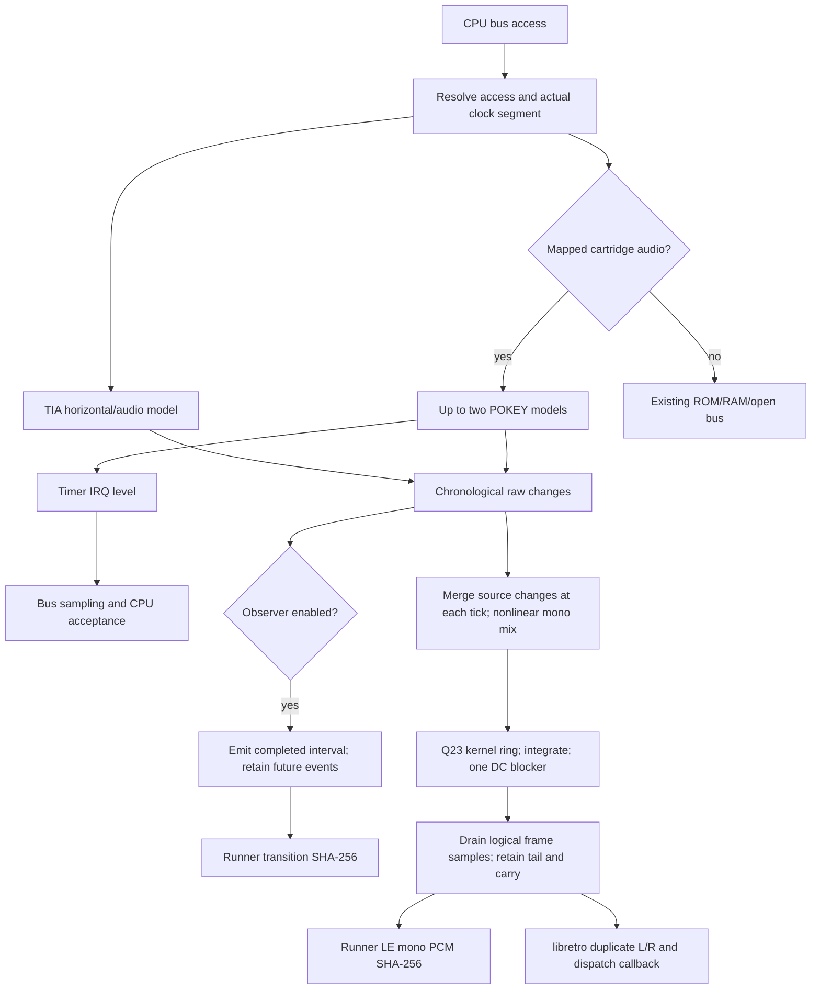

# Phase 04: Sound - Research

**Researched:** 2026-10-20
**Domain:** TIA/POKEY timing, fixed-point event synthesis, deterministic host audio
**Confidence:** MEDIUM — inspected code and isolated arithmetic probes; production audio does not exist yet.

<user_constraints>
## User Constraints (from CONTEXT.md)

The following sections are copied verbatim from the locked context. Their provenance is the context, not independent hardware verification. [VERIFIED: .planning/phases/04-sound/04-CONTEXT.md:17-157,232-243]

DATA_H7q2X9aM_START
## Implementation Decisions

The owner requested consideration of all relevant areas, delegated fan-out research, an adversarial pass and
automatic adoption of a coherent recommendation set. Three read-only reviews covered chips/bus, synthesis/mix,
and hosts/evidence. Decisions below reconcile their findings with settled preparation choices. Recommendations
are adopted under that delegation, not presented as answers to an interview that did not occur.

### TIA and POKEY behaviour

- **D-01:** Carry forward DEC.17, 22, 28–30 and 33. Own documented integer C chip models; no new runtime
  dependency. TIA uses its independent 456-tick lattice, A at 0/144 and B at 64/288, never MARIA's line or evenly
  spaced substitutes. Every decoded TIA write reaches it regardless of INPTCTRL. Preserve AUDF wrap behaviour,
  all AUDC patterns, and immediate AUDV level changes described in A7800-AUDIO §2.
- **D-02:** One mutable TIA horizontal epoch drives audio, RSYNC and WSYNC. The existing `tia_phase` seeds it;
  RSYNC must move both schedules together without retroactive events. Keep the existing no-RSYNC WSYNC timing
  and its tests. Register writes take effect at the bus's data tick: a slow write's start+5, rather than its
  cycle completion at start+6. Clarify preparation's ambiguous “cycle end” prose when implementing.
- **D-03:** Deterministic startup: zero TIA audio logic, existing initial phase, POKEY running as SKCTL=$03.
  Preserve an internal alternate-init profile for tests. These are compatibility defaults, not claims that
  physical unreset chips power up deterministically. Advance hardware over the existing boot timeline; do not
  invent BIOS residue or reset lattice phase at cartridge hand-off. A power cycle resets audio; the console's
  Reset input remains a switch read by software.
- **D-04:** POKEY counts actual bus phi2, including HALT/RDY holds and stretched slow cycles. Catch up before
  changing a tick-to-phi2 segment, mapped accesses, interrupt decisions and output flushes. Aggregate cycle
  counts cannot reconstruct transitions across lost slow-cycle segments. Implement documented joins,
  reload/STIMER pipelines, two-tone resynchronisation, high-pass delay, staggered polynomials and RANDOM/init
  semantics. Silent output is not permission to stop hidden counters or RANDOM.
- **D-05:** Model existing header POKEY codes with at most two fixed chip instances: $4000–$7FFF mirrored,
  $0450–$045F, $0800–$0FFF, and $0440–$044F including $440+$450. Both chips mix to mono. Reuse one chip model;
  no broader board or expansion work. Decode through the cartridge path with explicit read/write priority;
  preserve ROM reads on documented write-only overlaps and existing conflict normalization. CPU accesses and
  MARIA fetches must not accidentally share side effects.
- **D-06:** Fulfil the settled v4 IRQ wiring policy, including CPU acceptance. The existing CPU implements NMI,
  but no maskable IRQ path; a POKEY line field alone is insufficient. Add timer IRQST/IRQEN semantics and
  documented NMOS IRQ sampling/entry, retaining NMI priority and existing vectors. Use validated effective v4
  wiring, not raw bits from an invalid v4 block. Wire the @440 identity to its own bit even when it occupies
  instance slot zero. Test masking, acknowledgment, persistent levels, held cycles and NMI interaction.
- **D-07:** Hardware uncertainty remains confidence-qualified: TIA pattern disagreements, POKEY STIMER polarity,
  startup state and physical mix are recorded with sources. Use A7800-AUDIO's documented functional model and
  Altirra manual vectors as the provisional model; emulator agreement is not hardware proof. Real-console and
  Verilated referee work stays in its later milestone, and does not become an owner UAT task here.

### Synthesis, mix and runtime bounds

- **D-08:** Seed the approved sibling's 16-tap/32-phase Q15 kernel, interpolation and integer ring integration;
  retain a single approximately 20 Hz integer DC blocker and omit NES-specific filters. Use the provenance-
  approved seed pin `9f9386c661f6`; reconcile the audio preparation's different `34d68516a15e` reference before
  copying. Copy only needed sections and retain attribution as PROVENANCE.md requires. The sibling's spectral
  result is a hypothesis until measured through this production pipeline.
- **D-09:** Keep the released public contract: 48,000/1 Hz, mono int16, exact NTSC phase ratio 88/13,125.
  No sample-rate configuration or public synthesis profile is added. At this rate one sample interval spans
  at most 150 master-tick positions; merge mixed-level changes at a tick before kernel work. Bound catch-up,
  event carry, ring storage and integer intermediates explicitly; allocate nothing after load.
- **D-10:** Use owned integer TIA nonlinear and POKEY saturation tables generated from A7800-AUDIO §3's formulas,
  node-current weights and default cartridge gain. Simultaneous raw source changes are mixed together. Actual
  cartridge loading and coupling corners remain unmeasured; add no speculative board or TV filters.
- **D-11:** Correct the preparation's clipping argument: a maximum DC sum and unity kernel-row sum cannot prove
  no clipping when signed lobes ring. Derive scale from a conservative bound on the complete reconstruction
  and DC-blocker path, including rounding, to leave at least 1 dB headroom. Prove intermediate-width safety
  separately. Test maximum hardware combinations, adverse transitions and real built samples. A saturation
  clamp or flat-DC test does not establish zero clipping. Update the affected preparation claim in the same
  implementation change; no need to reopen the analog model.
- **D-12:** Start with exact synthesis only. Measure the hostile high-rate POKEY case and preserve bounded
  per-output-sample work. The documented box-bin performance trigger remains conditional, not an instruction
  to add another profile now. Never switch quality automatically with workload. Any measured fallback must
  preserve raw transition hashes and independently meet SND-05; otherwise record the finding for planning.

### Observation, hashes and frame boundaries

- **D-13:** Use a narrow internal per-instance transition tap for the runner, which already links private core
  inspection. Keep SHA-256 in the runner and public API version 3. NULL disables observation; avoid hashing,
  serialization and event storage for observation when disabled. General hooks and public registration
  contracts stay deferred. The tap must not affect machine state, PCM or frame hashes; callbacks do not reenter
  the core. Register observation before running, and keep its host context separate from power-cycle state.
- **D-14:** Canonical transition records are exactly 11 bytes: LE u64 absolute master tick, u8 source,
  LE u16 raw channel DAC level. No native structs, padding, mixer outputs or unchanged-level notifications.
  Source IDs are fixed: 0/1 TIA channels, 2–5 primary POKEY channels, 6–9 @440 secondary POKEY channels; a lone
  @440 uses its @440 IDs. Other single-chip locations use primary IDs. Serialize equal-tick events in source
  order, retaining meaningful within-source order; do not collapse raw transitions just because synthesis
  merges the tick. Known initial zero levels produce no synthetic change record; later changes use the same
  absolute boot timeline as the bus. Document the source assignment and format before pinning.
- **D-15:** Hash PCM as successive mono signed-int16 representations serialized to two LE bytes each. Hash only
  actual output samples, never capacity or stereo duplication. Keep transition and PCM digests separate.
  Rate, behaviour revision and synthesis identity accompany evidence; changing the mixer does not redefine
  the raw transition stream.
- **D-16:** `--hash-audio` produces two distinctly labelled SHA-256 values over the whole requested run,
  with completed-frame/sample counts and rate. Successful signal stop includes only completed frames. A failed
  run produces no success digest. Keep stdout's existing key/value style and exit-status table. Exact labels
  are the planner's choice and must be documented/tested. No per-frame query syntax, WAV export or new hashing
  package is needed.
- **D-17:** Audio belongs to logical half-open frame intervals [frame_start, frame_deadline), including the
  existing partial first frames. The CPU currently finishes an instruction beyond that deadline. Keep future
  transitions out of the current frame and its hash; use bounded carry to retain them, kernel tails, blocker
  state and fractional phase. Do not solve audio by changing CPU/frame semantics or dropping overshoot.
  Preserve the fast-boot first frame (8,190 ticks, 54 samples), BIOS first interval, and full 800/801 cadence.
- **D-18:** NULL audio skips writes only: chip clocks, synthesis history, count and future PCM advance identically.
  Validate buffer errors before running or invoking observation. Power cycle clears chip/ring/blocker/carry/
  fraction state. No-content output remains the existing silent test card. BIOS refusal is an existing sticky,
  post-execution error; emit no failed-frame PCM/hash result and document that existing exception instead of
  promising rollback of execution. Test ordinary invalid calls as atomic and BIOS refusal separately.

### Evidence and published pins

- **D-19:** Chip unit tests assert documented values, not just self-generated golden hashes. Cover A7800-AUDIO
  §9's lattice, all AUDC settings, AUDF changes, timers, polys, RANDOM, init, slow cycles and level writes;
  include RSYNC, IRQ and address-overlap cases. Use existing plain-C/CTest and fixture licensing conventions.
- **D-20:** Define SND-05's measurement before implementation: largest unintended spectral peak strictly below
  16 kHz, below -80 dBc against an audible intended fundamental; for ultrasonic-only cases with no in-band
  fundamental, below -80 dBFS against an explicitly defined full-scale reference. Pin settling, capture length,
  window, normalization and intended-harmonic masks. Exclude only intended physical harmonics and justified
  leakage lobes; a folded alias never becomes an exempt harmonic. Exercise actual TIA lattice tones and
  POKEY AUDF 0/1/3 through the production kernel/blocker, rather than only FFT-bin-rounded synthetic events.
  A deliberately aliased control must fail. Test-only floating spectral analysis may live outside the integer
  core; reuse the minimal permitted sibling harness without adding an analysis package to runtime or CI.
- **D-21:** Add non-silent sound/POKEY sample transition and PCM pins to existing cross-platform hash comparison,
  including be32 and applicable WASM output. Test observer-on/off equality, partitioned versus continuous
  rendering, discarded frames then audible output, reset and no-content silence. Pins establish regression
  stability, while chip vectors and spectral tests establish their meaning.
- **D-22:** Prove libretro batch preference and single-sample fallback sample-for-sample against core/runner
  mono, with equal L/R, actual counts, partial first frame, missing callbacks and reset/reload. Extend existing
  `runner.boot_to_play` with non-silent audio and a muted negative control. Keep hosted RetroArch within its
  established case and size budget; do not add recording/device automation. The agent handles any one-off
  RetroArch judgment; no owner listening test is required.
- **D-23:** Fold the pending POKEY re-pin todo. In the commit that maps $0450, bump the behaviour revision and
  rewrite the five POKEY samples' frame chains plus four affected `title@120` pins, regenerate compatibility
  documentation and record old/new values and causes in that plan's SUMMARY. Changes in samples without POKEY
  require investigation, not blanket re-pinning. Preserve ABI and API; replace stale numeric behaviour-version
  comments with a reference to the reported value. Reuse one intentional revision migration for this phase's
  released behaviour changes, with explicit reasons and established pin-writing rules.
- **D-24:** Every behaviour change includes a test in the existing CI workflow. Keep proportional gates, no
  self-skips, and existing review-round limits. Evidence is a command, exit status and hosted run URL where
  available; no committed execution logs. Ship-time merge/release checks remain the ship step's job.

### Agent's Discretion

Internal names, module splits, bounded carry representation, exact tie-order machinery, spectral harness details,
and CLI labels may be chosen during research/planning within these contracts. Research must prove spectral and
headroom claims; this discussion does not certify them. No speculative public API or dependency is authorized
merely by an illustrative architecture signature.

### Folded Todos

- `.planning/todos/pending/2026-10-19-re-pin-the-pokey-samples-when-pokey-lands.md`: directly triggered by mapping
  $0450; its migration is D-23. Keep the todo until execution produces evidence.

## Deferred Ideas

PAL, XM/YM2151/COVOX and other audio devices, physical mix calibration, hardware/RTL referees, public hooks,
arbitrary rates, WAV export, save states and broad diagnostics retain their existing milestone placement.

### Reviewed Todos (not folded)

- Release-rehearsal filtering, wasm32 promotion, arming the performance gate, Dependabot/publish review seeds,
  and nightly/cartdb review seeds stay in their existing separate work; keyword matches do not make them sound
  requirements. The prior phase already folded its CPU/run-loop review todo; it is not a new Phase 4 gap.
DATA_H7q2X9aM_END
</user_constraints>

## Summary

Use owned integer chip models, the approved sibling's reconstruction structure with the evidence-backed Q23 coefficient correction below, a single integer DC blocker, and the existing public mono PCM interface. Put timing ownership in the bus and mutable storage in the instance. Deliver one thin audible TIA path first, then widen POKEY, address decoding, IRQ, synthesis tests and host coverage. No package or new public API is required. The copied context remains the decision history; the narrow D-08 revision below is explicit new evidence for planning, not a silent rewrite of that history. [VERIFIED: .planning/phases/04-sound/04-CONTEXT.md:25-157; feasibility probes in this research]

Two findings materially affect planning. The approved synthesis pin and the audio preparation's different pin have identical synthesis and spectral-test blobs. However, the sibling spectral judge masks folded aliases, so its reported quality cannot establish this phase's acceptance. A hardware-scaled feasibility sweep refutes the unchanged Q15 seed and establishes a concrete compliant route: regenerate the same 16-tap/32-phase windowed-sinc kernel at Q23, preserving its interpolation/ring architecture. All 132 isolated test cases pass without reducing hardware-derived gain; all 132 deliberately aliased controls fail. Production verification still precedes published PCM pins. [VERIFIED: feasibility/sweep commands and results below]

The existing frame loop completes an instruction beyond its logical deadline. Preserve that CPU behavior while separating current-frame PCM/raw events from future carry. Also resolve the fast-boot clock origin explicitly: its master tick jumps forward while its phi2 count stays at power-on. [VERIFIED: src/frame.c:8-18,47-56,79-90; src/boot.c:43-76; src/instance.c:99-111]

**Primary recommendation:** Build the bus/chip/audio boundary and an early production quality test together; only freeze hashes after exact timing, headroom and spectral behavior pass. [VERIFIED: locked D-02,D-04,D-11,D-17,D-20,D-21]

## Architectural Responsibility Map

This is the recommended responsibility allocation under the locked instance/bus/host contracts. [VERIFIED: .planning/phases/04-sound/04-CONTEXT.md:25-157]

| Capability | Primary Tier | Secondary Tier | Rationale |
|---|---|---|---|
| Hardware clocks and register-write timestamps | Core bus | Chip models | Only the bus advances machine time and knows slow/held segments |
| TIA horizontal epoch, channel logic, RSYNC/WSYNC | TIA model | Bus | One mutable horizontal clock owns all TIA schedules |
| POKEY counters, polys, RANDOM and timer IRQ | POKEY model | Bus/CPU | Chip generates level and IRQ; bus provides actual clock; CPU accepts IRQ |
| POKEY address/overlap priority and effective wiring | Cartridge | Bus | Resolve declared hardware once; CPU and MARIA accesses have different effects |
| Nonlinear mixing, kernel, blocker and PCM carry | Audio/synth | Frame loop | Stateful reconstruction continues across caller buffer partitions |
| Completed-run transition/PCM SHA-256 | Runner | Internal observer | Hashing and serialization stay outside core |
| Stereo duplication and callback choice | libretro adapter | Public library | Adapter converts completed mono output only |
| Sample fixtures and platform equality | Existing CTest/CI | Runner | Exercise shipped objects and the real output |

<phase_requirements>
## Phase Requirements

The descriptions below are reproduced from the requirement source, with research support added. [VERIFIED: .planning/REQUIREMENTS.md:100-110]

| ID | Description | Research Support |
|---|---|---|
| SND-01 | `ctest -L tia` steps every AUDC setting through the period and bit pattern A7800-AUDIO tabulates, on the TIA's own 456-tick lattice, with TIA writes ungated by INPTCTRL. | Own TIA vectors, shared epoch, data-tick integration |
| SND-02 | `ctest -L pokey` checks POKEY at $4000, $0450 and $0800 as the header or hash list places it: 16-bit joins, 1.79 MHz mode, two-tone with the high-pass filter, the polynomial counters, RANDOM, SKCTL initialisation, and its clock stretching on slow cycles. | Manual vectors, piecewise phi2, decode/IRQ integration; include locked @440/dual coverage |
| SND-03 | `muhtari-run --hash-audio` prints the transition-stream and PCM hashes for the 7800basic sound and POKEY samples, identical on every platform, and no sample clips. | Canonical serialization, shared platform output, analytic headroom plus real-sample checks |
| SND-04 | The libretro batch and single-sample paths deliver stereo-duplicated PCM equal to the runner's, and `runner.boot_to_play` also requires non-silent audio. | Extend real module host and runner judge, including muted control |
| SND-05 | A test renders reference tones through the synthesiser and shows the largest non-harmonic peak below 16 kHz is under −80 dB. | Actual-frequency BH4-windowed production captures, dBc/dBFS distinction, alias control |
</phase_requirements>

## Project Constraints (from AGENTS.md)

All directives below are planning constraints, reproduced in condensed form from the opened project instructions. [VERIFIED: AGENTS.md:1-74]

- Keep permissive reuse, notices and exact approved pins; never open GPL/LGPL/unlicensed emulator source.
- Ship library, headless runner and libretro; add no device/window code.
- Keep ROM/BIOS/save bytes out of tracked content except manifest fixtures; keep personal data out; use noreply commits and hygiene hooks.
- Use integer-only, per-instance, deterministic, bounded execution, including hostile/JAM programs.
- Every behavior change includes a CI-run test and matching documentation. Keep README/header terse; prose belongs in docs.
- The agent performs judgment and verification. Ask the owner only for identity-bound consent or their hardware; no listening UAT.
- Repository gates use CMake -P/POSIX sh and remain below one tenth of core lines. Name prevented faults. At most two review-fix rounds and one gap round; tooling findings are seeds.
- Perform only this GSD step; never chain or enable either bypass. Work on the phase branch; PR/auto-merge/release confirmation belongs to ship.
- Evidence is a command, exit status and hosted URL when available, never a committed execution log.
- Lessons are hypotheses until reproduced; export only using their template when requested.
- Plan summaries require requirements-completed and block-style coverage entries with id, description, requirement, verification kind/ref/status and human_judgment.
- Use small modules, plain control flow, fixed-width integers, module prefixes and muhtari_ public names. Hardware comments describe behavior and cite a source. Keep planning IDs out of code, tests and user docs. Reuse existing code/standard facilities before adding dependencies.

The configuration explicitly says `"nyquist_validation": false`, `"security_enforcement": false`, `"parallelization": false`, and `"agent_skills": {}`; graph status reports disabled. Therefore no separate Validation Architecture or ASVS expansion belongs in this research, and execution remains sequential. Existing behavior tests and hostile-input checks are still required by AGENTS.md. [VERIFIED: .planning/config.json:4,28,52,74,86-88; graphify status command, exit 0]

## Standard Stack

Use the existing toolchain and packages; add no runtime or CI analysis dependency. Versions below describe observations/pins, not upgrade recommendations. [VERIFIED: locked D-01,D-08,D-20,D-24; CMakeLists.txt:40-91]

| Component | Version/pin | Purpose and disposition |
|---|---|---|
| Owned C core | C17 | Extend current instance/chip/bus modules; shipped archive remains integer-only |
| CMake/CTest | local 4.4.3 | Existing build and tests; measured with cmake --version |
| Ninja | local 1.13.2 | Existing local generator |
| C compiler | local Apple clang 21.0.0 | Local arithmetic/spectral research probes |
| nesturbator synthesis seed | 9f9386c661f6fb8f6063bf756655713aedadae77 | Reconstruction structure, interpolation, ring integration and useful arithmetic/test machinery; regenerate coefficient precision as explicitly resolved below |
| wasmtime | pinned/local 48.0.6 | Existing sample tool runtime |
| 7800basic | existing 0.41 pin | Existing built-only samples |
| SHA-256 | existing runner implementation | Reuse streaming hashes and explicit LE serialization |

Tool versions were observed through version commands; tool/sample pins are quoted as `7800basic-wasm@0.41,wasmtime@48.0.6` in the fixture source. [VERIFIED: tests/built/expected.txt:14-20; local version commands, exit 0; PROVENANCE.md:35-62]

**Installation:** none for runtime. Use existing pinned-tool fetch recipes if the execution checkout lacks them; do not add Python/NumPy, FFT libraries, BLIP libraries or a sound backend. [VERIFIED: locked D-01,D-08,D-20; tests/built/tests.cmake:4-17]

## Package Legitimacy Audit

Not applicable: this phase installs no external package. The sibling is a source seed governed by provenance, not a registry dependency. Read its exact LICENSE and permitted file content before copying and use the required commit-body attribution. The opened MIT license and provenance approval support this route. [VERIFIED: PROVENANCE.md:35-62; git show approved-pin:LICENSE, exit 0]

## Architecture Patterns

### System Architecture Diagram

Recommended data flow; equal-tick ordering and logical output horizons are explicit contracts. [VERIFIED: locked D-02,D-04,D-13–D-18]



### Component Responsibilities and Exact Seams

These are existing code seams, read directly this session. Proposed additions are recommendations, not claims that new files/types already exist. [VERIFIED: sources in table]

| Existing seam | Required work |
|---|---|
| src/internal.h:125-130,260-279 | Add owned TIA, two fixed POKEYs, synth, carry and effective wiring. Keep observer/context outside reset machine-state storage. Existing profile literally contains `uint16_t tia_phase;`; initialize one mutable epoch from it |
| src/tia.c:34-49 | Existing write entry is `void muhtari__tia_write(muhtari *m, uint16_t addr, uint64_t data_tick)`; pass the value internally and extend WSYNC to RSYNC/audio. Preserve no-RSYNC tests |
| src/bus.c:16-21,273-285,412-431 | Constants are `BUS_FAST_TICKS 4u`, `BUS_FAST_DATA 4u`, `BUS_SLOW_TICKS 6u`, `BUS_SLOW_DATA 5u`. Flush old clock segment before changing it; stamp writes at data, not end |
| src/bus.c:100-113,174-194,245-262 | Integrate next IRQ deadlines, held-cycle catch-up and poll-visible levels; bulk phi2 advancement must preserve transition timestamps |
| src/cart.c:506-520,543-555,748-765,827-859 | Consume effective identified sound, not raw flags; distinguish CPU read, peek and MARIA fetch. Existing `muhtari__cart_read(muhtari *m, uint16_t addr, int by_maria)` ignores by_maria today |
| src/cart.c:193-214,486-490 | v4 decoder validates irq but raw `out->a78_irq = be16(img + A78_IRQ);` survives ignored blocks. Derive/store effective wiring only from a valid accepted block; do not wire ignored raw bits |
| src/cpu.c:32-61,595-615,1489-1491 | Extend existing poll point/entry without changing opcode bus order; NMI already consumes its edge. Add a latched IRQ decision sampled with I at poll time, not a live flag check after the instruction |
| src/boot.c:43-100; src/instance.c:99-111,164 onward | Reset all chip/synth state, preserve host observer. Advance TIA boot epoch; handle fast-boot phi2 origin deliberately |
| src/frame.c:21-57,79-110 | Validate first. Replace `memset(io->audio, 0, (size_t)n * sizeof io->audio[0]);` with drain/discard of actual synthesis; preserve count, NULL semantics and sticky BIOS refusal |
| runner/main.c:864-940 | Register tap before execution; hash successful frames' actual mono counts; finalize only when whole run succeeds/stops successfully |
| libretro/libretro.c:468-520 | Keep existing duplication and batch preference; verify real non-silent samples and first partial interval |

**Proposed module split:** keep TIA in its existing module; add one POKEY module and one small audio/synth module, with integer tables separate only when this improves readability. Add subsystem CTest includes to the existing top-level include list and core object source list. Reuse the actual shipped object in unit tests. [VERIFIED: CMakeLists.txt:62-91; tests/tests.cmake:27-57; locked agent discretion]

### Timing, clock segments and bounds

- TIA events use one independent horizontal epoch. Catch up the old schedule through the write tick before applying RSYNC; schedule subsequent A/B edges from the new epoch without firing old events twice. AUDF is a comparison to the running counter, not a reload latch. AUDV can change the raw DAC immediately. The preparation records A `{0, 144}`, B `{64, 288}`, line `456`, and the AUDF20→5/count12 wrap delay `26` clocks. These are the adopted functional expectations, with physical pattern disputes still qualified. [VERIFIED: .planning/preparation/A7800-AUDIO.md:38-63; locked D-01,D-02,D-07]
- POKEY uses phi2 and a piecewise tick mapping, including held cycles. Flush before entering and leaving a slow segment, not merely at the next mapped access. A total phi2 difference loses where the stretched segments occurred. Keep sample/tick emission streaming so the worst number of mixed-level kernel additions in one output interval is at most 150 (one merged level per master tick); two chips do not double this kernel-add bound. Chip work remains a separate bound. [VERIFIED: src/bus.c:181-194,273-285; locked D-04,D-09; derived ceil(13125/88)=150]
- Count invisible timers/noise/RANDOM even with zero volume or volume-only mode. Base-clock prescalers may skip directly to the next due event, but fast timers and pending pipelines still execute. Use the manual's documented STIMER/reload, high-pass and two-tone vectors as separate tests, not hashes of the implementation. [VERIFIED: .planning/preparation/A7800-AUDIO.md:85-115,144-155; CITED: https://www.virtualdub.org/downloads/Altirra%20Hardware%20Reference%20Manual.pdf chapter 5]
- Preserve half-phase high-pass events explicitly. A whole-phi2-only DAC emitter can lose the pulse. Use the explicit divider-edge convention in Resolved clock conventions below; do not silently split six ticks into equal halves from the bus-call origin. [VERIFIED: locked D-04; .planning/preparation/A7800-AUDIO.md:88; docs/hardware/bus.md:24-32]
- Produce audio through an output horizon and retain future work. The existing constants are `MUHTARI__TICKS_PER_FRAME_NTSC 119402u`, `MUHTARI__SAMPLES_PER_PERIOD 88u`, `MUHTARI__TICKS_PER_PERIOD 13125u`, `MUHTARI__MAX_AUDIO_SAMPLES 801u`. Stream sample emission during catch-up rather than accumulating frame-sized transition arrays. A 16-slot impulse ring suffices for the seed's support; separately prove pending PCM/raw carry capacity from instruction-plus-interrupt overshoot and held-cycle bounds. No arbitrary drop or reallocating overflow path is acceptable. [VERIFIED: src/internal.h:15-21; src/frame.c:8-18; approved seed src/synth.c:2721-2771; locked D-09,D-17]
- Do not assume instruction overshoot is merely the maximum opcode's unheld bus cycles: a WSYNC-held read and MARIA hold can cross the deadline. Derive a conservative bound from the actual hold loop and DMA release, then assert it in adversarial tests, including an interrupt entry after the instruction. The exact carry capacity is an implementation proof obligation; this research does not certify a guessed array size. [VERIFIED: src/bus.c:148-168,219-262; src/cpu.c:1489-1491; locked D-17]

### IRQ acceptance without broad CPU refactoring

Keep the current one-poll-per-instruction design and sample IRQ level plus I at that point after ensuring POKEY is caught up. This preserves CLI/SEI/PLP old-I behavior and RTI's earlier restored-I timing. NMI wins a simultaneous decision; IRQ remains level-sensitive until chip acknowledgment. Add IRQ entry bus-cycle expectations and NMI vector hijack coverage independently of opcode vectors. The Altirra manual's CPU chapter explicitly documents flag-delay and overlapping interrupt behavior. [VERIFIED: src/cpu.c:39-60,956-960,1096-1100,1160-1189; CITED: https://www.virtualdub.org/downloads/Altirra%20Hardware%20Reference%20Manual.pdf §3.4]

Preserve the CPU test object's flat-bus seam: its replacement bus currently implements only `muhtari__bus_read` and `muhtari__bus_write`. Either keep poll-visible fields updated by those bus calls, or extend the test bus deliberately if a new internal bus-poll function is necessary. A chip-function call introduced directly into the CPU would otherwise break object-level tests. [VERIFIED: tests/cpu/vector_bus.c:1-46; CMakeLists.txt:62-85]

The manual also documents IRQEN propagation timing and warns that source disabling can trail an already-signaled IRQ. Plan explicit timer IRQST/IRQEN active-low register expectations and acknowledgment timing from the register description/figure, not only an instantaneous line boolean. Non-timer peripherals are outside this phase; document their unmapped/default read behavior rather than growing a serial/keyboard implementation. [CITED: https://www.virtualdub.org/downloads/Altirra%20Hardware%20Reference%20Manual.pdf §§5.7,14; VERIFIED: locked D-06 and phase boundary]

## Seed Reconciliation and Headroom Proof

### Approved seed, exact comparison

The following read-only commands returned exit 0; no source was copied into the repository:

```sh
git -C <approved-sibling> show 9f9386c661f6:LICENSE
git -C <approved-sibling> ls-tree 9f9386c661f6 src/synth.c tests/core/test_synth.c tests/runner/test_spectral.c
git -C <approved-sibling> ls-tree 34d68516a15e src/synth.c tests/core/test_synth.c tests/runner/test_spectral.c
git -C <approved-sibling> diff 9f9386c661f6 34d68516a15e -- src/synth.c tests/core/test_synth.c tests/runner/test_spectral.c
```

Both pins have identical blobs: synth `75d64d986154d72092f4020ea4fc842b7eefb573`, synth tests `b2da1f94f509744984113ce2fdc079b4a8442060`, spectral test `2108c4bd2dc27e792fd9e0ebf38f9a221817a9ce`. The diff is empty. Use the provenance-approved pin and update the stale audio-preparation citation when implementing. [VERIFIED: git ls-tree/diff commands above; PROVENANCE.md:35-62]

The seed's rows are normalized to 32768, and interpolation corrects its rounded sum at tap 7/8, including the shifted phase32 endpoint. Copy this correction, not independent coefficient rounding alone. Exclude its NES mixer tables, both NES high-pass corners and NES low-pass stage. Its final PCM helper saturates; do not treat saturation as a headroom proof. [VERIFIED: approved seed src/synth.c:1-47,2660-2771]

### A useful conservative bound, with a reproducible algorithm

An isolated integer probe enumerated every interpolated phase and every distinct sample/master-tick alignment. It used the approved kernel's exact interpolation/correction and event-before-sample convention, not a production implementation. Command `python3 /tmp/muhtari_headroom_probe.py` returned exit 0. Results: maximum corrected coefficient magnitude 28452; effective reconstruction positive weight mass 42452/32768 and negative mass 9684/32768; maximum L1 mass 52136/32768 = 1.591064453125. These values are verified for that probe convention only. [VERIFIED: isolated arithmetic probe run 2026-10-20, exit 0]

Production proof recipe:

1. For an event at integer tick t, compute q=floor(88t/13125), phase=(88t mod13125), and its corrected 16 coefficients.
2. For output sample n, form cumulative step response S(n,t) from coefficient taps 0 through n−q, clamped to 0 before support and 32768 afterward.
3. Summation by parts gives level weights w(n,t)=S(n,t)−S(n,t+1). Enumerate the finite support and all 88 distinct output alignments in a 13125-tick period. Check sum(w)=32768 exactly.
4. Let P=max sum of positive weights, N=max absolute sum of negative weights. For all mixed levels in [0,M], reconstruction lies in [−NM/32768, PM/32768].
5. For blocker y=x−x_previous+R*y_previous, its positive and negative impulse-response masses are each one. Thus |y|≤(P+N)M/32768 before fixed-point rounding. Add the recurrence's rounding bound and final PCM rounding explicitly.

This derivation covers arbitrary bounded mixed-level changes and signed kernel ringing. It is a recommendation derived from finite linear reconstruction, not a hardware claim. Re-run it against production ordering and coefficient arithmetic. [VERIFIED: probe algorithm and result; CITED: https://www.dsprelated.com/freebooks/filters/DC_Blocker.html for blocker equation]

For the probe's masses, M≤18354 leaves at least 1dB headroom and a one-PCM-LSB rounding allowance: floor((32767·10^(−1/20)−1)/1.591064453125)=18354. A 20Hz exponential pole at 48kHz rounds to Q30 1070934451. Use checked-in integer constants generated offline and name the recurrence; the seed instead multiplies the whole difference-plus-feedback by its HP coefficient, which is a different transfer function. [VERIFIED: isolated arithmetic probe, exit 0; approved seed src/synth.c:2755-2762]

Prove widths separately. At ≤150 merged changes/sample and |delta|≤M, a ring cell has at most 16 intervals of finite pending coefficient contributions. A conservative pending-sum bound uses 16·150·M·Cmax (under 2^41 at M=18354 and Cmax=28452); the effective reconstruction bound is far tighter for the integrator. Q30 guard state fits int64, but naively multiplying a Q30 state by a Q30 coefficient does not. Reuse the seed's quotient/remainder multiply to avoid the wide product. Test negative rounding and phase-boundary correction on be32/MSVC. [VERIFIED: seed src/synth.c:2667-2673; arithmetic derived from measured coefficient maximum and locked sample-work bound]

Use monotone owned TIA/POKEY tables from the adopted formulas and calculate gain from the maximum declared hardware. The preparation's POKEY table uses weighted bit drops and its TIA mix is nonlinear; do not replace them with raw-volume sums. Fix the preparation's DC-only clipping argument in the implementation PR. [VERIFIED: .planning/preparation/A7800-AUDIO.md:64-78; locked D-10,D-11]

Make table normalization dimensionally explicit. The literal TIA shape n/(n+30) reaches 0.5 at n=30. If the current weight represents 2.5V at full scale, normalize the table to 2n/(n+30); alternatively retain the literal shape and use its 5V supply normalization. These are equivalent expressions of the adopted curve, not alternative analog models. Do not silently multiply a half-scale table by an already full-scale weight. Generate endpoint/current-ratio tests before freezing PCM. [VERIFIED: .planning/preparation/A7800-AUDIO.md:61,72,74-76; arithmetic derivation from quoted n/(n+30)]

## Spectral Method and Early Risk

### What the sibling test establishes

The opened sibling judge literally says `Include folded aliases of the first 512 harmonic orders.` Its tone generator rounds to a coherent FFT bin. This contradicts this phase's intended rejection of folded aliases. Reuse the minimal FFT/capture mechanics if helpful, replace its classification and tone scheduling, and make an intentionally aliased path fail. [VERIFIED: approved seed tests/runner/test_spectral.c:168-182,237-265; locked D-20]

### Measurement to pin in the first synthesis plan

Recommended test-only method: 12000 output samples of settling (250ms at 48kHz), then 65536 actual int16 production samples; periodic four-term minimum Blackman-Harris window, w(n)=0.35875−0.48829cos(2πn/N)+0.14128cos(4πn/N)−0.01168cos(6πn/N). Normalize peak amplitude as 2|DFT|/sum(w). Use double math only in the test executable with the platform math library, or the permitted sibling integer FFT if it meets the same negative controls. No runtime or CI analysis package is needed. These numeric harness choices are recommendations in the delegated discretion area. [VERIFIED: locked D-20; CITED: https://www.analog.com/media/en/technical-documentation/application-notes/an215.pdf]

Pin the frequency search strictly to 0<f<16000Hz. For audible intended fundamentals, report 20log10(unintended_peak/fundamental_peak) in dBc; for ultrasonic-only input, report 20log10(unintended_peak/32767) in dBFS. Use a fitted sinusoid or tightly bounded window-peak interpolation to normalize an off-bin fundamental; nearest-bin amplitude alone underestimates it. Mask only the physical in-band intended lines and a justified finite leakage neighborhood (initial recommendation ±5 FFT bins), never modulo-folded harmonics. Bound aggregate leakage from multiple intended lines and test the analyzer on off-bin known sines. Noise/distortion modes require an explicit expected physical line set, not a square-wave harmonic assumption. [VERIFIED: locked D-20; CITED: https://www.dsprelated.com/freebooks/sasp/Spectrum_Analysis_Windows.html; recommendation derived from the stated measurement contract]

Use actual TIA event spacing, including its uneven B phases, and POKEY timers through the production clock/mixer/kernel/blocker. Include TIA AUDC4/AUDF sweeps, POKEY fast AUDF0/1/3, useful starting phases, actual slow-clock segments, one channel and synchronous/all-channel stress. Check PCM as delivered, plus internal pre-quantized output when locating a failure. A test-only nearest-sample/zero-order-hold version of the same tones must breach the threshold; also inject a known in-band spur near the exclusion-mask edge. [VERIFIED: locked D-20; recommended adversarial extensions]

### Isolated probe results — neither production pins nor certification

Command `python3 /tmp/muhtari_sound_probe.py` compiled a dependency-free C probe and returned exit 0. It used the approved Q15 kernel/correction, exact 88/13125 tick phase, a double-precision 20Hz blocker, rounded int16 output, the settling/capture/window above and a 0→16000 level swing. It did not implement POKEY chip logic, actual nonlinear cartridge scaling or production frame carry. Its peak search masked only the audible TIA fundamental ±5 bins. [VERIFIED: isolated probe run 2026-10-20, exit 0]

| Input schedule | Physical fundamental | Largest unintended peak below 16kHz | Result at probe scale |
|---|---:|---:|---:|
| TIA B spacings 224/232, div2 | 15699.7608Hz | 13123.5352Hz | −82.4215dBc |
| POKEY equivalent AUDF0, edge every 16 ticks | 223721.5909Hz | 834.9609Hz | −74.1340dBFS |
| POKEY equivalent AUDF1, edge every 20 ticks | 178977.2727Hz | 750Hz | −81.6910dBFS |
| POKEY equivalent AUDF3, edge every 28 ticks | 127840.9091Hz | 477.5391Hz | −80.5271dBFS |

The dBFS result changes with the final declared-hardware scale, while dBc does not. A production single POKEY channel may pass after legitimate headroom scaling; synchronous maximum channels can be louder. Do not tune the test signal amplitude to hide the problem. First measure final tables/blocker and determine whether coefficient/interpolation precision is responsible before proposing a change to a locked synthesis choice. If the unchanged seed cannot pass, record that new evidence and revise the implementation plan within this same research finding; do not mark the requirement satisfied or add speculative filters. [VERIFIED: isolated probe limitations; locked D-08,D-10–D-12,D-20]

A falsification probe postponed interpolation rounding by retaining exact coefficient numerators over 13125 while leaving the Q15 kernel rows unchanged. Command `python3 /tmp/muhtari_sound_precision_probe.py` returned exit 0. AUDF0 still measured −74.5977dBFS at the same level16000; AUDF1 improved to −86.7058dBFS and AUDF3 to −82.3266dBFS. Therefore “more interpolation precision alone fixes the ultrasonic case” is not supported. These remain isolated probe results with the limitations above. [VERIFIED: isolated precision probe run 2026-10-20, exit 0]

### Feasibility resolution: explicit minimal D-08 revision

**Use 16 taps, 32 phases, Q23 coefficient rows and the existing interpolated event/ring structure.** Regenerate the owned coefficient table from the seed's stated Nyquist-sinc/Kaiser-beta8 integral over 15 samples; retain exact row-sum correction, phase32 shifted endpoint and the integer 20Hz blocker. This revises D-08's coefficient precision only. The approved pin still supplies the architecture and required attribution; the regenerated higher-precision table is an explicitly documented adaptation. Do not retain the plan's stale identity `exact-q15-16x32-dc20`; name the result `exact-q23-16x32-dc20`. No new profile, rate, filter, dependency or automatic quality switch is introduced. [VERIFIED: feasibility commands/results below; approved seed src/synth.c:1-47,2697-2761; locked D-08,D-09,D-12]

The new evidence is sufficient to reopen the literal Q15 precision: its nine measured failures below conflict with SND-05, while changing coefficient precision alone supplies a passing route at slightly higher derived gain. This is a prescriptive research recommendation for the orchestrator to incorporate in plan04-01 and its preparation update. It is not a claim that original D-08 already authorized Q23, and the original locked context above is deliberately preserved verbatim. [VERIFIED: local feasibility/sweep experiment; SND-05 and locked D-08]

**Coefficient generation:** for phase p of 32 and tap j of 16, integrate sinc(x)·I0(8sqrt(1−(x/7.5)^2))/I0(8) on the intersection of [j−7−p/32−0.5,j−7−p/32+0.5] and [−7.5,7.5]. Round each integral to signed Q23, then correct tap7 for the first half of phases or tap8 for the second half so the row sums to 8388608. Integrate only inside the compact support; treating a support endpoint as zero in a composite quadrature introduces avoidable endpoint error. In the isolated generator, Simpson128 and Simpson256 give identical Q23 rows. A regenerated Q15 table differs from the approved seed by at most two Q15 LSBs; that small generator difference did not cure its spectral failure. [VERIFIED: /tmp/muhtari_sound_feasibility.py and quadrature-refinement command, exit0]

**Gain is fixed by hardware and transient safety, not spectral convenience.** Normalize the adopted TIA full current as 2.5/18 mA and one POKEY's full current as (3.8/6.8)·P(1) mA, where P is the adopted saturation curve. For a declared chip count c, divide the bound-derived maximum mixed level M across TIA and c cartridge currents. One channel at volume15 contributes P(0.25); four coherent channels contribute P(1), including nonlinearity before mixing. The two-chip stress uses both chips at the same phase. This is conservative DAC-level stress; actual chip tests must honor which channels can select the fast clock and their output polarity, rather than falsely claiming every channel independently selects that clock. [VERIFIED: .planning/preparation/A7800-AUDIO.md:71-76,85-93; manual AUDCTL register; feasibility probe]

The Q23/32 production-convention reconstruction bound measured L1=13341774/8388608=1.590463399887085. The same analytic blocker/rounding rule gives **M=18361**. Maximum corrected-row coefficient magnitude is 7283992; the conservative pending product bound 16·150·18361·7283992=320979305068800 remains below 2^49. Convert integrated Q23 to Q30 by multiplying128, then use quotient/remainder multiplication for the Q30 blocker. The coefficient table becomes 512 int32 cells (2048 bytes instead of the seed's1024); the impulse ring remains16 int64 slots and per-event work remains16 taps. [VERIFIED: /tmp/muhtari_sound_feasibility.py, coefficient/width probe, exit0; arithmetic derivation]

The bound-derived all-channel amplitude at two chips is **16332**, versus **16325** for the original seed at its own M=18354. Thus the passing candidate was tested slightly louder, not at a weakened amplitude. One-chip, one-channel and all-channel amplitudes were each calculated from the same current-ratio equation; no test has an independent level knob. [VERIFIED: feasibility/sweep outputs and generator]

Commands `python3 /tmp/muhtari_sound_feasibility.py` and `python3 /tmp/muhtari_sound_sweep.py` both returned exit0. Each candidate's132 cases include actual TIA B-spacing equivalents with AUDF0–31; POKEY-equivalent AUDF0/1/3; one/two declared chips; one/all active channels per chip; offsets0,7,137 ticks. The pipeline uses exact integer tick phase, corrected fixed-point coefficients, **integer** Q30 blocker coefficient1070934451 and final int16 rounding. Captures use the same12000 settle/65536 capture/BH4 window and physical-only in-band harmonic masks described above. No ultrasonic harmonic is folded into an exemption. The reported TIA dBc denominator is the maximum windowed fundamental-bin amplitude, a conservative underestimate relative to a fitted off-bin amplitude. [VERIFIED: isolated C sources generated by feasibility/sweep commands]

| Candidate | Derived M | Worst TIA dBc | Worst POKEY dBFS | Exact cases failing −80 | Deliberately aliased cases rejected |
|---|---:|---:|---:|---:|---:|
| Approved Q15/32 seed |18354|−82.34600|−73.94392|9/132|132/132|
| Same kernel family regenerated Q15/32 |18354|not separately swept|−73.59387 in focused test|fails|not used for recommendation|
| **Recommended Q23/32** |**18361**|**−82.10380**|**−94.71708**|**0/132**|**132/132**|
| Examined Q23/128 |18359|−89.47665|−102.77320|0/132|132/132|

Choose Q23/32 as the minimum measured correction; increasing phase count is unnecessary for the tested acceptance and is not part of the recommendation. The narrowest measured margin is2.10dB on TIA AUDF0, so production must retain the actual-model sweep and phase-offset tests. The alias control bypasses the kernel with nearest-sample level capture while retaining the same gain/blocker/int16 output; its worst TIA result is−9.18dBc and every case is rejected. The quality judge therefore distinguishes aliased output without masking aliases or changing scale. [VERIFIED: complete sweep and aliased-control results, exit0]

**Resolution boundary:** feasibility is established for a concrete bounded integer route. Production coefficient generation, owned mixer quantization, actual chip traces, carry and platform parity are still implementation acceptance tests; isolated equivalent schedules do not certify those unimplemented components. The planner now has a passing route rather than an instruction to execute an unchanged seed known to fail. [VERIFIED: experiment scope; source inspection confirms production sound is not implemented]

## Don't Hand-Roll

| Problem | Use | Avoid |
|---|---|---|
| SHA-256 and hash streaming | Existing runner SHA-256 | New package or hashing inside core |
| Reconstruction machinery | Approved seed structure/interpolation/ring; explicit Q23 coefficient adaptation, retimed and measured | New resampler architecture |
| Host audio | Existing libretro mono duplication/callback paths | Device management or recording automation |
| Spectral transform mechanics | Minimal permitted sibling harness or small test-only adaptation | Analysis runtime/package |
| Fixtures and platform coverage | Existing built recipes/inventories/hash comparison | New sample-fetch infrastructure or copyrighted committed bytes |
| Hardware behavior | Owned models from documentation with vector expectations | Porting excluded emulator source or copying facts-only RTL structure |

These choices follow locked scope and the opened provenance/build seams. [VERIFIED: locked D-01,D-08,D-13,D-20–D-24; PROVENANCE.md:1-62; runner/sha256.c; libretro/libretro.c:468-520]

## Common Pitfalls

1. **Wrong clock or write edge.** Equally spaced TIA edges, MARIA-derived TIA phase, tick/4 POKEY and start+6 slow writes all violate the adopted timing. Detect with timestamp vectors, RSYNC then WSYNC, and slow/held POKEY traces. [VERIFIED: locked D-01–D-04; src/bus.c:16-21]
2. **Sorting only inside each chip.** Lazy catch-up can emit a later TIA event before an earlier POKEY event. Merge chronological streams and source-order equal ticks before notifying; retain meaningful same-source order independently of mixed-level coalescing. [VERIFIED: locked D-14]
3. **Observing future/failed frames.** CPU overshoot can leak into a current-frame transition digest; BIOS refusal can occur after execution. Stage future raw events and publish only the allowed prefix. Runner must never finalize success hashes after any execution/dump failure. [VERIFIED: src/frame.c:79-90; runner/main.c:900-925; locked D-16–D-18]
4. **Freezing inaudible state.** Zero AUDV, init and volume-only output do not imply stopped hidden clocks. Test RANDOM and resumed audio after silence. [VERIFIED: .planning/preparation/A7800-AUDIO.md:85-92; locked D-04,D-19]
5. **POKEY mapping corrupts ROM or MARIA.** Keep write-only overlap priority and read/peek/DMA distinctions. Test all existing map codes, mirrors, valid/invalid v4 wiring and a lone @440 with secondary identity. [VERIFIED: src/cart.c:117-121,195-214,506-520,856-859; locked D-05,D-06,D-14]
6. **Green silence-only host tests.** Existing host PCM checks exercise silence; add a deterministic non-silent cartridge/sample and compare every sample/count, missing callbacks and reset/reload. [VERIFIED: tests/libretro/host.c:7-11; libretro/libretro.c:468-520; locked D-22]
7. **Clipping hidden by a clamp or quality hidden by masks.** Use the complete transient bound, pre-clamp counts/peaks, aliased controls and production scaling. [VERIFIED: seed src/synth.c:2682-2694; locked D-11,D-20]
8. **Changing the public contract accidentally.** Preserve API/ABI, partial frames, NULL output semantics, no-content silence and instance isolation; do not add public debug/profile options. [VERIFIED: locked D-09,D-13,D-17,D-18,D-23]

## Code Examples

The following is proposed algorithmic pseudocode, not an existing internal function signature. It restates locked D-14,D-15; serialized sizes/source IDs are copied in the User Constraints section. [VERIFIED: locked D-14,D-15]

```text
on raw change(tick, source, level):
    if level differs from last raw level:
        preserve event in chronological stream
        observer sees LE64(tick) || U8(source) || LE16(level)
    apply all mixed source changes at tick before adding one synthesis delta

after a successful logical frame:
    for each actual mono sample:
        runner SHA-256 consumes LE16(sample representation)
    increment completed frame/sample counters
```

For headroom verification, use the summation-by-parts algorithm above against the production coefficient function. For chip tests, assert the documented table/figure values before comparing golden digests. For host tests, compare the actual callback buffers to a parallel public-core instance, not another adapter conversion. [VERIFIED: locked D-11,D-19,D-21,D-22]

## Test and Evidence Integration

### Requirement coverage to schedule

These are implementation tasks in existing test infrastructure; proposed names are intentionally left to the planner. [VERIFIED: locked D-19–D-24; tests/tests.cmake:27-57; tests/core/tests.cmake:5-33]

| Area | Required evidence |
|---|---|
| TIA | Each AUDC period/ones/startup pattern; multiple AUDF; lowering/wrap; immediate volume; independent lattice; ungated writes; RSYNC/WSYNC and ties |
| POKEY | N+4/N+7 and base divisors; reload/STIMER/preemption; joined low/high; two-tone delay and force break; HP half phase; staggered polys; RANDOM/init; slow and held cycles; volume-only |
| Decode/IRQ | Every mapped window/mirror; ROM overlaps; DMA/peek purity; valid effective v4 mask; lone @440 identity; IRQ mask/ack/persistence, sampled-I instructions, held polls, NMI priority/hijack |
| Synthesis | Exact row/interpolation invariants; ring wrap; phase/cadence; bounded hostile workload; headroom/widths; actual-tone spectral and negative controls |
| Output boundaries | Partial fast/BIOS first frame; ordinary invalid calls atomic; sticky BIOS error separately; NULL audio followed by audible output; split rendering and observer equality; power cycle |
| Runner | Canonical LE records and PCM; no initial-zero event; no unchanged notifications; separate labels; completed counts/rate/revision/synthesis identity; successful stop and failed-run digest suppression |
| Hosts | Batch preferred over sample callback; sample fallback; equal L/R; exact counts/core parity; partial first frame; no callbacks; reset/reload; boot-to-play non-silence and muted negative control |
| Platforms | Sound and POKEY sample transition/PCM pins in hashes.txt on six native lanes, be32, applicable WASM; nofp/globals/allocator/fuzz/properties stay green |

The existing platform writer currently writes only the test card's frame/PNG hashes. Extend it with actual non-silent fixture paths and dependencies, so CI compares sound output rather than merely running unrelated audio units. It creates `"${OUT}/hashes.txt"` via file(CONFIGURE; the CI comparator expects seven native/be32 files and WASM compares separately to Linux. [VERIFIED: tests/cmake/hashes.cmake:4-22; .github/workflows/ci.yml:264-284,287-318]

Current fixture registration creates `set(MUHTARI_BUILT_DIR ${PROJECT_BINARY_DIR}/built)` and per-sample fixture names `built_${name}`. Add sound dependencies to the hash-writing test, and list portable audio tests in both applicable inventories. Dynamic-libretro cases stay out of WASI, whose test registry already excludes them. [VERIFIED: tests/built/tests.cmake:20,37-63; tests/tests.cmake:31-51]

### Pin migration must remain one intentional behavior revision

The current value is `MUHTARI__BEHAVIOUR_REVISION 1u`; the fixture marker is `# behaviour_revision 1`. Mapping the existing five POKEY samples changes their observed reads, so perform the revision migration in the same commit that enables @450. Preserve ABI/API. [VERIFIED: src/instance.c:8-12; tests/built/expected.txt:7-11; locked D-23]

The exact affected sample names are `eightysix, pokey, rmtramcompressiondemo, rmtramdemo and rmtromdemo`; the todo requires five frame chains and four title@120 rows, while eightysix uses boots@120. The pin writer fills only a '-' column at the current revision; changing the revision resets other frame pins for their own rewrite. Compare every non-POKEY sample's old/new chain, investigate any drift, regenerate compatibility docs and record old/new values/causes in SUMMARY. Keep the todo until evidence exists. [VERIFIED: .planning/todos/pending/2026-10-19-re-pin-the-pokey-samples-when-pokey-lands.md:15-34; tests/compat/pin.cmake:54-65,99-106; docs/emulation-tests.md, Writing a pin]

Do not create more repository-policy machinery just for sound. Extend current tests/inventories and use the standard workflow as the phase check; benchmark hostile audio and record its command/exit status. Hosted RetroArch stays within its current case budget; no new recording/device checks are justified. [VERIFIED: AGENTS.md:22-37; locked D-12,D-22,D-24]

## State of the Art

This section records local before/after contracts, not unverified industry trend claims. [VERIFIED: sources below]

| Existing behavior | Phase behavior | Evidence |
|---|---|---|
| Zero-filled PCM | Stateful mixed band-limited PCM | src/frame.c:99-101 and locked D-08–D-11 |
| NMI-only CPU acceptance | NMI-priority plus explicitly wired timer IRQ | src/cpu.c:595-615,1489-1491 and locked D-06 |
| Parsed sound metadata without cartridge audio | Effective mapped POKEY reads/writes | src/cart.c:856-859 and locked D-05 |
| Silence-only adapter parity | Non-silent sample-for-sample parity | tests/libretro/host.c:7-11 and locked D-22 |
| Sibling coherent/folded-mask spectral judge | Actual lattice frequencies, no alias exemption | approved test_spectral.c:168-182,237-265 and locked D-20 |

## Resolved Clock Conventions

### Fast boot: actual phi2 origin, not a simulated BIOS

Adopt the concrete convention already specified by plan04-04 Task1. Initialize all chip state once in power_on, with the adopted SKCTL03 compatibility default. Advance TIA's zero-start logic over absolute ticks0 through BOOT_TICK using its independent horizontal lattice. Fast boot has skipped CPU execution, so leave bus.phi2 at its existing0 and anchor POKEY's first clock segment at `(tick=BOOT_TICK, phi2=0)`; do not invent pre-handoff phi2 transitions or reset a previously clocked POKEY at handoff. Its first real cycle advances the chip normally. BIOS boot starts the segment at `(tick=0, phi2=0)` and follows its actual reset/BIOS bus cycles. [VERIFIED: .planning/phases/04-sound/04-04-PLAN.md, Task 1; src/boot.c:47-76,85-100; src/instance.c:99-111]

This separates the absolute raw-event timestamp epoch from the existing actual-cycle count. The fast-boot output sample grid starts at its released handoff, with audio_rem0, preserving54 samples in8190 ticks; BIOS preserves785 samples in117174 ticks. Pre-handoff TIA volume is zero, so advancing its hidden logic requires no invented audible residue. The model's SKCTL compatibility default is deterministic; it is not a claim that a physical cold chip, or a real skipped BIOS, has that same phase/state. This resolves the implementation convention under D-03,D-04,D-07,D-17 without changing CPU/RIOT timing or asking the owner for a physical-power-on decision. [VERIFIED: src/boot.c:10-16,43-102; src/frame.c:42-56; adopted plan04-04 and locked D-03,D-07]

### Half phases: retain the bus divider's asymmetric segment origin

Use these explicit clock-edge offsets for a cycle whose existing bus-call start is s. The next phi2 rise always follows the actual prior fall, including the extra low-phase tick after a slow cycle. Existing bus counts may still be committed at call completion; the chip's edge cursor must use the data/fall timestamp separately. [VERIFIED: docs/hardware/bus.md:24-32; src/bus.c:16-21,273-285; derived consistent edge representation]

| Segment | phi2 rise | phi2 fall/data | Existing call completion/next start |
|---|---:|---:|---:|
| Fast or repeated held cycle |s+2|s+4|s+4|
| Slow cycle |s+2|s+5|s+6|

For example, a slow call at0 has rise2/fall5; the next call starts6 and its rise is8. Thus the slow high phase is3 ticks and the following low phase is3 ticks, exactly the documented extra tick in phi2 and the next phi1. Consecutive fast edges instead have2-tick half phases. Applying `start+3/start+6` to a slow call would wrongly move its data/fall beyond the released start+5 contract. [VERIFIED: docs/hardware/bus.md:28-32,72-75; arithmetic derivation]

Cross-check: after reading the exact MIT license and file headers, the approved MiSTer pin's Maria clock divider was opened as documentation/circuit evidence only. It latches the slow selection for the opposite half and chooses divider intervals2 or3 on alternating phase enables; this supports preserving both half-edge intervals, rather than treating the aggregate six-tick call as an indivisible timer step. No RTL expression or structure is to be copied into the owned model. This is T3 implementation evidence, not a new hardware measurement. [CITED: https://github.com/MiSTer-devel/Atari7800_MiSTer/blob/0dc8ad2e3ff7/rtl/Maria/maria.sv#L192-L220; VERIFIED: PROVENANCE.md:27-29; exact-pin LICENSE and file-header reads, exit0]

For the adopted high-pass delay, advance its pipeline by the next three actual CLK2 half-edge boundaries from the high-channel clock event, not by multiplying a phi2 count by a guessed fixed duration. In an all-fast segment this is6 ticks; wholly slow half phases can make it9; mixed segments use the actual edge sequence. Preserve captured data and output-latch stages in the owned functional model and assert the manual's nominal half-cycle pulse vector plus a stretched-edge vector. This is the explicit compatibility convention for the manual's approximately1.5-cycle path, with D-07's physical uncertainty retained. [CITED: https://www.virtualdub.org/downloads/Altirra%20Hardware%20Reference%20Manual.pdf p107; VERIFIED: docs/hardware/bus.md:24-32; locked D-04,D-07]

## Assumptions Log

No unresolved design assumption remains as a planning prerequisite. The prior hypothesis that unchanged Q15 would pass was **refuted**, not renamed resolved: it fails9/132 hardware-scaled cases. Q23/32 supplies a measured feasible correction; production reproduction remains an explicit acceptance gate. The boot and half-phase conventions above are adopted compatibility rules, with their evidence and physical limits stated. [VERIFIED: feasibility sweep; current plan04-04; clock sources above]

Carry-capacity arithmetic, exact production-table quantization, actual chip spectra and cross-platform equality remain implementation proof obligations. They are not unknown architectural choices and are not certified by the isolated feasibility probe. [VERIFIED: locked D-09,D-17,D-20,D-21; experiment scope]

## Open Questions

No blocking research question remains for this phase's adopted functional model. Physical TIA pattern disputes, STIMER polarity, cartridge loading/gain and physical startup state retain D-07's explicit confidence qualification and later hardware milestone; they do not block this concrete implementation route or create owner UAT. [VERIFIED: .planning/preparation/A7800-AUDIO.md:171-187; locked D-07]

## Environment Availability

The following probes were read-only; availability describes this research environment, not every CI host. [VERIFIED: local command/version probes 2026-10-20]

| Dependency | Available | Version / evidence | Fallback |
|---|---|---|---|
| CMake, C compiler, Ninja | yes | 4.4.3; Apple clang21.0.0; 1.13.2 | Existing CI toolchain |
| Approved sibling git objects | yes | Both pins resolved; permitted files read at approved pin | Fetch only permitted pinned files after license verification |
| wasmtime pinned runtime | yes | 48.0.6 in existing build pins | Existing fetch-pin recipe |
| 7800basic package/OpenBIOS source | yes | Existing build-pin files observed | Existing fetch-pin recipe; build bytes remain untracked |
| Context7/Jina/ctx7 | unavailable here | No callable matching tools/CLI found | Built-in web open/search of primary docs |
| NumPy | unavailable | Import produced ModuleNotFoundError | No need: dependency-free C spectral probe and test harness |
| Hardware/RTL oracle | deferred | Outside locked phase | Documentation-derived vectors and confidence-qualified claims |

**Missing dependencies with no fallback:** none identified for planning. Physical accuracy claims remain explicitly limited; no console measurement is required here. [VERIFIED: locked D-07,D-19,D-20]

## Sources and Confidence

- **Local authoritative sources opened:** AGENTS.md; locked phase context; requirements/state/roadmap/config; preparation index, decisions, audio/system/architecture/cartridge/conformance/host/engineering references; provenance and asset policy; current core, host, runner and test/build seams cited inline. Local implementation facts are read directly, not inferred from grep alone. [VERIFIED: session file reads]
- **Approved seed:** nesturbator approved pin's LICENSE, src/synth.c and synth/spectral tests; exact blob comparison and arithmetic probes described above. Its tests establish what they do, not physical 7800 fidelity. [VERIFIED: git show/ls-tree/diff, exit 0]
- **Altirra Hardware Reference Manual:** [2026-01-02 edition](https://www.virtualdub.org/downloads/Altirra%20Hardware%20Reference%20Manual.pdf), CPU §3.4, POKEY ch5 and AppE. Edition matches the preparation pin. Documentation only; no Altirra source opened. [CITED: official manual URL]
- **DSP author references:** [Windowed-sinc interpolation](https://www.dsprelated.com/freebooks/pasp/Windowed_Sinc_Interpolation.html), [DC blocker](https://www.dsprelated.com/freebooks/filters/DC_Blocker.html), [spectral windows](https://www.dsprelated.com/freebooks/sasp/Spectrum_Analysis_Windows.html). [CITED: linked author textbook pages]
- **Primary window reference:** [Analog Devices AN215](https://www.analog.com/media/en/technical-documentation/application-notes/an215.pdf), minimum four-term Blackman-Harris window. [CITED: manufacturer application note]
- **Failed lookup:** Visual6502 timing page returned HTTP403; no observation was inferred from that failed fetch. Altirra's CPU chapter supplied the primary flag-delay cross-check. [VERIFIED: web open result]

The research-plan seam selected Jina/Context7/websearch; unavailable tools fell back to primary-document web access. The confidence seam returns MEDIUM for `--provider websearch --verified`, and the three research digests were cached with that tier. It returns LOW for unknown provider identifiers, so those identifiers were not used to inflate documentary confidence. No package registry verification is applicable. [VERIFIED: research-plan/classify-confidence/research-store commands, exit 0]

## Metadata

| Area | Confidence | Limit |
|---|---|---|
| Stack and code seams | HIGH for inspected local facts | No implementation or full suite run performed in research |
| Hardware behavior | MEDIUM | Documented adopted models; physical disputes remain qualified |
| Architecture | MEDIUM | Boot and half-phase conventions resolved; carry capacity remains an implementation proof |
| Synthesis headroom | HIGH for isolated Q15/Q23 calculations; unproven in production | Re-run against final arithmetic/order |
| SND-05 feasibility | HIGH for isolated equivalent schedules; production not certified | Q23/32 passes132/132 at derived hardware gain; unchanged Q15 refuted; aliased controls rejected132/132 |
| Host/platform coverage | HIGH for existing infrastructure; proposed extensions unimplemented | Actual sound pins and callback evidence still required |

**Research date:** 2026-10-20. **Validity:** through this phase unless source code, locked context or seed changes; remeasure all production quality claims before freezing pins. No implementation, fixture bytes or committed logs were added. The orchestrator owns artifact verification and commit. [VERIFIED: research task scope]
