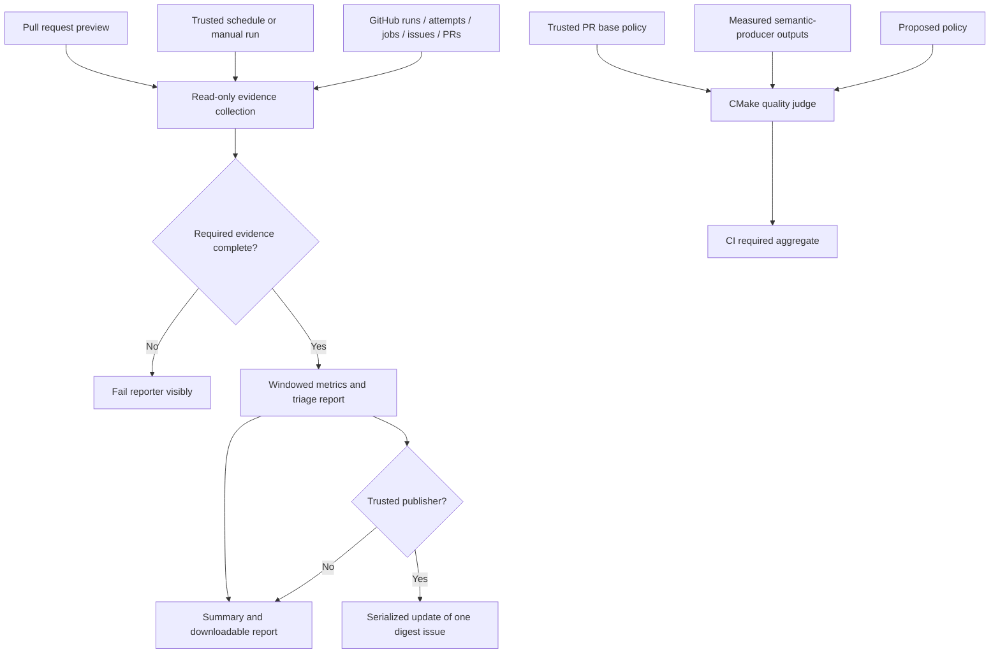

# Phase 5: Pipeline tune-up — Targeted Research Refresh

**Updated:** 2026-10-22. **Confidence:** MEDIUM for inspected branches; LOW for unmeasured fit.

<user_constraints>
## User Constraints — Current D-24–26

The following current decisions are copied verbatim; they supersede conflicting older guidance preserved below. Full current CONTEXT.md remains authoritative. [VERIFIED: .planning/phases/05-pipeline-tune-up/05-CONTEXT.md:244-283; quoted below]

<!-- DATA_60326604_START -->
- **D-24:** The measured 05-12 result is new evidence for targeted replanning, not permission to resume its
  failed task or reset review/gap limits. Its complete count is 14,842, quality921: one above the unchanged
  strict 14,841/quality920 contract. Adopt exactly one identified construction for the next plan: keep the
  shared original-observation authentication and status reader, but make the two measured-value consumers
  own their typed numeric reads. Remove the helper's three-line conditional numeric-extraction block; read
  the number once in the join's measured branch before extrema, and once in the aggregate after its
  unavailable/required-status handling before bounds/reporting. Inspection forecasts three lines removed and
  two added, a net one-line saving. This narrows helper responsibility without statement compression, deleted
  comments or removed controls. It is not measured savings or accepted fit. Planning must name this finite
  construction and its proof obligations; no calendar refactor, generalized savings search or fallback cleanup
  is authorized. Restoring accepted inline authentication alone would lose five lines of net sharing savings
  and leave the six-line perf-control addition unfunded; it is not an independently fitting fallback.
- **D-25:** Authentication must still validate each original item's identity before a reduction can discard it.
  Preserve exact artifact membership, trusted base SHA/policy, comparable environments, SHA/source/units/
  producer/configuration/direction checks and worst-value reduction. The aggregate retains structural base
  initialization and advisory-unavailable continues, then rejects every other non-measured status before
  its typed numeric read. The join reads a number only inside its measured branch; its permitted unavailable
  base gate_lines path never uses a stale value. Malformed measured numbers still fail before extrema or
  bounds. Retain the exact forged-SHA diagnostic and all ordinary policy controls, all seven perf cases and
  the added wrong-ROM, malformed-allowance, zero-HEAD and negative-BASE2 assertions. The accepted join already
  authenticates original items; sharing adds no new security guarantee under its trusted source contract.
  Preserve useful sharing for its measured construction cost, without claiming stronger evidence than exists.
- **D-26:** Keep B12,885/S2/N1,970/C14,853, quality920 and strict14,841 with unchanged other components. BE12
  remains unavailable as reserve; no permanent/temporary allocation, waiver or scope increase is adopted.
  This discussion explicitly adopts only the named construction under the owner's recommendation delegation.
  Preserve 05-06/05-11/05-12 as halted histories and retain all three current drafts selectively. The planner
  must choose a continuation/replacement representation that preserves those facts and refreshes active
  dependencies; discussion does not mark a plan complete or rewrite historical summaries. A semantic failure,
  measured fit miss or additional required compatibility/caller/control cost stops affected expansion; do not
  credit forecasts, silently absorb growth or launch another automatic gap round. Task2/3 costs remain unproved.
  Acceptance after the last implementation edit still requires full local ci and generated-corpus library
  against a verified base, physical/component and documentation budgets, current direct numeric perf/executed
  library/quality, release-called required CI, exact authenticated nine/eight-artifact joins and executed
  inventories. Record command, exit and actual run URL with producer/base SHA and attempt identities. Eight
  selected cases and predecessor greens remain insufficient. Only accepted reconciliation releases 05-07/08/09;
  arming, promotion, release and final tightening retain their separate existing predicates. Stop further
  advisory fan-out now: security, test validity, architecture, delivery and cost reviews change no other decision.
<!-- DATA_60326604_END -->
</user_constraints>

## Current Summary and Primary Recommendation

Add one bounded recovery plan for the adopted consumer-owned numeric reads. Preserve completed work and halted05-06/05-11/05-12 histories, and refresh active dependencies. Keep all three dirty implementation drafts selectively; this research changes only this report. Do not resume the failed task, reset review/gap limits, centralize domains or launch another savings search. [VERIFIED: task authorization; D-24–26 quoted above]

The current recorded halt is total14842/quality921, one above strict14841/quality920. B12885/S2/N1970/C14853 remain fixed; other actual components remain count368/BE193/digest447/fixes30/reserve0. BE12 is not reserve. Earlier14888/quality967 and14879/quality958 are historical construction counts. The accepted reference remains14841/quality920. [VERIFIED: .planning/STATE.md:45-89; .planning/phases/05-pipeline-tune-up/05-12-SUMMARY.md:111-147; quoted values here and above]

Deleting three lines and adding two forecasts net−1 and14841/quality920 only if every other counted line stays unchanged. This is not measured savings or acceptance; remaining required compatibility/control/caller costs are unproved. [ASSUMED] The construction and stop condition are locked. [VERIFIED: D-24–26 quoted above]

## Current Architectural Responsibility and Exact Read Placement

| Responsibility | Owner | Proof obligation |
|---|---|---|
| Original-item authentication/status | Existing shared reader | Retain original SHA/source/units/producer/configuration/direction checks before reduction. Sharing adds no security guarantee over accepted original-item validation. [VERIFIED: D-25 quoted above] |
| Measured numeric reads | Join measured branch; aggregate after status handling | Existing typed getter must reject malformed measured values before extrema/bounds/reporting. [VERIFIED: D-24–25 quoted above] |
| Membership/base/environment/extrema | Existing join | Preserve exact artifacts, trusted policy/base, comparable environments and worst-value reduction. [VERIFIED: D-25–26 quoted above] |
| Bounds and domain policy | Ordinary aggregate plus independent perf/compatibility judges/stores | No domain migration or new lifecycle framework. [VERIFIED: D-21–23 in current CONTEXT.md:207-242; current adopted scope] |

The helper API is macro(quality_observation json sha fields expected_source). Keep its authentication and status read; remove only its conditional numeric extraction. The existing getter checks JSON TYPE before GET, rejects empty strings/nonnegative-integer violations, and sets its result in caller scope. Keep it unchanged. [VERIFIED: tests/cmake/quality.cmake:4-15,99-119; exact block/API quoted below]

<!-- DATA_e8a35515_START -->
~~~cmake
# Validate the original observation before callers reduce or judge its value.
macro(quality_observation json sha fields expected_source)
  quality_get(observation "${json}" OBJECT metrics "${key}")
  quality_get(built "${observation}" STRING sha)
  quality_get(source "${observation}" STRING source)
  if(NOT built STREQUAL "${sha}" OR NOT source MATCHES "^https://github[.]com/[^/]+/[^/]+/actions/runs/[0-9]+$" OR
      (NOT "${expected_source}" STREQUAL "" AND NOT source STREQUAL "${expected_source}"))
    message(FATAL_ERROR "quality: commit or source mismatch ${key}; sha=${built}, expected=${sha}")
  endif()
  foreach(field ${fields})
    quality_get(a "${metric}" STRING "${field}")
    quality_get(b "${observation}" STRING "${field}")
    if(NOT a STREQUAL b)
      message(FATAL_ERROR "quality: observation identity ${key}.${field}")
    endif()
  endforeach()
  quality_get(status "${observation}" STRING status)
  if(status STREQUAL "measured")
    quality_get(value "${observation}" NUMBER value)
  endif()
endmacro()
~~~
<!-- DATA_e8a35515_END -->


Add that same numeric-read line immediately inside the join's measured branch, before reading/comparing an old reduced value. The permitted unavailable base gate_lines branch copies the observation without numeric use. Do not place extraction above the status decision or synthesize a fallback number. [VERIFIED: tests/cmake/quality_join.cmake:55-70; exact branch quoted below]

<!-- DATA_e7b8799c_START -->
~~~cmake
    foreach(side current base)
      set(expected_sha "${EXPECTED_SHA}")
      if(side STREQUAL "base")
        set(expected_sha "${BASE_SHA}")
      endif()
      quality_observation("${${side}}" "${expected_sha}" "units;producer;configuration;direction" "${SOURCE}")
      if(status STREQUAL "measured")
        string(JSON old ERROR_VARIABLE missing GET "${joined_${side}}" metrics "${key}" value)
        # Preserve the worst actual value; the existing judge owns all threshold decisions.
        if(NOT missing AND ((direction STREQUAL "ceiling" AND value LESS old) OR (direction STREQUAL "floor" AND value GREATER old)))
          continue()
        endif()
      elseif(NOT side STREQUAL "base" OR NOT key STREQUAL "gate_lines" OR NOT status STREQUAL "unavailable")
        message(FATAL_ERROR "quality_join: required evidence ${lane}.${key}")
      endif()
      string(JSON joined_${side} SET "${joined_${side}}" metrics "${key}" "${observation}")
~~~
<!-- DATA_e7b8799c_END -->


In the aggregate, retain structural initialization and advisory-unavailable continues, then reject every other non-measured status. Add the same typed numeric read immediately after those branches, before bounds/reporting. Neither unavailable path may consume a stale prior value. [VERIFIED: tests/cmake/quality.cmake:214-236; exact branches quoted below]

<!-- DATA_f252d2e1_START -->
~~~cmake
  foreach(input OBSERVATIONS BASELINE)
    set(sha "${EXPECTED_SHA}")
    if(input STREQUAL "BASELINE")
      set(sha "${BASE_SHA}")
    endif()
    quality_observation("${${input}}" "${sha}" "units;producer;configuration" "")
    if(input STREQUAL "BASELINE" AND absent AND key STREQUAL "gate_lines" AND
        DEFINED INITIAL_GATE_CEILING AND bound EQUAL INITIAL_GATE_CEILING AND status STREQUAL "unavailable")
      message(STATUS "quality: gate_lines structural initialization ${bound}; pre-policy base")
      continue()
    endif()
    if(status STREQUAL "unavailable" AND availability STREQUAL "advisory")
      quality_get(gap "${observation}" STRING reason)
      message(STATUS "quality: ${key} unavailable (${gap})")
      continue()
    elseif(NOT status STREQUAL "measured")
      message(FATAL_ERROR "quality: required evidence ${key}")
    endif()
    if(input STREQUAL "OBSERVATIONS" AND ((direction STREQUAL "ceiling" AND value GREATER bound) OR
        (direction STREQUAL "floor" AND value LESS bound)))
      message(FATAL_ERROR "quality: measured regression ${key}: ${value}, ${direction} ${bound}")
    endif()
    message(STATUS "quality: ${key} ${input} ${value} ${units}; ${direction} ${bound}; ${availability}; ${source}; reason=${new_${key}}")
~~~
<!-- DATA_f252d2e1_END -->


Installed official CMake help confirms macro caller-scope expansion and JSON TYPE versus converted GET semantics. No newer feature/dependency is required. [CITED: cmake --help-command macro and cmake --help-command string, exit0; https://cmake.org/cmake/help/v4.3/command/macro.html; https://cmake.org/cmake/help/v4.3/command/string.html]

## Current Finite Construction and Acceptance Obligations

1. Remove only the three-line helper conditional and add the two consumer reads. Preserve the exact forged-SHA control draft, authentication, all comments/controls, ordinary policy logic and meaningful branch ordering. No calendar refactor, inline-authentication fallback or fallback cleanup. [VERIFIED: D-24–25 quoted above]
2. Preserve all ordinary aggregate introduction/base/from/to/grant/calendar/expiry/renewal/conversion/actual-value controls. Preserve the exact observed/expected forged-SHA diagnostic and whitespace tolerance. The existing equal-valued fixture does not prove a smaller lane hidden by extrema; leave that claim as the explicitly deferred tooling seed. [VERIFIED: tests/policy/quality.cmake:6-13,154-180; current CONTEXT.md:492-495]
3. Preserve exactly “allowed identical missing no_base plus_1_00 plus_1_01 unstable” and the four added wrong-ROM, malformed-allowance, zero-HEAD and negative-BASE2 assertions. Keep exact+1.00/+1.01 arithmetic/verdicts, unstable/missing/nonpositive/NO_BASE, current/expired matching allowance and armed/report-only semantics. [VERIFIED: tests/perf/tests.cmake:20-55,68-73; tests/cmake/perf_compare.cmake:21-95; quoted registered values here]
4. Measure full physical and component deltas after controls/glue/callers. Require quality920 and strict14841 with unchanged other components, as well as C14853. A successful counter exit measures size; it does not accept fit. Semantic failure, measured miss or additional required cost stops affected expansion. No forecast credit, BE transfer, waiver, allocation increase or automatic gap round. [VERIFIED: D-26 quoted above]
5. Carry forward historical05-12 Tasks2–3 without claiming them completed: retained compatibility equality/lifecycle controls, POKEY accepted-base/replacement audit, truthful authority docs and actual local/direct/called acceptance. Their full cost remains unproved. [VERIFIED: .planning/phases/05-pipeline-tune-up/05-12-PLAN.md:134-182; 05-12-SUMMARY.md:163-186]

Compatibility retains unconditional fresh key/status/evidence equality in both directions before its trusted-base pass/legacy-allowance check. A waived merged regression can become the next base's nonpass state; no immutable domain grants, anti-renewal, automatic restoration or unified central policy. A valid allowance never excuses fresh mismatch. Preserve library's fresh results, verified BASE/ALLOW wiring and flipped-row self-test; change judge/caller only for a reproduced retained-contract violation. [VERIFIED: tests/cmake/compat_ratchet.cmake:30-94; tests/compat/library.cmake:123-148; D-23 in current CONTEXT.md:230-242]

The spent POKEY row remains; audit accepted reference/current verified base and actual generated-corpus replacement pass evidence before removal. Expiry date alone proves no retirement; never renew it. Current row is “7800basic-0.41/pokey title@120=8fed977457666af8e363f6bd4e5f37375e1f457d67156ef326042fc684f1ed9e 2026-11-19”; current replacement is “title@120=dcef4b423da52d04a824def3dfa1f0167c5b9e5bdfbf5af55906d21b46464244”, status “pass”, evidence “dcef4b423da52d04”. Presence of those strings is not completed replacement proof. [VERIFIED: tests/compat/allow.txt:8; tests/compat/ledger.csv:23; D-23/D-26]

Production perf already supplies retained ALLOW with ROM/HEAD/BASE1/BASE2/ARMED/NO_BASE; keep numeric first-parent measurements, equal paths, stripped environment,60/360 subtraction, tools and duplicate base. Hosted library retains event-selected base and actual inventory check. Release-called CI checks out PR head, while direct perf measures the merge's first parent; preserve distinct producer/head/merge/base/source/attempt identities. [VERIFIED: .github/workflows/ci.yml:385-391,480-579,603-618; .github/workflows/release.yml:38-50; caller contracts read this session]

The join's lane list is exactly “asan hygiene linux-arm64 linux-x64 macos-arm64 macos-x64 windows-arm64 windows-x64”; it conditionally adds “quality-perf”, with4 files per ordinary lane. Preserve exact current/base SHA, source, policy and comparable environment before reduction. Current direct acceptance requires9 authentic artifacts/numeric comparable perf; release-called requires8/perf intentionally absent. Use actual verified run/attempt identities and separate fresh ignored artifact directories. [VERIFIED: tests/cmake/quality_join.cmake:8-41,55-101; D-26 quoted above; quoted membership values here]

After the final implementation edit require full local ci/generated-corpus library against verified available base, physical/component/doc budgets, current direct numeric perf/executed library/quality, release-called required CI, authentic joins and corresponding exact executed inventories. Record command, exit and actual URL with producer/base/attempt identities. Historical8/8 selected cases and predecessor greens cannot accept changed callers. Only accepted recovery releases05-07/08/09; arming/promotion/release/final tightening retain separate predicates. No owner UAT or current hosted URL is claimed. [VERIFIED: D-26 quoted above]

## Current Research Method, Environment and Assumptions

Existing tools were probed here: CMake/CTest4.4.3, Ninja1.13.2, gh2.101.0 (2026-09-15), jq-1.7.1-apple; version commands exited0. No package/install is proposed. Research-plan selected Context7; matching MCP/ctx7 was unavailable in discovery, so installed official help supplied macro/JSON semantics. Agent-skills returned no configured skills; graph status reported disabled. Configuration explicitly contains “nyquist_validation”: false and “security_enforcement”: false, so their template sections stay omitted while all adopted safety controls remain. [VERIFIED: current discovery/version/seam/help commands; .planning/config.json:24-54; exact false values quoted here]

Runtime state: hosted runs/artifacts remain stored evidence, live settings/permissions remain external configuration, library corpus/base environment wiring remains, and generated JUnit/count/quality outputs need fresh execution after edits. No product-data, OS-registration or secret migration belongs to the named source edit; unrelated OS/runtime systems were not inspected. [VERIFIED: task scope and D-24–26 quoted above]

Only assumption A1 is the static net−1 fit forecast. [ASSUMED] Branch/API placement is inspected; actual fit, focused malformed/unavailable behavior, remaining required cost and current full local/hosted acceptance remain unproved execution obligations. No assumption grants scope, budget or acceptance. [VERIFIED: D-24–26 quoted above]

**Ready for targeted planning:** one bounded recovery plan. No implementation tests, construction, commits or acceptance runs were performed by this researcher. Earlier research below is preserved history; its old copied decisions/initialization/range/migration guidance cannot override current D-21–26 or fixed budgets. [VERIFIED: task record and current context]

---

# Historical Research Preserved Below

The following report is the earlier research record. Its counts, source observations, feasibility experiments, tool/lane history and future-tense instructions describe that earlier pass. Reuse useful unaffected evidence; current decisions and bounded guidance above govern planning. In particular, B/S/N/C are now frozen, domain-policy migration is deferred, and no first-allocation task or generalized savings search is authorized. [VERIFIED: current CONTEXT.md D-21–26 quoted/referenced above]


> Scope revision 2026-10-22: CONTEXT D-09/D-10/D-21–23 and revised TUNE-03 defer central performance/compatibility
> policy migration and legacy-store retirement. Copied constraints and migration guidance below preserve the
> earlier research history; they do not authorize another construction/gap round. Reuse unaffected measurements.
> Remaining plans require narrow reconciliation before execution; no budget increase is adopted.
# Phase 5: Pipeline tune-up — Research

**Researched:** 2026-10-21
**Domain:** CMake/CTest and GitHub Actions reliability, reporting, quality and release safety.
**Status:** READY FOR PLANNING — first bounded measurement/simplification slice required before additions.
**Confidence:** MEDIUM; allocation ranges are sizing hypotheses, not measured caps.

<user_constraints>
## User Constraints (from CONTEXT.md)

The decisions and discretion below are copied verbatim from the current context, followed by its deferred ideas. The context is authoritative; proposed mechanisms and allocation estimates later in this report implement these choices. [VERIFIED: .planning/phases/05-pipeline-tune-up/05-CONTEXT.md:33-238,352-365; quoted below]

<!-- DATA_c7a4e291_START -->
### Weekly triage and monthly evidence

- **D-01:** Use one open issue labelled `digest`, refreshed weekly, plus a job summary and downloadable report.
  Keep the latest monthly CI-efficiency section visible across subsequent weekly updates until replaced. Follow
  ENGINEERING §7's Monday 06:00 UTC schedule; include manual dispatch and a non-publishing preview for verification.
  Do not add a dashboard service, notification bot, token, database or dependency. Pinning the issue is optional;
  do not make delivery depend on an owner pinning it.
- **D-02:** Cover unlabelled issues, PRs idle over seven days, old Dependabot PRs/majors, open nightly failures and
  age, stale/red release PRs, and relevant runner-image deprecations. Keep the report actionable: reason, age,
  evidence link and suggested next action. No automatic issue closing, dependency upgrades, settings mutation,
  reviewer assignment or fresh issue per report. Read this digest at subsequent phase discussions.
- **D-03:** Monthly means a UTC calendar month with an explicit evidence window, ordinarily the preceding month
  on its first Monday. Permit an initial current-month partial report for phase acceptance. Fetch all pages and
  attempts in the window; distinguish direct CI, release-called CI, light planning runs, cancellations, failures
  and intentional failure controls. Report per-job p50/p95 execution, available queue/dependency-wait evidence,
  rerun-pass candidates, runner-minutes per merged PR, critical path, compile share and available CTest utilization.
  A rerun passing is a flake candidate, not proof. Do not call time spent waiting for dependencies runner queue time.
  Report sample counts, tool/workload changes and unavailable data; do not substitute zero or claim a 90-day
  redundancy history from this young repository. Exclude intentional failures from product flake rates but retain
  their cost. Required API failures fail the reporter; optional missing evidence is named in the published report.
- **D-04:** Reuse `gh`, `jq`, POSIX sh and CMake. A scheduled trusted-default-branch publisher gets only the reads
  and issue-write permission it needs; PR previews cannot publish or access App credentials. Treat issue titles,
  PR bodies and branch names as data, never shell source. Write structured report bodies to files. Serialize
  publishers so concurrent dispatches cannot create duplicate digest issues, and fail visibly on a failed write.
  Native cron is best effort: retain manual recovery and expose last successful report time, without an external
  scheduler. No public ROM bytes, private paths, credentials or private title results enter these reports.

### CI reliability and cost

- **D-05:** Fix the reproduced compatibility freshness race by assigning each writer its own generated output,
  including the self-test. Preserve the exact stale-page negative control. Use CTest fixtures for prerequisites;
  reserve `RESOURCE_LOCK` for resources that cannot be isolated. Do not serialize the whole suite or add retries
  to conceal shared-file contention. Verify the affected checks repeatedly together with parallel/random order.
- **D-06:** Re-derive job bounds from the last 40 comparable successful executions, recording slowest duration,
  run URL/ID, sample count, workload and runner. Use twice the maximum, round job bounds up to minutes, retain
  the established five-minute network/roll-up floor, and mark fewer than ten samples provisional. Apply the
  same measurement principle to slow tests and emulation/sanitizer scales. A timeout is a censored lower bound,
  not an elapsed-time success to average away. Workload/toolchain changes invalidate older samples where relevant.
  The temporary 240-second `audio.samples` timeout is not a final measurement; preserve all eight comparisons.
  Measure concurrency and schedule costly tests early before shrinking work or increasing limits again.
- **D-07:** Keep all six native build/test/package legs required. Apply the existing DEC.46/ENGINEERING §9 flip:
  full `be32` execution has exceeded five minutes, so move its execution and full hash equality to nightly and
  keep PR cross-compilation required. Nightly must run the promised full inventory and compare against a native
  artifact built from the same commit with identical fixtures/configuration, with an exact file count. The PR
  required comparison becomes the six native files, plus WASM only if separately promoted. Update roll-up,
  inventory expectations, release-call behavior and docs together; report reduced per-PR BE execution coverage
  explicitly. Do not silently drop BE evidence from release/ship checks. A small PR BE execution slice is an
  option only if measurements show useful independent coverage within five minutes without duplicating machinery.
- **D-08:** No new cache by default. Consider compiler caching only after measured compile share reaches the
  settled 40% of a critical-path leg, and prove cached/cold equivalence before adopting it. Keep pinned-download
  integrity and fetch-path checks. Remove a check only with a named fault and a demonstrably stronger remaining
  signal; lack of failures alone does not prove redundancy. Preserve exact executed inventories, fail-on-missing
  artifacts, no self-skips, bounded hostile workloads and meaningful negative controls.

### One quality ratchet and honest portability

- **D-09:** One committed root `quality.json` owns quality bounds and exceptions, and one aggregate `quality`
  check consumes existing outputs under `CI required`. Use CMake `string(JSON)`, not a new language or platform.
  Reuse existing semantic validators for hashes, compatibility, ABI, sanitizers and performance; do not rebuild
  their judges inside a framework. Consolidate duplicate threshold/exception stores when migrating a metric,
  retaining original semantic evidence and controls. Report units, direction, producer, fixture/configuration,
  commit and availability for each metric. Baseline only what was actually measured.
- **D-10:** Compare policy changes with the trusted PR base: floors cannot fall, ceilings cannot rise, metrics
  cannot disappear, and new thresholds cannot legitimize the same PR's regression silently. A loosening needs
  the corresponding key/from/to, reason, date and bounded expiry (at most 60 days), visible in review and reports;
  expired or unrelated reasons do not authorize it. Tightening is free. A measured value must satisfy the effective
  bound too: comparing two JSON policies alone proves nothing. Missing/malformed required evidence fails; a
  named advisory/unavailable metric has no fabricated passing value. Validate boundary, missing-data, expired-
  exception and baseline-tampering cases using the existing negative-control pattern.
  The gate-code metric has one narrow structural distinction: initialization and explicitly adopted new-scope
  allocations follow D-19; permanent required machinery is not financed through recurring 60-day waivers.
  Under unchanged scope, count overruns still need the exact dated temporary exception and credible exit.
  A new scope allocation cannot loosen another metric, excuse a missing control or authorize self-rebaselining.
- **D-11:** Start with measured inventories, public compatibility, current ABI/warning/analyzer results, archive
  sizes, current fuzz targets/regressions, gate-code count and comparable Ir output. Historical/nondeterministic
  CI-duration observations require a defined comparable sample window; do not gate on an arbitrary shared-host
  outlier or let a PR forge its own hosted history. Scheduled coverage/open-crash/backlog measurements may join
  only with real producers and explicit freshness; today's workflows do not yet produce every metric described
  in preparation. Keep absent dimensions visible as evidence gaps, not zero findings or 100% coverage. Preserve
  independent release/archive and behavioral predicates even where the aggregate consumes their results.
- **D-12:** Arm the existing +1.00% Cachegrind comparison only after two fresh control dispatches on the same
  suitable commit each produce three identical measurements, a current PR produces a numeric valid base, and
  forced-failure/recovery verifies nightly reporting. Preserve equal-length paths, stripped environment, warm-up
  subtraction, matching compiler/tool versions, duplicate base measurements, exact threshold arithmetic and
  fail-closed missing inputs. Verify the current workloads, not just old success summaries. Keep wall-clock tails
  advisory. The present perf job measures the test card only: name that coverage honestly. Research whether a
  small representative existing DMA/TIA/POKEY diagnostic set fits the already allowed four-fixture bound; adding
  a measured fixture requires its own controls, not an unsupported claim that test-card arming protects all games.
- **D-13:** Audit WASM, library and nightly property history against their documented ten-green-main-run
  conditions. Count actual completed successful executions of each lane on distinct qualifying runs, not ten
  workflow IDs, skipped jobs, PR controls or rerun attempts. Promote eligible lanes with their exact artifact and
  inventory contracts; otherwise retain explicit advisory status and the missing evidence. No weakening a
  threshold or manufacturing runs merely to declare promotion. The audit here found only ten direct main-push
  CI records, including one failed and one still incomplete; eligibility has not been established. Recheck at
  execution. Post-merge truths belong to ship, never owner UAT.

### Freshness, release safety and proportionality

- **D-14:** CI/CD is the provisional weakest dimension and this phase's main improvement. Evidence: two audio
  timeouts, the reproduced output race, a required BE job above the agreed cost threshold, absent digest/quality
  infrastructure and over-budget enforcement code. Baseline all six ENGINEERING §12 dimensions using a short
  evidence-linked 1–5 rubric before execution changes; select any different lowest dimension only with new
  measured evidence within the fixed phase scope. Measure before/after critical-path time and runner work on
  comparable workloads, retain correctness/coverage, and ship the reliability fix and latency improvement.
- **D-15:** Measure repeated release rehearsals before changing their selection. Prefer automatic input-based
  selection over an owner-maintained label if duplication is material. Reuse only a successful rehearsal whose
  complete effective inputs remain equivalent: release/publish logic, called CI/build/package code, tools/pins,
  version inputs and all source affecting archives. A push without a change to one of four trigger paths is NOT
  by itself safe to skip: the current archive content may have changed. Initial runs, unknown diffs, force-pushes,
  missing evidence and changed inputs run a full rehearsal. If demonstrating safe reuse costs more machinery
  than it saves, retain the current conservative rehearsal and record the measured decision. A retained reuse
  claim must name the prior run/input identity and current-head validation; no stale green status is relabelled
  as a fresh rehearsal of another commit.
- **D-16:** Check user/maintainer docs against the released behavior, with concise README/install instructions
  and detailed testing/release runbooks in `docs/`. Reconcile stale hash-file counts/audio formats, lane statuses,
  test timeouts and release replay/cleanup promises with code. Run the install line against actual artifacts and
  `scripts/apply-repo-settings.sh --check`; request owner consent only for a needed admin mutation or merge.
  Include reproduced release lookup/attestation/Dependabot issues from the related todo; distinguish API error
  from 404 and verify signer identity before irreversible publication. Choose a narrow true docs claim where
  adding a new bot state machine would violate proportionality. Phase ship confirms release PR health and actual
  publication when applicable; pipeline-only commits use `ci:`/`test:`/`docs:` and do not invent a product release.
- **D-17:** Replace the hard tenth-of-src ceiling with one audited absolute physical-line ratchet in
  `quality.json`; keep 10% and full/authored source ratios diagnostic, with no deadline promising convergence.
  Count every repository-check implementation, dedicated fault-control harness, declarative enforcement,
  shared helper once, invocation contract and embedded workflow/configure predicate, including moved code
  and the counter/manifest/glue itself. Include comments and blanks. Default to whole files; any exact block
  exclusion must be purely operational/generation work with its boundary documented. Ordinary emulator product
  tests and fixture bytes are outside this maintenance metric; embedded repository-policy assertions and
  check controls are not. Publish the file/block inventory and broad sensitivity set. No source padding, line
  golf, hidden driver classification, outsourcing predicates to dependencies or free allowance from core growth.
  Preserve firmware/provenance/archive, signer/identity, privacy, bounded deterministic-core, exact executed
  inventory/no-skip and independent release safety outcomes with meaningful fault controls. Implementations may
  merge or be replaced by stronger evidence; preserving a fault does not require preserving its old script.
  The historical 1,367/8,577 count was narrow; 2,764 is a partial mixed-file sensitivity set, 8,607 overinclusive,
  and 2,262 one failed incomplete construction. None is a complete numerator, lower bound or replacement cap.
- **D-18:** Keep work small and cohesive, prioritize the reproduced faults and simplification, and stop expanding
  analysis when another lens changes no decision or verification. Security, reliability, maintainer cost,
  embedder/player compatibility, test validity and release consumers are relevant; UI design, rendering-engine
  rewrites, distributed services and unrelated language ecosystems add no phase requirement. Do not reopen
  settled emulator choices or turn all dormant review seeds into mandatory work. Export lessons in the existing
  pasteable template only when asked; do not start an export workflow as a second GSD step.

### Budget initialization, acceptance and planning readiness

- **D-19:** Freeze an exact audited starting commit/count `B` in the first bounded execution slice. Measure
  actual retained-fault net savings `S` from its readable simplification, including any changed control/glue
  cost; do not claim forecast savings or double-spend deletions. Before affected additions, fix per-component
  allocations totaling `N` and a phase ceiling `C = B - S + N`. A separately stated integration reserve is part
  of fixed `N`, never extra headroom. Allow additions only for the scoped digest/reporting, quality ratchet,
  BE relocation/comparison and reproduced safety/correctness fixes; each names its requirement/fault and
  includes its controls, shared definitions and invocation costs. Inherited-code refactoring is not a new
  allowance. Redistribute within the total only with the mapping visible. No new capability or allowance is
  implied by a convenient abstraction, dependency or renamed file. Maintain one short allocation table in
  existing planning artifacts and one numeric quality metric, not a classifier, allowance interpreter, fault
  taxonomy engine, policy DSL or prose-validation gate. At close, actual count must fit `C`; retire unused
  allowance/reserve and tighten to accepted actual. Subsequent permanent growth needs explicit scope adoption
  and a fixed from/to allocation before implementation; a proposed baseline edit alone cannot grant it.
  Temporary unchanged-scope overruns follow D-10, with expiry checked even when inherited from the base and
  a credible named removal/consolidation exit. No automatic renewal or waiver-to-baseline conversion.
- **D-20:** Planning may proceed with a complete counting boundary/fault-to-consumer map, component allocation
  ranges, named integration uncertainty and the first bounded baseline/simplification task. It need not first
  implement or prototype the complete phase. That task freezes `B`, demonstrates nonzero fault-preserving
  savings and fixes the numeric `N`/`C` before adding the new enforcement; it does not mint an unlimited budget.
  An unresolved boundary, lost fault/control, absent required evidence or exceeded allocation stops affected
  expansion. Simplify within the ceiling, or use the existing one-gap/new-evidence route for a concrete scope
  revision; do not repeat broad research or silently raise the total. Remaining independent work may proceed.
  Phase acceptance still requires all TUNE-01–05 outcomes and their automated/agent evidence, improved inherited
  machinery with measured retained-fault savings, and final count within the explicitly allocated absolute
  ceiling. A higher total caused by allocated required capabilities is reported honestly. The former 10%
  overage is a historical fact and advisory proportion, not a deferred mandatory debt or temporary waiver.
  Refresh only research affected by this policy change, reuse measured experiments and valid implementation
  guidance, and stop analysis when another lens changes no decision or control. No second GSD step here.

### Agent's Discretion

Internal schema names, helper boundaries, batching/API page sizes, readable report formatting, per-test cost
values and the exact simplifications are researcher/planner choices within these contracts. The numbered
choices are coherent outcomes, not a task breakdown; formal phase research still runs. No dependency addition
is justified merely by a convenient parser or reporting abstraction.
The agent may set the concrete allocations from evidence and make routine implementation choices within the
fixed scope/ceiling without another owner confirmation. It may not grant itself a larger scope or total.

### Folded Todos

Keep todos pending until execution supplies evidence; folding is not completion.

- `.planning/todos/pending/2026-10-16-arm-the-instructions-per-frame-gate.md`: controlled performance arming and
  nightly issue recovery, D-12.
- `.planning/todos/pending/2026-10-16-limit-release-rehearsals-to-pushes-that-change-release-inputs.md`: measure
  duplication and decide safe selection versus documented retention, D-15; not a mandate to skip.
- `.planning/todos/pending/2026-10-16-promote-the-wasm32-lane-into-ci-required.md`: eligibility audit and conditional
  promotion, D-13; no claim that the ten-run condition is already met.
- `.planning/todos/pending/2026-10-16-close-the-re-review-findings-on-the-dependabot-gate-and-the-publish-checks.md`:
  reproduce current publish/bot/docs claims, then apply the minimal correction within D-16 and review budgets.

## Deferred Ideas

New emulator capabilities remain in phases 6–11 or later milestones. External dashboards, caches without a measured
payoff, broad new analysis services, extra RetroArch cases and new public APIs are not part of this tune-up.
Do not reopen the owner's one-step or automation-first rules.

### Reviewed Todos (not folded)

- `.planning/todos/pending/2026-10-19-close-the-phase-2-re-review-findings-when-maria-and-the-run-loop-land.md`:
  its behavior/docs findings already have phase 3 dispositions; remaining test seeds are not pipeline requirements.
- `.planning/todos/pending/2026-10-19-close-the-phase-2-review-seeds-on-the-nightly-filter-and-the-rom-tables.md`:
  nightly input coverage must be assessed where this phase changes workflows, but cartdb reload/swap/parser and
  old header-comment findings are not automatically adopted. Reproduce current relevance first; keep dormant
  tooling seeds instead of expanding phase scope by keyword match.
<!-- DATA_c7a4e291_END -->
</user_constraints>

## Summary

Planning is ready under the revised absolute-ratchet contract. Plan a bounded first execution slice that freezes the starting commit and complete count `B`, proves nonzero retained-fault net savings `S`, and fixes per-component allocations `N` and ceiling `C = B - S + N` before affected additions. No exact new cap or measured saving is invented here. All five tune-up outcomes remain mandatory. [VERIFIED: context D-19–20 quoted above; .planning/REQUIREMENTS.md:10-14]

Reuse the existing measured experiments and semantic judges. The historical narrow numerator was 1,367; a partial mixed-file sensitivity set was 2,764; an overinclusive set was 8,607; the tested incomplete construction was 2,262. These describe different boundaries. None supplies today's complete numerator, a lower bound or the replacement ceiling; 857 belongs to the superseded hard-ratio contract. [VERIFIED: context D-17 quoted above]

**Primary recommendation:** simplify a small inherited enforcement path first, preserve its positive and fault-specific controls, then add the scoped digest, measured quality ratchet, nightly BE equality and reproduced correctness/safety fixes within fixed allocations. Publish final actual count and both source ratios; retire unused allowance. [VERIFIED: context D-17,D-19–20 quoted above]

## Architectural Responsibility Map

| Capability | Primary tier | Secondary tier | Rationale/source |
|---|---|---|---|
| Weekly/monthly collection | Trusted CI operational job | GitHub read APIs | Collect hosted evidence, never emulator instance state. [VERIFIED: context D-01–04] |
| Digest publication | Trusted default-branch job | One labelled issue | Separate preview from issue writes and credentials. [VERIFIED: context D-04] |
| Runtime and inventory validation | CTest/CMake | Artifact consumers | Reuse actual registered/executed inventories. [VERIFIED: cmake/MuhtariTests.cmake:28-69, `get_property(names DIRECTORY "${CMAKE_SOURCE_DIR}" PROPERTY TESTS)`] |
| Quality ratchet | CMake script in required CI | Trusted base and measured producers | Consume semantic judges; do not duplicate them. [VERIFIED: context D-09–11] |
| BE execution/equality | Nightly CI | Required PR cross-compilation | Same commit, configuration and fixtures; retain exact inventories. [VERIFIED: context D-07] |
| Release publication | Existing release workflow | Independent archive/provenance judges | Validate signer before immutable publication. [VERIFIED: scripts/publish.sh:82-134, `--signer-workflow "$REPO/.github/workflows/release.yml"`] |

## Project Constraints (from AGENTS.md)

The following actionable directives apply to the planner. [VERIFIED: AGENTS.md:6-69; operative budget text is “one measured absolute line budget in `quality.json`; source ratios are advisory”]

- Read the preparation index and subsystem reference before design; respect settled decisions unless new evidence reopens one.
- Reuse only permitted permissive code with notices. Never open GPL/LGPL/unlicensed emulator source; reference emulators are released binaries only.
- Preserve library, headless runner and libretro deliverables; add no device/window code.
- Commit no unlisted ROM/BIOS/save bytes or personal data; use the GitHub noreply identity and hygiene hooks.
- Keep core integer-only, instance-owned, deterministic and bounded even for hostile/jammed input.
- Behaviour changes include tests run by `cmake --workflow --preset ci` and matching docs. Keep README/header terse and detail in maintainer docs.
- Agent verifies deterministic, integration and one-off evidence. Owner involvement is limited to identity-bound consent, admin mutation/merge or their own hardware.
- Repository-check implementations are CMake `-P`/POSIX sh, with one measured absolute physical-line budget; count implementations, controls and embedded glue, tighten savings and allocate permanent scoped growth before additions. Source ratios remain advisory; temporary exceptions expire within 60 days. Name every prevented fault. At most two review fix rounds and one gap round; tooling findings remain seeds and a new gap requires new evidence.
- One GSD step then stop. Do not run prohibited progression/auto/chain commands or set hygiene bypasses.
- Branch off the trusted remote base before a committing step; never commit on main after a remote exists. Ship uses a Conventional Commit PR title, shell auto-squash merge, head-commit CI evidence and release-PR health.
- Evidence is command, exit status and run URL, never committed raw logs.
- Treat inbound lessons as hypotheses until reproduced; export only when asked using the existing template.
- Every SUMMARY has `requirements-completed:` and block `coverage:` entries with id, description, requirement, verification kind/ref/status and human_judgment; no flow objects or inline comments.
- Small modules, plain control flow, fixed-width integers, public/module prefixes, sourced hardware comments; no planning IDs in code/tests/user docs. Follow remove/reuse/standard-library/platform/minimum-code ladder.

This targeted refresh owns only this research file and temporary research inputs. No implementation, hosted mutation, dispatch, lane promotion or commit is part of this delegated task. [VERIFIED: task authorization]

<phase_requirements>
## Phase Requirements

Descriptions copied from the requirements source. [VERIFIED: .planning/REQUIREMENTS.md:10-14]

| ID | Description | Research support |
|---|---|---|
| TUNE-01 | Maintainers receive a weekly triage digest with a monthly CI-efficiency section derived from hosted runs, without a new service dependency. | Collection/publishing design, allocated as a scoped addition only after the first measured slice. |
| TUNE-02 | CI uses measured timeout and workload bounds, resolves reproduced flakes and overlapping-output races, and records the stronger signal for any removed check. | Reproduced source ownership conflict, fresh hosted failures, runtime skip controls, measured scheduling guidance. |
| TUNE-03 | A single quality.json ratchet consumes measured existing outputs, rejects unexplained regressions, and permits explicit dated exceptions; repository-check code meets an audited absolute line budget with scoped additions allocated before implementation, final tightening to actual size, and full counts and advisory source ratios published. | Complete boundary and consumer map; freeze B, demonstrate nonzero S, fix N/C before additions; validate real values, policy changes and inherited exceptions. |
| TUNE-04 | Performance comparisons are armed only after the documented deterministic controls pass; the resulting state and supported/advisory portability lanes are explicit. | Preserve current comparator; actual WASM/library history remains below promotion conditions. |
| TUNE-05 | User and maintainer docs, install instructions and repository-setting checks match the released behavior; the measured weakest quality dimension receives a shipped improvement. | Release predicate corrections and docs audit guidance; no implementation or shipment claimed. |
</phase_requirements>

## Standard Stack

Use the existing stack; install no research-selected package. Current versions here are observations of the research machine, not newly imposed pins. [VERIFIED: `command -v cmake ctest ninja sh gh jq ctx7; cmake --version; ctest --version; ninja --version; gh --version; jq --version`, exit 0 for the version commands]

| Tool | Observed version/contract | Use |
|---|---|---|
| CMake/CTest | 4.4.3 local; preset minimum explicitly `"cmakeMinimumRequired": { "major": 4, "minor": 3, "patch": 0 }` | Script checks and workflow presets. [VERIFIED: CMakePresets.json:1-9] |
| POSIX sh | Existing project shell contract | Repository automation; do not introduce Bash-only constructs in new scripts. [VERIFIED: context D-04,D-17] |
| gh | 2.101.0, release date reported 2026-09-15 | Hosted API reads/writes; safe structured files for bodies. [VERIFIED: `gh --version`, exit 0] |
| jq | jq-1.7.1-apple locally | Operational JSON collection/reporting. The quality judge itself uses CMake JSON. [VERIFIED: local version command; context D-09] |
| Ninja | 1.13.2 local | Existing build generator. [VERIFIED: CMakePresets.json:6-9, `"generator": "Ninja"`] |

No external-package installation is proposed, so no package-legitimacy/install gate is needed. No new dependency/service is authorized. [VERIFIED: context D-01,D-04,D-18]

## Counting Boundary and Fault-to-Consumer Map

### Complete boundary for planning

Use physical lines including comments and blanks. Charge a shared definition once, every dedicated control, registration/invocation contract and embedded predicate; charge moved implementations at their destination. The first slice expands the sets below to a short file/block inventory at its exact starting commit and counts the inventory/counter itself. It records byte/line boundaries for any exclusion and fails on a missing listed file or overlapping range. This is a hand-maintained inventory and arithmetic, not a classifier or policy language. [VERIFIED: context D-17,D-19–20 quoted above]

Default whole-file treatment applies to the policy and mixed files below. These are inventory **references**, not new file-creation instructions. Where an existing filename is quoted, it identifies a source read during this refresh or retained historical audit; no new output path is assumed. Count the entire mixed implementation unless the first slice documents a purely operational/generation block with exact endpoints. An exclusion may not contain a predicate, threshold, dedicated check control, shared enforcement definition or its invocation. [VERIFIED: context D-17 quoted above]

| Boundary | Charged scope and consumer | Fault retained / exclusions |
|---|---|---|
| Dedicated judges and helpers | Whole `tests/cmake/*.cmake`; consumers are hygiene, native/portability CTest, nightly and independent release checks. | All fault rows in the historical map below, plus extraction/comparison helper and exact-failure runner; no directory/name exemption. [CITED: retained audit below] |
| Shell implementations and hooks | Whole `scripts/*.sh`, `.githooks/pre-commit`, `.githooks/pre-push`; consumers are hook/CI/settings/release. | Privacy, asset admission, provenance, identity, trusted change classification, download integrity, desired-settings drift, signer/release/cleanup safety. Keep operation and check definitions together unless exact operational exclusions are documented. [CITED: scripts/hygiene.sh:1-177; scripts/publish.sh:1-183; hooks:1-4; retained audit] |
| Dedicated check registration and controls | Whole `tests/{abi,hygiene,policy,release,perf}/tests.cmake`; whole ABI negative-fixture C sources and isolated public-header compile fixtures (existing controls, not permission to add a new C policy implementation). | Harness generation, malformed policy fixtures, synthetic job decisions and all invocation metadata count, even inside test drivers; ordinary API behavioral programs are product tests outside. [CITED: tests/abi/tests.cmake:14-64,94-135; tests/hygiene/tests.cmake:1-356; tests/policy/tests.cmake:1-98; tests/release/tests.cmake:1-96; tests/perf/tests.cmake:1-67] |
| Mixed evidence drivers | Whole `tests/compat/{library,pin,tests,targets}.cmake`, `tests/cpu/{full,tests,targets}.cmake`, `tests/built/{build,frames,openbios,tests}.cmake`, `tests/diag/{assemble,tests}.cmake`, `tests/runner/tests.cmake`, `tests/fuzz/tests.cmake`; retain full-file sensitivity separately when blocks are excluded. | Corpus/pin/sample identity, behavior-revision repinning rules, generated-fixture equality, empty-corpus rejection, hash-set controls and docs exit-table checks count. Pure emulator test bodies are excluded only after exact block separation; deleting their checks is not a saving. [CITED: tests/cpu/tests.cmake:1-77,163-169; tests/built/tests.cmake:66-123; tests/diag/tests.cmake:58-97; tests/runner/tests.cmake:731-757,811-815; tests/fuzz/tests.cmake:139-161] |
| Embedded configure/preset enforcement | Whole root `CMakeLists.txt`, `CMakePresets.json`, `cmake/MuhtariTests.cmake`, `tests/tests.cmake`; charge relevant shared build/packaging/toolchain definitions where consumed by checks. | Version shape, required tools, warnings/no-FP/sanitizer options, lane selection, exact registration, labels, timeout scaling and package-layout contracts. Pure product build/install generation can be excluded by exact block; never exclude the same flag from every consumer. [CITED: CMakeLists.txt:3-7,22-60,174-282; cmake/MuhtariTests.cmake:1-69; CMakePresets.json:1-100; tests/tests.cmake:1-58; cmake/packaging.cmake:1-59] |
| Workflow policy and invocation glue | Whole all four existing workflow YAML files and new scoped reporting workflow; consumers are PR aggregate, nightly report and release/publisher. | Job selectors/permissions, trust and App boundary, timeout rules, exact artifact/JUnit counts, roll-up, perf measurement/arming, screenshot flip check, identity and cleanup predicates count. Checkout/download/rendering blocks may be excluded only if purely operational; broad whole-workflow sensitivity stays visible. [CITED: .github/workflows/ci.yml:548-559; .github/workflows/nightly.yml:227-262; .github/workflows/dependabot-automerge.yml:16-49; retained workflow audit below] |
| Declarative enforcement and controls | Whole `.clang-format`, `.github/rulesets/main.json`, `.github/dependabot.yml`; check-specific lists/thresholds, including inventory text, pin/fixture admission manifests, firmware denial list, waiver lists, title fixtures and future `quality.json`. | Definitions that decide pass/fail or permissions count once; they cannot become free embedded data. Ordinary ROM/vector/BIOS fixture bytes, generated cart database records and product expected audio/hardware observations are evidence inputs outside; their identity/shape predicates and forged-input controls remain in. [CITED: .clang-format:1-8; .github/rulesets/main.json:1-37; .github/dependabot.yml:1-20; cmake/MuhtariTests.cmake:29-65; tests/hygiene/tests.cmake:48-90,92-125,326-356] |
| Generators, mixed C/test tooling and future additions | Whole mixed `tools/compat_doc.cmake` and conservative whole `tools/cartdb.cmake`; count empty-replay checks in the shared fuzz replay header and dedicated evidence/control code wherever embedded. Charge the new counter, manifest, helpers, quality/report validators and their tests/glue. | Page equality, generator validation and no-empty-evidence remain charged. Product-only core/runner/libretro tests, product parsers, ROM source/bytes, ordinary screenshot equality and build assets are outside; policy/negative-control blocks inside any such file remain in. No generated copy is counted twice. [CITED: tools/compat_doc.cmake:62-80; tools/cartdb.cmake:1-17,40-48; tests/fuzz/tests.cmake:139-161; tests/fuzz/replay_main.h:78-101, “if (inputs == 0u)” and “no corpus inputs”; context D-17 quoted above] |

Boundary convention for mixed C and fixtures: a normal test comparing emulator behavior with hardware evidence is a product test, while a control proving the repository's judge rejects corrupt/empty/forged evidence is charged. Preserve this distinction in the short inventory; do not build a runtime taxonomy to enforce it. New locations inherit the same rule. Historical broad counts omit some controls/declarative definitions and include some operations, so do not use them as `B`. [VERIFIED: context D-17,D-19–20 quoted above]

### Retained faults and their final consumers

This map fixes responsibility and control obligations; it does not require retaining old script boundaries. Each changed fault must still have an executing consumer and a meaningful control. Reuse existing controls unchanged where semantics are unchanged. [VERIFIED: context D-08,D-17 quoted above]

| Fault / required result | Producer or retained judge | Consumer and required control |
|---|---|---|
| Forbidden bytes, licence/provenance drift, privacy/identity leak | Hygiene, manifest/vendored/notices/pins and firmware judges | Hook + hygiene + archive/publication consumers; wrong digest, header-stripped forbidden content, missing notice and invalid identity remain detected. |
| ABI/global/no-FP or platform floor regression | Built-object ABI/floor checks, no-FP lanes and analyzer | All six native legs + required aggregate; libc/global/no-FP fixtures and impossible floor controls retain their exact fault. |
| Registered but absent/skipped/duplicate/failed tests | Registration multiset + runtime JUnit judge | Every executed native/BE/WASM/nightly inventory; omitted, disabled, skipped and failed cases must reject. Static scanner removal requires equivalent cases in every affected lane. |
| Lost compatibility pass, forged current result, stale page | Compatibility semantic judge + separate output writers | Public/local ledger consumers and quality; status-flip, stale-page and missing-result controls remain independent. |
| Changed vector/sample/diagnostic identity or silent repin | Pin/fetch/sample/generated-fixture and behavior-revision judges | Hygiene + CI + full-vector nightly; altered digest, truncated corpus, bad revision and rebuild controls remain. |
| Missing/different platform hashes | Existing exact hash-set judge | Six native PR files; same-commit native/BE full-nightly pair; conditional WASM promotion. Missing member and byte-change controls must survive. |
| Slow/jammed or no-input work appearing green | Bounded workloads, test timeouts and replay nonempty checks | All affected preset/JUnit consumers; preserve all eight audio comparisons, hostile bounds and no-corpus controls. |
| Required dependency failed/skipped, or change bypassed heavy CI | Shared roll-up and changes/title/bot predicates | Single required check + trusted release reuse; heavy/light/failure/missing-dependency and bot-major/actor controls. |
| Policy self-rebaseline, metric deletion/type/missing data, expired waiver | New narrow quality judge using semantic outputs | Required quality/aggregate; actual bound, trusted base, new-metric independent baseline, inherited expiry, calendar/lifetime and tampering controls. |
| Partial/forged hosted evidence or unsafe publication | New report collection validation + trusted serialized publisher | Weekly issue + retained monthly summary/artifact; paginated/all-attempt fixtures, required API failure, literal hostile text, duplicate issue and failed-write controls. |
| False perf readiness or promotion | Existing Ir comparator + actual control/lane history | Required perf when armed; two fresh zero-spread dispatches, numeric PR base, forced-nightly-failure/recovery and distinct completed main-run audit. |
| Wrong release commit/signer, missing assets or cleanup error treated as absence | Independent archive/firmware + publication identity checks | Release/rehearsal/latest-install consumers; signer mismatch before publish, explicit absence vs API failure, tamper/asset-set and current-head input controls. |
| Misleading install/docs/settings claims | Actual install-line execution + read-only settings judge + agent docs/code review | Maintainer/user docs and ship; real artifact installation, drift check and honest supported/advisory status. |
| Hidden gate growth or spent savings twice | Physical-line counter + frozen inventory + trusted-base absolute metric | First slice and required quality; counter includes itself, missing/duplicate range tests, unauthorized count increase, exception expiry and final tightening. |

The map is derived from locked D-01–20 and the historical source fault inventory below, with current call sites re-read where cited above. It is a planning allocation map, not a claim that every old judge has been re-executed in this targeted refresh. [VERIFIED: current context quoted above; CITED: retained historical audit]

## Scoped Allocation Ranges and First Execution Slice

The ranges below are **incremental charged physical-line planning estimates**, including comments, dedicated controls, shared definitions and invocation changes. They are not measurements, allocated ceilings or proof that either endpoint is achievable. Count inherited rewrites in `B-S`; never fund them as new scope or book forecast deletions as `S`. D-20 authorizes the agent to fix concrete allocations from evidence without another routine owner confirmation. [ASSUMED] [VERIFIED: context D-19–20 quoted above]

| Scoped component | Planning range | Why this range / contained work |
|---|---:|---|
| Digest and monthly hosted-efficiency report | 450–750 | One sh/gh collector, bounded jq aggregation/rendering, required-data failures, all pages/attempts, preview/publish permissions, monthly preservation, hostile-text and write/concurrency controls. |
| Quality policy/evidence comparison | 280–480 | Typed narrow CMake judge, trusted-base acquisition contract, effective-value checks, independent new-metric baseline, real metadata, exact exception/date/lifetime checks and controls; retain domain judges. |
| Count/inventory integration | 70–130 | Simple physical-line arithmetic, explicit file/block list, own code/control count, missing/overlap checks and one metric; no classification or allocation engine. |
| BE relocation and equality | 60–140 | PR compile contract, nightly full execution and native reference, exact same-commit/configuration artifacts, inventories/roll-up/release glue and fault controls. |
| Reproduced safety/correctness additions | 40–100 | Unique freshness output, prepublish signer restriction and explicit cleanup API/404 handling, with their changed controls; simplification of inherited implementations remains outside this allowance. |
| Integration reserve, inside N | 100–180 | Cross-platform argument/extraction differences, trusted-base artifact plumbing and reusable release/nightly contract joins; no new feature or tool. |

Each row is a sizing hypothesis to refine once, with a named fault/requirement and actual changed paths. Do not sum upper endpoints into an automatic new cap, use spare allocation to expand scope or interpret a reserve as permission to overrun `N`. The first task selects exact per-component numbers, including a fixed reserve, before any affected addition; then `N` is fixed and `C` follows from measured `B` and `S`. [ASSUMED] [VERIFIED: context D-19 quoted above]

**First bounded slice — mandatory predecessor of additions:** [VERIFIED: context D-19–20 quoted above]

1. Freeze the exact starting commit and expand this boundary to a finite file/block inventory; count all physical lines once, including declarative policy, changed control glue and the counter. Record `B`, complete numerator, broad sensitivity, full/authored denominators and advisory ratios. `B` counts the starting commit only; keep the audit tool temporary rather than inflating that baseline. Allocate and count the future committed counter, manifest, controls and glue in `N` and the final actual count.
2. Implement one readable inherited simplification with existing consumers, preferably the demonstrated common comparison/extraction or single roll-up predicate. Choose a narrow path with a credible positive/negative test set; do not rewrite all safety code. First preserve execution, then remove the replaced duplicate body.
3. Recount the same boundary after including changed helpers, registration, controls and glue. Record net `S = B - simplified_actual` and demonstrate `S > 0` with retained fault/consumer/control evidence. A rename, comments stripped for density, an excluded driver, future deletion or a prototype subtotal does not qualify.
4. Fix one short component/fault/requirement allocation table with exact `N`, reserve inside `N`, and `C = B - S + N`. Keep the initialization record tied to starting commit and count; when the quality check lands, make it consume the fixed numeric metric. No allowance interpreter or pre-addition quality framework is required.
5. Enforce dependencies: expansion stops for unresolved boundary/control/evidence or any exceeded allocation. Redistribute only within fixed `N`, visibly; otherwise simplify or use the existing one-gap/new-evidence scope route. Independent work can proceed. At close require all TUNE outcomes, actual count within `C`, and tighten to accepted actual after retiring unused allowance/reserve.

**Named integration uncertainty:** cross-platform archive/floor/firmware behavior of extracted helpers; trusted base and independent baseline availability for newly introduced quality metrics; persisted exception calendar/lifetime validation; exact full BE inventory including package-dependent checks; release-called CI vs direct-run artifact identity; complete hosted attempts and older optional logs/artifacts; argument quoting between sh/CMake/jq on each runner. The first slice sizes shared helper effects, while the fixed component/reserve budgets contain the remaining integrations. These are execution verification obligations, not reasons to prototype the full phase or repeat broad research. [CITED: historical prototype limitations below; VERIFIED: context D-03,D-07,D-10,D-19–20 quoted above]

## Historical Inventory and Measurements (preserved)

These are the earlier same-day research results and source inspections, retained to prevent duplicate work. The commands, exit statuses and linked hosted run describe that earlier pass; this refresh did not rerun the scratch construction or hosted history audit. Historical provenance below is a citation to that research record, not a new verification of its scratch files. The revised context explicitly retains these results and their limits. [VERIFIED: context D-17,D-20 quoted above]

The historical source observations were 8,577 full source lines, 2,047 generated cart-database lines and 6,530 authored-only lines. The narrow historical 1,367 numerator gave 15.94% / 20.93%; the then-enforced whole-line cap was 857. Those ratios remain historical diagnostics, and the old ceiling has been replaced. [CITED: prior research source-count commands, exit 0; VERIFIED: context D-17 quoted above]

### Audited broad-file fault map

Every file below was read in the prior research pass. E = enforcement; M = mixed implementation/operation/generation, conservatively charged whole in the broad construction; C = fault-specific control harness, charged rather than relabelled away. Columns are baseline physical lines / optimistic code-only probe lines. Removing explanatory comments is **not** an approved final simplification. [CITED: prior research record, 2026-10-21; source reads and `python3 /tmp/muhtari-p5-inventory.py`, exit 0]

| Existing file | Class | Lines | Retained fault or treatment |
|---|---|---:|---|
| tests/cmake/abi.cmake | E | 111 / 82 | Undefined calls, mutable instance-external state, public-symbol mismatch; retain all three modes. |
| tests/cmake/api_names.cmake | E | 50 / 40 | Undocumented header names and obsolete names in guide, both directions. |
| tests/cmake/api_version.cmake | E | 48 / 39 | Missing version fixture or untested public additions. |
| tests/cmake/archive_contents.cmake | E | 76 / 65 | Wrong archive set/member set, altered notices, leaked build paths. Replacement tested at 50 lines plus shared primitives. |
| tests/cmake/budgets.cmake | E | 31 / 23 | Oversized user/maintainer documentation/header. |
| tests/cmake/check_junit.cmake | E | 58 / 48 | Missing/duplicate/skipped/failed/error test evidence; retain. |
| tests/cmake/ci_required.cmake | E/C | 91 / 82 | Omitted required dependency, unauthorized skip, failed/cancelled job; replacement tested at 46 lines plus primitives. |
| tests/cmake/compat_ratchet.cmake | E | 100 / 86 | Bidirectional current evidence equality and loss of prior passing predicates; keep semantic judge. |
| tests/cmake/dependabot.cmake | E/C | 56 / 48 | Unsafe major/actor decision and bot patch/minor never merging; narrow docs rather than inventing bot state. |
| tests/cmake/exit_table.cmake | E | 22 / 17 | Runner help/docs exit-status drift. |
| tests/cmake/expect_fail.cmake | C | 19 / 12 | A control passing on a typo/crash/unrelated failure; retain exact status and output. |
| tests/cmake/fetch_vectors.cmake | M | 180 / 135 | Wrong commit, missing/extra/altered vectors; unsafe deletion/path aliases and unbounded fetch. Do not discard as a download driver. |
| tests/cmake/firmware_scan.cmake | E | 223 / 195 | Whole/header-stripped firmware/sample/cart hashes, 2600 prefixes, malformed digest database, empty/broken archive and unsafe extraction. Retain. |
| tests/cmake/floor.cmake | E | 134 / 121 | Loader OS/GLIBC floor, runtime imports, core exports, static-library runtime directive. Retain per-platform evidence. |
| tests/cmake/hashes.cmake | M | 72 / 62 | Missing/different lane artifacts plus non-empty frame/audio evidence. Comparison is enforcement even though writing is production of evidence. |
| tests/cmake/info_claims.cmake | E | 40 / 31 | Untested libretro capability claims. |
| tests/cmake/install_line.cmake | M | 54 / 42 | Broken actual README install command, wrong install result. Mixed execution/assertion stays visible. |
| tests/cmake/no_float.cmake | E | 59 / 42 | Source float types/literals, including compile-time constants missed by machine-code tests. No-FP builds are complementary. |
| tests/cmake/no_skip.cmake | E | 38 / 29 | Static self-skip/disable declarations. Runtime replacement was positively tested for two forms; retain scanner unless all current cases/lanes gain equivalent controls. |
| tests/cmake/no_test_entries.cmake | E | 49 / 39 | Synthetic test identifiers leaking into shipping cartridge database. |
| tests/cmake/notices.cmake | E | 57 / 46 | Missing/orphaned notices, forbidden source licence expressions, inconsistent info licence. |
| tests/cmake/perf_compare.cmake | E | 95 / 68 | Invalid/missing measurements, unstable base, exact +1% arithmetic, expiry and armed/report-only behavior. Existing seven controls passed preservation copy. |
| tests/cmake/pins.cmake | E | 49 / 42 | Duplicate/malformed pin rows, plain HTTP and truncated digests. Moving validation into fetch is chargeable work, not free deletion. |
| tests/cmake/rom_hash_coverage.cmake | E | 69 / 57 | Changed/unlisted/missing fixtures, duplicate rows, fuzz bytes over bound. Firmware scanning does not replace provenance coverage. |
| tests/cmake/single_version.cmake | E | 49 / 39 | Duplicate edited version at present and next release values. |
| tests/cmake/timeouts.cmake | E | 34 / 28 | Unmeasured timeout declarations. A measured reporter could be stronger, but no completed producer replacement was demonstrated. |
| tests/cmake/vectors_pin.cmake | E | 77 / 64 | Full-set pin/list/sample identity and exact ordered opcode coverage. |
| tests/cmake/vectors_sample_match.cmake | M | 74 / 54 | Regenerated committed sample differs from pinned full set. Generation and compare both charged in broad construction. |
| tests/cmake/vendored.cmake | E | 38 / 33 | Vendored source diverges from provenance hash or disappears. |
| scripts/apply-repo-settings.sh | M | 152 / 103 | Settings/labels/ruleset drift. Read-only judge is enforcement; applying desired settings is operation. Broad construction charges both, with definitions shared. |
| scripts/check-title.sh | E | 25 / 20 | Incorrect release categorization, invalid title and squash CI-skip tokens. |
| scripts/classify-changes.sh | E | 27 / 18 | Non-planning changes bypassing heavy CI, renames/truncation/unknown list. |
| scripts/fetch-pin.sh | M | 67 / 49 | Download integrity before use, absent pin, malformed archive shape. |
| scripts/hygiene.sh | E | 177 / 120 | Tree/index/history privacy, image name/content/binary admission, licence text, identity, branch and one-step policy. Its modes already share a scanner. |
| scripts/publish.sh | M | 183 / 145 | Exact archive/commit identity, firmware, attestation/tamper/download checks and cleanup truth; asset upload/create are operations. Shared names/hash helpers already exist. |
| tools/compat_doc.cmake | M | 80 / 64 | Generated page freshness includes an actual equality judge; do not label the whole mixed file an exempt generator. |

Baseline subtotal = 2,764; code-only optimistic probe = 2,188. This inventory is an audited **sensitivity set**, not a claim that 2,764 is the precise complete enforcement numerator. [CITED: prior research record, 2026-10-21; inventory command, exit 0]

### Embedded and configure enforcement cannot be omitted

- CI has change classification, live title reads, JUnit/inventory calls, exact hash counts, actual RetroArch screenshot comparison and pixel-flip control, perf build/measurement/input validation and required-result logic. The implementation contains `-DCOUNT=7` today; D-07 changes that contract to six native artifacts unless WASM earns promotion. [CITED: prior research record, 2026-10-21; .github/workflows/ci.yml:66-73,111-114,161-170,281-284,398-431,469-534,554-559]
- Nightly includes required-output validation, forced failure, exact JUnit calls and an issue decision on actual job results. Its current report dependency list is `needs: [bench, bench-wasm32, vectors-full, fuzz]`; property is advisory. [CITED: prior research record, 2026-10-21; .github/workflows/nightly.yml:94-116,146-149,193-225,227-262]
- Release includes same-head/permissions conditions, exact ref selection, publication state decisions and always-cleanup conditions; Dependabot embeds its authorization/update predicate. Charge those predicates and retained glue even when no shell script contains them. [CITED: prior research record, 2026-10-21; .github/workflows/release.yml:41-48,117-134,169-229; .github/workflows/dependabot-automerge.yml:18,25-49]
- Configure enforces exact registration/labels, version shape, availability and private-library evidence. Preserve these, including checks inside mixed registration drivers. Examples: `get_property(names DIRECTORY "${CMAKE_SOURCE_DIR}" PROPERTY TESTS)`, `if(NOT MUHTARI_VERSION MATCHES "^[0-9]+\\.[0-9]+\\.[0-9]+$")`, and `if(NOT n EQUAL COUNT)`. [CITED: prior research record, 2026-10-21; cmake/MuhtariTests.cmake:28-69; CMakeLists.txt:3-7; tests/compat/library.cmake:13-18,37-54,91-97]
- Hygiene registration embeds executed formatting/analyzer predicates and title/classifier/publish controls; these are not free test-driver lines. [CITED: prior research record, 2026-10-21; tests/hygiene/tests.cmake:11-15,41-46,96-125,171-198,245-264]

A broadest tracked-file sensitivity, deliberately including ordinary product tests, generators, build configuration and operation alongside enforcement, is **8,607 lines**: 29 check CMake files/2,053; 39 other test CMake files/3,891; two tool CMake files/413; six configure/CMakeLists files/498; eight shell/hook files/638; four workflows/1,114. This over-inclusive figure must not become the enforcement numerator or an impossibility proof. It prevents unexamined relocation being described as a saving. [CITED: prior research record, 2026-10-21; session `git ls-files` plus physical-line classification command, exit 0]

## Feasibility Experiment (historical failed construction)

### Construction and executed controls

Scratch files were created only under the temporary directory using the patch tool; no production file changed. [CITED: prior research record, 2026-10-21; session patch calls and pre-report clean `git status --short`, exit 0]

| Measured component | Physical lines | Result |
|---|---:|---|
| Shared require/run/multiset/extract/strict-row primitives | 51 | Equal unordered inputs pass; duplicate/missing evidence, failed command and malformed row fail specifically. |
| Shared-extraction archive replacement | 50 | Valid synthetic archive passes; missing notice and private build path fail. |
| Single executable roll-up predicate | 46 | Valid/heavy/light cases plus omitted dependency and failed job controls pass. Initial prototype accidentally included pre-jobs YAML keys; scoping extraction after jobs fixed the observed failure. |
| Typed trusted-base quality prototype | 103 | Bound equality passes; regression, missing metric, string posing as number, unexplained loosening and expired new exception fail. |
| Total new implementation | **250** | Count includes all helper bodies, comments and blank lines. |

[CITED: prior research record, 2026-10-21; `wc -l /tmp/muhtari-p5-{common,archive,quality,rollup}.cmake`, exit 0; `python3 /tmp/muhtari-p5-controls.py`, exit 0; final `python3 /tmp/muhtari-p5-policy-controls.py`, exit 0]

The preservation copy also passed all seven existing perf cases: `allowed identical missing no_base plus_1_00 plus_1_01 unstable`. The exact current threshold remains `set(limit 100)` and the decision compares scaled integers rather than rounded display output. [CITED: prior research record, 2026-10-21; tests/perf/tests.cmake:20-53,62-66; tests/cmake/perf_compare.cmake:56-95; controls command, exit 0]

The runtime replacement experiment constructed a real CTest suite. Normal execution passed the existing JUnit judge; `SKIP_RETURN_CODE 0` and `DISABLED TRUE` each produced the expected “did not run” failure. This supports removing duplicate static scans only after retaining every property case, all inventories, and same-lane execution; it is not authority to drop current controls wholesale. [CITED: prior research record, 2026-10-21; scratch controls command, exit 0; tests/cmake/check_junit.cmake:19-58]

### Resulting allocation of the tested strategy

The candidate uses the new archive and roll-up implementations, their common helpers, a quality prototype, and the strongest demonstrated no-skip replacement. Even granting deletion of the **entire** static scanner, its optimistic broad allocation is:

| Charged work | Lines |
|---|---:|
| Code-only broad preservation copy | 2,188 |
| Remove old archive, roll-up and no-skip bodies | −65 −82 −29 |
| Add shared primitives, replacement archive/roll-up and quality | +250 |
| Optimistic broad resulting subtotal | **2,262** |
| Embedded/configure/control glue, reporting and unfinished quality details | **Additional; no zero-cost exemption** |
| Historical hard-ratio cap, now superseded | **857** |
| Historical overage of this construction before additional work | **1,405** |

[CITED: prior research record, 2026-10-21; measured files and arithmetic 2188-65-82-29+250=2262]

This table is a **failed construction**, not the claimed minimum implementation size. For an independent cross-check, the retained ABI, firmware, floor, hygiene, settings and publishing implementations alone have 766 code-only lines; adding the 250 actually written replacement lines yields 1,016, already 159 above the cap before other faults. Some portions of settings/publishing are operational and may be separated honestly; doing so requires counting their enforcement, shared definitions and invocation contracts. Neither this subtotal nor broad inventory proves that a substantially different safety rewrite could not be smaller. [CITED: prior research record, 2026-10-21; scratch inventory rows and 82+195+121+120+103+145=766]

No credible complete allocation under the former cap was established in that pass. **No lines have been allocated at zero** for API-failure handling, safe digest publication, trusted-base fetching, metric producers, exception lifetime semantics, new negative controls, added workflow conditions or nightly BE comparison. Operational collection/rendering of reporting data is not inherently repository-policy enforcement; its required-data validation, failure rules, publication restrictions and quality/history decisions are enforcement and must be counted. Moving JSON programs or shell predicates into another workflow does not help. [CITED: prior research record, 2026-10-21; tested construction above; context D-03–04,D-10,D-17]

### Limitations and current planning disposition

The quality prototype is intentionally insufficient for production: it does not implement the independent-baseline path for newly introduced metrics; persisted exceptions need validation even when head/base already share the loosened bound; calendar-valid dates and lifetime-from-grant need full validation; producers/metadata and base acquisition are not implemented. Its 103 lines cannot be used as a complete quality budget promise. The archive replacement was tested on synthetic Linux-shaped archives, not every native artifact; floor/firmware implementations were preserved, not fully rewritten. [CITED: prior research record, 2026-10-21; scratch prototype source and executed controls]

The prior RESEARCH BLOCKED disposition applied to the former complete-construction/857-line prerequisite. D-17 and D-19–20 explicitly supersede it. Retain the tested mechanisms and their limitations; do not treat 2,262 as a lower bound, complete numerator, budget target or replacement cap. Current planning proceeds from the boundary/map/ranges and a first measured simplification slice, without requiring a full replacement prototype. No exact production `B`, `S`, `N` or `C` has yet been frozen. [VERIFIED: context D-17,D-19–20 quoted above]

## Architecture Patterns

### System architecture



This diagram is a proposed mapping of the locked contracts, not a description of an already implemented digest/quality pipeline. [CITED: prior research record, 2026-10-21; context D-01–04,D-09–11]

### Weekly/monthly reporting implementation

Use a collection phase that writes structured data files before rendering. Obtain all run pages in the UTC window, then every attempt and its jobs; deduplicate by run/attempt/job identity, not job display name. The jobs endpoint defaults to latest executions, so request attempts or explicit all filtering. Split overlarge search windows rather than silently hitting the documented listing cap. Preserve incomplete/cancelled attempts and intentional failure cost. [CITED: https://docs.github.com/en/rest/actions/workflow-runs; https://docs.github.com/en/rest/actions/workflow-jobs]

Calculate execution from valid job timestamps; keep run elapsed, dependency wait and observable queue evidence separate. Compute nearest-rank p50/p95 with sample count, compare critical-path legs within matching workload/tool/runner groups, and state missing compile/CTest evidence. Do not infer runner scheduling time by subtracting run creation from every dependent job's start. Producer outputs must retain commit, fixture/configuration, unit and source-run links. [CITED: prior research record, 2026-10-21; context D-03,D-06,D-09]

Keep a stable delimited monthly section in the issue and replace it only when a new monthly report is complete. On weekly publication, merge that section with current triage; preview does no write. Serialize trusted publishers in one concurrency group, reject duplicates instead of choosing one silently, write bodies to files and fail on create/edit errors. Record generation/success time and evidence window in the visible report. Native scheduling can be delayed or dropped; manual recovery stays available. [CITED: prior research record, 2026-10-21; context D-01–04; CITED: https://docs.github.com/en/actions/reference/workflows-and-actions/events-that-trigger-workflows]

Pass issue/PR strings through environment/JSON arguments as data, never interpolate them into executable shell. Keep reporter read/write permissions separate from PR preview and never mint the release App token there. [CITED: prior research record, 2026-10-21; context D-04; CITED: https://docs.github.com/en/actions/concepts/security/script-injections]

### One policy, existing semantic judges

The central policy should describe metric identity, direction, units, bound, required/advisory availability and producer/configuration. Reuse current compatibility/perf/hash/archive/ABI/sanitizer predicates; centralize numeric bounds and waiver records instead of implementing a second semantic judge. Fetch/read the PR base by its trusted event SHA; fail on missing base evidence. A PR's own edited policy or fetched history is not an authoritative historical baseline. [CITED: prior research record, 2026-10-21; context D-09–11]

Compare both policy monotonicity and actual measured values against the effective bound. Detect removals, required-to-advisory changes and metric identity changes. Require exact key/from/to/reason/grant date/expiry for loosening, validate expiry even when copied unchanged from the base, and never let a new metric baseline justify the same PR's regression. Bind every observation to the built commit and producer configuration. [CITED: prior research record, 2026-10-21; context D-09–11; scratch type/bound controls]

Use CMake JSON type checks rather than treating any successful GET as typed numeric evidence. The documented JSON operations support member/type/length/get access; missing values/errors must fail closed. [CITED: https://cmake.org/cmake/help/v4.3/command/string.html]

### Absolute metric, scoped planning record

Keep one numeric gate-code ceiling in the same quality policy as the other measured metrics. The allocation table is a short planning record, not executable authority to grant arbitrary increases. Under unchanged scope, compare against the trusted base; validate inherited exception expiry on every run, require exact key/from/to and removal/consolidation exit, and do not silently renew. A permanent increase needs explicit adopted scope and fixed from/to before implementation. Gate-budget initialization does not authorize loosening any other metric. [VERIFIED: context D-10,D-19 quoted above]

## CI Reliability and Performance Findings

Hosted timings, lane counts and scratch source observations in this section are historical evidence from the earlier pass. Reuse them to target work; collect final comparable cohorts and qualifying controls during execution. Do not report them as newly sampled readiness. [VERIFIED: context D-06,D-12–13 quoted above]

The shared freshness output is explicit: `set(policy_compat_cmd ... -DOUT=${CMAKE_BINARY_DIR}/policy/compatibility.md)`, then `set(policy_cmd ${policy_compat_cmd} ...)` in the self-test. Give the two writers distinct outputs; keep the same stale-page mutation and failure regex. The historical race is recorded as reproduced, and source ownership was rechecked in the prior research pass. [CITED: prior research record, 2026-10-21; tests/policy/tests.cmake:80-98; .planning/milestones/v1.0-phases/04-sound/deferred-items.md:3-12]

The prior hosted read recorded [run 39617761785](https://github.com/szTheory/muhtari/actions/runs/39617761785), commit `752916f87e9ed8f42cfbc4b88e76089b74c7509e`, completed with failure. BE job elapsed 656 seconds. macOS x64 `basic.pokey` timed out at 10.10 seconds; `audio.samples` passed at 124.92 seconds. Windows x64 `runner.movie.replay` timed out at 0.71 seconds; audio passed at 66.52 seconds. These are individual observations, not success-derived final bounds. [CITED: prior research record, 2026-10-21; `gh run view 39617761785 -R szTheory/muhtari --json status,conclusion,url,headSha,jobs`, exit 0; `gh api --allow-escape-sequences repos/szTheory/muhtari/actions/jobs/119283102842/logs`, exit 0; corresponding job 119283102978 logs, exit 0]

Current declarations are `LABELS basic portable TIMEOUT 10` and movie cases `LABELS runner portable TIMEOUT 1`. The observed Windows elapsed is less than that declared bound: do not infer from its display alone that the intended timeout is 0.71 seconds or that a bound increase fixes the cause. Inspect subprocess/CTest scheduling evidence and retain censored-timeout handling. [CITED: prior research record, 2026-10-21; tests/built/tests.cmake:57-62; tests/runner/tests.cmake:586-592; hosted logs above]

Keep all eight audio comparisons. Current registration states `TIMEOUT 240` with a provisional explanation and eight required built fixtures; the test's own script rejects a corpus count other than `8`. Measure the final workload and schedule costly tests early before changing bounds. Fixtures order prerequisites, not arbitrary exclusive access; use unique outputs first. CTest COST orders expensive tests first when parallel testing is enabled. [CITED: prior research record, 2026-10-21; tests/audio/tests.cmake:1-27,103-113; CITED: https://cmake.org/cmake/help/v3.25/prop_test/COST.html; https://cmake.org/cmake/help/v4.3/prop_test/FIXTURES_REQUIRED.html]

For D-06, collect the last 40 comparable **successful job executions**, split native legs and workload/toolchain cohorts, record maximum/run URL/sample count, twice maximum and round job minutes upward with the five-minute network/roll-up floor. Mark fewer than ten samples provisional; timeouts never count as completed success. Measure concurrency/test utilization and compiler share before a cache decision. The research did not fabricate a final timeout table from one run. [CITED: prior research record, 2026-10-21; context D-06,D-08]

Move BE full execution to nightly, retaining required PR cross-compilation. Use a complete runnable nightly inventory, including formerly release-labelled checks if packaging is part of that promised full inventory; do not merely reuse the current portable filter and call it full. Build a native reference at the identical commit/configuration and compare exact artifact membership/count and hashes. Update reusable release CI, roll-up controls, inventories and docs together. [CITED: prior research record, 2026-10-21; context D-07; current portable filter .github/workflows/ci.yml:253-262]

### Performance arming and lane promotion

Preserve the current Ir measurement design and comparator. Two fresh same-commit control dispatches, a current numeric PR base and forced nightly failure/recovery remain execution/ship evidence, not research outcomes. No dispatch was performed in either research pass. The existing workflow only measures the test card and currently declares `MUHTARI_PERF_ARMED: "false"`; no broad gameplay performance claim is justified by arming that fixture. [CITED: prior research record, 2026-10-21; .github/workflows/ci.yml:26-29,441-446,469-534; context D-12]

A bounded expansion can use the already existing DMA diagnostic and built TIA/POKEY workloads within the four-fixture limit, but neither cost nor zero-spread Cachegrind controls for them was established here. Keep test-card coverage explicit and leave additions conditional on their own measurements; do not make unmeasured fixture expansion a phase prerequisite. [CITED: prior research record, 2026-10-21; tests/diag/tests.cmake:20-22, `tests/diag/dma.a78`; tests/audio/tests.cmake:103-113, `built_soundtest` and `built_pokey`; context D-12; ASSUMED: fit/cost of expanded Cachegrind workloads]

The prior direct-main-push lane audit found **9** distinct runs with an actually completed successful WASM job, and **5** for library. One older run has two successful WASM executions but counts once; absent/skipped lanes do not count. Neither meets ten qualifying successful runs. Keep both advisory and recheck at execution. Nightly property qualification was not completed in this bounded pass; no promotion is authorized by the absence of an audit. [CITED: prior research record, 2026-10-21; `python3 /tmp/muhtari-p5-lanes.py`, exit 0, using paginated CI main-push runs and jobs `filter=all`; current advisory contracts .github/workflows/ci.yml:286-287,320-325; .github/workflows/nightly.yml:193-203]

## Release, Freshness and Weakest Dimension

Prefer retaining conservative rehearsals unless a measured duplicate cost justifies complete-input identity machinery. Four trigger paths are not a complete effective-input identity: package contents depend on source/build/tool/pin/version changes. No safe prior-run reuse implementation was demonstrated, so do not plan a path-only skip or stale-status relabel. [CITED: prior research record, 2026-10-21; context D-15; .github/workflows/release.yml:14-19,41-45]

Two release faults remain source-reproducible: the pre-publication verifier currently supplies `--source-ref "$SOURCE_REF"` but no signer-workflow constraint, while the later downloaded-asset verifier supplies `--signer-workflow "$REPO/.github/workflows/release.yml"`; cleanup treats every failed lookup as absence. Move the existing signer restriction into the pre-publication check too, and require successful lookup or an explicit 404 before declaring a release/tag gone. An authentication/rate/API error must fail cleanup. [CITED: prior research record, 2026-10-21; scripts/publish.sh:87-96,129-132,158-166; CITED: https://cli.github.com/manual/gh_attestation_verify]

Narrow the Dependabot docs claim to initial arming under current actor/update predicates, unless a separately justified state machine is chosen within budget. Existing code checks the PR author and original actor and arms auto-merge; that is not a persisted authorization revocation mechanism for every later human push. [CITED: prior research record, 2026-10-21; .github/workflows/dependabot-automerge.yml:18,25-49; docs/maintaining.md:157-160]

Before implementation, baseline the six dimensions using evidence-linked 1–5 ratings: performance, CI/CD, ease of use, architecture, docs/README and upgrade path/semver. CI/CD remains the provisional lowest based on reproduced race, observed timeouts, excessive BE PR cost and absent reporting/quality infrastructure. Do not invent numeric scores in research; record the rubric and baseline together before changes, then compare comparable critical-path and runner-work measurements afterward. [CITED: prior research record, 2026-10-21; context D-14; .planning/preparation/ENGINEERING.md:267-275]

Run the actual README installation against current artifacts and the read-only repository-settings check during execution; fix docs for resulting hash counts, audio outputs, lane status, measured timeouts and release replay/cleanup. A product release is not forced by pipeline-only work. Only an actual needed admin mutation or merge requires owner consent. [CITED: prior research record, 2026-10-21; context D-16; docs/testing.md:12-18; docs/maintaining.md:125-128]

## Don't Hand-Roll

| Problem | Use | Avoid/source |
|---|---|---|
| Numeric quality JSON parsing | CMake type/member/get operations | New parser/runtime dependency. [CITED: https://cmake.org/cmake/help/v4.3/command/string.html] |
| Compatibility/perf/hash semantics | Existing judges and exact controls | A generic framework that silently changes the domain rules. [CITED: prior research record, 2026-10-21; context D-09] |
| Hosted inventory/reporting | Existing gh/jq and structured files | New dashboard/database/bot. [CITED: prior research record, 2026-10-21; context D-01–04] |
| Safe downloads/extraction | Existing pinned-fetch integrity and one shared extraction contract | Deleting firmware, notice, floor or provenance checks as apparent duplicates. [CITED: prior research record, 2026-10-21; fault map above] |
| Gate allowance bookkeeping | One manual allocation table plus one numeric metric | Classifier, allowance interpreter, taxonomy engine, policy DSL or prose-validation gate. [VERIFIED: context D-19 quoted above] |
| Race prevention | Separate output ownership and CTest fixtures | Whole-suite lock/retry workaround. [CITED: prior research record, 2026-10-21; context D-05] |

## Common Pitfalls

- **Budget by directory/name:** relocation and “test driver” naming hide the numerator. Count actual predicates and glue; show broad sensitivity. [CITED: prior research record, 2026-10-21; context D-17]
- **Policy-only ratchet:** a monotonic policy can coexist with regressed measurements. Judge actual effective bounds and commit identity. [CITED: prior research record, 2026-10-21; quality regression/tampering controls]
- **Expired inherited waiver:** checking an exception only on the PR that introduces it lets later unchanged copies live forever. The prototype is incomplete; add controls when implementing the narrow production judge. [CITED: prior research record, 2026-10-21; quality prototype source]
- **Green workflow IDs as promotion history:** absent/skipped/duplicate reruns inflate eligibility. Actual audit gives WASM 9 and library 5. [CITED: prior research record, 2026-10-21; lane audit]
- **Run creation minus dependent start called queue:** includes dependency wait. Report observation limits instead. [CITED: prior research record, 2026-10-21; context D-03]
- **Latest attempt as all cost:** default job filtering and partial reruns omit previous work. Collect attempts explicitly. [CITED: https://docs.github.com/en/rest/actions/workflow-jobs]
- **Full BE meaning portable-only:** exact nightly inventory and same-commit native equality are additional work. [CITED: prior research record, 2026-10-21; context D-07]
- **Blanket timeout “fix”:** current hosted evidence has several distinct failures. Use comparable success cohorts and censored failures. [CITED: prior research record, 2026-10-21; hosted evidence above]

- **Replacement cap by estimate:** neither the historical failed construction nor the sum of estimate maxima sets the ceiling. Freeze actual `B`, prove `S>0`, then fix `N/C`. [VERIFIED: context D-17,D-19–20 quoted above]
- **Inherited refactor financed as scope:** new helper/control/invocation cost can erase a deletion. Measure net savings once; charge counter, inventory and declarative policy too. [VERIFIED: context D-17,D-19 quoted above]
- **Waiver carried forever:** expiry applies even if the base already contains the exception. Do not convert a temporary overrun into a new baseline. [VERIFIED: context D-10,D-19 quoted above]
- **Helpful unrelated framework:** stop at explicit files/blocks, arithmetic and domain judges. Preserve every fault without requiring old script boundaries. [VERIFIED: context D-17–20 quoted above]

## Code Examples

The following exact shared primitive was executed in scratch and rejects unequal multiplicities; it is a candidate reusable operation, not the full implementation allocation. [CITED: prior research record, 2026-10-21; /tmp/muhtari-p5-common.cmake:22-29; primitive controls exit 0]

<!-- DATA_2f7c6a84_START -->
```cmake
function(equal label actual expected)
  list(SORT actual)
  list(SORT expected)
  if(NOT actual STREQUAL expected)
    message(FATAL_ERROR "${label}: got [${actual}], expected [${expected}]")
  endif()
endfunction()
```
<!-- DATA_2f7c6a84_END -->

Use the existing exact-failure control operation rather than `WILL_FAIL`: the implementation compares `NOT rc STREQUAL CODE OR NOT out MATCHES "${REGEX}"`. This protects against a typo, missing tool or unrelated crash being accepted as proof. [CITED: prior research record, 2026-10-21; tests/cmake/expect_fail.cmake:12-19]

## Runtime State Inventory

This phase refactors enforcement and moves CI responsibilities; it does not rename emulator identities. The categories were considered explicitly. [CITED: prior research record, 2026-10-21; phase scope/context]

| Category | Observed state | Required treatment |
|---|---|---|
| Stored data | Hosted run/attempt/job evidence and rolling labelled issue bodies. No product-data migration is proposed. | Read all relevant history; retain monthly section during weekly issue edits. [CITED: prior research record, 2026-10-21; context D-01–04] |
| Live service config | Hosted repo settings/ruleset and release App installation remain external state. | Read-only settings check; do not assume committed desired state equals live state. [CITED: prior research record, 2026-10-21; scripts/apply-repo-settings.sh:57-120] |
| OS-registered state | No OS registration is introduced or changed by the proposed reporting/workflow design. Existing unrelated registrations were not inspected. | No registration migration in scope. [CITED: prior research record, 2026-10-21; scope D-01–18] |
| Secrets/env vars | Existing release App credentials; PR preview must not receive them. | Keep existing names/ownership and OIDC boundary; never read the key. [CITED: prior research record, 2026-10-21; .github/workflows/release.yml:148-155; context D-04] |
| Build artifacts/installed tools | Existing JUnit/hash/archive/generated-doc outputs and pinned tools. | Unique writer outputs; exact same-commit artifact contracts; refresh inventories together. [CITED: prior research record, 2026-10-21; source findings above] |

## Testing Guidance

Use the existing CMake/CTest registration, exact inventory and exact-failure runner. Each behavioral policy change must gain meaningful controls run by `cmake --workflow --preset ci`; update the native inventory and any affected lane inventories deliberately. Avoid adding a test framework or reproducing implementation branches without a distinct failure signal. [VERIFIED: AGENTS.md:23-31; “Every behaviour change lands with a test that `cmake --workflow --preset ci` runs”; cmake/MuhtariTests.cmake:13-23,28-69 quoted earlier]

| Outcome | Required verification |
|---|---|
| All scoped budgets | Counter positive fixture and missing/overlapping input rejection; exact starting and final inventories; nonzero net retained-fault savings, fixed allocation and final actual <= ceiling. Check own implementation/control/glue cost. |
| Report | Fixture-driven calendar/month retention, pagination/attempt/cancellation/cost accounting, missing optional data and required API failures; hostile title/body text remains literal; preview cannot write; trusted concurrent dispatch and failed write are visible. Initial partial month is labelled. |
| Reliability | Repeated affected freshness checks together under parallel/random scheduling, retaining stale-page control; audio keeps all eight comparisons; measure completed-success cohorts and censored failures separately. |
| Quality | Exact bound equality, over/under directions, missing/malformed/type/removal/availability/identity errors, trusted-base tampering, independent new-metric baseline, inherited expired exception, invalid calendar/lifetime and unrelated waiver. Preserve each semantic judge's own controls. |
| BE / portability | PR compile proof plus full nightly executed inventory and same-commit/configuration native equality; missing artifact/file-count and byte-difference controls. Promotion requires actual qualifying lane history. |
| Performance | Existing exact seven comparator cases; two fresh same-commit control dispatches with three identical measurements each, current numeric PR base and forced nightly failure/recovery. Added fixtures need their own controls. |
| Release / docs | Prepublish wrong-signer control; lookup 404 versus API/auth/rate failure; existing archive/firmware/tamper/member/commit controls; install actual artifacts, settings check, docs against current behavior and ship-time release-PR health. |

This table implements the copied D-01–20 outcomes; it creates no extra product requirement. Existing exact control semantics are `if(NOT rc STREQUAL CODE OR NOT out MATCHES "${REGEX}")`. [VERIFIED: tests/cmake/expect_fail.cmake:13-18; verbatim condition quoted]

Use narrow CTest regex selection while changing a component, then run the prescribed complete workflow. For the race, use the existing freshness/self-test names with parallel random order and repeat-until-fail; run both in the same invocation. Record the command, exit status and hosted URL for recurring/hosted evidence; leave raw logs untracked. Local scratch positive controls remain one-off research evidence. [VERIFIED: context D-05; AGENTS.md:23-31,50; existing names “policy.compat_doc_fresh” and “policy.compat_doc_fresh.self_test” in tests/policy/tests.cmake:86-98]

A local targeted command after configure/build is `ctest --preset ci -R '^policy[.]compat_doc_fresh([.]self_test)?$' --parallel 2 --schedule-random --repeat until-fail:20 --output-on-failure`. Twenty repetitions is an agent-selected bounded check, not a statistical proof. Final gate remains `cmake --workflow --preset ci`. A release-only artifact check requires the package step before its CTest invocation. [ASSUMED] [VERIFIED: context D-05; tests/release/tests.cmake:1-11, “they read the archives the package step writes”]

## Environment Availability

Observed in this targeted refresh; versions are machine observations, not new package pins. [VERIFIED: `command -v cmake ctest ninja sh gh jq ctx7; cmake --version; ctest --version; ninja --version; gh --version; jq --version`, exit 0]

| Dependency | Availability/version | Required by / fallback |
|---|---|---|
| CMake / CTest | Available, 4.4.3 | Existing presets require “`"cmakeMinimumRequired": { "major": 4, "minor": 3, "patch": 0 }`”; use existing runtime. [VERIFIED: CMakePresets.json:1-9] |
| Ninja / POSIX sh | Available, Ninja 1.13.2 | Existing generator and scripts; no new runtime. |
| gh / jq | Available, gh 2.101.0 (2026-09-15), jq-1.7.1-apple | Existing reporting/API stack; current hosted authentication/permissions remain execution checks, not newly asserted by version availability. |
| Context7 MCP / ctx7 | No matching MCP tool discovered; command inventory did not find ctx7 | Research seam selected Context7; official web docs used as fallback, no installer. |
| Six hosted native legs, qemu, Cachegrind | Workflow contracts exist; not executed by this refresh | Collect final timing, same-commit BE and zero-spread perf controls during execution. Historical hosted observations remain evidence, not a substitute. |

Missing local documentation provider has an official-doc fallback. No blocking new external dependency is introduced. Hosted control availability and privilege checks belong to execution within existing workflow boundaries. [VERIFIED: context D-04,D-12–13 quoted above]

Validation Architecture and Security Domain template sections are omitted because configuration explicitly says `"nyquist_validation": false` and `"security_enforcement": false`. This does not waive the required safety or automated controls above. [VERIFIED: .planning/config.json:24-28,49-54; quoted values]

## State of the Art

The current project contract replaces a hard source ratio with one audited absolute ratchet and preallocated scoped additions; both source ratios remain diagnostic. New machinery is unnecessary for adoption: a short inventory, arithmetic, a fixed planning table and one numeric metric suffice. The historical experiments remain mechanisms and counterexamples to one construction, not a universal impossibility result. [VERIFIED: context D-17,D-19–20 quoted above]

Use CMake's existing typed JSON operations; no runtime/dependency upgrade is needed for the prescribed mechanism. Official 4.3 documentation distinguishes JSON `TYPE` from converted `GET` values. [CITED: https://cmake.org/cmake/help/v4.3/command/string.html]

## Assumptions Log

| ID | Claim | Risk / disposition |
|---|---|---|
| A1 | Additional DMA/TIA/POKEY Cachegrind fixtures may fit the four-fixture bound and available time. [ASSUMED] | Keep conditional on actual cost and zero-spread controls; test-card arming remains explicitly limited. |
| A2 | Incremental component allocation ranges and reserve above fit readable implementations. [ASSUMED] | Sizing hypotheses only; first bounded slice fixes exact allocations from evidence before additions. D-20 expressly delegates this routine choice. |
| A3 | Twenty parallel/random repetitions are a useful bounded local race check. [ASSUMED] | Not proof of absence; retain separate output ownership and recurring CI checks. |

No assumption establishes savings, cap, lane promotion, perf readiness or a completed TUNE requirement. [VERIFIED: planning contract quoted above]

## Open Questions and Planning Readiness

1. **Exact B/S/N/C:** intentionally unfrozen until the first bounded execution slice. The boundary, faults/consumers, estimates and integration risks above satisfy D-20's planning prerequisite. Nonzero actual retained-fault savings and fixed allocation remain hard dependencies before additions. [VERIFIED: context D-19–20 quoted above]
2. **Final comparable timing bounds:** collect last-40-success cohorts with runner/tool/workload identities and censored-failure notes. Historical individual failures target the audit; they do not set final limits. [VERIFIED: context D-06 quoted above]
3. **Perf and lane readiness:** fresh controlled dispatches, current numeric PR base and nightly recovery remain required; re-audit lane executions. The historical WASM 9/library 5 observation is preserved without implying present eligibility. [VERIFIED: context D-12–13 quoted above; CITED: prior lane audit]
4. **Cross-platform and quality integration:** resolve the named bounded uncertainties inside fixed allocations; an actual missing required baseline/control, boundary ambiguity or overrun stops the affected expansion. No renewed broad feasibility search or implicit higher ceiling. [VERIFIED: context D-19–20 quoted above]

**Ready for planning:** create cohesive dependent plans for all TUNE outcomes, with the measurement/simplification slice first. The former 857-line prerequisite is superseded; no full production prototype is required before plan generation. Research readiness does not claim implementation or phase acceptance. [VERIFIED: context D-20 quoted above; .planning/ROADMAP.md:32-44]

## Sources and Research Method

- Current local authority read: AGENTS, complete phase context, requirements, roadmap, state, config, preparation index, ENGINEERING §§3–9/11–13 and DECISIONS process/testing/delivery choices. Existing implementation and consumer files cited in the boundary and testing sections were opened; no external emulator source was opened. [VERIFIED: current file-read commands, exit 0]
- Previous research report was read before modification; its source inventory, 250-line scratch construction, exact controls, failed-construction arithmetic, hosted failures and promotion audit are retained with historical provenance and limitations. They were not rerun in this targeted refresh. [VERIFIED: task record; context D-17,D-20 quoted above]
- Official [CMake JSON](https://cmake.org/cmake/help/v4.3/command/string.html), [CTest fixture](https://cmake.org/cmake/help/v4.3/prop_test/FIXTURES_REQUIRED.html), [CTest COST](https://cmake.org/cmake/help/latest/prop_test/COST.html), [GitHub run](https://docs.github.com/en/rest/actions/workflow-runs), [job/attempt API](https://docs.github.com/en/rest/actions/workflow-jobs) and [gh attestation](https://cli.github.com/manual/gh_attestation_verify) sources were opened for targeted confirmation. Other external guidance below retains earlier official citations rather than claiming a new broad review. [CITED: linked primary documentation]
- Research-plan selected Context7 for three questions; no Context7 MCP/CLI was available, so official web documentation was used. Confidence seam returned MEDIUM for `websearch --verified`; three refreshed source digests were cached with that tier. Config has no configured agent skills; graph status reports disabled. [VERIFIED: research-plan, classify-confidence, research-store, agent-skills and graphify commands, exit 0]
- No new package is installed/recommended; a package legitimacy audit is therefore inapplicable. CMake/POSIX sh/gh/jq are locked existing choices. [VERIFIED: context D-01,D-04,D-09 quoted above]

## Metadata

| Area | Confidence | Reason |
|---|---|---|
| Existing stack/mechanisms | MEDIUM | Current file reads, local version observations and targeted official docs; historical controls retain their limits. |
| Boundary and responsibility | MEDIUM | Explicit charged classes and fault-to-consumer map; first slice expands and freezes exact count without a classifier. |
| Allocation ranges | LOW as measurements | Discretionary estimates only; no exact cap or savings claimed. |
| Planning readiness | MEDIUM | Revised D-20 permits dependent planning; hard evidence prerequisites are explicit. |
| Execution readiness / final acceptance | Not claimed | Measurements, controls, count and ship evidence still required. |

**Valid until:** recheck hosted history, tools and exact source boundary at execution; the locked contract remains authoritative until explicitly changed.
**Terminal disposition:** RESEARCH COMPLETE for planning. Only the research report was written; no implementation, hosted write, dispatch, promotion or commit by this researcher.
