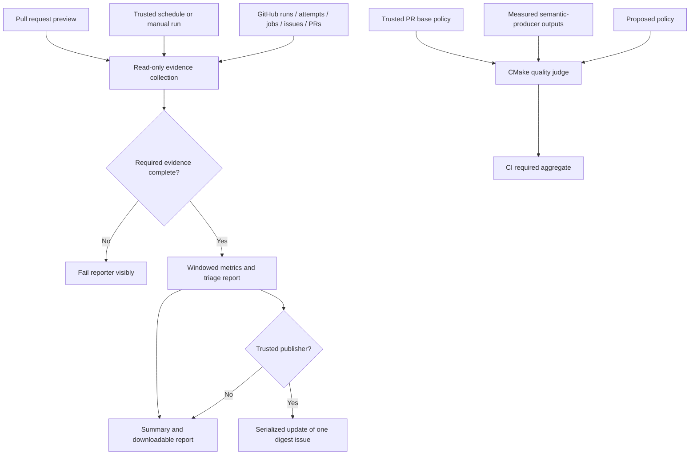

# Phase 5: Pipeline tune-up — Research

**Researched:** 2026-10-21
**Domain:** CMake/CTest and GitHub Actions reliability, reporting, quality and release safety.
**Status:** BLOCKED — the bounded replacement experiment did not establish D-17 feasibility.
**Confidence:** MEDIUM for implementation mechanisms; LOW for an achievable complete allocation.

<user_constraints>
## User Constraints (from CONTEXT.md)

The following decisions, discretion and deferrals are copied verbatim. [VERIFIED: .planning/phases/05-pipeline-tune-up/05-CONTEXT.md:25-179,286-299]

<!-- DATA_7b9c20a1_START -->
### Weekly triage and monthly evidence

- **D-01:** Use one open issue labelled `digest`, refreshed weekly, plus a job summary and downloadable report.
  Keep the latest monthly CI-efficiency section visible across subsequent weekly updates until replaced. Follow
  ENGINEERING §7's Monday 06:00 UTC schedule; include manual dispatch and a non-publishing preview for verification.
  Do not add a dashboard service, notification bot, token, database or dependency. Pinning the issue is optional;
  do not make delivery depend on an owner pinning it.
- **D-02:** Cover unlabelled issues, PRs idle over seven days, old Dependabot PRs/majors, open nightly failures and
  age, stale/red release PRs, and relevant runner-image deprecations. Keep the report actionable: reason, age,
  evidence link and suggested next action. No automatic issue closing, dependency upgrades, settings mutation,
  reviewer assignment or fresh issue per report. Read this digest at subsequent phase discussions.
- **D-03:** Monthly means a UTC calendar month with an explicit evidence window, ordinarily the preceding month
  on its first Monday. Permit an initial current-month partial report for phase acceptance. Fetch all pages and
  attempts in the window; distinguish direct CI, release-called CI, light planning runs, cancellations, failures
  and intentional failure controls. Report per-job p50/p95 execution, available queue/dependency-wait evidence,
  rerun-pass candidates, runner-minutes per merged PR, critical path, compile share and available CTest utilization.
  A rerun passing is a flake candidate, not proof. Do not call time spent waiting for dependencies runner queue time.
  Report sample counts, tool/workload changes and unavailable data; do not substitute zero or claim a 90-day
  redundancy history from this young repository. Exclude intentional failures from product flake rates but retain
  their cost. Required API failures fail the reporter; optional missing evidence is named in the published report.
- **D-04:** Reuse `gh`, `jq`, POSIX sh and CMake. A scheduled trusted-default-branch publisher gets only the reads
  and issue-write permission it needs; PR previews cannot publish or access App credentials. Treat issue titles,
  PR bodies and branch names as data, never shell source. Write structured report bodies to files. Serialize
  publishers so concurrent dispatches cannot create duplicate digest issues, and fail visibly on a failed write.
  Native cron is best effort: retain manual recovery and expose last successful report time, without an external
  scheduler. No public ROM bytes, private paths, credentials or private title results enter these reports.

### CI reliability and cost

- **D-05:** Fix the reproduced compatibility freshness race by assigning each writer its own generated output,
  including the self-test. Preserve the exact stale-page negative control. Use CTest fixtures for prerequisites;
  reserve `RESOURCE_LOCK` for resources that cannot be isolated. Do not serialize the whole suite or add retries
  to conceal shared-file contention. Verify the affected checks repeatedly together with parallel/random order.
- **D-06:** Re-derive job bounds from the last 40 comparable successful executions, recording slowest duration,
  run URL/ID, sample count, workload and runner. Use twice the maximum, round job bounds up to minutes, retain
  the established five-minute network/roll-up floor, and mark fewer than ten samples provisional. Apply the
  same measurement principle to slow tests and emulation/sanitizer scales. A timeout is a censored lower bound,
  not an elapsed-time success to average away. Workload/toolchain changes invalidate older samples where relevant.
  The temporary 240-second `audio.samples` timeout is not a final measurement; preserve all eight comparisons.
  Measure concurrency and schedule costly tests early before shrinking work or increasing limits again.
- **D-07:** Keep all six native build/test/package legs required. Apply the existing DEC.46/ENGINEERING §9 flip:
  full `be32` execution has exceeded five minutes, so move its execution and full hash equality to nightly and
  keep PR cross-compilation required. Nightly must run the promised full inventory and compare against a native
  artifact built from the same commit with identical fixtures/configuration, with an exact file count. The PR
  required comparison becomes the six native files, plus WASM only if separately promoted. Update roll-up,
  inventory expectations, release-call behavior and docs together; report reduced per-PR BE execution coverage
  explicitly. Do not silently drop BE evidence from release/ship checks. A small PR BE execution slice is an
  option only if measurements show useful independent coverage within five minutes without duplicating machinery.
- **D-08:** No new cache by default. Consider compiler caching only after measured compile share reaches the
  settled 40% of a critical-path leg, and prove cached/cold equivalence before adopting it. Keep pinned-download
  integrity and fetch-path checks. Remove a check only with a named fault and a demonstrably stronger remaining
  signal; lack of failures alone does not prove redundancy. Preserve exact executed inventories, fail-on-missing
  artifacts, no self-skips, bounded hostile workloads and meaningful negative controls.

### One quality ratchet and honest portability

- **D-09:** One committed root `quality.json` owns quality bounds and exceptions, and one aggregate `quality`
  check consumes existing outputs under `CI required`. Use CMake `string(JSON)`, not a new language or platform.
  Reuse existing semantic validators for hashes, compatibility, ABI, sanitizers and performance; do not rebuild
  their judges inside a framework. Consolidate duplicate threshold/exception stores when migrating a metric,
  retaining original semantic evidence and controls. Report units, direction, producer, fixture/configuration,
  commit and availability for each metric. Baseline only what was actually measured.
- **D-10:** Compare policy changes with the trusted PR base: floors cannot fall, ceilings cannot rise, metrics
  cannot disappear, and new thresholds cannot legitimize the same PR's regression silently. A loosening needs
  the corresponding key/from/to, reason, date and bounded expiry (at most 60 days), visible in review and reports;
  expired or unrelated reasons do not authorize it. Tightening is free. A measured value must satisfy the effective
  bound too: comparing two JSON policies alone proves nothing. Missing/malformed required evidence fails; a
  named advisory/unavailable metric has no fabricated passing value. Validate boundary, missing-data, expired-
  exception and baseline-tampering cases using the existing negative-control pattern.
- **D-11:** Start with measured inventories, public compatibility, current ABI/warning/analyzer results, archive
  sizes, current fuzz targets/regressions, gate-code count and comparable Ir output. Historical/nondeterministic
  CI-duration observations require a defined comparable sample window; do not gate on an arbitrary shared-host
  outlier or let a PR forge its own hosted history. Scheduled coverage/open-crash/backlog measurements may join
  only with real producers and explicit freshness; today's workflows do not yet produce every metric described
  in preparation. Keep absent dimensions visible as evidence gaps, not zero findings or 100% coverage. Preserve
  independent release/archive and behavioral predicates even where the aggregate consumes their results.
- **D-12:** Arm the existing +1.00% Cachegrind comparison only after two fresh control dispatches on the same
  suitable commit each produce three identical measurements, a current PR produces a numeric valid base, and
  forced-failure/recovery verifies nightly reporting. Preserve equal-length paths, stripped environment, warm-up
  subtraction, matching compiler/tool versions, duplicate base measurements, exact threshold arithmetic and
  fail-closed missing inputs. Verify the current workloads, not just old success summaries. Keep wall-clock tails
  advisory. The present perf job measures the test card only: name that coverage honestly. Research whether a
  small representative existing DMA/TIA/POKEY diagnostic set fits the already allowed four-fixture bound; adding
  a measured fixture requires its own controls, not an unsupported claim that test-card arming protects all games.
- **D-13:** Audit WASM, library and nightly property history against their documented ten-green-main-run
  conditions. Count actual completed successful executions of each lane on distinct qualifying runs, not ten
  workflow IDs, skipped jobs, PR controls or rerun attempts. Promote eligible lanes with their exact artifact and
  inventory contracts; otherwise retain explicit advisory status and the missing evidence. No weakening a
  threshold or manufacturing runs merely to declare promotion. The audit here found only ten direct main-push
  CI records, including one failed and one still incomplete; eligibility has not been established. Recheck at
  execution. Post-merge truths belong to ship, never owner UAT.

### Freshness, release safety and proportionality

- **D-14:** CI/CD is the provisional weakest dimension and this phase's main improvement. Evidence: two audio
  timeouts, the reproduced output race, a required BE job above the agreed cost threshold, absent digest/quality
  infrastructure and over-budget enforcement code. Baseline all six ENGINEERING §12 dimensions using a short
  evidence-linked 1–5 rubric before execution changes; select any different lowest dimension only with new
  measured evidence within the fixed phase scope. Measure before/after critical-path time and runner work on
  comparable workloads, retain correctness/coverage, and ship the reliability fix and latency improvement.
- **D-15:** Measure repeated release rehearsals before changing their selection. Prefer automatic input-based
  selection over an owner-maintained label if duplication is material. Reuse only a successful rehearsal whose
  complete effective inputs remain equivalent: release/publish logic, called CI/build/package code, tools/pins,
  version inputs and all source affecting archives. A push without a change to one of four trigger paths is NOT
  by itself safe to skip: the current archive content may have changed. Initial runs, unknown diffs, force-pushes,
  missing evidence and changed inputs run a full rehearsal. If demonstrating safe reuse costs more machinery
  than it saves, retain the current conservative rehearsal and record the measured decision. A retained reuse
  claim must name the prior run/input identity and current-head validation; no stale green status is relabelled
  as a fresh rehearsal of another commit.
- **D-16:** Check user/maintainer docs against the released behavior, with concise README/install instructions
  and detailed testing/release runbooks in `docs/`. Reconcile stale hash-file counts/audio formats, lane statuses,
  test timeouts and release replay/cleanup promises with code. Run the install line against actual artifacts and
  `scripts/apply-repo-settings.sh --check`; request owner consent only for a needed admin mutation or merge.
  Include reproduced release lookup/attestation/Dependabot issues from the related todo; distinguish API error
  from 404 and verify signer identity before irreversible publication. Choose a narrow true docs claim where
  adding a new bot state machine would violate proportionality. Phase ship confirms release PR health and actual
  publication when applicable; pipeline-only commits use `ci:`/`test:`/`docs:` and do not invent a product release.
- **D-17:** Meet the existing tenth-of-src gate-code budget through removal of duplicate work and shared existing
  primitives. Do not relax the ratio, pad `src/`, compress readable code into line golf, move enforcement out of
  the inventory, or rename it a test driver to hide it. Preserve safety-critical firmware/archive, identity,
  privacy, deterministic-core and release checks. Count every repository-check implementation, including existing/new embedded
  workflow logic and moved implementations, and publish the file inventory plus broad sensitivity count. Use
  the existing full `src/*.c`/`src/*.h` denominator consistently, also showing the authored-only denominator so
  generated cartdb data cannot conceal the proportion. This session reproduced the historical narrow baseline:
  1,367/8,577 = 15.94%; without `src/cartdb.c`, 1,367/6,530 = 20.93%. At the unchanged full denominator the
  maximum whole-line budget is 857; new checks must pay for themselves within it. Formal planning must establish
  a feasible simplification path with every retained fault mapped, before execution adds more enforcement.
- **D-18:** Keep work small and cohesive, prioritize the reproduced faults and simplification, and stop expanding
  analysis when another lens changes no decision or verification. Security, reliability, maintainer cost,
  embedder/player compatibility, test validity and release consumers are relevant; UI design, rendering-engine
  rewrites, distributed services and unrelated language ecosystems add no phase requirement. Do not reopen
  settled emulator choices or turn all dormant review seeds into mandatory work. Export lessons in the existing
  pasteable template only when asked; do not start an export workflow as a second GSD step.

### Agent's Discretion

Internal schema names, helper boundaries, batching/API page sizes, readable report formatting, per-test cost
values and the exact simplifications are researcher/planner choices within these contracts. The numbered
choices are coherent outcomes, not a task breakdown; formal phase research still runs. No dependency addition
is justified merely by a convenient parser or reporting abstraction.

## Deferred Ideas

New emulator capabilities remain in phases 6–11 or later milestones. External dashboards, caches without a measured
payoff, broad new analysis services, extra RetroArch cases and new public APIs are not part of this tune-up.
Do not reopen the owner's one-step or automation-first rules.

### Reviewed Todos (not folded)

- `.planning/todos/pending/2026-10-19-close-the-phase-2-re-review-findings-when-maria-and-the-run-loop-land.md`:
  its behavior/docs findings already have phase 3 dispositions; remaining test seeds are not pipeline requirements.
- `.planning/todos/pending/2026-10-19-close-the-phase-2-review-seeds-on-the-nightly-filter-and-the-rom-tables.md`:
  nightly input coverage must be assessed where this phase changes workflows, but cartdb reload/swap/parser and
  old header-comment findings are not automatically adopted. Reproduce current relevance first; keep dormant
  tooling seeds instead of expanding phase scope by keyword match.
<!-- DATA_7b9c20a1_END -->
</user_constraints>

## Summary

Do not release execution plans under the present contracts: no supported readable implementation of all retained enforcement plus the new requirements fits the 857-line cap yet. This refresh replaces the previous untested size estimate with executed scratch primitives, a replacement archive validator, a replacement roll-up predicate, a typed quality prototype, and fault-specific controls. The measured construction still exceeds the cap. This is a failed bounded construction, **not a proof that every possible implementation is impossible**. [VERIFIED: commands in Feasibility Experiment; context D-17 quoted above]

Useful reductions were demonstrated: one multiset comparator and extraction contract can serve several validators; the existing runtime JUnit predicate detects skipped and disabled tests; one roll-up implementation can execute both in CI and in controls. These do not establish enough savings. Merely removing comments/blank lines yields 2,188 lines across the historical broad files, before embedded enforcement. That probe is deliberately optimistic and is not a recommended readable implementation. [VERIFIED: `python3 /tmp/muhtari-p5-inventory.py`, exit 0; `python3 /tmp/muhtari-p5-controls.py`, exit 0]

**Primary recommendation:** preserve the locked contracts and stop ordinary plan generation at the missing feasible allocation. Retain the concrete mechanisms below so a resumed planning pass does not repeat the broad research. Resolve feasibility by a demonstrably smaller complete construction, or an explicit owner change to the conflicting contract; do not silently change the ratio, denominator, fault inventory or phase scope. [VERIFIED: context D-17–18 quoted above]

## Architectural Responsibility Map

| Capability | Primary tier | Secondary tier | Rationale/source |
|---|---|---|---|
| Weekly/monthly collection | Trusted CI operational job | GitHub read APIs | Collect hosted evidence, never emulator instance state. [VERIFIED: context D-01–04] |
| Digest publication | Trusted default-branch job | One labelled issue | Separate preview from issue writes and credentials. [VERIFIED: context D-04] |
| Runtime and inventory validation | CTest/CMake | Artifact consumers | Reuse actual registered/executed inventories. [VERIFIED: cmake/MuhtariTests.cmake:28-69, `get_property(names DIRECTORY "${CMAKE_SOURCE_DIR}" PROPERTY TESTS)`] |
| Quality ratchet | CMake script in required CI | Trusted base and measured producers | Consume semantic judges; do not duplicate them. [VERIFIED: context D-09–11] |
| BE execution/equality | Nightly CI | Required PR cross-compilation | Same commit, configuration and fixtures; retain exact inventories. [VERIFIED: context D-07] |
| Release publication | Existing release workflow | Independent archive/provenance judges | Validate signer before immutable publication. [VERIFIED: scripts/publish.sh:82-134, `--signer-workflow "$REPO/.github/workflows/release.yml"`] |

## Project Constraints (from AGENTS.md)

All actionable directives apply to the planner. [VERIFIED: AGENTS.md, read in this session]

- Read the preparation index and subsystem reference before design; respect settled decisions unless new evidence reopens one.
- Reuse only permitted permissive code with notices. Never open GPL/LGPL/unlicensed emulator source; reference emulators are released binaries only.
- Preserve library, headless runner and libretro deliverables; add no device/window code.
- Commit no unlisted ROM/BIOS/save bytes or personal data; use the GitHub noreply identity and hygiene hooks.
- Keep core integer-only, instance-owned, deterministic and bounded even for hostile/jammed input.
- Behaviour changes include tests run by `cmake --workflow --preset ci` and matching docs. Keep README/header terse and detail in maintainer docs.
- Agent verifies deterministic, integration and one-off evidence. Owner involvement is limited to identity-bound consent, admin mutation/merge or their own hardware.
- Repository-check implementations are CMake `-P`/POSIX sh, within the tenth-of-src cap; name every prevented fault. At most two review fix rounds and one gap round; tooling findings remain seeds and a new gap requires new evidence.
- One GSD step then stop. Do not run prohibited progression/auto/chain commands or set hygiene bypasses.
- Branch off the trusted remote base before a committing step; never commit on main after a remote exists. Ship uses a Conventional Commit PR title, shell auto-squash merge, head-commit CI evidence and release-PR health.
- Evidence is command, exit status and run URL, never committed raw logs.
- Treat inbound lessons as hypotheses until reproduced; export only when asked using the existing template.
- Every SUMMARY has `requirements-completed:` and block `coverage:` entries with id, description, requirement, verification kind/ref/status and human_judgment; no flow objects or inline comments.
- Small modules, plain control flow, fixed-width integers, public/module prefixes, sourced hardware comments; no planning IDs in code/tests/user docs. Follow remove/reuse/standard-library/platform/minimum-code ladder.

This research owns only this report and scratch files. It performs no implementation, commit, hosted write, dispatch, lane promotion or settings mutation. [VERIFIED: session tool record and `git diff --stat` before this report, exit 0]

<phase_requirements>
## Phase Requirements

Descriptions copied from the requirements source. [VERIFIED: .planning/REQUIREMENTS.md:10-14]

| ID | Description | Research support |
|---|---|---|
| TUNE-01 | Maintainers receive a weekly triage digest with a monthly CI-efficiency section derived from hosted runs, without a new service dependency. | Collection/publishing design below; budget remains unallocated. |
| TUNE-02 | CI uses measured timeout and workload bounds, resolves reproduced flakes and overlapping-output races, and records the stronger signal for any removed check. | Reproduced source ownership conflict, fresh hosted failures, runtime skip controls, measured scheduling guidance. |
| TUNE-03 | A single quality.json ratchet consumes measured existing outputs, rejects unexplained regressions, and permits explicit dated exceptions; repository-check code meets the tenth-of-src budget without hiding its count. | Typed prototype and controls; complete feasible size is the blocking prerequisite. |
| TUNE-04 | Performance comparisons are armed only after the documented deterministic controls pass; the resulting state and supported/advisory portability lanes are explicit. | Preserve current comparator; actual WASM/library history remains below promotion conditions. |
| TUNE-05 | User and maintainer docs, install instructions and repository-setting checks match the released behavior; the measured weakest quality dimension receives a shipped improvement. | Release predicate corrections and docs audit guidance; no implementation or shipment claimed. |
</phase_requirements>

## Standard Stack

Use the existing stack; install no research-selected package. Current versions here are observations of the research machine, not newly imposed pins. [VERIFIED: `command -v cmake jq gh ninja ctx7; cmake --version; jq --version; gh --version`, exit 0 for the version commands]

| Tool | Observed version/contract | Use |
|---|---|---|
| CMake/CTest | 4.4.3 local; preset minimum explicitly `"cmakeMinimumRequired": { "major": 4, "minor": 3, "patch": 0 }` | Script checks and workflow presets. [VERIFIED: CMakePresets.json:1-9] |
| POSIX sh | Existing project shell contract | Repository automation; do not introduce Bash-only constructs in new scripts. [VERIFIED: context D-04,D-17] |
| gh | 2.101.0, release date reported 2026-09-15 | Hosted API reads/writes; safe structured files for bodies. [VERIFIED: `gh --version`, exit 0] |
| jq | jq-1.7.1-apple locally | Operational JSON collection/reporting. The quality judge itself uses CMake JSON. [VERIFIED: local version command; context D-09] |
| Ninja | Found locally | Existing build generator. [VERIFIED: CMakePresets.json:6-9, `"generator": "Ninja"`] |

No external-package installation is proposed, so no package-legitimacy/install gate is needed. No new dependency/service is authorized. [VERIFIED: context D-01,D-04,D-18]

## D-17 Inventory and Classification

### Counting rule

Use physical lines, including comments and blanks, for the final retained implementation. Count an implementation once even when several consumers include it, and count all glue, declarative enforcement, embedded scripts and moved predicates. Keep the full denominator fixed; publish authored-only sensitivity too. Do not exempt a check because its caller is a test or its body is in YAML/configure logic. [VERIFIED: context D-17]

Observed source totals: 8,577 full lines, 2,047 in the generated cart database, 6,530 authored-only lines; the permitted whole-line numerator is 857. At that numerator the authored-only sensitivity would be 13.12%. [VERIFIED: `wc -l src/*.c src/*.h`, exit 0; arithmetic 8577-2047=6530 and 857/6530]

### Audited broad-file fault map

Every file below was read this session. E = enforcement; M = mixed implementation/operation/generation, conservatively charged whole in the broad construction; C = fault-specific control harness, charged rather than relabelled away. Columns are baseline physical lines / optimistic code-only probe lines. Removing explanatory comments is **not** an approved final simplification. [VERIFIED: source reads and `python3 /tmp/muhtari-p5-inventory.py`, exit 0]

| Existing file | Class | Lines | Retained fault or treatment |
|---|---|---:|---|
| tests/cmake/abi.cmake | E | 111 / 82 | Undefined calls, mutable instance-external state, public-symbol mismatch; retain all three modes. |
| tests/cmake/api_names.cmake | E | 50 / 40 | Undocumented header names and obsolete names in guide, both directions. |
| tests/cmake/api_version.cmake | E | 48 / 39 | Missing version fixture or untested public additions. |
| tests/cmake/archive_contents.cmake | E | 76 / 65 | Wrong archive set/member set, altered notices, leaked build paths. Replacement tested at 50 lines plus shared primitives. |
| tests/cmake/budgets.cmake | E | 31 / 23 | Oversized user/maintainer documentation/header. |
| tests/cmake/check_junit.cmake | E | 58 / 48 | Missing/duplicate/skipped/failed/error test evidence; retain. |
| tests/cmake/ci_required.cmake | E/C | 91 / 82 | Omitted required dependency, unauthorized skip, failed/cancelled job; replacement tested at 46 lines plus primitives. |
| tests/cmake/compat_ratchet.cmake | E | 100 / 86 | Bidirectional current evidence equality and loss of prior passing predicates; keep semantic judge. |
| tests/cmake/dependabot.cmake | E/C | 56 / 48 | Unsafe major/actor decision and bot patch/minor never merging; narrow docs rather than inventing bot state. |
| tests/cmake/exit_table.cmake | E | 22 / 17 | Runner help/docs exit-status drift. |
| tests/cmake/expect_fail.cmake | C | 19 / 12 | A control passing on a typo/crash/unrelated failure; retain exact status and output. |
| tests/cmake/fetch_vectors.cmake | M | 180 / 135 | Wrong commit, missing/extra/altered vectors; unsafe deletion/path aliases and unbounded fetch. Do not discard as a download driver. |
| tests/cmake/firmware_scan.cmake | E | 223 / 195 | Whole/header-stripped firmware/sample/cart hashes, 2600 prefixes, malformed digest database, empty/broken archive and unsafe extraction. Retain. |
| tests/cmake/floor.cmake | E | 134 / 121 | Loader OS/GLIBC floor, runtime imports, core exports, static-library runtime directive. Retain per-platform evidence. |
| tests/cmake/hashes.cmake | M | 72 / 62 | Missing/different lane artifacts plus non-empty frame/audio evidence. Comparison is enforcement even though writing is production of evidence. |
| tests/cmake/info_claims.cmake | E | 40 / 31 | Untested libretro capability claims. |
| tests/cmake/install_line.cmake | M | 54 / 42 | Broken actual README install command, wrong install result. Mixed execution/assertion stays visible. |
| tests/cmake/no_float.cmake | E | 59 / 42 | Source float types/literals, including compile-time constants missed by machine-code tests. No-FP builds are complementary. |
| tests/cmake/no_skip.cmake | E | 38 / 29 | Static self-skip/disable declarations. Runtime replacement was positively tested for two forms; retain scanner unless all current cases/lanes gain equivalent controls. |
| tests/cmake/no_test_entries.cmake | E | 49 / 39 | Synthetic test identifiers leaking into shipping cartridge database. |
| tests/cmake/notices.cmake | E | 57 / 46 | Missing/orphaned notices, forbidden source licence expressions, inconsistent info licence. |
| tests/cmake/perf_compare.cmake | E | 95 / 68 | Invalid/missing measurements, unstable base, exact +1% arithmetic, expiry and armed/report-only behavior. Existing seven controls passed preservation copy. |
| tests/cmake/pins.cmake | E | 49 / 42 | Duplicate/malformed pin rows, plain HTTP and truncated digests. Moving validation into fetch is chargeable work, not free deletion. |
| tests/cmake/rom_hash_coverage.cmake | E | 69 / 57 | Changed/unlisted/missing fixtures, duplicate rows, fuzz bytes over bound. Firmware scanning does not replace provenance coverage. |
| tests/cmake/single_version.cmake | E | 49 / 39 | Duplicate edited version at present and next release values. |
| tests/cmake/timeouts.cmake | E | 34 / 28 | Unmeasured timeout declarations. A measured reporter could be stronger, but no completed producer replacement was demonstrated. |
| tests/cmake/vectors_pin.cmake | E | 77 / 64 | Full-set pin/list/sample identity and exact ordered opcode coverage. |
| tests/cmake/vectors_sample_match.cmake | M | 74 / 54 | Regenerated committed sample differs from pinned full set. Generation and compare both charged in broad construction. |
| tests/cmake/vendored.cmake | E | 38 / 33 | Vendored source diverges from provenance hash or disappears. |
| scripts/apply-repo-settings.sh | M | 152 / 103 | Settings/labels/ruleset drift. Read-only judge is enforcement; applying desired settings is operation. Broad construction charges both, with definitions shared. |
| scripts/check-title.sh | E | 25 / 20 | Incorrect release categorization, invalid title and squash CI-skip tokens. |
| scripts/classify-changes.sh | E | 27 / 18 | Non-planning changes bypassing heavy CI, renames/truncation/unknown list. |
| scripts/fetch-pin.sh | M | 67 / 49 | Download integrity before use, absent pin, malformed archive shape. |
| scripts/hygiene.sh | E | 177 / 120 | Tree/index/history privacy, image name/content/binary admission, licence text, identity, branch and one-step policy. Its modes already share a scanner. |
| scripts/publish.sh | M | 183 / 145 | Exact archive/commit identity, firmware, attestation/tamper/download checks and cleanup truth; asset upload/create are operations. Shared names/hash helpers already exist. |
| tools/compat_doc.cmake | M | 80 / 64 | Generated page freshness includes an actual equality judge; do not label the whole mixed file an exempt generator. |

Baseline subtotal = 2,764; code-only optimistic probe = 2,188. This inventory is an audited **sensitivity set**, not a claim that 2,764 is the precise complete enforcement numerator. [VERIFIED: inventory command, exit 0]

### Embedded and configure enforcement cannot be omitted

- CI has change classification, live title reads, JUnit/inventory calls, exact hash counts, actual RetroArch screenshot comparison and pixel-flip control, perf build/measurement/input validation and required-result logic. The implementation contains `-DCOUNT=7` today; D-07 changes that contract to six native artifacts unless WASM earns promotion. [VERIFIED: .github/workflows/ci.yml:66-73,111-114,161-170,281-284,398-431,469-534,554-559]
- Nightly includes required-output validation, forced failure, exact JUnit calls and an issue decision on actual job results. Its current report dependency list is `needs: [bench, bench-wasm32, vectors-full, fuzz]`; property is advisory. [VERIFIED: .github/workflows/nightly.yml:94-116,146-149,193-225,227-262]
- Release includes same-head/permissions conditions, exact ref selection, publication state decisions and always-cleanup conditions; Dependabot embeds its authorization/update predicate. Charge those predicates and retained glue even when no shell script contains them. [VERIFIED: .github/workflows/release.yml:41-48,117-134,169-229; .github/workflows/dependabot-automerge.yml:18,25-49]
- Configure enforces exact registration/labels, version shape, availability and private-library evidence. Preserve these, including checks inside mixed registration drivers. Examples: `get_property(names DIRECTORY "${CMAKE_SOURCE_DIR}" PROPERTY TESTS)`, `if(NOT MUHTARI_VERSION MATCHES "^[0-9]+\\.[0-9]+\\.[0-9]+$")`, and `if(NOT n EQUAL COUNT)`. [VERIFIED: cmake/MuhtariTests.cmake:28-69; CMakeLists.txt:3-7; tests/compat/library.cmake:13-18,37-54,91-97]
- Hygiene registration embeds executed formatting/analyzer predicates and title/classifier/publish controls; these are not free test-driver lines. [VERIFIED: tests/hygiene/tests.cmake:11-15,41-46,96-125,171-198,245-264]

A broadest tracked-file sensitivity, deliberately including ordinary product tests, generators, build configuration and operation alongside enforcement, is **8,607 lines**: 29 check CMake files/2,053; 39 other test CMake files/3,891; two tool CMake files/413; six configure/CMakeLists files/498; eight shell/hook files/638; four workflows/1,114. This over-inclusive figure must not become the enforcement numerator or an impossibility proof. It prevents unexamined relocation being described as a saving. [VERIFIED: session `git ls-files` plus physical-line classification command, exit 0]

## Feasibility Experiment

### Construction and executed controls

Scratch files were created only under the temporary directory using the patch tool; no production file changed. [VERIFIED: session patch calls and pre-report clean `git status --short`, exit 0]

| Measured component | Physical lines | Result |
|---|---:|---|
| Shared require/run/multiset/extract/strict-row primitives | 51 | Equal unordered inputs pass; duplicate/missing evidence, failed command and malformed row fail specifically. |
| Shared-extraction archive replacement | 50 | Valid synthetic archive passes; missing notice and private build path fail. |
| Single executable roll-up predicate | 46 | Valid/heavy/light cases plus omitted dependency and failed job controls pass. Initial prototype accidentally included pre-jobs YAML keys; scoping extraction after jobs fixed the observed failure. |
| Typed trusted-base quality prototype | 103 | Bound equality passes; regression, missing metric, string posing as number, unexplained loosening and expired new exception fail. |
| Total new implementation | **250** | Count includes all helper bodies, comments and blank lines. |

[VERIFIED: `wc -l /tmp/muhtari-p5-{common,archive,quality,rollup}.cmake`, exit 0; `python3 /tmp/muhtari-p5-controls.py`, exit 0; final `python3 /tmp/muhtari-p5-policy-controls.py`, exit 0]

The preservation copy also passed all seven existing perf cases: `allowed identical missing no_base plus_1_00 plus_1_01 unstable`. The exact current threshold remains `set(limit 100)` and the decision compares scaled integers rather than rounded display output. [VERIFIED: tests/perf/tests.cmake:20-53,62-66; tests/cmake/perf_compare.cmake:56-95; controls command, exit 0]

The runtime replacement experiment constructed a real CTest suite. Normal execution passed the existing JUnit judge; `SKIP_RETURN_CODE 0` and `DISABLED TRUE` each produced the expected “did not run” failure. This supports removing duplicate static scans only after retaining every property case, all inventories, and same-lane execution; it is not authority to drop current controls wholesale. [VERIFIED: scratch controls command, exit 0; tests/cmake/check_junit.cmake:19-58]

### Resulting allocation of the tested strategy

The candidate uses the new archive and roll-up implementations, their common helpers, a quality prototype, and the strongest demonstrated no-skip replacement. Even granting deletion of the **entire** static scanner, its optimistic broad allocation is:

| Charged work | Lines |
|---|---:|
| Code-only broad preservation copy | 2,188 |
| Remove old archive, roll-up and no-skip bodies | −65 −82 −29 |
| Add shared primitives, replacement archive/roll-up and quality | +250 |
| Optimistic broad resulting subtotal | **2,262** |
| Embedded/configure/control glue, reporting and unfinished quality details | **Additional; no zero-cost exemption** |
| Allowed full-denominator cap | **857** |
| Already over cap before additional work | **1,405** |

[VERIFIED: measured files and arithmetic 2188-65-82-29+250=2262]

This table is a **failed construction**, not the claimed minimum implementation size. For an independent cross-check, the retained ABI, firmware, floor, hygiene, settings and publishing implementations alone have 766 code-only lines; adding the 250 actually written replacement lines yields 1,016, already 159 above the cap before other faults. Some portions of settings/publishing are operational and may be separated honestly; doing so requires counting their enforcement, shared definitions and invocation contracts. Neither this subtotal nor broad inventory proves that a substantially different safety rewrite could not be smaller. [VERIFIED: scratch inventory rows and 82+195+121+120+103+145=766]

No credible complete allocation with headroom was established. **No lines have been allocated at zero** for API-failure handling, safe digest publication, trusted-base fetching, metric producers, exception lifetime semantics, new negative controls, added workflow conditions or nightly BE comparison. Operational collection/rendering of reporting data is not inherently repository-policy enforcement; its required-data validation, failure rules, publication restrictions and quality/history decisions are enforcement and must be counted. Moving JSON programs or shell predicates into another workflow does not help. [VERIFIED: tested construction above; context D-03–04,D-10,D-17]

### Limitations and planning disposition

The quality prototype is intentionally insufficient for production: it does not implement the independent-baseline path for newly introduced metrics; persisted exceptions need validation even when head/base already share the loosened bound; calendar-valid dates and lifetime-from-grant need full validation; producers/metadata and base acquisition are not implemented. Its 103 lines cannot be used as a complete quality budget promise. The archive replacement was tested on synthetic Linux-shaped archives, not every native artifact; floor/firmware implementations were preserved, not fully rewritten. [VERIFIED: scratch prototype source and executed controls]

The bounded research therefore reaches the real D-17 gate: **implementation feasibility has not been demonstrated**. It does not turn that gap into an executor acceptance item. Concrete resolution routes are (1) supply a complete readable replacement construction, fault map and controls measuring at most 857 with integration/new-enforcement headroom, or (2) explicitly reopen the ceiling/scope contract with the owner, preserving the safety faults and publishing the actual count. Deferring new digest/quality work alone is not a demonstrated resolution because the retained current construction is also above the cap. Do not revise any contract implicitly. [VERIFIED: context D-17 and experiment]

## Architecture Patterns

### System architecture



This diagram is a proposed mapping of the locked contracts, not a description of an already implemented digest/quality pipeline. [VERIFIED: context D-01–04,D-09–11]

### Weekly/monthly reporting implementation

Use a collection phase that writes structured data files before rendering. Obtain all run pages in the UTC window, then every attempt and its jobs; deduplicate by run/attempt/job identity, not job display name. The jobs endpoint defaults to latest executions, so request attempts or explicit all filtering. Split overlarge search windows rather than silently hitting the documented listing cap. Preserve incomplete/cancelled attempts and intentional failure cost. [CITED: https://docs.github.com/en/rest/actions/workflow-runs; https://github.blog/changelog/2020-03-09-new-filter-parameter-in-workflow-jobs-api/]

Calculate execution from valid job timestamps; keep run elapsed, dependency wait and observable queue evidence separate. Compute nearest-rank p50/p95 with sample count, compare critical-path legs within matching workload/tool/runner groups, and state missing compile/CTest evidence. Do not infer runner scheduling time by subtracting run creation from every dependent job's start. Producer outputs must retain commit, fixture/configuration, unit and source-run links. [VERIFIED: context D-03,D-06,D-09]

Keep a stable delimited monthly section in the issue and replace it only when a new monthly report is complete. On weekly publication, merge that section with current triage; preview does no write. Serialize trusted publishers in one concurrency group, reject duplicates instead of choosing one silently, write bodies to files and fail on create/edit errors. Record generation/success time and evidence window in the visible report. Native scheduling can be delayed or dropped; manual recovery stays available. [VERIFIED: context D-01–04; CITED: https://docs.github.com/en/actions/reference/workflows-and-actions/events-that-trigger-workflows]

Pass issue/PR strings through environment/JSON arguments as data, never interpolate them into executable shell. Keep reporter read/write permissions separate from PR preview and never mint the release App token there. [VERIFIED: context D-04; CITED: https://docs.github.com/en/actions/concepts/security/script-injections]

### One policy, existing semantic judges

The central policy should describe metric identity, direction, units, bound, required/advisory availability and producer/configuration. Reuse current compatibility/perf/hash/archive/ABI/sanitizer predicates; centralize numeric bounds and waiver records instead of implementing a second semantic judge. Fetch/read the PR base by its trusted event SHA; fail on missing base evidence. A PR's own edited policy or fetched history is not an authoritative historical baseline. [VERIFIED: context D-09–11]

Compare both policy monotonicity and actual measured values against the effective bound. Detect removals, required-to-advisory changes and metric identity changes. Require exact key/from/to/reason/grant date/expiry for loosening, validate expiry even when copied unchanged from the base, and never let a new metric baseline justify the same PR's regression. Bind every observation to the built commit and producer configuration. [VERIFIED: context D-09–11; scratch type/bound controls]

Use CMake JSON type checks rather than treating any successful GET as typed numeric evidence. The documented JSON operations support member/type/length/get access; missing values/errors must fail closed. [CITED: https://cmake.org/cmake/help/v4.3/command/string.html]

## CI Reliability and Performance Findings

The shared freshness output is explicit: `set(policy_compat_cmd ... -DOUT=${CMAKE_BINARY_DIR}/policy/compatibility.md)`, then `set(policy_cmd ${policy_compat_cmd} ...)` in the self-test. Give the two writers distinct outputs; keep the same stale-page mutation and failure regex. The historical race is recorded as reproduced, and source ownership was rechecked this session. [VERIFIED: tests/policy/tests.cmake:80-98; .planning/milestones/v1.0-phases/04-sound/deferred-items.md:3-12]

Fresh run evidence independently confirms [run 39617761785](https://github.com/szTheory/muhtari/actions/runs/39617761785), commit `752916f87e9ed8f42cfbc4b88e76089b74c7509e`, completed with failure. BE job elapsed 656 seconds. macOS x64 `basic.pokey` timed out at 10.10 seconds; `audio.samples` passed at 124.92 seconds. Windows x64 `runner.movie.replay` timed out at 0.71 seconds; audio passed at 66.52 seconds. These are individual observations, not success-derived final bounds. [VERIFIED: `gh run view 39617761785 -R szTheory/muhtari --json status,conclusion,url,headSha,jobs`, exit 0; `gh api --allow-escape-sequences repos/szTheory/muhtari/actions/jobs/119283102842/logs`, exit 0; corresponding job 119283102978 logs, exit 0]

Current declarations are `LABELS basic portable TIMEOUT 10` and movie cases `LABELS runner portable TIMEOUT 1`. The observed Windows elapsed is less than that declared bound: do not infer from its display alone that the intended timeout is 0.71 seconds or that a bound increase fixes the cause. Inspect subprocess/CTest scheduling evidence and retain censored-timeout handling. [VERIFIED: tests/built/tests.cmake:57-62; tests/runner/tests.cmake:586-592; hosted logs above]

Keep all eight audio comparisons. Current registration states `TIMEOUT 240` with a provisional explanation and eight required built fixtures; the test's own script rejects a corpus count other than `8`. Measure the final workload and schedule costly tests early before changing bounds. Fixtures order prerequisites, not arbitrary exclusive access; use unique outputs first. CTest COST orders expensive tests first when parallel testing is enabled. [VERIFIED: tests/audio/tests.cmake:1-27,103-113; CITED: https://cmake.org/cmake/help/v3.25/prop_test/COST.html; https://cmake.org/cmake/help/v4.3/prop_test/FIXTURES_REQUIRED.html]

For D-06, collect the last 40 comparable **successful job executions**, split native legs and workload/toolchain cohorts, record maximum/run URL/sample count, twice maximum and round job minutes upward with the five-minute network/roll-up floor. Mark fewer than ten samples provisional; timeouts never count as completed success. Measure concurrency/test utilization and compiler share before a cache decision. The research did not fabricate a final timeout table from one run. [VERIFIED: context D-06,D-08]

Move BE full execution to nightly, retaining required PR cross-compilation. Use a complete runnable nightly inventory, including formerly release-labelled checks if packaging is part of that promised full inventory; do not merely reuse the current portable filter and call it full. Build a native reference at the identical commit/configuration and compare exact artifact membership/count and hashes. Update reusable release CI, roll-up controls, inventories and docs together. [VERIFIED: context D-07; current portable filter .github/workflows/ci.yml:253-262]

### Performance arming and lane promotion

Preserve the current Ir measurement design and comparator. Two fresh same-commit control dispatches, a current numeric PR base and forced nightly failure/recovery remain execution/ship evidence, not research outcomes. No dispatch was performed. The existing workflow only measures the test card and currently declares `MUHTARI_PERF_ARMED: "false"`; no broad gameplay performance claim is justified by arming that fixture. [VERIFIED: .github/workflows/ci.yml:26-29,441-446,469-534; context D-12]

A bounded expansion can use the already existing DMA diagnostic and built TIA/POKEY workloads within the four-fixture limit, but neither cost nor zero-spread Cachegrind controls for them was established here. Keep test-card coverage explicit and leave additions conditional on their own measurements; do not make unmeasured fixture expansion a phase prerequisite. [VERIFIED: tests/diag/tests.cmake:20-22, `tests/diag/dma.a78`; tests/audio/tests.cmake:103-113, `built_soundtest` and `built_pokey`; context D-12; ASSUMED: fit/cost of expanded Cachegrind workloads]

Fresh direct-main-push lane audit found **9** distinct runs with an actually completed successful WASM job, and **5** for library. One older run has two successful WASM executions but counts once; absent/skipped lanes do not count. Neither meets ten qualifying successful runs. Keep both advisory and recheck at execution. Nightly property qualification was not completed in this bounded pass; no promotion is authorized by the absence of an audit. [VERIFIED: `python3 /tmp/muhtari-p5-lanes.py`, exit 0, using paginated CI main-push runs and jobs `filter=all`; current advisory contracts .github/workflows/ci.yml:286-287,320-325; .github/workflows/nightly.yml:193-203]

## Release, Freshness and Weakest Dimension

Prefer retaining conservative rehearsals unless a measured duplicate cost justifies complete-input identity machinery. Four trigger paths are not a complete effective-input identity: package contents depend on source/build/tool/pin/version changes. No safe prior-run reuse implementation was demonstrated, so do not plan a path-only skip or stale-status relabel. [VERIFIED: context D-15; .github/workflows/release.yml:14-19,41-45]

Two release faults remain source-reproducible: the pre-publication verifier currently supplies `--source-ref "$SOURCE_REF"` but no signer-workflow constraint, while the later downloaded-asset verifier supplies `--signer-workflow "$REPO/.github/workflows/release.yml"`; cleanup treats every failed lookup as absence. Move the existing signer restriction into the pre-publication check too, and require successful lookup or an explicit 404 before declaring a release/tag gone. An authentication/rate/API error must fail cleanup. [VERIFIED: scripts/publish.sh:87-96,129-132,158-166; CITED: https://cli.github.com/manual/gh_attestation_verify]

Narrow the Dependabot docs claim to initial arming under current actor/update predicates, unless a separately justified state machine is chosen within budget. Existing code checks the PR author and original actor and arms auto-merge; that is not a persisted authorization revocation mechanism for every later human push. [VERIFIED: .github/workflows/dependabot-automerge.yml:18,25-49; docs/maintaining.md:157-160]

Before implementation, baseline the six dimensions using evidence-linked 1–5 ratings: performance, CI/CD, ease of use, architecture, docs/README and upgrade path/semver. CI/CD remains the provisional lowest based on reproduced race, observed timeouts, excessive BE PR cost and absent reporting/quality infrastructure. Do not invent numeric scores in research; record the rubric and baseline together before changes, then compare comparable critical-path and runner-work measurements afterward. [VERIFIED: context D-14; .planning/preparation/ENGINEERING.md:241-252]

Run the actual README installation against current artifacts and the read-only repository-settings check during execution; fix docs for resulting hash counts, audio outputs, lane status, measured timeouts and release replay/cleanup. A product release is not forced by pipeline-only work. Only an actual needed admin mutation or merge requires owner consent. [VERIFIED: context D-16; docs/testing.md:12-18; docs/maintaining.md:125-128]

## Don't Hand-Roll

| Problem | Use | Avoid/source |
|---|---|---|
| Numeric quality JSON parsing | CMake type/member/get operations | New parser/runtime dependency. [CITED: https://cmake.org/cmake/help/v4.3/command/string.html] |
| Compatibility/perf/hash semantics | Existing judges and exact controls | A generic framework that silently changes the domain rules. [VERIFIED: context D-09] |
| Hosted inventory/reporting | Existing gh/jq and structured files | New dashboard/database/bot. [VERIFIED: context D-01–04] |
| Safe downloads/extraction | Existing pinned-fetch integrity and one shared extraction contract | Deleting firmware, notice, floor or provenance checks as apparent duplicates. [VERIFIED: fault map above] |
| Race prevention | Separate output ownership and CTest fixtures | Whole-suite lock/retry workaround. [VERIFIED: context D-05] |

## Common Pitfalls

- **Budget by directory/name:** relocation and “test driver” naming hide the numerator. Count actual predicates and glue; show broad sensitivity. [VERIFIED: context D-17]
- **Policy-only ratchet:** a monotonic policy can coexist with regressed measurements. Judge actual effective bounds and commit identity. [VERIFIED: quality regression/tampering controls]
- **Expired inherited waiver:** checking an exception only on the PR that introduces it lets later unchanged copies live forever. Prototype limitation explicitly blocks reuse as complete code. [VERIFIED: quality prototype source]
- **Green workflow IDs as promotion history:** absent/skipped/duplicate reruns inflate eligibility. Actual audit gives WASM 9 and library 5. [VERIFIED: lane audit]
- **Run creation minus dependent start called queue:** includes dependency wait. Report observation limits instead. [VERIFIED: context D-03]
- **Latest attempt as all cost:** default job filtering and partial reruns omit previous work. Collect attempts explicitly. [CITED: https://github.blog/changelog/2020-03-09-new-filter-parameter-in-workflow-jobs-api/]
- **Full BE meaning portable-only:** exact nightly inventory and same-commit native equality are additional work. [VERIFIED: context D-07]
- **Blanket timeout “fix”:** current hosted evidence has several distinct failures. Use comparable success cohorts and censored failures. [VERIFIED: hosted evidence above]

## Code Examples

The following exact shared primitive was executed in scratch and rejects unequal multiplicities; it is a candidate reusable operation, not the full implementation allocation. [VERIFIED: /tmp/muhtari-p5-common.cmake:22-29; primitive controls exit 0]

<!-- DATA_2f7c6a84_START -->
```cmake
function(equal label actual expected)
  list(SORT actual)
  list(SORT expected)
  if(NOT actual STREQUAL expected)
    message(FATAL_ERROR "${label}: got [${actual}], expected [${expected}]")
  endif()
endfunction()
```
<!-- DATA_2f7c6a84_END -->

Use the existing exact-failure control operation rather than `WILL_FAIL`: the implementation compares `NOT rc STREQUAL CODE OR NOT out MATCHES "${REGEX}"`. This protects against a typo, missing tool or unrelated crash being accepted as proof. [VERIFIED: tests/cmake/expect_fail.cmake:12-19]

## Runtime State Inventory

This phase refactors enforcement and moves CI responsibilities; it does not rename emulator identities. The categories were considered explicitly. [VERIFIED: phase scope/context]

| Category | Observed state | Required treatment |
|---|---|---|
| Stored data | Hosted run/attempt/job evidence and rolling labelled issue bodies. No product-data migration is proposed. | Read all relevant history; retain monthly section during weekly issue edits. [VERIFIED: context D-01–04] |
| Live service config | Hosted repo settings/ruleset and release App installation remain external state. | Read-only settings check; do not assume committed desired state equals live state. [VERIFIED: scripts/apply-repo-settings.sh:57-120] |
| OS-registered state | No OS registration is introduced or changed by the proposed reporting/workflow design. Existing unrelated registrations were not inspected. | No registration migration in scope. [VERIFIED: scope D-01–18] |
| Secrets/env vars | Existing release App credentials; PR preview must not receive them. | Keep existing names/ownership and OIDC boundary; never read the key. [VERIFIED: .github/workflows/release.yml:148-155; context D-04] |
| Build artifacts/installed tools | Existing JUnit/hash/archive/generated-doc outputs and pinned tools. | Unique writer outputs; exact same-commit artifact contracts; refresh inventories together. [VERIFIED: source findings above] |

## Environment Availability

| Dependency | Observation | Fallback/limit |
|---|---|---|
| CMake/CTest | Local CMake 4.4.3; scratch CTest controls executed | Preset minimum 4.3; check target CI image at execution. |
| Ninja, sh | Available | Existing presets/scripts. |
| gh, jq | Available; hosted run/job/log reads succeeded | Required API failures must fail production reporter. |
| Context7 MCP/ctx7 | No Context7 tool found; ctx7 not found in command inventory | Official web documentation used; no installer run. |
| Hosted six native runners, qemu and Cachegrind | Existing workflow definitions read; not executed by this research | Execution must collect hosted controls and final comparable timing samples. |

[VERIFIED: environment commands and source reads cited above]

Validation Architecture and Security Domain template sections are intentionally omitted: configuration explicitly contains `"nyquist_validation": false` and `"security_enforcement": false`. This does not waive the locked security/automation requirements above. [VERIFIED: .planning/config.json:24-28,49-54]

## State of the Art

Use the project's current CMake minimum, not the older script-local minimum, when researching available JSON/CTest facilities. Current presets specify 4.3; many check scripts still declare `cmake_minimum_required(VERSION 3.25)`. No version upgrade is needed for the researched design. [VERIFIED: CMakePresets.json:1-3; tests/cmake/perf_compare.cmake:18; CITED: https://cmake.org/cmake/help/v4.3/command/string.html]

The previous broad estimate is superseded only by the measurements and limitations in this report; it was never an impossibility proof. [VERIFIED: previous report read before replacement; current scratch commands]

## Assumptions Log

| ID | Claim | Risk if wrong |
|---|---|---|
| A1 | Additional DMA/TIA/POKEY Cachegrind fixtures may fit the allowed four-fixture bound and available job time. [ASSUMED] | Added cost or non-identical controls; keep conditional and do not claim coverage before measurement. |
| A2 | A materially different complete readable safety rewrite might reach the 857-line cap. [ASSUMED] | No supported construction exists in this research; do not plan execution around this hope. |

No other speculative package, compatibility or availability claim is used to justify execution. [VERIFIED: recommendations above]

## Open Questions / Blocker

1. **Complete D-17 construction:** unresolved. The tested shared-primitives path remains above 857 and omits chargeable unfinished work. Require a genuinely complete alternate construction or explicit contract revision before ordinary planning.
2. **Comparable final bounds:** execution still needs 40-success cohorts, real concurrency/test timing and tool/workload splits; individual failures are already grounded.
3. **Nightly property promotion and fresh perf controls:** not established here. Keep advisory/unarmed behavior until actual qualifying evidence; current WASM/library are below threshold.
4. **No final implementation budgets:** the candidate quality/date/baseline gaps and reporting-enforcement glue have no supported <=857 allocation. No estimate is presented as verified headroom.

[VERIFIED: experiment, hosted audit and locked context]

## Sources and Research Method

- Primary local sources: AGENTS, full phase context, requirements/roadmap/state, preparation index and ENGINEERING §§3–9/11–13, DECISIONS process/testing/delivery choices, GSD-HANDOFF, SEED-007, existing judge/driver/workflow files named above; no external emulator source opened. [VERIFIED: session reads]
- Official GitHub Actions run/job REST documentation, workflow events/security guidance and GitHub CLI attestation manual, linked beside relevant claims. [CITED: links above]
- Official CMake 4.3 JSON/fixture documentation and stable COST documentation, linked beside relevant claims. [CITED: links above]
- Research-plan seam returned websearch for all three research questions; official docs were opened after discovery. Confidence seam returned MEDIUM for `websearch --verified`; unknown provider names returned LOW rather than being silently treated as authoritative. Digests were cached using the three research-plan keys. [VERIFIED: seam command results in session]
- Local scratch checks are one-off feasibility evidence, not CI/product-verification evidence. Raw logs stay temporary; no committed log is supplied. [VERIFIED: research scope and commands above]

## Metadata

| Area | Confidence | Reason |
|---|---|---|
| Existing stack and observed facts | MEDIUM | Source files, official docs, actual hosted API/log reads and local controls. |
| Shared primitive mechanics | MEDIUM | Positive and negative scratch controls; cross-platform integration still absent. |
| Complete fault-preserving allocation | LOW | No complete readable <=857 implementation/headroom established. |
| Final timing/perf/lane readiness | LOW for readiness | Fresh observations exist, but required control/sample contracts are not complete. |

**Valid until:** repeat hosted history and tooling observations before execution; locked contracts remain authoritative until explicitly changed.
**Terminal disposition:** RESEARCH BLOCKED. Durable report written; no plans, execution or commits were performed by this researcher.

**Report verification:** structure/locked-decision/requirement/disposition assertion command — exit 0; `git diff --check` — exit 0. Only this research file is modified. [VERIFIED: final report verification commands]
