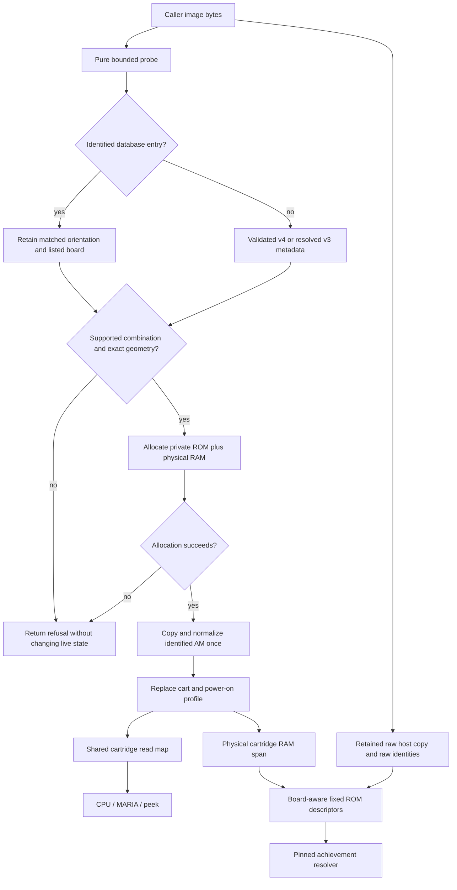

# Phase 06: Retail cartridge boards - Research

**Researched:** 2026-10-23
**Domain:** C17 cartridge identification, physical address decoding, libretro visibility and bounded acceptance
**Confidence:** MEDIUM

<user_constraints>
## User Constraints (from CONTEXT.md)

The following locked decisions and discretion are copied verbatim from the phase context. [VERIFIED: .planning/phases/06-retail-cartridge-boards/06-CONTEXT.md:23-199]

### Locked Decisions

### Activision layout and identity

- **D-01:** Use OM order, matching the bundled softlist, as the installed Activision representation.
  Preserve which lookup pass matched. Only an identified half-swapped Activision match authorizes swapping
  each 16 KiB bank's 8 KiB halves. Normalize the new private allocation before replacing the loaded cart;
  never modify caller bytes, normalize twice or add a second runtime mapper for the other dump order.
- **D-02:** Retain hashes of the supplied full image and headerless bytes under their current runner meanings,
  including the existing treatment of trailers. Normalization does not redefine raw identity, movie identity
  or RetroAchievements identity. Expose identified half-swap orientation through an additive descriptive bit
  in the existing probe flags, and report it through existing-style runner probe output. No new hash database,
  layout override API/CLI, public peek, hash-filled struct extension or dependency is needed.
- **D-03:** An unknown image explicitly declaring Activision uses documented assumed OM order, with an
  existing-style warning that this is assumed rather than detected. Do not guess from filename, reset vector,
  footer plausibility or trial execution. An unknown headerless image retains the existing probe fallback;
  its size alone does not identify an Activision board. Modified AM images without a hash match must be
  converted externally to the documented convention. Keep hash → validated v4 → resolved v3 precedence,
  controller/region rules and raw header diagnostics.

### Board behavior and evidence confidence

- **D-04:** Activision accepts exactly 128 KiB. With OM bytes, each 8 KiB CPU window begins at the following
  image offset. Bank selection starts at zero. The switched pair is reversed within its 16 KiB OM bank;
  treating it as one contiguous 16 KiB span is incorrect.

  | CPU window | OM image offset |
  |---|---|
  | $4000–$5FFF | $18000 |
  | $6000–$7FFF | $1A000 |
  | $8000–$9FFF | $1C000 |
  | $A000–$BFFF | bank × $4000 + $2000 |
  | $C000–$DFFF | bank × $4000 |
  | $E000–$FFFF | $1E000 |

  CPU writes at $FF80–$FF8F select address bits A2–A0; written data is ignored. Reads and peeks do not
  select banks. Do not broaden this to every $E000–$FFFF write on the basis of one emulator.
- **D-05:** Absolute accepts exactly 64 KiB. $4000–$7FFF selects image bank 0 or 1; $8000–$FFFF holds the
  fixed upper 32 KiB. Start at bank zero. Only a CPU write at $8000 selects: D0 selects zero; otherwise D1
  selects one; otherwise retain. Thus values 0/1/2/3 mean retain/0/1/0. Ignore higher data bits. Do not adopt
  the alternative any-A15-write decoder without new evidence.
- **D-06:** Fractalus accepts exactly 32 KiB ROM at $8000–$FFFF and allocates exactly 2 KiB physical RAM.
  For $4000–$7FFF use physical index `((addr & 0x0E00) >> 1) | (addr & 0x00FF)` for reads and writes.
  Adjacent 256-byte pages alias; all 2,048 physical bytes have eight aliases across the window. A8 and the
  upper mirror bits are disconnected; an ordinary `ram_size - 1` mask on the uncompressed address is wrong.
  The v4 name “8K EXRAM/A8” does not establish physical 8 KiB capacity. Research must explicitly reconcile
  accepted v4 A8 declarations with this board and leave undocumented combinations unsupported rather than
  silently treating every A8 combination as a supported SuperGame variant.
- **D-07:** CPU reads, MARIA fetches and peeks share these memory maps; ordinary reads have no banking side
  effects. Preserve established audio decoding priority. Keep bank zero and zero-filled volatile RAM as the
  deterministic power-on profile; restore them on load and power cycle. Console RESET input remains distinct
  from a power cycle; existing `retro_reset` remains a power cycle. Fractalus RAM is not battery storage.
- **D-08:** Label uncertain hardware edges. The guide establishes core maps but explicitly leaves extended
  hotspots and unusual Absolute write values uncertain. Activision $FF88–$FF8F decoding, Absolute precedence,
  Fractalus mirrors above $4FFF and deterministic latch/SRAM startup are selected compatibility/profile
  policies supported by the preparation's implementation evidence, not new cartridge measurements. Use named,
  cited constants and independently derived vectors. Later hardware evidence can reopen them under DEC.11;
  no owner-console run or new accuracy oracle blocks this phase.

### Loading and host visibility

- **D-09:** Add exact geometries to probe/load validation before allocation or live-state changes. Preserve
  existing truncated/invalid/unsupported status distinctions and size-mismatch warnings; reject unsupported
  combinations explicitly. Failed validation allocates nothing. Allocation failure retains the previous
  cart. Normalize only within the accepted allocation. Retain one ROM-plus-physical-RAM allocation, bounded
  indices, no allocations after load, integer-only state and instance isolation. Keep the existing board
  switch rather than introducing a mapper framework or pointer table. Preserve API struct sizes and ABI;
  apply the documented version policy to the additive flags/warning and behavior revision during implementation.
- **D-10:** libretro fixed ROM descriptors must equal mapped CPU bytes for both Activision orders. Existing
  descriptors point at original content, so translate their 8 KiB offsets using retained input orientation
  or use a shared private normalized representation; never point OM offsets into AM data. Map Absolute fixed
  upper ROM and Fractalus fixed ROM. Leave switched ROM windows unmapped, as with existing banked spans.
- **D-11:** Replace the false contiguous Fractalus RAM descriptor. Prefer sixteen truthful 256-byte aliases
  covering $4000–$4FFF, backed by the physical 2 KiB, with higher mirrors explicitly unmapped in host descriptors.
  Confirm the pinned rcheevos resolver retains all intended regions below its 32-region cap, including fixed
  ROM. If that cannot fit, omit Fractalus RAM descriptors and document the limitation; retain the existing
  physical cartridge-RAM memory span. Core bus aliases still cover the entire window. Do not claim complete
  achievement visibility, grow the resolver or add a dependency. Tests must require intended mappings, not
  merely accept either NULL or a correct byte.

### Automated acceptance and adversarial cases

- **D-12:** Extend existing plain-C cart tests with independent address vectors: all banks, both halves,
  window endpoints, selector boundaries and neighbors, ignored address/data bits, initial state, ROM immutability,
  CPU/MARIA/peek agreement and reload/power cycle. Exercise every Fractalus window address against all 2,048
  physical bytes using multiple patterns; verify both intended aliases and distinct physical locations.
  Do not compute expected values by calling the production mapper.
- **D-13:** Add one owned executable diagnostic per board using existing assembly, manifest, mailbox, numeric
  expectation and bounded-driver conventions. Activision runs selector code from a fixed window. Derive
  expected records from the selected map before pinning outputs. Run the fixtures through library, real runner
  and in-process libretro paths, checking actual mailbox values and bounded execution rather than only a
  screenshot or non-crash. Identified AM/OM pairs must have equal mapped reads, diagnostic records and frame/audio
  behavior while preserving distinct raw identities and unchanged input buffers. Use the existing test-only
  database seam; never insert synthetic hashes into production tables. Reuse existing hosted RetroArch cases.
- **D-14:** Malformed-size and hostile-bank tests must actually select every new board. Extend deterministic
  corpus/property coverage and existing fuzz targets; the current execution fuzzer generates only linear images,
  and the loader fuzzer's raw-copy assertion must gain an independent expected normalization. Keep bounded case
  counts and existing nightly duration. Test refusals on an already loaded, switched board with written RAM:
  compare deep ROM/RAM bytes, registers and subsequent execution against a control, not only pointer-containing
  instance structures. Include allocator failure, no allocation during frames/power cycles/bus traffic, and
  interleaved instances compared with independent controls.
- **D-15:** All behavior tests run under the existing CI workflow/presets and exact inventories. Extend native
  frame/audio equality inputs for the owned diagnostics and preserve applicable existing portability lanes;
  their required/advisory status does not change. Preserve old compatibility predicates and pins; investigate
  any changed old result rather than blanket re-pinning. Diagnostic success proves board semantics, not retail
  playability or PAL completion. Keep untested retail ledger rows honest. Publish behavior prose in hardware,
  embedding/runner/libretro/testing docs as appropriate, with a short user-facing README and terse public header.

### Fixed tooling scope and planning prerequisites

- **D-16:** Adopt a fixed maximum **192 net counted lines** solely for BOARD-01–03 integration and its controls.
  Measured starting count **B = 15,287** at `617dfa762ddb649839b925be5aa582180066fa78`; assumed savings **S = 0**;
  fixed allowance **N = 192**; maximum **C = 15,479**. This is an allocation estimate, not demonstrated fit.

  | Allocation | Maximum lines | Fault prevented |
  |---|---:|---|
  | Semantic/diagnostic/fuzz registrations | 48 | New boards exist but their evidence does not execute |
  | Runner/libretro invocation contracts | 40 | Host acceptance silently tests another board or no output |
  | Manifest, inventories and claim glue | 32 | Missing fixtures/tests or unsupported coverage claims |
  | Narrow permanent-allocation admission and controls | 40 | Candidate policy self-authorizes unrelated loosening |
  | Integration reserve | 32 | Required counted integration omitted from estimates |

  Count complete affected enforcement files, comments/blanks, controls, inventory and embedded glue under
  ENGINEERING §11. Product C tests and owned assembly follow its existing classification; relocation does not
  create savings. Redistribution is visible within N, unused allowance retires and final actual tightens C.
  No new lane, generic framework, allowance language or automatic rebaseline is authorized.
- **D-17:** Planning must establish a narrow, trusted-base admission path for this explicit new scope inside
  D-16. The current quality judge demonstrates initial adoption and dated exceptions, not a permanent increase
  against an existing ceiling; `INITIAL_GATE_CEILING` is not a blanket escape. Preserve rejection of unrelated
  policy loosening, expiry/missing evidence controls and measured-value checks. Do not finance permanent growth
  through renewing temporary exceptions. If the fixed construction cannot fit, record the concrete failing
  construction and stop affected expansion; another allocation requires new evidence and an explicit decision.
- **D-18:** The independent `archive_bytes` ceiling is 399,937 and has no headroom established for new code.
  Research/planning must identify a bounded package-size measurement and a lawful acceptance path before
  implementation depends on raising it. D-16 authorizes no byte increase, no candidate self-rebaseline and no
  weakened package guard. A necessary permanent byte allocation must be separately fixed with attributable
  measurements and explicit scope; do not invent an amount during this discussion. Preserve independent
  performance and compatibility guards; the armed performance workload remains the test card.

### Agent's Discretion

Internal helper names and file splits, additive flag/warning names, independent diagnostic patterns and IDs,
and plan ordering are delegated within these contracts. Research should resolve factual and budget-admission
prerequisites before writing executable tasks; it must not treat an estimate as a successful experiment.

### Deferred Ideas (OUT OF SCOPE)

Hardware measurements and oracle expansion remain in the accuracy milestone; layout override tools need an actual
consumer beyond this phase. Saves, PAL and expansion boards retain their roadmap phases. No new hosted RetroArch case.

### Reviewed Todos (not folded)
- `.planning/todos/pending/2026-10-19-close-the-phase-2-re-review-findings-when-maria-and-the-run-loop-land.md`
  — substantive run-loop items already closed; residual test seeds do not become board requirements.
- `.planning/todos/pending/2026-10-16-promote-the-wasm32-lane-into-ci-required.md`
  — separate qualifying main-run history, not earned by adding board tests.
- `.planning/todos/pending/2026-10-19-close-the-phase-2-review-seeds-on-the-nightly-filter-and-the-rom-tables.md`
  — surviving generator/firmware-scan tooling seeds remain deferred; no generator rewrite is needed.
- `.planning/todos/pending/2026-10-16-close-the-re-review-findings-on-the-dependabot-gate-and-the-publish-checks.md`
  — unrelated release/CI follow-up; Phase 5's accepted safety work remains authoritative.
</user_constraints>

## Summary

Use the existing cartridge switch, pure identification stage and one private ROM-plus-RAM allocation. The lookup already computes Activision half-swap hashes but discards which pass matched; retain that result in the existing flags, normalize only the accepted private copy, and translate host descriptors back to the supplied orientation. The loader currently refuses all three boards. The physical Fractalus index needs compressed address bits rather than the current generic power-of-two mask. [VERIFIED: src/cart.c:376-409,436-440,748-812]

The preferred Fractalus host representation is feasible: a scratch executable using the existing descriptor builder and pinned resolver mapped sixteen adjacent-page aliases and fixed ROM with **36 descriptors, 21 resolver regions, 65,536 total bytes and zero mismatches**. The fixed gate admission has a concrete small construction and adversarial scratch evidence; full integration and its permanent controls have not been measured within the allowance. Fresh local packages fit the unchanged byte ceiling, but six-lane fit is unproved. A newly discovered prerequisite is exact fixture-manifest hashing in aggregate environment identity: adding owned fixture rows otherwise makes current/base evidence incomparable. [VERIFIED: local probes documented under Evidence; libretro/libretro.c:687-715; tests/cmake/quality_evidence.cmake:25-27,153-159; tests/cmake/quality_join.cmake:36-41]

**Primary recommendation:** Make the first plan establish measured admission, additive-fixture comparability and unchanged-cap package acceptance before depending on counted expansion; then implement identification/maps, independent semantic tests and owned diagnostics, host integration, and final portability/compatibility acceptance. This is a planning order, not a claim that implementation fits.

## Architectural Responsibility Map

| Capability | Primary tier | Secondary tier | Rationale |
|---|---|---|---|
| Image identity and layout orientation | Core loader | Runner probe | Identification remains pure; raw bytes belong to callers/hosts. [VERIFIED: src/cart.c:376-409,453-572; libretro/libretro.c:642-667] |
| Banking and physical aliases | Core cartridge/bus | MARIA and CPU callers | Shared cartridge memory view with separate audio side-effect priority. [VERIFIED: src/cart.c:844-940] |
| Power-on latch and volatile RAM | Instance-owned core | Host restart | Reset clears bank/RAM; host Restart calls the power cycle. [VERIFIED: src/cart.c:777-795; libretro/libretro.c:455-465] |
| Achievement descriptors | libretro host adapter | Pinned resolver test | Descriptors reference the host content copy, not private installed ROM. [VERIFIED: libretro/libretro.c:642-667,737-778] |
| Diagnostic verdict and bounded execution | Test harness/runner | Owned cartridge code | ROM reports numeric observations; the driver owns expected values and frame cap. [VERIFIED: tests/diag/driver.c:1-20,257-319] |
| Gate and package admission | Existing CMake/POSIX controls | Existing CI aggregate | The aggregate authenticates base/source/environment and judges measured outputs. [VERIFIED: tests/cmake/quality.cmake:121-236; .github/workflows/ci.yml:603-618] |

## Project Constraints (from AGENTS.md)

All directives below are binding; they are a condensed planning checklist, not an allocation change. [VERIFIED: AGENTS.md:1-83]

- Read preparation references and settled decisions before subsystem design; reopen choices only with new evidence.
- Accept permissive material only with required notices. Never open GPL/LGPL/unlicensed emulator source or keep copies; oracle emulators run as released binaries.
- Retain library, headless runner and libretro deliverables; introduce no window/audio/input-device code.
- Commit only admitted fixtures; keep ROM/BIOS/save bytes, personal paths and identities out of artifacts. Use configured noreply identity and hygiene hooks.
- Integer-only, instance-owned, deterministic and bounded core; no allocation after load. Hostile or jammed ROMs cannot hold a call indefinitely.
- Every behavior change receives CI-run tests and documentation together. README/header stay short; maintainer and hardware behavior belongs in docs.
- Verification is automation-first. Agent judges documents/images/RetroArch. Only identity-bound consent or an owner-hardware run reaches the owner.
- All repository-check implementations, comments/blanks, controls, inventories and embedded glue count. Gate code uses CMake script or POSIX sh. No line golf, hidden counts, weakened controls, new baseline funding or speculative savings.
- Fixed scope allocations precede permanent growth; temporary exceptions expire within 60 days and need a credible exit. Name the fault each gate prevents.
- At most two code-review fix rounds and one gap round. Tooling/test review findings become seeds; re-plan a gap only with new evidence.
- Exactly one GSD step per session, then stop and report the next exact command. Do not invoke the forbidden chained/autonomous/profile commands or hygiene bypasses.
- Remain on the existing phase branch; never commit on main with a remote. Ship uses a Conventional Commit PR title, shell auto-squash merge, head CI confirmation and green release PR confirmation.
- Evidence consists of command, exit and run URL; never commit logs. Lessons remain hypotheses until reproduced; export only when requested.
- SUMMARY metadata uses requirements-completed and block-style coverage entries with the required verification fields; human_judgment is reserved for owner-only work.
- Small modules, plain control flow, fixed-width integers; public/module naming conventions; sourced hardware comments; no planning IDs in code, test names or user docs.
- Remove the need, reuse existing code, then standard library/platform, then minimum new code; prefer a permissive seed with notice over another package.

<phase_requirements>
## Phase Requirements

| ID | Description | Research support |
|---|---|---|
| BOARD-01 | Activision cartridges run with correct banking and equivalent mapped behavior for the two identified dump layouts, while raw image identity remains inspectable. | Preserve lookup-pass orientation, normalize private ROM, compare independent mapped windows and raw host hashes. |
| BOARD-02 | Absolute cartridges run with documented fixed/switched windows and power-on banks. | Exact geometry, address/data decoder vectors, fixed-window executable diagnostic and reset/reload controls. |
| BOARD-03 | Fractalus cartridges run with the documented mirrored physical RAM and bounded alias accesses. | Compressed physical index, complete window coverage, truthful host aliases and bounded access/fuzz coverage. |

Requirement descriptions are verbatim. [VERIFIED: .planning/REQUIREMENTS.md:18-20]
</phase_requirements>

## Standard Stack

Use existing dependencies and tooling; this phase needs no external package installation. This is a recommendation grounded in the existing implementation and locked dependency preference. [VERIFIED: src/cart.c:5-9; tests/diag/assemble.cmake:7-17; .planning/phases/06-retail-cartridge-boards/06-CONTEXT.md:13-16]

| Tool/component | Existing contract / observed version | Use |
|---|---|---|
| C compiler | C17; local Apple Clang 21.0.0 | Existing plain-C core and semantic tests. [VERIFIED: .planning/preparation/DECISIONS.md:77-82; local environment probe] |
| CMake / Ninja | Required preset minimum: `"major": 4, "minor": 3, "patch": 0`; observed CMake 4.4.3 / Ninja 1.13.2 | Existing configure/build/package/preset acceptance. [VERIFIED: CMakePresets.json:1-9; local environment probe] |
| wasmtime | Pinned/observed `48.0.6` | Run the existing diagnostic tool binaries; PATH installation is unnecessary. [VERIFIED: pins.txt:10-17; local environment probe] |
| 7800basic binary package | Pinned `7800basic-wasm 0.41` | Existing dasm/sign/header pipeline, used as tools only. [VERIFIED: pins.txt:19-23; tests/diag/assemble.cmake:58-75] |
| rcheevos test oracle | Pinned `rcheevos 12.1.0`, commit `6755915f2bdf6c11c83b3e0e68c4623a39c0dabe` | Existing test-only memory resolver, never packaged. [VERIFIED: pins.txt:46-50; tests/libretro/tests.cmake:93-129] |

No npm/PyPI/crates package or registry-version upgrade is recommended; a package legitimacy audit is consequently inapplicable. Do not add a mapper framework, alternate hash database or new oracle dependency. [VERIFIED: .planning/phases/06-retail-cartridge-boards/06-CONTEXT.md:34-37,99-104,112-116]

## Architecture Patterns

### System Architecture Diagram



The diagram is the recommended extension of current validation/install boundaries and locked D-01–11; no second runtime AM mapper is needed. [VERIFIED: src/cart.c:453-572,734-795; .planning/phases/06-retail-cartridge-boards/06-CONTEXT.md:25-116]

### Component responsibilities and seams

- **Identification:** retain the existing direct, slice and half-swap order. The half-swap pass is limited to `n == 128u * CART_KIB`, and a non-Activision hit is discarded. Propagate the match orientation through both headered and headerless probe paths before installation; raw header fields must remain raw. [VERIFIED: src/cart.c:395-407,469-491,547-565,624-642]
- **Allocation transaction:** the existing allocation is `(size_t)info->rom_size + info->ram_size`, then `memcpy`, old-cart free, pointer installation and reset. Copy normalized bytes into the new allocation before freeing the old one; failed validation and failed allocation must preserve the old instance and its deep buffers. [VERIFIED: src/cart.c:748-772]
- **Mapper:** extend the existing board switch. The public board values already are `MUHTARI_BOARD_ACTIVISION = 3`, `MUHTARI_BOARD_ABSOLUTE = 4`, `MUHTARI_BOARD_FRACTALUS = 5`. Do not invent replacement board IDs or change the public struct layout. [VERIFIED: include/muhtari.h:85-93,140-168]
- **State:** `uint8_t bank;`, `uint8_t ram_bank;`, `muhtari_cart_info info;` already live with owned ROM/RAM pointers. Reuse the bank latch; retained descriptive orientation can live in the copied info flags. Reset currently assigns `m->cart.bank = 0u;` and zero-fills RAM. [VERIFIED: src/internal.h:225-238; src/cart.c:777-795]
- **Audio priority:** writes decode POKEY before RAM/banking; CPU reads decode POKEY before cartridge memory, while MARIA and peeks use memory. Review overlapping ROM-at-4000 behavior when accepting the new boards: the current overlap predicate explicitly knows only linear-ROM geometry and existing options. Preserve established priority and prove new-board overlap handling, rather than letting Activision ROM be hidden by an incidental sound declaration. [VERIFIED: src/cart.c:873-896,905-925]
- **API versions:** existing `MUHTARI_API_VERSION 3` must advance for new public constants; `MUHTARI_CART_HEADER = 1u, MUHTARI_CART_HASH_MATCH = 2u` and the warning list ending `MUHTARI_CART_WARN_CART_TYPE_CONFLICT = 512u` are append-only starting points. Allocate names/bits during implementation, cover them in the next API smoke file and embedding docs, retain ABI/struct sizes, and advance the behavior revision for newly executable behavior. [VERIFIED: include/muhtari.h:12,125-137; tests/cmake/api_version.cmake:1-6,12-20; .planning/preparation/ARCHITECTURE.md:119-127]

### Accepted v4 A8 scope

The specification calls option 2 A8 for both Linear and SuperGame; its naming does not specify a physical 8 KiB Fractalus SRAM or prove a switched SuperGame/A8 board. The guide describes physical 2 KiB with adjacent-page aliases. [CITED: https://7800.8bitdev.org/index.php/A78_Header_Specification] [CITED: https://7800.8bitdev.org/index.php?title=ATARI_7800_BANKSWITCHING_GUIDE&oldid=391]

The implementation currently accepts `mapper == 0u` with low device bits `opt & 3u`, accepts `mapper == 1u` with `opt & 7u`, and translates both `case 2u` values into `MUHTARI_BOARD_FRACTALUS` and `2u * CART_KIB`. Thus removing the common board refusal without preserving the original mapper would silently admit unsupported combinations. [VERIFIED: src/cart.c:215-246]

Prescriptive acceptance matrix, derived from D-06/D-09 rather than claimed new hardware evidence:

| Declaration | Phase-06 disposition |
|---|---|
| v3 mirror RAM, resolved Fractalus, 32 KiB ROM | Accept physical 2 KiB Fractalus with supported sound/device rules retained. |
| v4 Linear, A8 option, no BankSet, 32 KiB ROM | Accept as the same physical Fractalus board. |
| v4 SuperGame plus A8 | Explicitly unsupported in this phase; retain the mapper distinction instead of collapsing it to supported Fractalus. |
| v4 A8 with BankSet | Remain unsupported/deferred. |
| Fractalus declaration with another ROM geometry | Refuse according to existing invalid/truncated distinctions. |
| Reserved malformed v4 bits | Preserve existing ignored-v4 warning and resolved-v3 fallback policy. |

[VERIFIED: .planning/phases/06-retail-cartridge-boards/06-CONTEXT.md:63-70,99-104; src/cart.c:193-268,506-520,565-571]

Do not make a syntactically valid but unsupported SuperGame/A8 declaration “invalid v4” merely to fall back to a supported v3 image. A small private decode discriminator/refusal marker is sufficient; any new public board option is unnecessary. A database match still has the established override precedence. This is a recommended internal construction based on the current ordered decoder. [VERIFIED: src/cart.c:506-520,543-571]

### Exact map and host construction

D-04–06 are the authoritative implementation vectors, copied above. The pinned permissive MAME file corroborates the OM read layout and Absolute D0 precedence; it also implements a broader Activision write decoder, which this phase must not adopt. The guide explicitly leaves the unusual edges uncertain; retain the phase's compatibility/profile labels. [CITED: https://github.com/mamedev/mame/blob/dddf4cd1faeeca6a6dac26ecbc2da2da4242b740/src/devices/bus/a7800/rom.cpp] [CITED: https://7800.8bitdev.org/index.php?title=ATARI_7800_BANKSWITCHING_GUIDE&oldid=391] [VERIFIED: .planning/phases/06-retail-cartridge-boards/06-CONTEXT.md:44-96]

For fixed Activision descriptors pointing into original AM input, XOR each canonical 8 KiB source offset with the half-bank bit before applying the header offset. Use separate 8 KiB descriptors, including fixed lower windows and fixed final ROM; leave the switched pair unmapped. For Absolute expose the fixed upper ROM only; for Fractalus expose fixed ROM and sixteen 256-byte aliases, leaving higher cartridge RAM mirrors unmapped in descriptors. These are implementation recommendations required by D-10–11. The adapter already retains raw content and constructs spans in ascending CPU order, including explicit gaps. [VERIFIED: libretro/libretro.c:642-667,687-715,737-778; .planning/phases/06-retail-cartridge-boards/06-CONTEXT.md:105-116]

The resolver declares `#define RC_LIBRETRO_MAX_MEMORY_REGIONS 32` and silently returns when full; sequential contiguous host memory can coalesce, so descriptor count is not resolver-region count. The scratch map proof used the exact existing builder and real pinned resolver: it establishes representability, not correctness of an unimplemented loaded Fractalus cartridge. Tests must later require every intended byte and deliberate holes through the actual loaded adapter. The existing permissive condition `p == NULL || *p == muhtari__peek(m, (uint16_t)addr)` must not stand in for mandatory board mappings. [VERIFIED: build/pins/rcheevos/src/rc_libretro.h:39-45; build/pins/rcheevos/src/rc_libretro.c:454-480; tests/libretro/rcheevos.c:165-196; local map probe]

### Executable diagnostics: concrete wiring gap

Use one owned assembly diagnostic per board with existing includes, cfg/header tools, rebuild/manifest admission and external numeric expectations. The source constructor actually builds `set(result ${name}.a78)`, and writes generated artifacts under `set(dir "${OUT}/${name}")`; use that pipeline rather than raw byte blobs or retail dumps. Existing board registrations list `linear16 bank6 sg144`. [VERIFIED: tests/diag/assemble.cmake:35-47,71-95; tests/diag/tests.cmake:32-38]

**Activision needs a fixed execution window.** The shared library currently assumes inclusion after C000 and places `FONT = $F800`; C000 is switched on Activision. Place all selector code/helpers and vectors in the fixed final window, adapting assembly placement without changing old fixtures. Keep representative mailbox records within the shared renderer's `SHOW_RECS = SHOW_ROWS - 1`, where `SHOW_ROWS = 28`; exhaustiveness belongs in C semantic tests. [VERIFIED: tests/diag/lib.s:2-7,51-58,251-260; .planning/phases/06-retail-cartridge-boards/06-CONTEXT.md:44-60,125-131]

The shipped runner presently has **no numeric mailbox report path**: its options and final output handle frames/audio/movie/boot, then destroy the instance. Merely launching it with frame hashes does not fulfill D-13's runner mailbox requirement. Plan the smallest explicit diagnostic-report option using the existing memory span/internal observation seam and bounded frame count; the test harness must parse version/status/ROM ID/record count/CRC and actual values against independently derived expectations. Keep verdict CSV parsing in test code, not in the production runner. Do not introduce a general memory debugger or public peek API. This is a recommended addition needed for D-13, not an existing CLI claim. [VERIFIED: runner/main.c:376-396,965-1026; tests/diag/driver.c:29-39,257-319; .planning/phases/06-retail-cartridge-boards/06-CONTEXT.md:125-131]

Use the real installed-style runner for ordinary OM/Absolute/Fractalus diagnostics. For synthetic identified AM/OM pairs use the existing test-only runner substitution `muhtari-run-testdb`, which reuses runner sources with test tables; give in-process libretro the corresponding test-table linkage. Do not add diagnostic hashes to production tables. Compare records and frame/audio behavior while separately asserting distinct raw hashes and unchanged caller buffers. [VERIFIED: tests/runner/tests.cmake:696-712; tests/cart/test_cartdb.c:26-38; .planning/phases/06-retail-cartridge-boards/06-CONTEXT.md:125-131]

## Fixed Gate Admission and Planning Prerequisites

### Trusted-base boundary and narrow construction

Current policy says `"ceiling": 15287` for gate lines and `"ceiling": 399937` for archive bytes. The judge's `INITIAL_GATE_CEILING` branch is reached only when a metric is absent from base policy. Existing `gate_existing` deliberately expects `quality: unexplained loosening`; passing a new initial ceiling is not a permanent-allocation mechanism. [VERIFIED: quality.json:3-10,60-66; tests/cmake/quality.cmake:168-205; tests/policy/quality.cmake:19-30,124-130]

Keep base policy extracted from event-derived Git history and retain exact lane membership, SHA/source/producer/configuration/units, worst-value reduction, evidence availability, immutable exception lifetime and measured-bound checks. The CI caller obtains base from `.pull_request.base.sha // .before // empty`; candidate policy is a separate input. [VERIFIED: .github/workflows/ci.yml:603-618; tests/cmake/quality_join.cmake:8-20,26-80; tests/cmake/quality.cmake:57-115,137-205,211-233]

**Concrete recommended admission:** add one literal, reviewed branch in the existing judge immediately before ordinary loosening comparison. It applies only when the metric already exists, its key is gate_lines, the trusted prior ceiling and independent measured base are both 15,287, the candidate bound is above 15,287 and at most 15,479, and neither side is using a reason for this permanent transition. Require one exact provenance string encoding the approved starting commit, B/S/N and only BOARD-01–03. Treat that candidate string as an exact selector for a reviewed literal grant, never as a grant interpreter or a caller-selectable ceiling. Set the comparison threshold only for this metric; do not mutate the trusted policy, baseline observations or other thresholds. Ordinary evidence validation and measured regression checking still run afterward. Scope authorization comes from D-16–17 and reviewed source, not from arbitrary candidate metadata. [VERIFIED: .planning/phases/06-retail-cartridge-boards/06-CONTEXT.md:143-171; tests/cmake/quality.cmake:168-205,211-233; local admission probe]

A scratch copy of the judge demonstrated this branch in **nine added physical lines**. Fifteen cases returned their expected exits: valid cap and final tightening accepted; over-cap, different base ceiling/count, missing/forged provenance, measured overrun, missing evidence, wrong SHA/identity, other metric and simultaneous archive loosening refused; the existing lawful dated-waiver path retained its prior semantics. The scratch probe is not permanent gate code and is not a measured integration fit. [VERIFIED: local admission probe documented under Evidence]

The exact starting allocation is `B = 15,287`, `S = 0`, `N = 192`, `C = 15,479`; the measured current whole-file count remains 15,287. Use the context's five-row allocation unchanged. The admission/control component has at most 40 lines; its complete production CMake controls and invocation glue have not been constructed here. Do not claim nine-line admission proves the 40-line component or 192-line phase fits. [VERIFIED: .planning/phases/06-retail-cartridge-boards/06-CONTEXT.md:143-164; local gate-count command]

First measured implementation task must:

1. Reproduce the unchanged baseline and scratch controls; implement the narrow admission and its controls in existing files.
2. Port the scratch adversarial cases into the existing CMake controls, retaining original expiry, renewal, missing-evidence, identity and measured-regression cases. Add a simultaneous unrelated byte-ceiling loosening case, not only an isolated wrong metric.
3. Count entire affected files, comments, blanks, fixtures/control glue and exact inventory changes with the existing counter; record net per-allocation changes and reserve consumption.
4. Prove old policy still refuses an increase without the exact fixed grant; prove candidate-declared larger B/N/C or another metric does not authorize itself.
5. Stop affected expansion with the concrete failing count/construction if the complete obligation cannot fit. No renewing temporary exception, automatic rebaseline, hidden relocation savings or invented allocation is permissible.

These are task/stop conditions derived from D-16–17 and ENGINEERING, not requests for routine owner verification. [VERIFIED: .planning/preparation/ENGINEERING.md:251-275; .planning/phases/06-retail-cartridge-boards/06-CONTEXT.md:143-171]

### Newly discovered additive-fixture comparability prerequisite

The evidence producer executes `file(SHA256 "${ROOT}/tests/roms/manifest.txt" fixture)` and places that digest in `environment`; it rebuilds base, then demands exact equality. The join repeats exact environment equality. Therefore adding D-13's mandatory manifest rows will fail the current aggregate even if compiler, old fixtures and code behavior remain correct. [VERIFIED: tests/cmake/quality_evidence.cmake:25-27,148-159; tests/cmake/quality_join.cmake:36-41]

Before such additions, make comparability explicitly allow only the named new owned fixture rows while checking every old trusted-base manifest row is unchanged and all candidate rows are admitted/rebuilt. Keep pinned toolchain/sample identity checks. A candidate-provided shared digest or deleting fixture identity is not an acceptable repair. Prefer one bounded base-manifest subset comparison in the existing producer, with negative controls for changed/deleted old rows, changed toolchain/samples and an unrelated added fixture. The exact implementation and counted fit are unresolved; price them visibly within D-16's existing allocation/reserve. If they cannot fit, stop the affected expansion and report the measurement. [VERIFIED: tests/cmake/quality_evidence.cmake:25-27,153-159; tests/cmake/rom_hash_coverage.cmake:18-44; .planning/phases/06-retail-cartridge-boards/06-CONTEXT.md:143-171]

### Independent unchanged package ceiling

The metric is the **sum of exactly three component ZIP sizes per native lane**, reduced to the worst lane by the join. It is not a single binary size, uncompressed library size, source-tree size or sum across platforms. The producer requires `count EQUAL 3` and `release.archive_contents`, then sums `file(SIZE ...)`. [VERIFIED: tests/cmake/quality_evidence.cmake:103-117; tests/cmake/quality_join.cmake:61-71]

Bounded local measurement command, run from a clean configured source tree:

```sh
cmake --preset ci
cmake --build --preset ci --target package
ctest --preset ci-release --output-on-failure
set -- build/ci/muhtari-*.zip
[ "$#" -eq 3 ] || exit 1
bytes=0
for archive do bytes=$((bytes + $(wc -c < "$archive"))); done
printf 'archive_bytes=%s ceiling=399937\n' "$bytes"
[ "$bytes" -le 399937 ]
```

The commands use existing preset/package outputs; the shell sum reproduces the producer without adding a new permanent gate. The package constructor specifies `CPACK_COMPONENTS_ALL library runner libretro` and `CPACK_PACKAGE_DIRECTORY ${PROJECT_BINARY_DIR}`. Configure/build have returned exit 0 here; six release tests passed. A scratch CMake sum measured library 68,290, libretro 67,400 and runner 76,524 bytes, total **212,214**, under 399,937 on local macOS arm64. This is baseline feasibility evidence for one lane only. [VERIFIED: cmake/packaging.cmake:47-57; CMakePresets.json:16-23,170-187; local package probe]

**Lawful acceptance:** leave archive_bytes at 399,937; package each relevant slice early and require all six existing native producers and their aggregate to fit it. No fixture or tool dependency is added to shipped archives. If size exceeds the ceiling, pursue measured behavior-preserving reductions inside approved scope or halt the size-dependent work. A separate fixed byte allocation requires attributable measurements and an explicit new scope decision; D-16 and a candidate reason do not supply one. A temporary exception is not financing for permanent code. No baseline observation can prove future cross-platform fit. [VERIFIED: .planning/phases/06-retail-cartridge-boards/06-CONTEXT.md:173-179; tests/cmake/quality.cmake:197-233; tests/cmake/quality_evidence.cmake:103-117]

## Don't Hand-Roll

| Problem | Use instead | Rationale/source |
|---|---|---|
| New mapper framework or runtime AM mapper | Existing switch plus copy-time normalization | Existing local seam and locked representation. [VERIFIED: src/cart.c:748-772,844-940; context D-01/D-09] |
| Hash database for synthetic fixtures | Existing test-table substitution | Test hashes are deliberately isolated from production. [VERIFIED: tests/runner/tests.cmake:696-712; tests/cart/tests.cmake:42-59] |
| New diagnostic assembler/signature/header tool | Existing pinned binary pipeline | Existing stages and byte-freshness controls already execute. [VERIFIED: tests/diag/assemble.cmake:58-95] |
| Custom achievement resolver or larger region cap | Existing pinned rcheevos resolver | Preferred truthful map measured below cap; no dependency growth needed. [VERIFIED: local map probe; build/pins/rcheevos/src/rc_libretro.h:39-45] |
| Serialization API for transactional tests | Existing test-only state digest pattern plus deep buffers/control execution | Digest clears pointers and includes ROM/RAM. [VERIFIED: tests/prop/test_prop.c:132-154] |
| Allocation DSL or broad new policy store | One literal gate-only admission in current judge | Fixed scoped grant, existing trusted-base/evidence checks and D-17. [VERIFIED: tests/cmake/quality.cmake:168-233; context D-17; local admission probe] |

## Common Pitfalls

### Mapping and identity errors

- **Switched OM halves:** treating A000–DFFF as contiguous source bytes reverses the required halves. Give each 8 KiB half independently derived byte tags and test all bank/window endpoints. [VERIFIED: context D-04; permitted pinned MAME board read implementation]
- **False RAM mask:** `i & (ram_size - 1u)` keeps the wrong address bits for Fractalus. Test all window addresses against an independently constructed physical-byte/page alias relation, with several byte patterns to expose distinct physical locations. [VERIFIED: src/cart.c:803-812; context D-06/D-12]
- **Normalization changing identity:** raw runner hashes include supplied bytes and existing trailer handling. Retain original host content; normalization affects only installed bytes. Do not recompute raw identities from canonical storage. [VERIFIED: context D-01–03; libretro/libretro.c:642-667]
- **Metadata name mistaken for hardware evidence:** A8 names alone do not license SuperGame/A8 execution or physical 8 KiB allocation. [CITED: https://7800.8bitdev.org/index.php/A78_Header_Specification] [VERIFIED: context D-06]
- **Inaccurate host mapping accepted as absent:** require intended aliases/fixed ROM non-NULL, switched windows NULL and retained physical span size; existing resolver loop's optional-NULL acceptance is too weak. [VERIFIED: tests/libretro/rcheevos.c:171-196; context D-10–11]

### Transaction, allocation and fuzz gaps

The loader fuzzer currently checks raw-copy equality with `memcmp(m->cart.rom, data + at, probed->rom_size) == 0`, and checks rejected-state equality using `memcmp(m, &before, sizeof before) == 0`. The first needs an independent expected normalization; the second does not compare allocated ROM/RAM bytes. It loads a fresh instance, so it also misses refusal after prior switching/RAM writes. [VERIFIED: tests/fuzz/loader.c:35-74]

The execution fuzzer builds only `RUN_CART_BYTES 49152u` linear images, asserts that size, and compares status/audio count/video after two frames. The property pool also routes seeds/random content through that linear builder, although its deep-state digest already includes allocated bytes. Merely adding loader seeds does not make execution/property coverage select the new boards. [VERIFIED: tests/fuzz/run_cart.h:1-41; tests/fuzz/run.c:24-29,85-109; tests/prop/test_prop.c:71-96,132-154]

Plan bounded board-selecting builders and a deterministic matrix, then extend the existing fuzz targets with those builders. Keep existing nightly durations (`-max_total_time=60`) and frame bounds; increase neither by default. Exercise selector neighbors/all data/address bits and aliases directly so random instruction streams cannot miss banking. Assert the selected board before claiming a case covers it. Compare nontrivial resumed execution against an independent control following refusals, allocator failure and instance interleaving; assert no core allocation during bus accesses, frame runs or power cycles. [VERIFIED: tests/fuzz/tests.cmake:84-90,125-134; context D-12–15]

### Gate and evidence errors

The nine-line admission proof does not grant tooling headroom beyond the fixed total; manifest comparability, runner-report invocation controls, inventories and their negative controls all count. A passing macOS archive sum does not show the cross-platform maximum fits. Register new hashes through the existing native/PowerPC/WASM artifact paths without changing required/advisory status, and retain old compatibility predicates and pins. [VERIFIED: context D-15–18; tests/cmake/hashes.cmake:4-47; .github/workflows/ci.yml:304-356]

## Code Examples

### Physical index and independent vector construction

Locked expression, quoted verbatim from D-06: `((addr & 0x0E00) >> 1) | (addr & 0x00FF)`. [VERIFIED: .planning/phases/06-retail-cartridge-boards/06-CONTEXT.md:63-68]

```c
/* Proposed production expression; exact constants are the locked D-06 expression above. */
uint32_t physical = ((addr & 0x0E00) >> 1) | (addr & 0x00FF);
```

For tests, construct eight physical 256-byte blocks, and explicitly enumerate each block's adjacent CPU page pair and four high-window mirrors. Compare every offset from those vectors; do not call the production index or merely duplicate the same bit expression in expected-value code. Preserve the context's independent-pattern requirement. [VERIFIED: context D-06/D-12]

### Fixed admission comparison skeleton

Proposed algorithm, expressed without new policy API names:

```text
Read prior metric and prior measured count from authenticated base inputs.
If and only if:
  existing metric is gate_lines;
  prior ceiling = 15287 and independent base measurement = 15287;
  15287 < candidate bound <= 15479;
  both exception lists exclude this metric;
  candidate provenance equals the single reviewed BOARD-01–03 literal:
    admit this one gate-bound transition.
Continue original observation identity/status/value checks for every metric.
```

The numbers are verbatim D-16 values copied in User Constraints, and the existing metric key is `"gate_lines"`. This is the scratch-tested narrow construction, not a generic candidate scope interpreter. [VERIFIED: quality.json:3-10; context D-16; local admission probe]

## State of the Art

| Existing behavior | Required behavior | Evidence |
|---|---|---|
| Probe identifies unsupported retail boards | Exact board/combination geometry, then supported load | `cart_refused` currently permits only linear/SuperGame. [VERIFIED: src/cart.c:436-440] |
| Half-swapped lookup discards orientation | Identified-only copy normalization and descriptive flag | [VERIFIED: src/cart.c:376-409; context D-01–03] |
| RAM descriptor uses contiguous physical span | Truthful Fractalus aliases with deliberate higher holes | [VERIFIED: libretro/libretro.c:754-756; local map probe; context D-11] |
| Permanent existing-ceiling increase needs dated reason | Narrow preapproved literal gate grant, ordinary checks retained | [VERIFIED: tests/cmake/quality.cmake:189-205; local admission probe; context D-17] |
| Any fixture-manifest addition changes environment | Narrow additive-owned-fixture comparability, old rows/toolchain protected | [VERIFIED: tests/cmake/quality_evidence.cmake:25-27,153-159] |

This is a project transition table, not an ecosystem deprecation claim.

## Assumptions Log

| # | Claim | Section | Risk if wrong / handling |
|---|---|---|---|
| A1 | [ASSUMED] Complete admission controls, fixture comparability and all required counted integration can fit within the fixed 192-line allocation. | Fixed Gate Admission | Not proved. First measured task must prove it or stop affected expansion; do not lock this as successful fit. |
| A2 | [ASSUMED] Complete board/runner changes can fit archive_bytes 399937 across all six native lanes. | Package ceiling | Local baseline fit is insufficient. Package early, measure every existing native leg; reduce within scope or halt. |

These are explicitly unproved feasibility assumptions, not permission to raise limits. Neither needs a speculative owner acceptance: replace it with measured implementation evidence or report the failure under D-16–18. Hardware edges already selected in D-08 remain labeled compatibility/profile policies, not new assumptions to reopen.

## Open Questions

1. **Full counted construction:** nine admission lines are measured; permanent controls/glue, additive-manifest handling and total phase registrations remain to be measured. Resolve in the first bounded task; no reserve replenishment.
2. **Runner numeric observation:** an explicit diagnostic report path is required for real-runner mailbox checks. Choose the smallest bounded surface during planning and include its invocation controls in the existing allocation. Do not assert current hash-only output checks records.
3. **Cross-platform package fit:** local current baseline fits, future native maxima are unknown. Preserve the ceiling and fail measured overages; no unrequested byte grant.
4. **v4 SuperGame/A8 semantics:** no phase evidence establishes this hardware combination; leave it explicitly unsupported. Linear/A8 Fractalus is the narrow accepted case. No new owner-console run blocks the selected profile.

[VERIFIED: sources in the corresponding Architecture/Admission sections; context D-06,D-08,D-13,D-16–18]

## Environment Availability

| Dependency | Available | Observed / fallback |
|---|---|---|
| C17 compiler | Yes | Apple Clang 21.0.0; native CI provides other release compilers. |
| CMake / Ninja | Yes | 4.4.3 / 1.13.2; project requires minimum 4.3 presets. |
| Pinned wasmtime | Yes | 48.0.6 under ignored build pins; not required on PATH. |
| Pinned diagnostic binaries | Yes | Rebuild test executed successfully. |
| Pinned rcheevos resolver | Yes | Existing target linked and scratch map probe executed. |
| Six native release environments | Not locally established | Use the existing native matrix; local macOS cannot establish their package sizes. |

[VERIFIED: local environment/build/test probes; CMakePresets.json:1-23; pins.txt:10-23,46-50; .github/workflows/ci.yml:191-217]

No missing dependency currently blocks local research. Full cross-platform package acceptance remains an implementation acceptance prerequisite, not proof supplied by local tooling.

## Verification Scope and Evidence

Validation Architecture and Security Domain template sections are omitted because configuration explicitly states `"nyquist_validation": false` and `"security_enforcement": false`. Bounds, state transactionality, immutable inputs and hostile cartridge tests remain mandatory phase behavior. This is an emulator/load boundary, with no new authentication/session/web tier. [VERIFIED: .planning/config.json:28,52,61; context D-09,D-14]

Commands below were run during research. Local commands have no hosted run URL; N/A is intentional. No committed logs or product changes were produced.

| Command / probe | Exit | Result | Run URL |
|---|---:|---|---|
| `cmake -DROOT=. -DINVENTORY=tests/policy/gate-lines.txt -DOUT=/tmp/muhtari-phase06-gate-count.json -P tests/cmake/gate_count.cmake` | 0 | 15,287 counted physical lines; full/authored src 8,580/6,533 | N/A — local |
| `cmake --preset ci` | 0 | Native Release configuration | N/A — local |
| `cmake --build --preset ci --target package` | 0 | Three fresh component ZIPs | N/A — local |
| `cmake -DBUILD=build/ci -P /tmp/muhtari-phase06-package-size.cmake` | 0 | 212,214 combined bytes; unchanged ceiling 399,937 | N/A — local |
| `ctest --preset ci-release --output-on-failure` | 0 | 6/6 release checks | N/A — local |
| `ctest --preset ci -R '^(cart[.]\|diag[.]\|policy[.]quality\|libretro[.]rcheevos)' --output-on-failure` | 0 | 33/33 tests including required fixtures | N/A — local |
| `cc -std=c17 -I. -Iinclude -Ihost -Irunner -Ilibretro -Ibuild/ci/generated -Ibuild/pins/rcheevos/include -Ibuild/pins/rcheevos/src /tmp/muhtari-phase06-map-probe.c runner/sha256.c build/ci/libmuhtari.a build/ci/libmuhtari_host.a build/ci/libmuhtari_test_rcheevos.a -o /tmp/muhtari-phase06-map-probe`, then `/tmp/muhtari-phase06-map-probe` | 0 / 0 | 36 descriptors, 21 regions, 65,536 bytes; all intended RAM/ROM and higher holes checked, zero mismatches | N/A — local |
| `python3 /tmp/muhtari-phase06-admission-probe.py` | 0 | 15 scratch cases matched expected exits; admission adds 9 physical lines; no production integration claim | N/A — local |

Scratch files are disposable research probes, not proposed Python repository checks. Permanent controls must use the existing CMake/POSIX mechanisms and be fully counted.

## Sources

### Primary: project code and direct experiments

- Read source-of-truth files and line ranges cited inline: cartridge/bus/instance/public header; runner and libretro; diagnostic, test database, fuzz/property and aggregate controls.
- Preparation index, decisions, cartridge/header notes, architecture, host integration, conformance, engineering section 11, provenance and asset policy were consulted before recommendations.
- Direct current-session gate count, compiler/tool versions, package producer/release checks, resolver probe and isolated judge mutation controls; confidence is limited to the actual observations cited above.

### External primary/project-owned documentation and permitted implementation evidence

- [A78 header specification, revision 1120](https://7800.8bitdev.org/index.php?title=A78_Header_Specification&oldid=1120) — mapper/A8 names and v4 precedence; no physical SRAM capacity inferred from the label.
- [Bankswitching guide, revision 391](https://7800.8bitdev.org/index.php?title=ATARI_7800_BANKSWITCHING_GUIDE&oldid=391) — documented core maps and explicit uncertainty.
- [Pinned MAME board file](https://github.com/mamedev/mame/blob/dddf4cd1faeeca6a6dac26ecbc2da2da4242b740/src/devices/bus/a7800/rom.cpp) — BSD-3 per-file header verified before reading; behavior corroboration only, not a seed. Its broader selector and unsafe-looking Fractalus index were not adopted.
- Pinned rcheevos checkout: MIT license verified; own resolver source and existing compile/link integration were read and executed. Quote of authoritative limit: `#define RC_LIBRETRO_MAX_MEMORY_REGIONS 32`. [VERIFIED: build/pins/rcheevos/src/rc_libretro.h:39-45]

### Retrieval and confidence

The research-plan seam selected jina for specific-URL fetches; no jina tool was available, so built-in web retrieval and a direct pinned-source fetch were used. The seam returned **MEDIUM** for verified websearch findings; that tier is retained for external documentation and the overall recommendation. Cache digests were stored through the research-store seam. No additional package was installed and no prohibited emulator source was opened.

## Metadata

**Confidence breakdown:**
- Stack/environment: MEDIUM overall; current local tools/pins and successful existing commands are directly verified.
- Board architecture: MEDIUM; current source and locked maps are grounded, uncertain hardware edges remain explicitly qualified.
- Admission: MEDIUM for the nine-line scratch construction; full counted-control/comparability fit remains unproved.
- Package fit: MEDIUM for current local baseline; no claim about unbuilt future native maxima.
- Pitfalls: MEDIUM; raw-copy fuzz, pointer-only rejection snapshots, optional descriptor holes and exact-manifest environment coupling are present code observations.

**Research date:** 2026-10-23
**Refresh trigger:** any changed phase decision, gate policy, pinned resolver or loader/host seam.
**Planning disposition:** Ready for a bounded prerequisite-first plan. Do not make later execution depend on unmeasured tooling fit or an unauthorized archive-byte increase.
