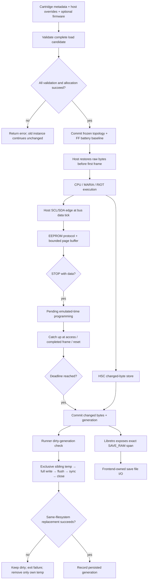

# Phase 07: Battery saves across hosts - Research

**Researched:** 2026-10-23
**Domain:** C17 hardware emulation, battery lifecycle, host persistence and libretro
**Confidence:** MEDIUM overall; repository observations are directly sourced; external documentation confidence follows the research seam.

<user_constraints>
## User Constraints (from CONTEXT.md)

<!-- DATA_Q7k4W2nR_START -->
### Locked Decisions

The following decisions and delegated discretion are copied verbatim from the phase context.
Their provenance is the owner's accepted phase contract, not an additional research assumption.

## Implementation Decisions

### HSC and firmware

- **D-01:** Attach HSC from resolved cartridge metadata or an explicit load-time override.
  Map its physical 2,048-byte SRAM at $1000–$17FF and 4,096-byte ROM at $3000–$3FFF
  through the existing decode paths. CPU reads/writes, MARIA fetches and side-effect-free
  peeks must agree where the hardware decode permits access. Preserve BIOS/INPTCTRL and
  existing cartridge/audio priority; do not add unconditional aliases through disabled
  decode. SRAM starts FF on a new load and is never formatted by the emulator.
- **D-02:** Optional user HSC firmware must be exactly 4,096 bytes and copied at load.
  Identify the canonical SHA-1 `a3af676991391a6dd716c79022d4947206b78164` using the
  existing SHA-1 implementation. Accept an explicitly supplied unknown image with a
  visible identity warning; absent C6/FE signature bytes at offsets $900/$904 also warn.
  This interprets DEC.60's hash check as identification, consistent with preparation
  §7's signature warning and existing optional-BIOS policy, rather than a canonical-ROM
  allowlist. It permits owned synthetic firmware tests without special production hashes.
  HSC has no reset vectors: do not reuse BIOS reset-vector validation or accept 16 KiB.
  Invalid size, unreadable requested media and inconsistent pointer/length pairs fail
  before replacing any live state. A supplied HSC ROM implies attachment; an explicit
  disable conflicting with that request is an error.
- **D-03:** Without firmware, expose only the documented C6/FE signature with deterministic
  inert ROM fill. State clearly that this supports compatible direct-SRAM software and
  supplies none of the seven firmware routines, screens or formatting. No firmware
  traps, copied instructions, bundled Atari bytes, vector success emulation or OpenHSC
  implementation. Runner gains an explicit HSC-ROM path; libretro discovers optional
  `highscre.bin` in its system directory only when HSC is attached. Missing optional
  firmware selects the limited stub with a visible notice; present unreadable/malformed
  firmware fails loading. Firmware bytes never enter saves or release archives.

### SaveKey and AtariVox hardware

- **D-04:** Own a small bounded pin-level 24LC256 model, shared by SaveKey and AtariVox's
  EEPROM-only behavior. Observe effective SCL/SDA after both RIOT ORA and DDRA writes
  at their actual bus data tick; released inputs pull high and either device may pull
  SDA low. Port 2 uses SWCHA SDA bit2/SCL bit3; support the corresponding port-1 wiring.
  Device-driven SDA changes must not generate host START/STOP events. Reads/peeks observe
  pins without inventing clock edges or protocol progress. Do not seed from excluded
  EEPROM RTL or add an I2C package.
- **D-05:** Implement address-select ACK/NAK, repeated START, two address bytes with A15
  ignored, random/current/sequential reads, master ACK versus final NAK, 64-byte page
  wrap and 32 KiB sequential wrap. Incomplete traffic and unsupported control addresses
  recover through documented STOP/START behavior with bounded state. Buffer writes;
  an address-only transaction does not start programming. STOP with data starts a named
  fixed 5 ms emulated-time busy interval; NAK while busy. Microchip specifies a maximum,
  so this duration is a deterministic compatibility model, not measured hardware timing.
  Publish changed persistent bytes only when programming completes. A same-value write
  still becomes busy but changes no generation. End-of-frame catch-up commits due writes
  without requiring software to poll; stalled CPUs and DMA cannot prevent time advancing.
  Power cycle first settles any already-due completion, then discards incomplete/pending
  programming and resets the protocol clock while retaining committed data. An exit or
  host flush never advances emulated time to finish a write. Test and document these edges.

### Battery API, lifecycle and attachment

- **D-06:** Battery layout version 1 is raw HSC alone (2,048), EEPROM alone (32,768), or
  HSC followed by EEPROM (34,816 bytes); absent media is NULL/0. No header, checksums,
  host-endian fields, filename identity or firmware bytes inside this span. All new
  public surface is additive and size-tagged; old media structs get zero/default tails
  and old linked clients retain behavior. Expose battery memory, layout version and a
  change generation without growing existing caller requirements. Apply the established
  API/ABI/behavior version policy during implementation.
- **D-07:** Resolve storage attachment at successful load and freeze pointer, length,
  layout and device placement until the next successful load or destroy. At most one
  EEPROM is supported, on either port; reject dual attachments transactionally rather
  than sharing an array or inventing layout 2. Explicit pre-load overrides win over
  resolved controller declarations; a SaveKey hint with no explicit location defaults
  to port 2. Explicit non-save device selection can suppress that default. Distinguish
  auto from explicit unplugged selection using existing conventions. HSC and EEPROM
  may coexist. Document precedence and test conflicting declarations/overrides.
- **D-08:** Preserve existing per-frame joystick/input semantics. Adding, removing or
  moving battery-bearing attachments through a per-frame input or late frontend callback
  must not resize/reinterpret SAVE_RAM; require reload and report the limitation visibly.
  Auto or the already attached save device remains valid. Avoid a general controller
  configuration redesign in this phase. Libretro must establish provisioning before
  publishing SAVE_RAM; first retro_run is too late. Do not assume controller setters
  necessarily ran before retro_load_game.
- **D-09:** Hosts may restore raw battery bytes after successful load and before the
  first emulated frame; these writes establish the initial clean baseline. Generation
  tracks actual committed emulated byte changes thereafter, including HSC CPU stores
  and completed EEPROM programming, and never read traffic, same-value stores or aborted
  transactions. Direct arbitrary host mutation after that import window is outside this
  contract; do not add shadow copies or per-query scans to discover it. Use a 64-bit
  equality token with defined unsigned wrap. A power cycle retains bytes and generation,
  so resetting hardware does not erase unflushed dirty evidence. A successful new load
  creates a new baseline; a refused load preserves bytes, topology, pointers, generation
  and subsequent execution. Boot setup currently runs no cartridge instructions before
  the first frame; retain and test the safe restore window. Peeks/getters remain observers.

### Runner persistence

- **D-10:** `--save-dir DIR` explicitly opts into persistence and requires a cartridge and
  an existing directory. Without it, create/read no save files. With no battery, it is a
  no-op after option validation. Use `<rom basename without its final extension>.sav`:
  only the final component matters, and an initial dot alone is not an extension.
  Preserve this established per-game naming; document one writer per save path and
  separate directories for same-basename games/concurrent sessions. No content-hash
  suffix, shared device file, locking service, migration container or sidecar identity.
- **D-11:** Read at most span-size plus one into FF-filled staging before applying data.
  A missing save is blank; zero/short files are padded FF; exact-size files are copied;
  oversize returns the reserved size-mismatch exit 4. Other directory/open/read/close or
  non-regular-file errors return 1 before frames. Missing means absence of that file,
  not an inaccessible/missing save directory. Arm persistence only after import succeeds;
  failure cleanup must never replace a rejected save with blank or partial memory.
  Import/missing blank is clean: do not create/rewrite a file until emulated bytes change.
  Raw contents are untrusted RAM, never a structure to parse or repair.
- **D-12:** `--save-interval F` is a positive bounded frame count, requires `--save-dir`,
  and defaults to 60 frames. On each cadence, flush only a changed generation; a change
  waits at most F subsequently completed frames. On-demand and orderly-exit flushing use
  the same dirty path. Preserve POSIX SIGUSR1 on-demand and SIGINT/SIGTERM orderly stops;
  on Windows support console CTRL_BREAK as on-demand and CTRL_C as stop using the native
  callback, with appropriate inter-thread flag synchronization. Handlers only record
  requests; all core access and I/O occur in the frame loop. Repeated/coalesced requests
  must work, including a request arriving during a flush. Force termination has no final
  flush guarantee. Document platform-specific capability honestly, without a new IPC protocol.
- **D-13:** A save transaction exclusively creates its own sibling temporary file,
  checks full write, stdio flush, file sync and close, then replaces the destination
  using the platform's same-filesystem replacement operation. Use POSIX rename and a
  narrow Windows replacement seam; MoveFileEx with replace/write-through and no copy
  fallback is preferred over ReplaceFile's documented destructive failure cases.
  Never unlink/truncate the destination first, copy over it or reuse another process's
  temporary. Bound collision attempts and remove only this attempt's temporary.
  Update last-persisted generation only after success. Stop visibly with exit 1 on
  flush failure, retain dirty state and do not silently reflush in cleanup. Tests must
  prove prior bytes survive each pre-replacement failure through the actual consumer.
  State the replacement commit point and tested local-filesystem guarantees; do not
  promise universal power-loss durability or unchanged old bytes after a successful
  replacement followed by a later error. No post-replacement directory-sync requirement
  or durability framework is added here.
- **D-14:** Finish the current bounded frame before servicing stop/flush requests.
  Final flush occurs before destroying valid loaded state, including after an unrelated
  output failure following valid frames; preserve the original failure exit. Never
  persist after failed import, failed load or BIOS rejection. Do not advance an EEPROM
  busy deadline merely to save. Successful normal/INT/TERM completion returns 0 only
  if required flushing succeeds. Reuse the exit table and capabilities/probe conventions;
  add exit 4 when its behavior becomes live. No new general host protocol or movie format.

### Frontend interoperability and evidence

- **D-15:** libretro exposes the exact core battery span as RETRO_MEMORY_SAVE_RAM with
  stable pointer/size, power-cycle retention and NULL/0 when absent or unloaded; the
  frontend owns .srm I/O. Late options requiring different storage take effect on reload.
  Descriptors expose actual HSC SRAM at $1000–$17FF and installed ROM/stub at $3000–$3FFF,
  with correct RAM/CONST flags; absent-HSC holes remain holes. EEPROM is serial hardware,
  not a fabricated flat CPU descriptor. Preserve existing cartridge/RAM descriptor truths
  and resolver limits. Test every intended HSC mapped byte with the pinned rcheevos
  resolver and prove SRAM aliases the battery span. Add optional firmware and libretro_saves
  claims only with their actual in-process and hosted proofs; save states stay unavailable.
- **D-16:** Keep exactly two logical hosted RetroArch cases: existing DMA screenshot
  equivalence, and the save round trip. Remove the redundant hosted no-content smoke
  while retaining its existing in-process coverage. The new owned diagnostic attaches
  both media, increments separate counters through CPU-visible HSC and real I2C traffic,
  waits until EEPROM programming completes, reads back and displays both counters.
  Two fresh frontend processes sharing only designated save storage must show 1 then 2.
  Compare independent expected counter pixels and each complete 34,816-byte .srm snapshot
  against the corresponding fresh runner .sav result. Matching black/wrong screenshots,
  preseeded counters or one unchanged medium cannot pass. Fresh per-launch directories
  must not delete the shared save directory; the current helper always removes RA_DIR.
  Consolidate within the existing 300-test-line budget and measured timeout policy;
  tests/retroarch currently totals 246 physical lines, not unlimited spare capacity.
- **D-17:** Detailed semantics belong in existing plain-C/in-process/runner tests, legal
  owned diagnostic machinery, deterministic property tests and bounded I2C fuzz replay
  plus existing nightly fuzz. Cover every layout, firmware validation/stub limit, pin
  edges/DDR changes, ACK phases, wraps, interrupted transactions, busy boundaries,
  same-value writes, generation, reset/import/load failures, allocator failures,
  instance isolation and no allocation after load. Inject write/flush/sync/close/replace
  faults through a narrow test seam, not production failure flags or a general I/O
  framework. Verify exact saved bytes and actual fresh-process execution, not merely
  successful exits. Preserve old predicates/pins and native/PowerPC equality evidence;
  extend existing lanes/inventories without promoting advisory lanes or adding cases.
- **D-18:** Before fixture-dependent acceptance, extend the existing trusted-manifest
  comparison narrowly for named owned Phase 7 diagnostics with real candidate/base
  producer/join evidence. Its current allowlist admits only Phase 6 board diagnostics.
  Every trusted old row remains byte-identical; reject modified/deleted/duplicate or
  unrelated rows, preserve raw trusted identity, and keep ordinary admission/provenance
  checks. This authorizes scoped fixture admission, not arbitrary fixture comparability.
  The independent three-component archive ceiling remains 399,937 bytes on every native
  lane. Measure early and at final six-native acceptance; no size increase, automatic
  rebaseline, new maintenance quota or weakened performance/compatibility guard is granted.
  Apply ENGINEERING §11 architecture review to the ownership boundaries and checks.
  Graduate behavior prose into hardware/embedding/runner/libretro/testing docs together;
  keep README short and the public header terse.

### Agent's Discretion

Exact additive API field/function names, internal storage placement, source splits,
diagnostic names, fixture count beyond the single combined hosted fixture, fault-injection
seams and task ordering are delegated within these contracts. Research must resolve
factual contradictions and demonstrate fixture/package prerequisites before relying on
them. This discussion does not claim those future experiments have passed.

### Deferred Ideas (OUT OF SCOPE)

## Deferred Ideas

Shared per-device/cross-game media, automatic same-basename migration/locking, dual EEPROM
layouts, full OpenHSC, speech, external IPC/continuation protocols and universal power-loss
durability are not added. Hardware timing measurements remain in the accuracy milestone.

### Reviewed Todos (not folded)
- `.planning/todos/pending/2026-10-19-close-the-phase-2-re-review-findings-when-maria-and-the-run-loop-land.md`
  — run-loop contracts already closed; residual test seeds are not save requirements.
- `.planning/todos/pending/2026-10-19-close-the-phase-2-review-seeds-on-the-nightly-filter-and-the-rom-tables.md`
  — surviving generator/firmware-scan seeds are outside this change; retained guards still apply.
- `.planning/todos/pending/2026-10-16-close-the-re-review-findings-on-the-dependabot-gate-and-the-publish-checks.md`
  — unrelated CI follow-up; do not reopen accepted release safety.
- `.planning/todos/pending/2026-10-16-promote-the-wasm32-lane-into-ci-required.md`
  — separate qualifying history, not earned by battery support.
<!-- DATA_Q7k4W2nR_END -->
</user_constraints>

## Summary

Use one instance-owned battery backing span, one hardware owner for each device, and two thin host integrations. Resolve and validate topology and firmware before the existing load commit point; preserve committed bytes and dirty generation through power cycle. Keep persistent bytes separate from EEPROM transaction/page-buffer state. These are locked requirements, not alternatives. [VERIFIED: .planning/phases/07-battery-saves/07-CONTEXT.md, D-01–09]

The current code provides the cartridge metadata, transactional loader, shared cartridge reads, pin reads, counting allocator, actual-runner wrappers and actual libretro resolver needed for this work. It does not provide battery persistence yet: the memory switch has only `MUHTARI_MEMORY_SYSTEM_RAM`, `MUHTARI_MEMORY_RIOT_RAM`, `MUHTARI_MEMORY_CART_RAM`; the adapter returns memory only for `RETRO_MEMORY_SYSTEM_RAM`. [VERIFIED: src/ports.c:200-215, quoted case names above; libretro/libretro.c:904-920, quote: `id != RETRO_MEMORY_SYSTEM_RAM`]

The acceptance prerequisites are executable work, not accomplished experiments: scoped diagnostic admission, actual candidate/base producer/join proof, early package measurement and final six-native acceptance. The current manifest gate accepts only `^tests/diag/(activision|absolute|fractalus)[.]a78$`; the archive policy remains `"ceiling": 399937`. [VERIFIED: tests/cmake/quality.cmake:142-156; quality.json:51-57, quotes above] No new fixture or save code was produced during research.

**Primary recommendation:** Sequence load/API/HSC, timed serial hardware, runner import/transactions, frontend provisioning/maps, then the combined fresh-process diagnostic and unchanged-lane acceptance; perform the narrow fixture prerequisite before relying on admitted diagnostic evidence.

## Architectural Responsibility Map

This is the recommended responsibility allocation under D-01–18; the tiers are native components, not browser/server layers. [VERIFIED: .planning/phases/07-battery-saves/07-CONTEXT.md, D-01–18]

| Capability | Primary Tier | Secondary Tier | Rationale |
|---|---|---|---|
| Storage attachment, backing bytes, generation | Core instance/load | Device modules | One span and topology for the successful load lifetime |
| HSC SRAM/ROM and signature stub | Core hardware | Cartridge decode; BIOS gate | Shared CPU/MARIA/peek memory owner; no file parsing |
| 24LC256 protocol and programming completion | Core hardware | RIOT/ports and frame clock | Pin transitions are bus events; completion uses emulated time |
| Raw save import and atomic replacement | Runner host | OS file operations | Core bytes are RAM; host controls paths and failures |
| SAVE_RAM publication and reload-only options | Libretro adapter | Core public API | Frontend owns persistence and needs storage before first run |
| Save file read/write | External frontend | SAVE_RAM pointer | RetroArch owns its own file lifecycle |
| Numeric/pixel/media acceptance | Existing tests and CI | Pinned tools and frontend binary | Independent expectations and complete media establish behavior |

## Project Constraints (from AGENTS.md)

These are actionable constraints extracted from the project instructions. [VERIFIED: AGENTS.md, Rules 1–11, GSD summaries and Style]

- Use permissively licensed material with required provenance; never open GPL/LGPL/unlicensed emulator source. Reference emulators run only as released binaries.
- Deliver the C library, headless runner and libretro core. Add no window, sound-device or input-device code.
- Keep ROM/firmware/save bytes out of tracked files except admitted fixtures. Keep personal identifiers and absolute personal paths out of committed prose. Use the noreply identity and existing hygiene hooks.
- Keep the core integer-only, bounded and instance-owned, deterministic across platforms; retain no allocation after load.
- Every behavior change needs a test run by `cmake --workflow --preset ci`; update behavior documentation with implementation. Keep README short and the public header terse.
- Automate verification and exercise real integration consumers. The agent judges docs/images/frontend runs; only identity-bound consent or the owner's hardware can require owner participation.
- Extend existing CMake/POSIX-sh checks proportionally. State each changed check's concrete fault and exercise representative pass/fault behavior through its consumer. Apply ENGINEERING §11 architecture review. Preserve the two review-fix rounds and one gap round; seed optional improvements and block actual contract violations.
- Complete only this GSD step, stop, and report the exact next command. Never chain GSD steps, run the forbidden commands, or set bypass variables.
- Use the authorized phase branch and pull-request process; research itself does not switch branches or commit because the orchestrator owns that operation.
- Evidence consists of command, exit status and hosted run URL when applicable, never a committed log.
- Treat inbound lessons as hypotheses until reproduced locally. Export only when asked.
- Summaries need `requirements-completed:` and block-style `coverage:` entries with required fields; owner judgment is false except the narrow rule-6 exceptions.
- Use small modules, plain flow, fixed-width integers, public `muhtari_` names and module-local prefixes. Cite hardware facts. Keep planning IDs out of product code, test names and user docs. Follow the remove/reuse/standard-library/platform/minimum-code ladder.

ENGINEERING §11 expressly retires maintenance-line admission and replacement quotas while preserving independent product, safety, provenance, evidence and release contracts. Review ownership, locality, coupling, state/control flow, independent tests, clarity and recurring cost in ordinary review rationale; do not create a new registry or scored review document. [VERIFIED: .planning/preparation/ENGINEERING.md:252-283, quote: “No complexity score, file quota or replacement maintenance threshold takes its place.”]

<phase_requirements>
## Phase Requirements

Descriptions below are verbatim from the requirements file. [VERIFIED: .planning/REQUIREMENTS.md:28-33]

| ID | Description | Research Support |
|---|---|---|
| SAVE-01 | HSC-compatible software can use its 2 KB SRAM and a validated user-supplied 4 KB ROM; the ROM-free signature stub supports direct-SRAM callers with its firmware limitation documented. | Shared cartridge decode; load-time firmware validation/copy; synthetic firmware and stub tests |
| SAVE-02 | SaveKey and AtariVox EEPROM users can read/write the 32 KB device through pin-level I2C, including repeated START, page wrap, sequential reads and bounded busy polling. | RIOT data-tick seam; bounded state machine; independent protocol traces and time-boundary tests |
| SAVE-03 | Embedders receive a load-stable battery span with layout version 1 and a generation counter reflecting actual byte changes; power cycle retains battery bytes. | Fixed backing storage, frozen topology, append-only API, genuine old-layout client and lifecycle properties |
| SAVE-04 | The runner reloads per-game raw .sav data from --save-dir, pads short media with FF, rejects oversized data, and never silently discards a load error. | Validated directory and basename; span+one staging; persistence arming after successful import |
| SAVE-05 | Runner periodic, on-demand and orderly-exit flushing atomically replaces saves and preserves the previous valid file when persistence fails. | Shared dirty path; bounded exclusive sibling temp; platform sync/replace seams and actual-consumer fault tests |
| SAVE-06 | RetroArch retains HSC/SaveKey bytes through SAVE_RAM across fresh launches, proven by the bounded second hosted save-round-trip case; raw .srm and runner .sav media agree. | Load-time provisioning, exact core pointer, resolver proof and independent counter/pixel/media oracle |
</phase_requirements>

## Standard Stack

Use the existing toolchain and pinned tools; this phase needs no external package install and no new runtime dependency. This follows the delegated dependency choice and existing C17/CMake/plain-C test contracts. [VERIFIED: AGENTS.md, Style; .planning/preparation/DECISIONS.md, DEC.44–45]

| Component | Current authority | Phase use |
|---|---|---|
| C17 | Existing project requirement; quote: `C17 without extensions` | Own bounded device logic and host file operations [VERIFIED: .planning/preparation/DECISIONS.md, DEC.45] |
| CMake/Ninja | Preset quotes: `"cmakeMinimumRequired": { "major": 4, "minor": 3, "patch": 0 }`, `"generator": "Ninja"` | Extend existing target/test registration [VERIFIED: CMakePresets.json:1-9] |
| SHA-1 implementation | Quotes: `muhtari__sha1_init`, `muhtari__sha1_update`, `muhtari__sha1_final` | Identify supplied HSC firmware; no new hash dependency [VERIFIED: src/sha1.h:16-18] |
| Owned assembly pipeline | Quotes: `dasm.wasm`, `7800sign.wasm`, `7800header.wasm` | Build admitted owned diagnostic with the established recipe [VERIFIED: tests/diag/assemble.cmake:79-83] |
| RetroArch | Pin quote: `retroarch-dmg 1.22.2` | Keep the existing released binary/pin [VERIFIED: pins.txt:35-37] |
| rcheevos | Pin quote: `rcheevos 12.1.0` | Use the existing resolver, never invent an address-coverage approximation [VERIFIED: pins.txt:46-50] |
| Property/fuzz harness | Quote: `foreach(prop IN ITEMS split_run peek_pure instances_isolated input_at_vblank)` | Extend the seeded in-repo harness and existing fuzz lanes [VERIFIED: tests/prop/tests.cmake:18-27] |

**Installation:** None recommended. Package registry/current-version checks and Package Legitimacy Audit are not applicable because no external package is installed. The plan must keep the pinned build tools unchanged. [VERIFIED: .planning/phases/07-battery-saves/07-CONTEXT.md, D-04/D-17–18]

## Architecture Patterns

### System Architecture Diagram

Recommended flow, implementing D-01–18:



### Component Responsibilities and Actual Touchpoints

These are source-inspected seams and recommended changes, not a claim that new functions or files exist.

| Existing owner | Current behavior and evidence | Required integration |
|---|---|---|
| Public header / instance loader | `muhtari_media` currently ends at `size_t bios_size;`; `MUHTARI_API_VERSION 4`. [VERIFIED: include/muhtari.h:12-13,177-184, verbatim declarations above] | Append load options; zero-default unavailable tails; add battery metadata/span access; increment API once for the addition |
| Instance lifecycle | `muhtari_load` validates then calls `muhtari__cart_install`; old cartridge is freed only after replacement allocation succeeds. [VERIFIED: src/instance.c:184-231; src/cart.c:782-818] | Resolve topology and validate/copy firmware before that commit point; initialize backing bytes only after success |
| Reset | `muhtari__power_on` clears bus/CPU and calls cart reset; `power_cycle` restarts boot. [VERIFIED: src/instance.c:99-116,170-181] | Settle already-due EEPROM work before resetting tick origin; preserve bytes/generation; discard pending programming/protocol |
| Cartridge | Metadata already sets `MUHTARI_DEVICE_HSC` and `MUHTARI_DEVICE_SAVEKEY` from save bits. Reads/peeks and writes have existing POKEY priority. [VERIFIED: src/cart.c:551-560,954-1005, quoted names above] | Add HSC only to its own windows within permitted decode, after preserving existing audio priority |
| CPU bus | BIOS first, MEN-off decode next; cartridge reads/writes only through selected device. Slow data constants are `BUS_SLOW_TICKS 6u`, `BUS_SLOW_DATA 5u`. [VERIFIED: src/bus.c:16-21,35-65,342-370,437-456] | Thread/derive the actual data tick for serial pin events; do not use cycle start or finished-cycle time |
| MARIA fetch | Quote: `muhtari__cart_read(m, addr, 1)`, reached through its own decode. [VERIFIED: src/maria.c:68-88] | Reuse HSC cartridge owner for DMA; preserve hardware gating and BIOS precedence |
| RIOT | Quote: `(out & ddr) | (pins & (uint8_t)~ddr)`; ORA/DDRA writes currently only update register and PA7. [VERIFIED: src/riot.c:78-89,133-151] | Observe effective host drive after both writes; apply EEPROM SDA pull-low without changing ordinary controller readback semantics |
| Ports/memory | `ports_check_device`, `muhtari__ports_device`, pending latch and `muhtari_get_memory` own current controller and span behavior. [VERIFIED: src/ports.c:16-89,188-217] | Keep joystick latching; add frozen EEPROM placement; reject storage-bearing hot swaps before modifying pending input |
| Frame loop | Execution calls `run_to_deadline(m)` then finalizes output. [VERIFIED: src/frame.c:69-102] | Catch up EEPROM at actual current emulated tick after execution, even without poll traffic, before host observation |
| Runner | `load` builds media; `frame_input` currently applies ports later; `run` destroys state before main's final stdout flush. [VERIFIED: runner/main.c:797-817,826-845,924-993,1050-1101] | Pass resolved pre-load ports/HSC requests; import once; service requests after frames; final dirty flush before destroy, including unrelated output failure |
| Runner signals | Quote: `static volatile sig_atomic_t stop_flag;`; installs `SIGINT`, `SIGTERM` only. [VERIFIED: runner/stop.c:5-32] | Separate stop and flush requests; POSIX persistent handlers and Windows native synchronized callback |
| Libretro | `lr_load_content` constructs media; `lr_memory_maps` supplies descriptors; memory getters currently only SYSTEM_RAM. [VERIFIED: libretro/libretro.c:653-692,748-818,904-920] | Resolve options and firmware before load; expose exact battery span immediately on successful return; query actual installed HSC ROM through additive public surface |
| Diagnostic / policy / equality | Existing assembler, mailbox driver, policy producer/join and hashes mechanisms. [VERIFIED: tests/diag/assemble.cmake:79-105; tests/diag/tests.cmake:13-37; tests/cmake/quality_evidence.cmake:25-56; tests/cmake/lane_equality.cmake:13-36] | Extend actual consumers and exact inventories, preserving raw trusted identity and old predicates |

### Recommended Storage and API Shape

Recommendation: use a fixed maximum battery byte array in the opaque instance, plus fixed HSC ROM and bounded EEPROM protocol/page state. Put the active media at the beginning of the array in layout order; EEPROM starts at zero when alone and immediately after HSC when combined. This avoids a new post-commit allocation and makes one public span authoritative. Keep layout calculation in one owner, with device pointers derived at load. Do not duplicate EEPROM arrays for hosts or ports. The governing values are locked: “raw HSC alone (2,048), EEPROM alone (32,768), or HSC followed by EEPROM (34,816 bytes); absent media is NULL/0.” [VERIFIED: .planning/phases/07-battery-saves/07-CONTEXT.md, D-06]

Recommendation: append size-tagged load options to media for HSC auto/on/off, optional firmware pointer/length and per-port overrides; keep the original minimum accepted size. Copy only available tail bytes into a zeroed local candidate before reading them. Add a battery memory kind and a size-tagged metadata query with layout, topology/placement, firmware warning identity and generation. Provide a read-only view of the installed HSC ROM/stub for the public-API libretro client. Exact exported names are delegated; no proposed spelling is an existing symbol. The adapter is explicitly a thin public-header client; production includes `"muhtari.h"`, while `"internal.h"` is guarded by `MUHTARI_LIBRETRO_TEST`. [VERIFIED: libretro/libretro.c:1-29, quotes above; src/internal.h:391-407, quote: `MUHTARI__MEDIA_SIZE_FIRST`]

Recommendation: use the existing auto/unplugged distinction when interpreting new load overrides. Current values are `MUHTARI_PORT_NONE = 0`, `MUHTARI_PORT_ATARIVOX = 10`, `MUHTARI_PORT_UNPLUGGED = 256`; zero input means “the cartridge's.” Add an explicit SaveKey device value without reassigning an A78 code. Implement and test a precedence table: explicit override per port, otherwise resolved controller declaration, otherwise save hint on port 2 unless explicitly suppressed. Reject two EEPROM placements before load mutation. [VERIFIED: include/muhtari.h:108-125,205-208, verbatim values above; .planning/phases/07-battery-saves/07-CONTEXT.md, D-07–08]

### Timing and Bounded EEPROM State

Manufacturer facts: SDA changes while SCL is high define START/STOP; page writes wrap within the physical page, programming starts at STOP, and polling receives no ACK while busy. Random reads set an address before repeated START; sequential reads advance across the full device. The documented write time is a maximum, not a measured fixed latency. [CITED: https://ww1.microchip.com/downloads/aemDocuments/documents/MPD/ProductDocuments/DataSheets/24AA256-24LC256-24FC256-256K-I2C-Serial-EEPROM-DS20001203.pdf, DS20001203Y §§4–8, 2022]

Recommendation: separate host drive, effective pins and device SDA drive. Decode START/STOP only from host-originated SDA transitions; drive/release ACK/data on falling edges and sample incoming bits/master ACK on rising edges. A read or peek returns the present resolved level and never synthesizes an edge. Each pin update performs a fixed bounded transition, and each completion examines at most one page. Track touched offsets so an incomplete/short page never writes unrelated bytes. More-than-page traffic overwrites buffer positions without growing memory. Preserve the byte address across repeated START, but clear incomplete packet state. These choices implement the locked protocol contract. [VERIFIED: .planning/phases/07-battery-saves/07-CONTEXT.md, D-04–05]

Recommendation: name the fixed busy interval and derive its integer tick value with upward rounding. The current NTSC clock quote is “7,159,090.909 Hz (139.68 ns)” from crystal “315/22 MHz”; half-crystal ticks make the selected 5 ms model `ceil(315000000 / 8800) = 35796` ticks. The last number is a proposed derived model constant, not an existing in-repo enum or hardware measurement. PAL execution remains out of scope. [VERIFIED: .planning/preparation/A7800-SYSTEM.md:29-36, quotes above; .planning/phases/07-battery-saves/07-CONTEXT.md, D-05]

Recommendation: settle due programming before each protocol-changing access using that access's data tick, and after completed frame execution using the actual bus tick. Use absolute emulated deadlines within the current power-cycle epoch. Before power cycle, commit only work already due, then reset protocol/busy state before boot changes time origin. Never catch up by advancing ticks in a getter, flush, teardown or host restore. Test before/equal/after deadline and completed-instruction overshoot separately from audio's logical half-open frame horizon. Current execution deliberately ends at the first instruction boundary at/after deadline. [VERIFIED: src/frame.c:9-19,69-102; .planning/phases/07-battery-saves/07-CONTEXT.md, D-05/D-09/D-14]

Recommendation: update generation only for actual changed HSC stores or committed changed EEPROM bytes; increment an unsigned equality token with defined wrap. One increment per changed completed page is sufficient: the host compares equality, not byte counts. No import call or scan is needed to discover host changes during the initial restore window; direct restore writes leave the load generation unchanged. Retain generation through reset. [VERIFIED: .planning/phases/07-battery-saves/07-CONTEXT.md, D-09]

### HSC Decode and Firmware

Recommendation: keep HSC under the existing selected cartridge path so BIOS/MEN gates remain authoritative. Share one lookup between cartridge peek and CPU/MARIA reads; write only SRAM and compare old/new value before generation changes. Test each window endpoint, every intended mapped byte, BIOS active, MEN off, absence, relevant mirrors and audio overlap. Do not add unconditional handling at the top of the bus. Current BIOS precedes MEN decode and MARIA independently checks BIOS before cartridge. [VERIFIED: src/bus.c:35-65; src/maria.c:76-88; src/cart.c:954-1005]

Recommendation: validate exact HSC size and pointer/length consistency independently of BIOS validation; stage firmware until load can commit. Compute identity with existing SHA-1, expose identity/signature warnings, accept explicitly supplied unknown synthetic firmware. Make a deterministic blank ROM with only the signature modifications; document that it is not callable firmware. Do not validate HSC with the BIOS reset-vector function. The locked sizes/map/signature are “2,048-byte SRAM at $1000–$17FF”, “4,096-byte ROM at $3000–$3FFF”, “C6/FE”, offsets “$900/$904”; HSC has no reset vectors. [VERIFIED: .planning/phases/07-battery-saves/07-CONTEXT.md, D-01–03, quotes above]

Fresh HSC wiki access failed in this session; that supplies no new observation about the wiki or hardware. The accepted preparation and context remain the authority for the locked HSC contract; no disassembly or unlicensed emulator source was opened. [VERIFIED: research web lookup result, 2026-10-23; .planning/preparation/A7800-CARTRIDGES-AND-PERIPHERALS.md:175-186]

### Runner Transaction and Request Handling

Recommendation: one runner-owned save context tracks path, span, persisted generation and explicit arming/failure state. Validate the directory even if no battery exists; derive only the final filename component, including both platform separators where appropriate. Read at most active length plus one into FF staging and apply only after read and close succeed. Distinguish absent file from absent/inaccessible directory and reject non-regular inputs before reading a FIFO/device can block. No failed import cleanup may arm persistence. [VERIFIED: .planning/phases/07-battery-saves/07-CONTEXT.md, D-10–11]

Recommendation: a single dirty-flush routine handles cadence, on-demand and final flush. Capture the target generation, exclusively create a sibling temporary, write all bytes, check stdio flush, sync, close and replacement; only then mark that captured generation persisted. Bound exclusive-create collisions; unlink only a temporary this attempt actually created. Treat replacement success as the commit point. Never retry automatically during failure cleanup. This is the locked transaction, not a general I/O framework. [VERIFIED: .planning/phases/07-battery-saves/07-CONTEXT.md, D-12–14]

For Windows, Microsoft documents replacement and write-through flags; copying across volumes is enabled only by the copy-allowed flag. Use the existing platform boundary style and choose the narrow replacement seam with replacement/write-through but no copy fallback. Microsoft's ReplaceFile documentation has failure cases where the replaced path no longer exists, which rules it out for this contract. Check CRT file sync before close. Do not infer universal power-loss safety from these APIs. [CITED: https://learn.microsoft.com/en-us/windows/win32/api/winbase/nf-winbase-movefileexw] [CITED: https://learn.microsoft.com/en-us/windows/win32/api/winbase/nf-winbase-replacefilew] [CITED: https://learn.microsoft.com/en-us/cpp/c-runtime-library/reference/commit?view=msvc-170]

POSIX rename remains the locked operation. The Open Group pages returned HTTP 403 in this session, so research does not claim a fresh documentation verification. Prove local old-file preservation for all pre-replacement failures through actual runner tests; retain the context's limited filesystem guarantee and no directory-sync requirement. [VERIFIED: .planning/phases/07-battery-saves/07-CONTEXT.md, D-13; research web lookup result, 2026-10-23]

Recommendation: consume flush requests before starting a flush, never by clearing the flag afterwards; block the relevant POSIX signal around read/clear, then unblock during I/O so a new request remains pending. Keep stop sticky. Install persistent handlers and preserve inherited ignored signals. On Windows use the native callback and interlocked exchange/OR operations, because it runs on a separate thread. Do no allocation, I/O or core call in a handler. [VERIFIED: runner/stop.c:15-21; .planning/phases/07-battery-saves/07-CONTEXT.md, D-12] [CITED: https://learn.microsoft.com/en-us/windows/console/handlerroutine]

Recommendation: distinguish import-valid, loaded-valid, frame-completed and flush-failed state explicitly. Service stop/flush after the bounded current frame; flush dirty bytes before destroying valid state even after PNG/report failure, preserving the original failure status. Suppress all persistence after failed import/load or BIOS rejection, and suppress retry after an unsuccessful save transaction. A pre-frame stop after clean import must not create a save. Current final stdout flush happens after destruction, so ensure its path cannot discard dirty state. [VERIFIED: runner/main.c:960-993,1035-1101; .planning/phases/07-battery-saves/07-CONTEXT.md, D-14]

### Libretro Provisioning and Address Maps

The pinned API defines `RETRO_MEMORY_SAVE_RAM 0`, allows NULL/0 for unavailable memory, and defaults controller ports to JOYPAD. The header describes controller selection as a hint; research found no affirmative guarantee that a setter has already run at load. Therefore follow the locked robust ordering rather than infer a callback-order promise from silence. [VERIFIED: libretro/libretro.h:498-509,7644-7673,7814-7839, verbatim constant above] [CITED: https://docs.libretro.com/development/cores/developing-cores/]

Recommendation: establish load-time HSC/storage overrides through options that can be read inside load, honor controller requests already supplied, resolve automatic metadata when callbacks have not occurred, and freeze provisioning before memory publication. Late changes that require different storage must report reload visibly while preserving the active span and attachment. Keep ordinary per-frame joystick changes valid. In particular, do not leave `lr_input` silently discarding a battery-topology error from `muhtari_set_input`. [VERIFIED: libretro/libretro.c:370-392,444-464,653-692,825-869; .planning/phases/07-battery-saves/07-CONTEXT.md, D-07–08/D-15]

Recommendation: discover the optional HSC firmware once HSC attachment is resolved, before final core load. A missing file selects the stub; a present unreadable/malformed file fails. Do not copy the BIOS helper's “unusable candidate → next candidate → fast fallback” policy, which is different. Keep copied firmware in core-owned storage and expose that installed memory for descriptors; the adapter must not map its source buffer after freeing it. [VERIFIED: libretro/libretro.c:568-646; .planning/phases/07-battery-saves/07-CONTEXT.md, D-02–03/D-15]

Recommendation: insert ordered HSC descriptors between existing spans, RAM aliased to battery start and ROM/stub flagged CONST; leave absent HSC holes intact and never make a flat CPU EEPROM descriptor. Exercise the pinned resolver for every byte and hole, including combinations with all already modeled cartridge boards. Keep resolver capacity unchanged; no descriptor-count estimate replaces a real resolver run. Current adapter limit is `LR_MAX_DESCRIPTORS 64u`, while existing Fractalus acceptance deliberately stays below the pinned resolver's separate region cap. [VERIFIED: libretro/libretro.c:46-48,694-727,748-818, quote above; docs/libretro.md, Achievements]

## Compatibility and Versioning Impact

The baseline identifiers are `#define MUHTARI_API_VERSION 4`, `MUHTARI__ABI 1u`, `MUHTARI__BEHAVIOUR_REVISION 3u`. Header additions require an API increment; append-only size-tagged additions preserve ABI. SAVE-bearing execution changes behavior, so apply the behavior-version policy with a recorded reason and exact same-input evidence; do not change the package release manually. [VERIFIED: include/muhtari.h:12; src/instance.c:8-12; .planning/preparation/ARCHITECTURE.md, version table]

Recommendation: plan API 5 and behavior revision 4 while retaining ABI 1, if these are the only additions before implementation. New numbers are proposed decisions derived from the established policy, not existing constants. Preserve old struct-prefix offsets/minima; update full-size asserts and new version coverage. Add a genuinely frozen old-media client (old declarations or a frozen old header compiled and linked to the new library), plus tests for short accepted tags, zero/default missing tails, future zero tails and future nonzero rejection. Existing API tests include the current header, so merely rerunning them does not prove an old linked caller's media allocation is read safely. [VERIFIED: tests/api/v3.c:1-11, quote: `#include "muhtari.h"`; src/internal.h:391-407,485-494; src/instance.c:19-41]

Two concrete version-coupled judges need deliberate handling: API self-test text contains `K <= 4: untested_field`; the hash producer expects `^audio_behaviour_revision 3$`. The sample identity judge permits only a unique exact `# behaviour_revision 2` to `# behaviour_revision 3` annotation change. It is not a generic current-revision scrubber. [VERIFIED: tests/abi/tests.cmake:54-64; tests/cmake/hashes.cmake:27-31; tests/cmake/quality.cmake:159-188, verbatim strings above]

Recommendation: retain all existing frame/raw/PCM pins unless measured behavior truly changes. If sample annotation must advance, first prove unchanged sample output and extend only the exact evidenced previous-to-new annotation relation, with pass/fault producer/join tests and unchanged raw trusted identity. Do not rebaseline sample rows, broaden comment stripping or downgrade the judge. Make this a named implementation prerequisite, alongside fixture admission. [VERIFIED: .planning/phases/07-battery-saves/07-CONTEXT.md, D-17–18; tests/cmake/quality.cmake:159-188]

## Don't Hand-Roll

| Problem | Do not build | Use instead | Authority |
|---|---|---|---|
| Firmware identity | New digest library or production synthetic hash exception | Existing SHA-1 and warning identity | [VERIFIED: src/sha1.h:16-18; context D-02] |
| Cartridge/BIOS routing | Independent HSC decode above the bus gates | Current selected cartridge path | [VERIFIED: src/bus.c:35-65; context D-01] |
| Save transport | Header/checksum container, per-game identity sidecar, lock service | Exact raw span, one writer per path | [VERIFIED: context D-06/D-10] |
| EEPROM emulation | I2C package, excluded RTL or transaction-log allocation | Small owned bounded pin state machine | [VERIFIED: context D-04–05] |
| Atomic host replacement | Unlink-first, truncate-first or copy-over strategy | Narrow existing-platform sync/replace seam | [VERIFIED: context D-13] |
| New observability/control protocol | IPC or continuation protocol | Existing CLI, exit table, signal/control requests | [VERIFIED: context D-12/D-14] |
| Test orchestration and safety | New general I/O/fault framework or gate registry | Existing actual-main wrappers, CMake checks, property/fuzz and policy consumers | [VERIFIED: context D-17–18; ENGINEERING §11] |
| Address coverage | Descriptor arithmetic-only assertions | Pinned rcheevos resolver | [VERIFIED: tests/libretro/rcheevos.c:1-12] |

## Common Pitfalls

The following pitfalls are contract-derived failure mechanisms to test, not newly measured defects in unreleased battery code. [VERIFIED: .planning/phases/07-battery-saves/07-CONTEXT.md, D-01–18]

1. **Reading nonexistent media tails.** Appending fields but directly dereferencing them for an old short media struct violates the compatibility contract. Use a zeroed candidate and available-byte copy; test a real old-size client.
2. **Late EEPROM provisioning.** First-run or late-controller attachment changes frontend memory after restore. Resolve at load and keep topology frozen.
3. **Self-generated START/STOP.** ACK/data pull-low changes must not be mistaken for host transactions. Separate host drive from device drive and test all ACK turnarounds.
4. **Busy timing uses wall time or cycle start.** This breaks determinism and boundary polls. Use actual bus data ticks and frame-end catch-up, including JAM/DMA/stalls.
5. **Buffered bytes appear in saves.** Page traffic is not persistent until due completion. Exit/flush must not run time forward.
6. **Reset loses dirty evidence.** Clearing generation with frame counters prevents final save. Settle already-due programming and preserve bytes/token before resetting protocol clock.
7. **Save import failure creates a blank replacement.** Persistence must remain unarmed through every failed import/open/read/close/size check.
8. **False missing-file fallback.** Missing directory, unreadable file, a directory at the save path and non-regular media are errors, not blank RAM.
9. **Flush loses a concurrent request.** Clear/consume the request before work with appropriate platform synchronization; test a request arriving during the transaction.
10. **Cleanup silently retries failed save.** Dirty must remain observable but the runner stops visibly; only the failed attempt's temporary may be removed.
11. **Two screenshots agree for the wrong reason.** Independent expected counter pixels plus complete media snapshots must reject black output, wrong counters and a single unchanged medium.
12. **Launch cleanup erases the test save.** Keep shared persistence outside per-launch cleanup; test both launch and save directory identities.
13. **Preparation overstates shipped behavior.** Reconcile firmware validation, shared-file suggestions, current capability claims and future-feature prose with D-02/D-09/D-10/D-15.
14. **A narrow migration gate is treated as generic.** Both the fixture allowlist and sample-annotation relation are explicit current code and need evidenced narrow extensions.

## Code Examples

### Existing size-tagged output pattern

The source-of-truth excerpt is `uint32_t size;`, `memcpy(&size, out, sizeof size);`, `memcpy(out, full, size < ours ? size : ours);`. [VERIFIED: src/instance.c:37-42]

```c
/* Existing code, not a new proposed API. */
uint32_t size;
memcpy(&size, out, sizeof size);
memcpy(out, full, size < ours ? size : ours);
```

For input additions, pair that convention with a zeroed candidate and bounded prefix copying; do not extrapolate the output helper into an unchecked full input read. [VERIFIED: docs/embedding.md, Structs and sizes; src/instance.c:19-41]

### Existing bus data-tick pattern

The source excerpt is `muhtari__tia_write(m, addr, v, m->bus.ticks + data_at(len));`. [VERIFIED: src/bus.c:443-448]

```c
/* Existing timing seam to reuse when RIOT exposes serial host transitions. */
muhtari__tia_write(m, addr, v, m->bus.ticks + data_at(len));
```

### Recommended save transaction ordering

This pseudocode is a proposed implementation skeleton, not existing symbols:

```text
if not armed or generation equals persisted_generation: return success
consume request safely before starting I/O
remember current generation
create own sibling temporary exclusively, with bounded collision attempts
write complete raw span
check fflush, file sync, fclose
replace destination on same filesystem without copy fallback
on success: persisted_generation = remembered generation
on failure: retain dirty evidence; remove only own temporary; report failure
```

The ordering is required by D-11–14; tests must drive the real runner through each boundary. [VERIFIED: .planning/phases/07-battery-saves/07-CONTEXT.md, D-11–14]

## Verification Strategy and Concrete Test Placement

Nyquist and ASVS sections are intentionally omitted: config contains `"nyquist_validation": false` and `"security_enforcement": false`. Ordinary behavior/safety/provenance checks still apply. [VERIFIED: .planning/config.json:24-28,51-54, verbatim values above]

The following table prescribes implementation tests; new test names and files must follow subsystem naming and contain no planning IDs. Existing target names cited here are source-established. [VERIFIED: AGENTS.md, Rule 5 and Style; tests/core/tests.cmake:5-33; tests/runner/tests.cmake:36-53; tests/libretro/tests.cmake:96-130]

| Area / requirements | Extend existing owner | Required independent evidence |
|---|---|---|
| HSC / SAVE-01 | Core/cart/bus tests and owned diagnostic driver | Every SRAM/ROM byte; absent holes; CPU/MARIA/peek agreement under allowed decode; changed/same-value stores; firmware size/signature/hash warnings; malformed and pointer/length refusals preserve old state; stub exposes no routine semantics |
| Serial hardware / SAVE-02 | Input/RIOT tests plus dedicated bounded device cases | ORA and DDR-only waveforms on either port; address ACK/NAK; every ninth clock and direction turnaround; repeated START, address-only STOP, random/current/sequential read, final master NAK, physical page and full-device wraps |
| Completion / SAVE-02–03 | Core/frame cases | Busy at deadline-minus-one, equal, plus-one; reads versus peeks; unchanged write still busy but clean generation; JAM, DMA and no-poll frame catch-up; reset before/equal/after deadline; pending write never force-finished on exit |
| Lifecycle / SAVE-03 | Counting allocator, core and properties | All three layouts and absent media; stable exact pointer/size through frames/reset; dual attachment refusal; load override precedence; host restore before first frame; failed reload retains topology, bytes, pointers, token and subsequent frame output |
| Bounds / SAVE-02–03 | Existing allocator/property/fuzz lanes | Failure at every actual allocation; no allocation after load; isolated instances; bounded random pin transcripts and deterministic replay; getters/peeks do not modify protocol/token |
| Runner import / SAVE-04 | Actual runner CMake invocations and test-main wrapper | Missing/empty/short/exact/oversize/non-regular/unreadable/read/close errors; absent directory; all basename corner cases; no saves without opt-in; no write after failed import or clean blank import |
| Runner transaction / SAVE-05 | Narrow test-only I/O seams and actual runner consumer | Exclusive-create collisions; partial write, flush, sync, close, replace failure; compare complete prior file before/after; no leaked own temp; foreign temp untouched; dirty token persists; cleanup never retries |
| Runner control / SAVE-05 | Existing actual-main frame wrapper and platform process tests | Cadence bound, on-demand, repeated/coalesced requests, request during flush; INT/TERM and Windows BREAK/C handling; current frame completes; final save after unrelated output failure; original status retained |
| Adapter / SAVE-03,06 | Dynamically loaded host, BIOS-failure harness, resolver | SAVE_RAM before first run; each layout, reset, unload and absent memory; callback before/after load; load-time options; late reload warning; all HSC descriptor bytes/holes/flags and SRAM pointer alias; no EEPROM descriptor |
| Claims / SAVE-01,06 | Existing .info inventory judge and host tests | Optional firmware and save claims map to exercised tests; state support stays false; shipped artifacts contain no firmware/save bytes |
| End-to-end / SAVE-06 | Existing hosted helper and compare consumer | Two fresh frontend launches and two fresh runner launches, only designated save directories shared; expected counters 1 then 2, both media independently read through emulated hardware, complete raw saves and expected pixel checks |

Current actual-main precedent substitutes only the frame call then includes runner main, and resets stop state in its test-local context. Reuse this style for precise frame-boundary/fault scheduling rather than add production flags. [VERIFIED: tests/runner/test_audio.c:10-33,57-79, quote: `#define muhtari_run_frame wrapped_frame`]

The allocator already supports a failed call via `uint32_t fail_from;` and counts allocation/free sizes; extend its existing cases rather than invent a second allocator harness. [VERIFIED: tests/alloc.h:14-38, quote above]

### Fresh-Process Oracle

Recommendation: one combined owned diagnostic starts from erased-media sentinel handling, increments separate HSC and EEPROM counters once per process startup, waits for completed programming, reads both through actual hardware paths, then displays independently judged numeric patterns. Use distinct locations/patterns so swapping media cannot pass. The oracle should reject black output, wrong expected pixels, constant counters, missing/short/oversize media, and success on only one device. A runner/frontend match alone is not independent.

Run frontend launch one with empty designated storage; retain and inspect the full media snapshot. Launch a fresh second process with that exact snapshot as the only transferred state. In a separate empty runner save directory, repeat two fresh runner processes and compare first-to-first and second-to-second complete files. Do not transfer movies, frontend options generated by a prior launch, system firmware or memory between processes. This is the D-16 oracle, including exact combined span length “34,816-byte .srm snapshot” and expected “1 then 2.” [VERIFIED: .planning/phases/07-battery-saves/07-CONTEXT.md, D-16]

The current hosted helper performs `file(REMOVE_RECURSE "${RA_DIR}")` before creating `home assets cache cores info logs playlists saves shots states system`; its template points saves at `"@RA_DIR@/saves"`. Therefore give each launch its own directory and add an explicitly designated shared save directory outside that subtree. Reuse the existing helper/template, keep private home/system/config outputs per launch and verify the child did not fall back to user paths. [VERIFIED: tests/retroarch/run_retroarch.cmake:21-27,42-49; tests/retroarch/test.cfg.in:31-42, verbatim expressions above]

Keep the two logical hosted cases (DMA equivalence and save round trip) by removing hosted no-content launch/comparison, while retaining in-process no-content. Retarget the existing compare negative control to the retained DMA output and add independent counter checking in the existing consumer. Physical line measurement is currently “87 + 54 + 59 + 46 = 246” across the four hosted test files; D-16 retains the “300-test-line budget.” The workflow currently launches no-content and DMA separately. [VERIFIED: research command `wc -l tests/retroarch/*`, exit 0, 2026-10-23; .github/workflows/ci.yml:425-470; .planning/phases/07-battery-saves/07-CONTEXT.md, D-16] Do not move complexity elsewhere solely to evade the hosted scope/cost contract.

### Fixture and Evidence Prerequisite

Recommendation: choose one explicit combined diagnostic name, optionally only narrowly justified additional owned protocol diagnostics. Extend the existing trusted comparison for exactly those names; no wildcard for all future diagnostics. Existing trusted rows remain raw byte-identical and protected even when a later base includes the new diagnostics. Reuse existing ordinary manifest legality/rebuild/digest admission. [VERIFIED: .planning/phases/07-battery-saves/07-CONTEXT.md, D-18; tests/cmake/quality.cmake:117-156]

Before fixture-dependent acceptance, run representative valid named additions and faults through the real evidence producer and join: changed/deleted/duplicate old rows, duplicate new row, unrelated name, malformed field, false license/digest, changed comments, forged identity, wrong compiler/platform and mismatched base/run. Keep the raw trusted manifest digest and independent event-base authority. Current producer fetches trusted bytes with `git ... show "${base}:tests/roms/manifest.txt"`, invokes the comparison and includes the resulting identity in its environment; join requires complete environment equality before reducing observations. [VERIFIED: tests/cmake/quality_evidence.cmake:25-56; tests/cmake/quality_join.cmake:26-41, quote above; tests/policy/quality.cmake:284-328]

This is **future implementation verification**. Research has not added a manifest row, built a new diagnostic, passed a Phase 7 candidate/base join or measured Phase 7 native packages. A passing existing baseline does not establish any of those claims.

## Resource Bounds and Acceptance Tranches

| Bound | Plan obligation | Source |
|---|---|---|
| Battery bytes | Exact active spans; fixed maximum backing and bounded page state; no ROM inside battery span | Quote: “2,048”, “32,768”, “34,816 bytes” [VERIFIED: context D-06] |
| Programming | Fixed selected interval, bounded transition per edge and at most a page completion | Quote: “64-byte page wrap”, “fixed 5 ms emulated-time busy interval” [VERIFIED: context D-05] |
| Run and allocation | Keep bounded frame return, JAM progress, no allocation after load | Quote: `core.no_alloc_after_load` [VERIFIED: tests/core/tests.cmake:32-33; src/frame.c:9-19] |
| Runner input | Span-size-plus-one staging; bounded filename arithmetic, positive bounded cadence, collision attempts | [VERIFIED: context D-10–13] |
| Hosted frontend | Exactly two logical cases, complete snapshots, retained test-line and measured timeout policy | Quote: “300-test-line budget” [VERIFIED: context D-16] |
| Release size | Each native lane's three-component ZIP sum stays at or below independent ceiling | Quote: `"ceiling": 399937`; `CPACK_COMPONENTS_ALL library runner libretro` [VERIFIED: quality.json:51-57; cmake/packaging.cmake:47-58] |
| Existing guards | Preserve pins/predicates, complete native/BE inventories and equality, required/advisory status | [VERIFIED: context D-17–18; tests/cmake/lane_equality.cmake:13-36] |

Recommended implementation tranches, with explicit dependencies rather than a new GSD step:

1. **Establish feasibility and test seams.** Finalize small ownership boundaries and the additive public shape; choose diagnostic names; extend the narrow trusted-fixture comparison with real pass/fault producer/join evidence before depending on it. Establish baseline package measurement with existing packaging and independent-base mechanism; retain the fixed ceiling.
2. **Load/API/HSC vertical slice.** Implement load candidate handling, topology and backing, HSC map/firmware/stub, generation, reset retention and real old-layout client. Land tests/docs with behavior; measure three-component size early.
3. **Timed EEPROM vertical slice.** Add pin state machine, RIOT data tick integration, completion catch-up/reset rules, property and fuzz replay. Verify through real CPU I2C and owned numeric diagnostic, not internal writes alone. Remeasure size after substantive hardware code.
4. **Runner persistence vertical slice.** Import, exclusive transaction, platform sync/replace, request synchronization and finalization. Test actual consumer faults and fresh-process exact bytes. Keep standard movie format; resolve its existing device declarations before load without redesigning it.
5. **Libretro slice.** Provision at load, optional firmware, stable SAVE_RAM, late-change warning and actual HSC descriptors via public query. Exercise loaded host, all layouts, callback ordering and pinned resolver before making claims.
6. **Combined hosted proof and equality.** Finish diagnostic admission/rebuild, independent mailbox/pixels/media oracle, two fresh launches, retained DMA case and updated equality/inventories. Keep detailed semantics below hosted layer.
7. **Final acceptance and documentation.** Run the normal workflows and exact current/base quality joins on all six native lanes plus retained BE/equality/nightly evidence; inspect actual hosted screenshots, media and artifacts; confirm three-component sums against the unchanged bound. Record command/status/run URLs and stop after the authorized step.

These tranches are recommendations under the delegated ordering discretion; they are not completed plans or claims of future feasibility. Any measured archive failure is a specific blocking issue to resolve within the fixed bound, not permission for a rebaseline, size grant or new maintenance quota. [VERIFIED: context Agent's Discretion and D-18; .planning/preparation/ENGINEERING.md:263-275]

## State of the Art and Resolved Contradictions

| Older/preparatory wording | Planning authority now | Required action |
|---|---|---|
| BIOS and HSC share size/reset-vector wording | HSC is exact-size identity-checked optional firmware, without reset vectors | Correct preparation conflation and add distinct validation [VERIFIED: .planning/preparation/ARCHITECTURE.md, §6; context D-02] |
| HSC hash implies canonical allowlist | Hash identifies; explicit unknown image warns and is accepted | Test synthetic firmware and signatures without adding production test hashes [VERIFIED: context D-02] |
| `save_generation` changes whenever “a battery byte changes” | Committed emulated changes only after restore window | No shadow scans/import dirty state; retain token through power cycle [VERIFIED: .planning/preparation/ARCHITECTURE.md, §7; context D-09] |
| Optional shared HSC file suggestion | Per-game basename raw span, one writer, separate directories for collisions | Do not add shared-device file or identity migration [VERIFIED: .planning/preparation/A7800-CARTRIDGES-AND-PERIPHERALS.md:200-202; context D-10] |
| Datasheet busy details marked unverified | Manufacturer protocol was fetched; selected fixed delay remains a model | Graduate facts and label selected timing honestly [VERIFIED: .planning/preparation/A7800-CARTRIDGES-AND-PERIPHERALS.md:188-191] [CITED: https://ww1.microchip.com/downloads/aemDocuments/documents/MPD/ProductDocuments/DataSheets/24AA256-24LC256-24FC256-256K-I2C-Serial-EEPROM-DS20001203.pdf] |
| SAVE_RAM treated as available through metadata | Actual memory getter currently lacks it | Implement before enabling claims [VERIFIED: libretro/libretro.c:904-920] |
| Historic maintenance LOC allocations | Retired, no replacement score/quota | Use concrete ownership/contract review; retain unrelated budgets [VERIFIED: .planning/preparation/ENGINEERING.md:252-283] |
| Old state/project prose calls shipping pending | State/context show next phase is research/planning only | Do not claim any SAVE requirement complete; avoid reopening Phase 6 scope [VERIFIED: .planning/STATE.md, Current focus and Decisions; context Phase Boundary] |

## Environment Availability

This is a local observation, not an assertion that all hosted or cross-platform execution is already available. [VERIFIED: research commands recorded below, 2026-10-23]

| Dependency | Local observation | Required by | Fallback / plan action |
|---|---|---|---|
| CMake | Version 4.4.3 | Existing presets/checks | Available; keep minimum/pins |
| C compiler | Apple clang 21.0.0 | Native baseline | Available; other compilers use existing CI |
| Ninja | Command resolves | Existing generator | Available; no version claim made |
| Existing native build | Runner reports 0.4.0; selected tests pass | Current integration baseline | Rebuild current source before implementation claims |
| Pinned wasmtime | Version 48.0.6 | Owned diagnostic assembler pipeline | Available |
| Pinned assembler module | Existing recipe input found | Owned diagnostic build | Use pinned WASM pipeline, not a new native assembler |
| Native dasm / ctx7 | Not found on command lookup | Neither required | Existing WASM tools / official docs via web |
| RetroArch executable at existing workflow staging location | Not found by probe | Real hosted acceptance | Existing pinned fetch/mount/copy workflow; not a product blocker |
| Six native platforms / Windows console / BE runtime | Not exercised by local commands | Final acceptance and platform semantics | Existing CI lanes; record real run URLs |

No dependency install is requested in this research. The absent local RetroArch staging executable is not proof that no RetroArch exists elsewhere; it means the existing staging probe did not find it. Likewise, no Windows/BE behavior was simulated by claiming local API documentation is a runtime test.

## Research Evidence

Commands were run against the existing workspace/build, not a Phase 7 implementation. No hosted run was started for this research. Existing historical run URLs remain in the prior phase verification and are not repurposed as Phase 7 evidence. [VERIFIED: research execution records, 2026-10-23]

| Command | Exit status | Observation / limit |
|---|---|---|
| `git status --short` | 0 | Clean before research file creation |
| `git rev-parse HEAD` | 0 | `3405c4aa7fb42c1598a06651eb9d21d43710d132` at observation |
| `cmake --version` | 0 | `4.4.3` |
| `cc --version` | 0 | `Apple clang version 21.0.0` |
| `build/pins/wasmtime/wasmtime --version` | 0 | `wasmtime 48.0.6` |
| `build/ci/runner/muhtari-run --version` | 0 | `muhtari-run 0.4.0`; identifies existing binary only |
| `wc -l tests/retroarch/*` | 0 | `246 total`; neither a new allowance nor full acceptance |
| `ctest --test-dir build/ci -R '^core\.(load\.|get_memory\.|no_alloc_after_load)|^runner\.exit\.table$|^libretro\.host\.memory_map$' --output-on-failure` | 0 | 11 selected/prerequisite tests passed in existing build |
| Research init, skill query, research-plan and confidence classification queries | 0 | Correct phase output; no configured agent skills; websearch/official cross-check classified MEDIUM |
| Graph status query | 0 | Graph disabled; no semantic graph assumed |
| Open Group rename / HSC wiki web opens | Tool fetch errors | HTTP 403 / inaccessible; no fresh observation claimed |

## Assumptions Log

No training-only factual claim is used as a locked design decision. Recommendations above are choices within the context's explicitly delegated discretion, not assertions that proposed symbols, tests, fixture admission or platform guarantees already exist. External source retrieval failures are reported as no observation; future acceptance remains required work.

| # | Claim | Section | Risk if wrong |
|---|---|---|---|
| — | None tagged ASSUMED | — | — |

## Open Questions

1. **Measured size on the final six-native set.** The fixed ceiling is known; Phase 7 output size is unmeasured. Resolve with early real packaging and final independent current/base quality acceptance. No size increase is authorized. [VERIFIED: context D-18; quality.json:51-57]
2. **Exact additive API names and loader warning surface.** Delegated, not a user checkpoint. Choose one coherent size-tagged query/read-only firmware span and load-tail design before implementation; cover frozen prefixes and the public-only adapter. [VERIFIED: context Agent's Discretion and D-06; libretro/libretro.c:19-29]
3. **Diagnostic names and scoped admission proof.** Not chosen or run by research. Choose the minimum owned fixture set and demonstrate the real candidate/base producer/join relation before fixture-dependent acceptance. [VERIFIED: context D-18]
4. **Behavior-version metadata transition.** Current explicit judges know the previous revisions; preserve their protections while adding only the new evidenced transition if required. No automatic rebaseline is permitted. [VERIFIED: tests/cmake/quality.cmake:159-188; context D-17–18]
5. **Windows control and replacement behavior.** Official APIs support the proposed seams, but native tests remain to be run on the existing Windows lanes, including a real console event path. [CITED: Microsoft documentation in Sources] The agent owns those tests; this is not owner UAT.

No unresolved product decision requires a routine owner confirmation.

## Sources

### Primary Repository Sources

- Phase context D-01–18; requirement rows and roadmap success criteria; project instructions and preparation index.
- Loader, public header, instance state, cartridge decode, RIOT/ports, frame loop, boot and SHA-1 source inspected in this session, with specific ranges quoted beside discrete values above.
- Runner main/stop/movie/exit table; libretro adapter/pinned header/info; actual-main, counting allocator, host, resolver, diagnostic, property/fuzz, policy/evidence/equality/packaging mechanisms inspected in this session.
- Current quality policy and ENGINEERING §11; prior Phase 6 context/verification for historical accepted bounds, not future save completion.

### External Official Documentation — MEDIUM

The research-plan seam selected websearch; `query classify-confidence --provider websearch --verified` returned `"confidence": "MEDIUM"`. No npm/registry evidence or fabricated package legitimacy was used to inflate confidence. Repository source excerpts are direct source-of-truth observations with VERIFIED provenance; the web-provider confidence function does not model local-file authority. [VERIFIED: research seam command output, 2026-10-23]

- [Microchip DS20001203Y](https://ww1.microchip.com/downloads/aemDocuments/documents/MPD/ProductDocuments/DataSheets/24AA256-24LC256-24FC256-256K-I2C-Serial-EEPROM-DS20001203.pdf), 1998–2022, §§4–8 and electrical timing — protocol, page buffer/wrap, programming/polling and read modes.
- [Libretro core development](https://docs.libretro.com/development/cores/developing-cores/) — lifecycle and host/core responsibility; the local pinned header remains build authority.
- [MoveFileExW](https://learn.microsoft.com/en-us/windows/win32/api/winbase/nf-winbase-movefileexw) — replacement/write-through versus optional copy behavior.
- [ReplaceFileW](https://learn.microsoft.com/en-us/windows/win32/api/winbase/nf-winbase-replacefilew) — destructive documented failure cases, used to challenge the replacement recommendation.
- [_commit](https://learn.microsoft.com/en-us/cpp/c-runtime-library/reference/commit?view=msvc-170), updated 2022-12-02 — CRT sync behavior and result.
- [HandlerRoutine](https://learn.microsoft.com/en-us/windows/console/handlerroutine) — native callback thread and control-event semantics.

### Lookup Limitations

- Open Group rename pages and HSC technical-reference page could not be retrieved here. No absence or compatibility inference was made from failed access; locked context and inspected in-repo documentation supply the existing decisions.
- No prohibited emulator source, copyrighted firmware, ROM image or save file was downloaded. No new package or fixture was installed/admitted.

## Metadata

**Confidence breakdown:**
- Standard stack: MEDIUM overall; existing pins/tool versions/source ownership inspected, no new dependency recommendation.
- Architecture: MEDIUM overall; exact code seams inspected and recommendations constrained by locked context; implementation measurements still pending.
- Pitfalls: MEDIUM overall; concrete current integration hazards and contract-derived failure mechanisms, with platform docs checked.
- Package/hosted acceptance: unmeasured future work; no pass claim.

**Research date:** 2026-10-23
**Valid until:** 2026-11-22 for stable protocol/lifecycle facts; re-read changed source and pins at planning/execution.

